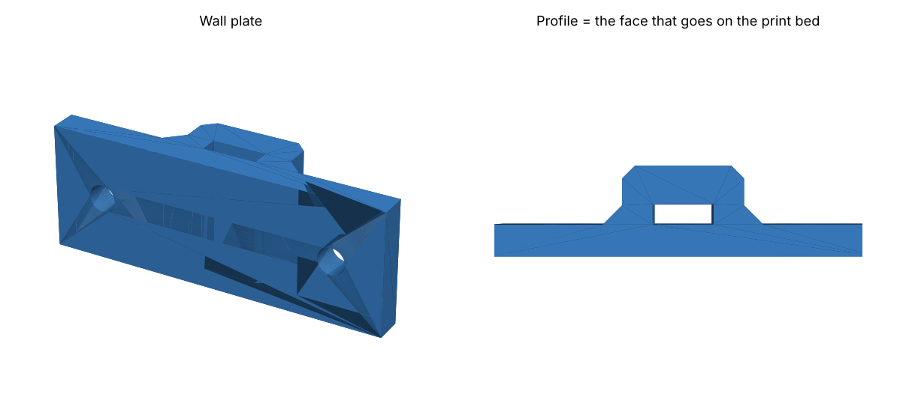

# Anti-tip wall plate

A small plate that screws to the wall, with a raised saddle for a zip tie. It
follows the layout of the common two-plate furniture anti-tip kit. On the rack
side the tie goes through the saddle on the
[shared-wall bracket's anchor variant](../shared-wall-bracket/#anchor-variant),
or straight around a steel upright.



> **Use at your own risk.** This is not a tested or certified tip-over
> restraint. It has not been printed or load tested, and no load rating is
> stated or implied. See the [disclaimer](../DISCLAIMER.md).

## Use

- Fit it as high on the rack as you can: through the anchor variant's saddle on
  the top tier, or around a rear upright just under the top bracket.
- Use a bought nylon zip tie, not a printed one. The slot is 9.5 x 3.2 mm, for
  ties up to 7.6 mm wide. A 250 mm tie is a reasonable length.
- Two screw holes, 4.8 mm, for #8 or 4 mm pan-head screws. Fix into a stud
  where possible; otherwise use an anchor suited to your wall.
- Use at least two tether points on a double-wide rack.

## Printing

Print it standing on its profile (the T-shaped face on the bed, the 22 mm
width pointing up). The layers then run unbroken through the plate and around
the saddle. Printed flat on its back, a pull would try to peel the saddle off
along a layer line.

No supports. Use 4 or more wall loops; at this size that prints nearly solid.

**Do not print it in PLA.** The tie keeps the plate under constant load, and
PLA slowly deforms under constant load and softens when warm. Use PETG, ABS or
ASA.

## Files

| Path | What it is |
|---|---|
| `wall_plate.py` | Parametric CadQuery source. |
| `models/anti_tip_wall_plate.stl` / `.step` | The plate: 60 x 22 mm, 14.2 mm tall. |

## Regenerating

```sh
python3 wall_plate.py                                   # writes models/
python3 wall_plate.py --tie-width 4.8 --tie-thickness 1.4
```
