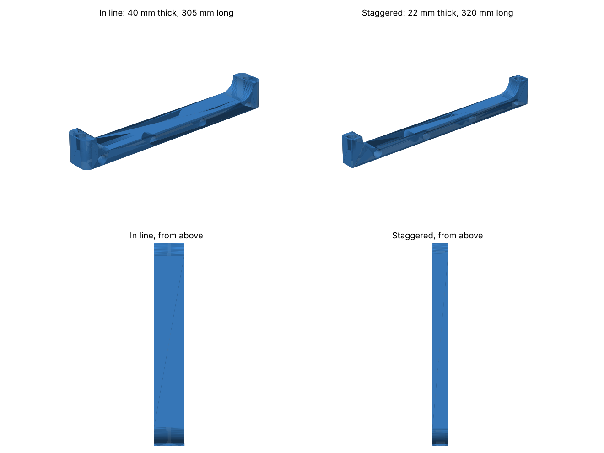
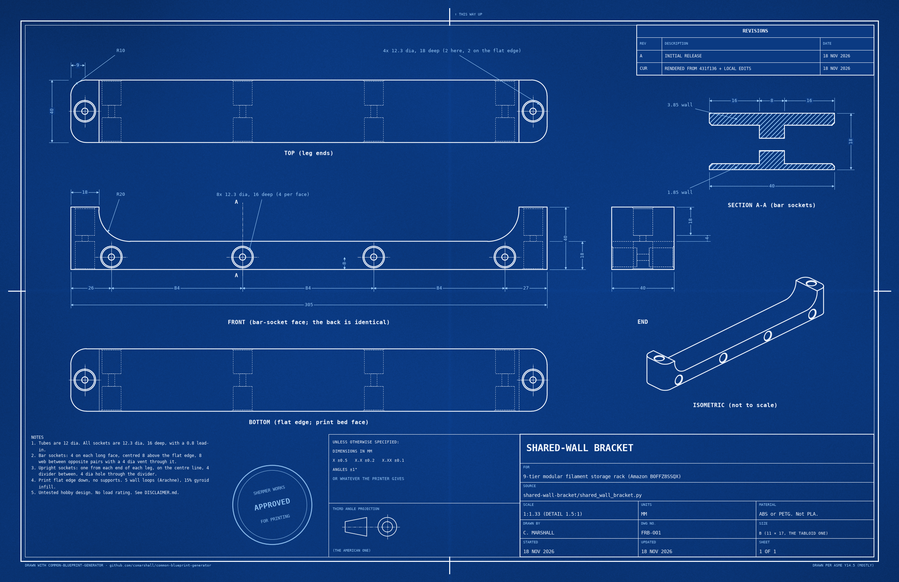

# Shared-wall bracket

Lets two columns of the rack stand side by side and share one centre wall,
instead of standing as two separate towers.


An interactive 3D view is [at the bottom of this page](#interactive-3d-view).
GitHub also shows a rotatable viewer when you open any file in `models/` ending in `.stl`.

The stock bracket has bar sockets on one face only. This part is two stock
brackets back to back in one piece, with bar sockets on both faces and a single
centred row of upright sockets. Nine make a full-height shared wall, and free
up nine stock brackets and a set of uprights from the second kit.

> **Use at your own risk.** Untested hobby design, no warranty, no load rating.
> See the [disclaimer](../DISCLAIMER.md).

## Two layouts



| | In line | Staggered |
|---|---|---|
| Size | 40 x 305 x 40 mm | 22 x 320 x 40 mm |
| Bar sockets | The two faces' sockets sit end to end, with a 4 mm web between | One face's sockets are shifted 16 mm along the bracket, so the two sets pass side by side |
| Columns | Line up front and back | Neighbouring columns stand 16 mm apart front to back |
| Parts | One design | A mirror-image pair, A and B |
| Solid volume | 229 cm3 | 122 cm3 |
| Printed, estimated (ABS, 5 walls, 15% infill) | about 133 g | about 94 g |
| Rail stiffness, vertical | 1.0 | 0.55 |
| Socket walls | 1.85 / 2.85 / 3.85 mm | The same, plus 3.7 mm between neighbouring sockets and 4 mm behind each |

Both layouts seat every bar and tube exactly as deep as the stock bracket (18
mm), and both keep the 4 mm upright divider, so tier height matches the stock
walls either way. The staggered bracket is thinner, so its rail is less stiff;
by estimate the rail still has a wide margin at the rack's rated load, but
neither layout has been load tested.

**Staggered A and B.** Facing the rack, an A bracket sets the column on its
right 16 mm further back; a B bracket sets the column on its left further
back. Turning a bracket end for end changes nothing. Turning one upside down
does not make an A into a B: the bars would sit at the wrong height. Use the
B models.

### A row of columns


For a row of five columns, each tier needs four shared-wall brackets and two
stock brackets at the ends:

- **In line:** 4 in-line brackets. Every column lines up.
- **Staggered, alternating:** 2 A and 2 B. Columns 2 and 4 sit 16 mm back.
- **Staggered, A only:** 4 A. Each column steps a further 16 mm back, 64 mm
  across the row.

In the staggered layouts some columns stand off the wall. The zip-tie tether
bridges that gap; add a spacer only if you want every column bearing on the
wall. `make_layout_diagram.py --columns N` redraws the diagram for any row.

## Status

- Geometry is built from caliper measurements of a stock bracket (see the
  [top-level README](../README.md#does-your-rack-match)).
- **Socket fit is untested.** Sockets are 12.3 mm for a 12 mm tube. Print
  `models/fit_test_coupon_v2.stl` first and adjust `--fit-clearance`.
- Two values are judged from photos, not measured: the 20 mm inside corner
  radius and the upright socket centre at 9 mm from the end.
- The `.3mf` projects were generated by script and pass a strict 3MF read, but
  have **not been opened in Snapmaker Orca**. Check the wall count, wall
  generator and slot 1 filament after loading.

## Load warning

The shared uprights carry both columns, roughly double the stock load on those
two tubes. Reviews of this rack report tubes buckling and the tower tipping at
nine loaded tiers. Anchor the rack to a wall and keep heavy spools low. Use
the anchor variant on the top tier: it has a zip-tie saddle on its rear end,
in the style of a furniture anti-tip kit. A zip tie runs through that saddle
and through the [anti-tip wall plate](../anti-tip-wall-plate/) screwed to the
wall.

## Files

| Path | What it is |
|---|---|
| `shared_wall_bracket.py` | Parametric CadQuery source. Writes STEP and STL. |
| `models/shared_wall_bracket_v2.*` | The in-line bracket (STL, STEP, Snapmaker U1 project). |
| `models/shared_wall_bracket_staggered_a.*`, `_b.*` | The staggered bracket, A and its mirror image B. |
| `models/*_anchor.*` | Each of the above with a zip-tie saddle on the rear end. |
| `models/fit_test_coupon_v2.*` | One upright socket and one bar socket, for tuning fit. |
| `blueprint.png` / `.svg` | Dimensioned drawing, generated by `make_blueprint.py`. |
| `make_layout_diagram.py` | Draws `row_of_five.png`, the plan view of a row of columns. |
| `make_readme_stl.py` | Rewrites the small viewer mesh embedded at the bottom of this page. |
| `legacy/` | First version, drawn from listing photos before measuring. Not for printing. |

## Drawing

[](blueprint.png)

Top, front, bottom and end views, a section through a bar socket, and an
isometric. Every view is projected from the CAD model, and the dimensions come
from the same parameters, so the sheet matches what is printed. A vector copy
is in [`blueprint.svg`](blueprint.svg).

## Design

The drawing and the points below describe the in-line bracket; the staggered
one shares its side profile, sockets and divider.

- 40 x 305 x 40 mm: two 18 mm bar sockets and a 4 mm centre web.
- The upright divider is 4 mm to match the stock part. It sets tier height, so
  it must not change, or the centre wall drifts out of level with the outer
  walls on every tier.
- Bar positions and height match the stock bracket, because the far end of
  every bar sits in a stock bracket.
- Outer vertical corners are rounded at 10 mm. No edge next to a socket mouth
  is rounded, so every socket wall keeps its full thickness.

## Anchor variant

The same bracket with a saddle on its rear end face: a 13 x 3.2 mm slot for a
zip tie up to 7.6 mm wide, behind a 6 mm bar. It runs 22 mm up from the flat
edge and adds 9.2 mm to the back of the bracket.

- The saddle is printed as one profile rising from the bed, so the layers run
  unbroken through both legs and the bar, and a pull toward the wall loads the
  plastic along the layers.
- The slot is wider than the upright socket, so the saddle's legs join solid
  plastic either side of the socket. The 2.85 mm wall behind the socket is
  unchanged and carries none of the tether load.
- The tether leaves a gap to the wall, so the rack does not have to sit flush.

## Printing

- Orientation: flat edge on the bed, no supports.
- Snapmaker U1 (270 x 270 mm bed): every version only fits rotated 45 degrees,
  one per plate. Clear to the bed edge: in line 17 mm (anchor 16 mm); staggered
  15 mm (anchor 12 mm).
- 5 wall loops with the Arachne wall generator, so the 1.85, 2.85 and 3.85 mm
  socket walls print as solid perimeters.
- 15% gyroid infill and 5 bottom shell layers. See
  [Why these settings](#why-these-settings).
- **Not PLA.** The bracket is under constant load, and PLA slowly deforms
  under constant load and softens when warm.
- PETG or ABS. A 305 mm ABS part is prone to warping; use a brim and keep
  draughts off it.

## Why these settings

Snapmaker Orca is a fork of OrcaSlicer, so the OrcaSlicer wiki is the reference
for these settings. The stock U1 `0.20mm Standard` process uses 2 wall loops,
the Classic wall generator, 15% grid infill and 3 bottom shell layers.

| Setting | Stock | Here | Basis |
|---|---|---|---|
| Wall loops | 2 | 5 | Calculated. Each socket wall gets loops from both faces, so loops needed = (wall / 2) / line width. At the stock 0.42 mm outer and 0.45 mm inner line widths, 5 loops fill the thickest socket wall (3.85 mm). |
| Wall generator | Classic | Arachne | Varies line width to close the slivers a fixed-width wall would leave. |
| Infill pattern | Grid | Gyroid | Documented. The [OrcaSlicer patterns page](https://www.orcaslicer.com/wiki/print_settings/strength/strength_settings_patterns.html) says grid's overlapping points may cause noise or artifacts, and describes gyroid as isotropic, with curved geometry that helps reduce warping. |
| Bottom shell layers | 3 | 5 | Precaution, not documented behaviour. The [shells page](https://www.orcaslicer.com/wiki/print_settings/strength/strength_settings_top_bottom_shells.html) says more shell layers increase part strength. The specific aim is to make the 1.85 mm wall between the bed face and each bar socket print fully solid; check that in the slicer preview. |
| Brim | Slicer default | Outer, 10 mm (5 mm on the anchor variant) | A long ABS part lifts at the ends. The width is what fits inside the bed margin. |

With 5 wall loops the walls carry nearly all the load, so the infill choice is
mostly about print reliability.

## Opening the U1 projects

Use **File > Open Project** (or drag the `.3mf` in and choose to open it as a
project). **Import** loads the geometry only and discards every setting in the
file, including the ones stored on the part.

## Regenerating

From this folder, with the virtual environment from the top-level README active:

```sh
python3 shared_wall_bracket.py --out models             # rebuilds every STL and STEP
python3 shared_wall_bracket.py --fit-clearance 0.35      # looser sockets
python3 make_blueprint.py                                # redraws blueprint.png / .svg
python3 make_layout_diagram.py                           # redraws row_of_five.png
python3 make_readme_stl.py                               # refreshes the 3D view below
```

To rebuild a U1 project you also need the `Snapmaker` folder from
[snapmaker-profiles](https://github.com/Snapmaker/snapmaker-profiles):

```sh
python3 ../tools/make_u1_project.py \
  --stl out_v2/shared_wall_bracket_v2.stl \
  --profiles /path/to/snapmaker-profiles/Snapmaker \
  --out models/shared_wall_bracket_v2_U1_ABS.3mf \
  --brim-width 10
```

The project selects the stock `Snapmaker U1 (0.4 nozzle)` printer, the
`0.20mm Standard` process and `Generic ABS @U1 0.4 nozzle` in slot 1. It
overrides wall loops (5), wall generator (Arachne), infill (15% gyroid) and
bottom shell layers (5), and adds an outer brim sized to the bed margin (`--brim-width`): 10 mm, or 5 mm on
the in-line anchor variant and 8 mm on the staggered anchor variants.
These settings are written both to the process and to the part itself.

## Interactive 3D view

Drag to rotate. This is a simplified mesh for viewing only (square corners, no
lead-in chamfers or vent holes); print from the files in `models/`. If no
viewer appears here, open
[`models/shared_wall_bracket_v2.stl`](models/shared_wall_bracket_v2.stl), which
GitHub displays in its own 3D viewer.

```stl
solid shared_wall_bracket
facet normal -0.00 -0.00 -1.00
outer loop
vertex 5.4 6.1 0.0
vertex 20.0 0.0 0.0
vertex 3.5 3.9 0.0
endloop
endfacet
facet normal 0.00 0.00 -1.00
outer loop
vertex 0.7 2.9 0.0
vertex 3.5 3.9 0.0
vertex 20.0 0.0 0.0
endloop
endfacet
facet normal -0.00 -0.00 -1.00
outer loop
vertex 6.2 9.0 0.0
vertex 20.0 0.0 0.0
vertex 5.4 6.1 0.0
endloop
endfacet
facet normal -0.00 -0.00 -1.00
outer loop
vertex 5.4 11.9 0.0
vertex 20.0 0.0 0.0
vertex 6.2 9.0 0.0
endloop
endfacet
facet normal -0.00 -0.00 -1.00
outer loop
vertex 3.5 14.1 0.0
vertex 20.0 0.0 0.0
vertex 5.4 11.9 0.0
endloop
endfacet
facet normal 0.00 -0.00 -1.00
outer loop
vertex -20.0 0.0 0.0
vertex -4.6 13.1 0.0
vertex -6.0 10.5 0.0
endloop
endfacet
facet normal 0.00 -0.00 -1.00
outer loop
vertex -20.0 0.0 0.0
vertex -6.0 10.5 0.0
vertex -6.0 7.5 0.0
endloop
endfacet
facet normal 0.00 0.00 -1.00
outer loop
vertex -20.0 0.0 0.0
vertex -6.0 7.5 0.0
vertex -4.6 4.9 0.0
endloop
endfacet
facet normal 0.00 0.00 -1.00
outer loop
vertex -20.0 0.0 0.0
vertex -4.6 4.9 0.0
vertex -2.2 3.2 0.0
endloop
endfacet
facet normal 0.00 0.00 -1.00
outer loop
vertex -20.0 0.0 0.0
vertex -2.2 3.2 0.0
vertex 0.7 2.9 0.0
endloop
endfacet
facet normal 0.00 0.00 -1.00
outer loop
vertex -20.0 0.0 0.0
vertex 0.7 2.9 0.0
vertex 20.0 0.0 0.0
endloop
endfacet
facet normal 0.00 0.00 -1.00
outer loop
vertex 3.5 290.9 0.0
vertex 20.0 305.0 0.0
vertex 20.0 0.0 0.0
endloop
endfacet
facet normal -0.00 -0.00 -1.00
outer loop
vertex 3.5 290.9 0.0
vertex 20.0 0.0 0.0
vertex 3.5 14.1 0.0
endloop
endfacet
facet normal 0.00 -0.00 -1.00
outer loop
vertex 5.4 293.1 0.0
vertex 20.0 305.0 0.0
vertex 3.5 290.9 0.0
endloop
endfacet
facet normal -0.00 -0.00 -1.00
outer loop
vertex 0.7 289.9 0.0
vertex 3.5 14.1 0.0
vertex 0.7 15.1 0.0
endloop
endfacet
facet normal 0.00 -0.00 -1.00
outer loop
vertex 0.7 289.9 0.0
vertex 0.7 15.1 0.0
vertex -2.2 14.8 0.0
endloop
endfacet
facet normal 0.00 0.00 -1.00
outer loop
vertex 0.7 289.9 0.0
vertex 3.5 290.9 0.0
vertex 3.5 14.1 0.0
endloop
endfacet
facet normal 0.00 -0.00 -1.00
outer loop
vertex 6.2 296.0 0.0
vertex 20.0 305.0 0.0
vertex 5.4 293.1 0.0
endloop
endfacet
facet normal 0.00 -0.00 -1.00
outer loop
vertex -2.2 290.2 0.0
vertex -2.2 14.8 0.0
vertex -4.6 13.1 0.0
endloop
endfacet
facet normal 0.00 -0.00 -1.00
outer loop
vertex -2.2 290.2 0.0
vertex 0.7 289.9 0.0
vertex -2.2 14.8 0.0
endloop
endfacet
facet normal 0.00 -0.00 -1.00
outer loop
vertex 5.4 298.9 0.0
vertex 20.0 305.0 0.0
vertex 6.2 296.0 0.0
endloop
endfacet
facet normal 0.00 -0.00 -1.00
outer loop
vertex -4.6 291.9 0.0
vertex -2.2 290.2 0.0
vertex -4.6 13.1 0.0
endloop
endfacet
facet normal 0.00 -0.00 -1.00
outer loop
vertex 3.5 301.1 0.0
vertex 20.0 305.0 0.0
vertex 5.4 298.9 0.0
endloop
endfacet
facet normal 0.00 -0.00 -1.00
outer loop
vertex 0.7 302.1 0.0
vertex 20.0 305.0 0.0
vertex 3.5 301.1 0.0
endloop
endfacet
facet normal 0.00 -0.00 -1.00
outer loop
vertex -20.0 305.0 0.0
vertex 0.7 302.1 0.0
vertex -2.2 301.8 0.0
endloop
endfacet
facet normal 0.00 -0.00 -1.00
outer loop
vertex -20.0 305.0 0.0
vertex -2.2 301.8 0.0
vertex -4.6 300.1 0.0
endloop
endfacet
facet normal 0.00 -0.00 -1.00
outer loop
vertex -20.0 305.0 0.0
vertex -4.6 300.1 0.0
vertex -6.0 297.5 0.0
endloop
endfacet
facet normal 0.00 -0.00 -1.00
outer loop
vertex -20.0 305.0 0.0
vertex -6.0 297.5 0.0
vertex -6.0 294.5 0.0
endloop
endfacet
facet normal 0.00 0.00 -1.00
outer loop
vertex -20.0 305.0 0.0
vertex -6.0 294.5 0.0
vertex -4.6 291.9 0.0
endloop
endfacet
facet normal 0.00 -0.00 -1.00
outer loop
vertex -20.0 305.0 0.0
vertex 20.0 305.0 0.0
vertex 0.7 302.1 0.0
endloop
endfacet
facet normal 0.00 -0.00 -1.00
outer loop
vertex -20.0 305.0 0.0
vertex -4.6 291.9 0.0
vertex -20.0 0.0 0.0
endloop
endfacet
facet normal 0.00 -0.00 -1.00
outer loop
vertex -4.6 291.9 0.0
vertex -4.6 13.1 0.0
vertex -20.0 0.0 0.0
endloop
endfacet
facet normal 0.00 -1.00 0.00
outer loop
vertex -20.0 0.0 0.0
vertex 20.0 0.0 40.0
vertex -20.0 0.0 40.0
endloop
endfacet
facet normal 0.00 -1.00 0.00
outer loop
vertex -20.0 0.0 0.0
vertex 20.0 0.0 0.0
vertex 20.0 0.0 40.0
endloop
endfacet
facet normal 1.00 0.00 0.00
outer loop
vertex 20.0 283.4 5.1
vertex 20.0 281.5 2.9
vertex 20.0 305.0 0.0
endloop
endfacet
facet normal 1.00 -0.00 -0.00
outer loop
vertex 20.0 278.7 1.9
vertex 20.0 305.0 0.0
vertex 20.0 281.5 2.9
endloop
endfacet
facet normal 1.00 0.00 0.00
outer loop
vertex 20.0 284.1 8.0
vertex 20.0 283.4 5.1
vertex 20.0 305.0 0.0
endloop
endfacet
facet normal 1.00 0.00 0.00
outer loop
vertex 20.0 283.4 10.9
vertex 20.0 284.1 8.0
vertex 20.0 305.0 0.0
endloop
endfacet
facet normal 1.00 0.00 0.00
outer loop
vertex 20.0 281.1 23.9
vertex 20.0 281.5 13.1
vertex 20.0 283.4 10.9
endloop
endfacet
facet normal 1.00 0.00 0.00
outer loop
vertex 20.0 281.1 23.9
vertex 20.0 278.7 14.1
vertex 20.0 281.5 13.1
endloop
endfacet
facet normal 1.00 0.00 0.00
outer loop
vertex 20.0 285.5 30.3
vertex 20.0 281.1 23.9
vertex 20.0 283.4 10.9
endloop
endfacet
facet normal 1.00 -0.00 0.00
outer loop
vertex 20.0 285.5 30.3
vertex 20.0 305.0 0.0
vertex 20.0 305.0 40.0
endloop
endfacet
facet normal 1.00 0.00 0.00
outer loop
vertex 20.0 285.5 30.3
vertex 20.0 283.4 10.9
vertex 20.0 305.0 0.0
endloop
endfacet
facet normal 1.00 -0.00 0.00
outer loop
vertex 20.0 274.7 19.5
vertex 20.0 275.8 13.8
vertex 20.0 278.7 14.1
endloop
endfacet
facet normal 1.00 -0.00 0.00
outer loop
vertex 20.0 274.7 19.5
vertex 20.0 273.4 12.1
vertex 20.0 275.8 13.8
endloop
endfacet
facet normal 1.00 -0.00 0.00
outer loop
vertex 20.0 274.7 19.5
vertex 20.0 278.7 14.1
vertex 20.0 281.1 23.9
endloop
endfacet
facet normal 1.00 -0.00 0.00
outer loop
vertex 20.0 287.0 38.0
vertex 20.0 285.5 30.3
vertex 20.0 305.0 40.0
endloop
endfacet
facet normal 1.00 -0.00 0.00
outer loop
vertex 20.0 267.0 18.0
vertex 20.0 272.0 9.5
vertex 20.0 273.4 12.1
endloop
endfacet
facet normal 1.00 -0.00 0.00
outer loop
vertex 20.0 267.0 18.0
vertex 20.0 272.0 6.5
vertex 20.0 272.0 9.5
endloop
endfacet
facet normal 1.00 -0.00 0.00
outer loop
vertex 20.0 267.0 18.0
vertex 20.0 273.4 12.1
vertex 20.0 274.7 19.5
endloop
endfacet
facet normal 1.00 -0.00 0.00
outer loop
vertex 20.0 287.0 40.0
vertex 20.0 287.0 38.0
vertex 20.0 305.0 40.0
endloop
endfacet
facet normal 1.00 -0.00 -0.00
outer loop
vertex 20.0 197.5 2.9
vertex 20.0 275.8 2.2
vertex 20.0 273.4 3.9
endloop
endfacet
facet normal 1.00 0.00 -0.00
outer loop
vertex 20.0 199.4 5.1
vertex 20.0 272.0 6.5
vertex 20.0 267.0 18.0
endloop
endfacet
facet normal 1.00 -0.00 -0.00
outer loop
vertex 20.0 199.4 5.1
vertex 20.0 273.4 3.9
vertex 20.0 272.0 6.5
endloop
endfacet
facet normal 1.00 -0.00 0.00
outer loop
vertex 20.0 199.4 5.1
vertex 20.0 197.5 2.9
vertex 20.0 273.4 3.9
endloop
endfacet
facet normal 1.00 0.00 -0.00
outer loop
vertex 20.0 194.7 1.9
vertex 20.0 275.8 2.2
vertex 20.0 197.5 2.9
endloop
endfacet
facet normal 1.00 -0.00 0.00
outer loop
vertex 20.0 200.2 8.0
vertex 20.0 199.4 5.1
vertex 20.0 267.0 18.0
endloop
endfacet
facet normal 1.00 -0.00 0.00
outer loop
vertex 20.0 199.4 10.9
vertex 20.0 200.2 8.0
vertex 20.0 267.0 18.0
endloop
endfacet
facet normal 1.00 -0.00 0.00
outer loop
vertex 20.0 197.5 13.1
vertex 20.0 199.4 10.9
vertex 20.0 267.0 18.0
endloop
endfacet
facet normal 1.00 -0.00 -0.00
outer loop
vertex 20.0 113.5 2.9
vertex 20.0 191.8 2.2
vertex 20.0 189.4 3.9
endloop
endfacet
facet normal 1.00 -0.00 -0.00
outer loop
vertex 20.0 115.4 5.1
vertex 20.0 189.4 3.9
vertex 20.0 188.0 6.5
endloop
endfacet
facet normal 1.00 -0.00 0.00
outer loop
vertex 20.0 115.4 5.1
vertex 20.0 113.5 2.9
vertex 20.0 189.4 3.9
endloop
endfacet
facet normal 1.00 0.00 -0.00
outer loop
vertex 20.0 110.7 1.9
vertex 20.0 191.8 2.2
vertex 20.0 113.5 2.9
endloop
endfacet
facet normal 1.00 -0.00 0.00
outer loop
vertex 20.0 116.2 8.0
vertex 20.0 188.0 6.5
vertex 20.0 188.0 9.5
endloop
endfacet
facet normal 1.00 -0.00 0.00
outer loop
vertex 20.0 116.2 8.0
vertex 20.0 115.4 5.1
vertex 20.0 188.0 6.5
endloop
endfacet
facet normal 1.00 -0.00 0.00
outer loop
vertex 20.0 115.4 10.9
vertex 20.0 188.0 9.5
vertex 20.0 189.4 12.1
endloop
endfacet
facet normal 1.00 -0.00 0.00
outer loop
vertex 20.0 115.4 10.9
vertex 20.0 116.2 8.0
vertex 20.0 188.0 9.5
endloop
endfacet
facet normal 1.00 -0.00 0.00
outer loop
vertex 20.0 113.5 13.1
vertex 20.0 189.4 12.1
vertex 20.0 191.8 13.8
endloop
endfacet
facet normal 1.00 -0.00 0.00
outer loop
vertex 20.0 113.5 13.1
vertex 20.0 115.4 10.9
vertex 20.0 189.4 12.1
endloop
endfacet
facet normal 1.00 -0.00 0.00
outer loop
vertex 20.0 110.7 14.1
vertex 20.0 113.5 13.1
vertex 20.0 191.8 13.8
endloop
endfacet
facet normal 1.00 -0.00 -0.00
outer loop
vertex 20.0 29.5 2.9
vertex 20.0 107.8 2.2
vertex 20.0 105.4 3.9
endloop
endfacet
facet normal 1.00 -0.00 -0.00
outer loop
vertex 20.0 31.4 5.1
vertex 20.0 105.4 3.9
vertex 20.0 104.0 6.5
endloop
endfacet
facet normal 1.00 -0.00 0.00
outer loop
vertex 20.0 31.4 5.1
vertex 20.0 29.5 2.9
vertex 20.0 105.4 3.9
endloop
endfacet
facet normal 1.00 0.00 -0.00
outer loop
vertex 20.0 26.7 1.9
vertex 20.0 107.8 2.2
vertex 20.0 29.5 2.9
endloop
endfacet
facet normal 1.00 -0.00 0.00
outer loop
vertex 20.0 38.0 18.0
vertex 20.0 105.4 12.1
vertex 20.0 107.8 13.8
endloop
endfacet
facet normal 1.00 -0.00 0.00
outer loop
vertex 20.0 38.0 18.0
vertex 20.0 104.0 9.5
vertex 20.0 105.4 12.1
endloop
endfacet
facet normal 1.00 -0.00 0.00
outer loop
vertex 20.0 38.0 18.0
vertex 20.0 104.0 6.5
vertex 20.0 104.0 9.5
endloop
endfacet
facet normal 1.00 0.00 0.00
outer loop
vertex 20.0 38.0 18.0
vertex 20.0 31.4 10.9
vertex 20.0 32.1 8.0
endloop
endfacet
facet normal 1.00 -0.00 0.00
outer loop
vertex 20.0 38.0 18.0
vertex 20.0 31.4 5.1
vertex 20.0 104.0 6.5
endloop
endfacet
facet normal 1.00 0.00 0.00
outer loop
vertex 20.0 38.0 18.0
vertex 20.0 32.1 8.0
vertex 20.0 31.4 5.1
endloop
endfacet
facet normal 1.00 -0.00 0.00
outer loop
vertex 20.0 29.5 13.1
vertex 20.0 31.4 10.9
vertex 20.0 38.0 18.0
endloop
endfacet
facet normal 1.00 0.00 0.00
outer loop
vertex 20.0 30.3 19.5
vertex 20.0 26.7 14.1
vertex 20.0 29.5 13.1
endloop
endfacet
facet normal 1.00 -0.00 0.00
outer loop
vertex 20.0 30.3 19.5
vertex 20.0 29.5 13.1
vertex 20.0 38.0 18.0
endloop
endfacet
facet normal 1.00 0.00 0.00
outer loop
vertex 20.0 0.0 0.0
vertex 20.0 20.0 6.5
vertex 20.0 20.0 9.5
endloop
endfacet
facet normal 1.00 0.00 -0.00
outer loop
vertex 20.0 0.0 0.0
vertex 20.0 21.4 3.9
vertex 20.0 20.0 6.5
endloop
endfacet
facet normal 1.00 0.00 -0.00
outer loop
vertex 20.0 0.0 0.0
vertex 20.0 23.8 2.2
vertex 20.0 21.4 3.9
endloop
endfacet
facet normal 1.00 0.00 -0.00
outer loop
vertex 20.0 0.0 0.0
vertex 20.0 26.7 1.9
vertex 20.0 23.8 2.2
endloop
endfacet
facet normal 1.00 -0.00 0.00
outer loop
vertex 20.0 23.9 23.9
vertex 20.0 23.8 13.8
vertex 20.0 26.7 14.1
endloop
endfacet
facet normal 1.00 -0.00 0.00
outer loop
vertex 20.0 23.9 23.9
vertex 20.0 21.4 12.1
vertex 20.0 23.8 13.8
endloop
endfacet
facet normal 1.00 -0.00 0.00
outer loop
vertex 20.0 23.9 23.9
vertex 20.0 26.7 14.1
vertex 20.0 30.3 19.5
endloop
endfacet
facet normal 1.00 -0.00 0.00
outer loop
vertex 20.0 19.5 30.3
vertex 20.0 21.4 12.1
vertex 20.0 23.9 23.9
endloop
endfacet
facet normal 1.00 -0.00 0.00
outer loop
vertex 20.0 19.5 30.3
vertex 20.0 20.0 9.5
vertex 20.0 21.4 12.1
endloop
endfacet
facet normal 1.00 -0.00 0.00
outer loop
vertex 20.0 19.5 30.3
vertex 20.0 0.0 0.0
vertex 20.0 20.0 9.5
endloop
endfacet
facet normal 1.00 -0.00 0.00
outer loop
vertex 20.0 0.0 40.0
vertex 20.0 0.0 0.0
vertex 20.0 19.5 30.3
endloop
endfacet
facet normal 1.00 -0.00 -0.00
outer loop
vertex 20.0 0.0 40.0
vertex 20.0 19.5 30.3
vertex 20.0 18.0 38.0
endloop
endfacet
facet normal 1.00 -0.00 0.00
outer loop
vertex 20.0 0.0 40.0
vertex 20.0 18.0 38.0
vertex 20.0 18.0 40.0
endloop
endfacet
facet normal 1.00 0.00 -0.00
outer loop
vertex 20.0 0.0 0.0
vertex 20.0 305.0 0.0
vertex 20.0 194.7 1.9
endloop
endfacet
facet normal 1.00 -0.00 -0.00
outer loop
vertex 20.0 194.7 1.9
vertex 20.0 305.0 0.0
vertex 20.0 278.7 1.9
endloop
endfacet
facet normal 1.00 0.00 -0.00
outer loop
vertex 20.0 194.7 1.9
vertex 20.0 278.7 1.9
vertex 20.0 275.8 2.2
endloop
endfacet
facet normal 1.00 0.00 -0.00
outer loop
vertex 20.0 0.0 0.0
vertex 20.0 194.7 1.9
vertex 20.0 191.8 2.2
endloop
endfacet
facet normal 1.00 0.00 -0.00
outer loop
vertex 20.0 0.0 0.0
vertex 20.0 191.8 2.2
vertex 20.0 110.7 1.9
endloop
endfacet
facet normal 1.00 0.00 -0.00
outer loop
vertex 20.0 0.0 0.0
vertex 20.0 110.7 1.9
vertex 20.0 107.8 2.2
endloop
endfacet
facet normal 1.00 0.00 -0.00
outer loop
vertex 20.0 0.0 0.0
vertex 20.0 107.8 2.2
vertex 20.0 26.7 1.9
endloop
endfacet
facet normal 1.00 0.00 0.00
outer loop
vertex 20.0 267.0 18.0
vertex 20.0 38.0 18.0
vertex 20.0 110.7 14.1
endloop
endfacet
facet normal 1.00 0.00 0.00
outer loop
vertex 20.0 110.7 14.1
vertex 20.0 38.0 18.0
vertex 20.0 107.8 13.8
endloop
endfacet
facet normal 1.00 -0.00 0.00
outer loop
vertex 20.0 267.0 18.0
vertex 20.0 110.7 14.1
vertex 20.0 194.7 14.1
endloop
endfacet
facet normal 1.00 0.00 0.00
outer loop
vertex 20.0 194.7 14.1
vertex 20.0 110.7 14.1
vertex 20.0 191.8 13.8
endloop
endfacet
facet normal 1.00 0.00 0.00
outer loop
vertex 20.0 267.0 18.0
vertex 20.0 194.7 14.1
vertex 20.0 197.5 13.1
endloop
endfacet
facet normal -1.00 -0.00 -0.00
outer loop
vertex -20.0 283.4 5.1
vertex -20.0 305.0 0.0
vertex -20.0 281.5 2.9
endloop
endfacet
facet normal -1.00 0.00 0.00
outer loop
vertex -20.0 278.7 1.9
vertex -20.0 281.5 2.9
vertex -20.0 305.0 0.0
endloop
endfacet
facet normal -1.00 -0.00 -0.00
outer loop
vertex -20.0 284.1 8.0
vertex -20.0 305.0 0.0
vertex -20.0 283.4 5.1
endloop
endfacet
facet normal -1.00 -0.00 -0.00
outer loop
vertex -20.0 283.4 10.9
vertex -20.0 305.0 0.0
vertex -20.0 284.1 8.0
endloop
endfacet
facet normal -1.00 -0.00 -0.00
outer loop
vertex -20.0 281.1 23.9
vertex -20.0 283.4 10.9
vertex -20.0 281.5 13.1
endloop
endfacet
facet normal -1.00 -0.00 -0.00
outer loop
vertex -20.0 281.1 23.9
vertex -20.0 281.5 13.1
vertex -20.0 278.7 14.1
endloop
endfacet
facet normal -1.00 -0.00 0.00
outer loop
vertex -20.0 285.5 30.3
vertex -20.0 283.4 10.9
vertex -20.0 281.1 23.9
endloop
endfacet
facet normal -1.00 0.00 0.00
outer loop
vertex -20.0 285.5 30.3
vertex -20.0 305.0 40.0
vertex -20.0 305.0 0.0
endloop
endfacet
facet normal -1.00 -0.00 -0.00
outer loop
vertex -20.0 285.5 30.3
vertex -20.0 305.0 0.0
vertex -20.0 283.4 10.9
endloop
endfacet
facet normal -1.00 0.00 -0.00
outer loop
vertex -20.0 274.7 19.5
vertex -20.0 278.7 14.1
vertex -20.0 275.8 13.8
endloop
endfacet
facet normal -1.00 0.00 -0.00
outer loop
vertex -20.0 274.7 19.5
vertex -20.0 275.8 13.8
vertex -20.0 273.4 12.1
endloop
endfacet
facet normal -1.00 0.00 -0.00
outer loop
vertex -20.0 274.7 19.5
vertex -20.0 281.1 23.9
vertex -20.0 278.7 14.1
endloop
endfacet
facet normal -1.00 0.00 -0.00
outer loop
vertex -20.0 287.0 38.0
vertex -20.0 305.0 40.0
vertex -20.0 285.5 30.3
endloop
endfacet
facet normal -1.00 0.00 -0.00
outer loop
vertex -20.0 267.0 18.0
vertex -20.0 273.4 12.1
vertex -20.0 272.0 9.5
endloop
endfacet
facet normal -1.00 0.00 0.00
outer loop
vertex -20.0 267.0 18.0
vertex -20.0 272.0 9.5
vertex -20.0 272.0 6.5
endloop
endfacet
facet normal -1.00 0.00 -0.00
outer loop
vertex -20.0 267.0 18.0
vertex -20.0 274.7 19.5
vertex -20.0 273.4 12.1
endloop
endfacet
facet normal -1.00 0.00 -0.00
outer loop
vertex -20.0 287.0 40.0
vertex -20.0 305.0 40.0
vertex -20.0 287.0 38.0
endloop
endfacet
facet normal -1.00 0.00 0.00
outer loop
vertex -20.0 197.5 2.9
vertex -20.0 273.4 3.9
vertex -20.0 275.8 2.2
endloop
endfacet
facet normal -1.00 0.00 0.00
outer loop
vertex -20.0 199.4 5.1
vertex -20.0 267.0 18.0
vertex -20.0 272.0 6.5
endloop
endfacet
facet normal -1.00 0.00 0.00
outer loop
vertex -20.0 199.4 5.1
vertex -20.0 272.0 6.5
vertex -20.0 273.4 3.9
endloop
endfacet
facet normal -1.00 0.00 -0.00
outer loop
vertex -20.0 199.4 5.1
vertex -20.0 273.4 3.9
vertex -20.0 197.5 2.9
endloop
endfacet
facet normal -1.00 0.00 0.00
outer loop
vertex -20.0 194.7 1.9
vertex -20.0 197.5 2.9
vertex -20.0 275.8 2.2
endloop
endfacet
facet normal -1.00 0.00 -0.00
outer loop
vertex -20.0 200.2 8.0
vertex -20.0 267.0 18.0
vertex -20.0 199.4 5.1
endloop
endfacet
facet normal -1.00 0.00 -0.00
outer loop
vertex -20.0 199.4 10.9
vertex -20.0 267.0 18.0
vertex -20.0 200.2 8.0
endloop
endfacet
facet normal -1.00 0.00 -0.00
outer loop
vertex -20.0 197.5 13.1
vertex -20.0 267.0 18.0
vertex -20.0 199.4 10.9
endloop
endfacet
facet normal -1.00 0.00 0.00
outer loop
vertex -20.0 113.5 2.9
vertex -20.0 189.4 3.9
vertex -20.0 191.8 2.2
endloop
endfacet
facet normal -1.00 0.00 0.00
outer loop
vertex -20.0 115.4 5.1
vertex -20.0 188.0 6.5
vertex -20.0 189.4 3.9
endloop
endfacet
facet normal -1.00 0.00 -0.00
outer loop
vertex -20.0 115.4 5.1
vertex -20.0 189.4 3.9
vertex -20.0 113.5 2.9
endloop
endfacet
facet normal -1.00 0.00 0.00
outer loop
vertex -20.0 110.7 1.9
vertex -20.0 113.5 2.9
vertex -20.0 191.8 2.2
endloop
endfacet
facet normal -1.00 0.00 0.00
outer loop
vertex -20.0 116.2 8.0
vertex -20.0 188.0 9.5
vertex -20.0 188.0 6.5
endloop
endfacet
facet normal -1.00 0.00 -0.00
outer loop
vertex -20.0 116.2 8.0
vertex -20.0 188.0 6.5
vertex -20.0 115.4 5.1
endloop
endfacet
facet normal -1.00 0.00 -0.00
outer loop
vertex -20.0 115.4 10.9
vertex -20.0 189.4 12.1
vertex -20.0 188.0 9.5
endloop
endfacet
facet normal -1.00 0.00 -0.00
outer loop
vertex -20.0 115.4 10.9
vertex -20.0 188.0 9.5
vertex -20.0 116.2 8.0
endloop
endfacet
facet normal -1.00 0.00 -0.00
outer loop
vertex -20.0 113.5 13.1
vertex -20.0 191.8 13.8
vertex -20.0 189.4 12.1
endloop
endfacet
facet normal -1.00 0.00 -0.00
outer loop
vertex -20.0 113.5 13.1
vertex -20.0 189.4 12.1
vertex -20.0 115.4 10.9
endloop
endfacet
facet normal -1.00 0.00 -0.00
outer loop
vertex -20.0 110.7 14.1
vertex -20.0 191.8 13.8
vertex -20.0 113.5 13.1
endloop
endfacet
facet normal -1.00 0.00 0.00
outer loop
vertex -20.0 29.5 2.9
vertex -20.0 105.4 3.9
vertex -20.0 107.8 2.2
endloop
endfacet
facet normal -1.00 0.00 0.00
outer loop
vertex -20.0 31.4 5.1
vertex -20.0 104.0 6.5
vertex -20.0 105.4 3.9
endloop
endfacet
facet normal -1.00 0.00 -0.00
outer loop
vertex -20.0 31.4 5.1
vertex -20.0 105.4 3.9
vertex -20.0 29.5 2.9
endloop
endfacet
facet normal -1.00 0.00 0.00
outer loop
vertex -20.0 26.7 1.9
vertex -20.0 29.5 2.9
vertex -20.0 107.8 2.2
endloop
endfacet
facet normal -1.00 0.00 -0.00
outer loop
vertex -20.0 38.0 18.0
vertex -20.0 107.8 13.8
vertex -20.0 105.4 12.1
endloop
endfacet
facet normal -1.00 0.00 -0.00
outer loop
vertex -20.0 38.0 18.0
vertex -20.0 105.4 12.1
vertex -20.0 104.0 9.5
endloop
endfacet
facet normal -1.00 0.00 0.00
outer loop
vertex -20.0 38.0 18.0
vertex -20.0 104.0 9.5
vertex -20.0 104.0 6.5
endloop
endfacet
facet normal -1.00 -0.00 0.00
outer loop
vertex -20.0 38.0 18.0
vertex -20.0 32.1 8.0
vertex -20.0 31.4 10.9
endloop
endfacet
facet normal -1.00 0.00 -0.00
outer loop
vertex -20.0 38.0 18.0
vertex -20.0 104.0 6.5
vertex -20.0 31.4 5.1
endloop
endfacet
facet normal -1.00 -0.00 0.00
outer loop
vertex -20.0 38.0 18.0
vertex -20.0 31.4 5.1
vertex -20.0 32.1 8.0
endloop
endfacet
facet normal -1.00 0.00 -0.00
outer loop
vertex -20.0 29.5 13.1
vertex -20.0 38.0 18.0
vertex -20.0 31.4 10.9
endloop
endfacet
facet normal -1.00 -0.00 0.00
outer loop
vertex -20.0 30.3 19.5
vertex -20.0 29.5 13.1
vertex -20.0 26.7 14.1
endloop
endfacet
facet normal -1.00 0.00 -0.00
outer loop
vertex -20.0 30.3 19.5
vertex -20.0 38.0 18.0
vertex -20.0 29.5 13.1
endloop
endfacet
facet normal -1.00 0.00 0.00
outer loop
vertex -20.0 0.0 0.0
vertex -20.0 20.0 9.5
vertex -20.0 20.0 6.5
endloop
endfacet
facet normal -1.00 0.00 0.00
outer loop
vertex -20.0 0.0 0.0
vertex -20.0 20.0 6.5
vertex -20.0 21.4 3.9
endloop
endfacet
facet normal -1.00 0.00 0.00
outer loop
vertex -20.0 0.0 0.0
vertex -20.0 21.4 3.9
vertex -20.0 23.8 2.2
endloop
endfacet
facet normal -1.00 0.00 0.00
outer loop
vertex -20.0 0.0 0.0
vertex -20.0 23.8 2.2
vertex -20.0 26.7 1.9
endloop
endfacet
facet normal -1.00 0.00 -0.00
outer loop
vertex -20.0 23.9 23.9
vertex -20.0 26.7 14.1
vertex -20.0 23.8 13.8
endloop
endfacet
facet normal -1.00 0.00 0.00
outer loop
vertex -20.0 23.9 23.9
vertex -20.0 23.8 13.8
vertex -20.0 21.4 12.1
endloop
endfacet
facet normal -1.00 0.00 -0.00
outer loop
vertex -20.0 23.9 23.9
vertex -20.0 30.3 19.5
vertex -20.0 26.7 14.1
endloop
endfacet
facet normal -1.00 0.00 -0.00
outer loop
vertex -20.0 19.5 30.3
vertex -20.0 23.9 23.9
vertex -20.0 21.4 12.1
endloop
endfacet
facet normal -1.00 0.00 -0.00
outer loop
vertex -20.0 19.5 30.3
vertex -20.0 21.4 12.1
vertex -20.0 20.0 9.5
endloop
endfacet
facet normal -1.00 0.00 -0.00
outer loop
vertex -20.0 19.5 30.3
vertex -20.0 20.0 9.5
vertex -20.0 0.0 0.0
endloop
endfacet
facet normal -1.00 0.00 -0.00
outer loop
vertex -20.0 0.0 40.0
vertex -20.0 19.5 30.3
vertex -20.0 0.0 0.0
endloop
endfacet
facet normal -1.00 0.00 0.00
outer loop
vertex -20.0 0.0 40.0
vertex -20.0 18.0 38.0
vertex -20.0 19.5 30.3
endloop
endfacet
facet normal -1.00 0.00 0.00
outer loop
vertex -20.0 0.0 40.0
vertex -20.0 18.0 40.0
vertex -20.0 18.0 38.0
endloop
endfacet
facet normal -1.00 0.00 0.00
outer loop
vertex -20.0 0.0 0.0
vertex -20.0 194.7 1.9
vertex -20.0 305.0 0.0
endloop
endfacet
facet normal -1.00 0.00 0.00
outer loop
vertex -20.0 194.7 1.9
vertex -20.0 278.7 1.9
vertex -20.0 305.0 0.0
endloop
endfacet
facet normal -1.00 0.00 0.00
outer loop
vertex -20.0 194.7 1.9
vertex -20.0 275.8 2.2
vertex -20.0 278.7 1.9
endloop
endfacet
facet normal -1.00 0.00 0.00
outer loop
vertex -20.0 0.0 0.0
vertex -20.0 191.8 2.2
vertex -20.0 194.7 1.9
endloop
endfacet
facet normal -1.00 0.00 0.00
outer loop
vertex -20.0 0.0 0.0
vertex -20.0 110.7 1.9
vertex -20.0 191.8 2.2
endloop
endfacet
facet normal -1.00 0.00 0.00
outer loop
vertex -20.0 0.0 0.0
vertex -20.0 107.8 2.2
vertex -20.0 110.7 1.9
endloop
endfacet
facet normal -1.00 0.00 0.00
outer loop
vertex -20.0 0.0 0.0
vertex -20.0 26.7 1.9
vertex -20.0 107.8 2.2
endloop
endfacet
facet normal -1.00 -0.00 0.00
outer loop
vertex -20.0 267.0 18.0
vertex -20.0 110.7 14.1
vertex -20.0 38.0 18.0
endloop
endfacet
facet normal -1.00 -0.00 0.00
outer loop
vertex -20.0 110.7 14.1
vertex -20.0 107.8 13.8
vertex -20.0 38.0 18.0
endloop
endfacet
facet normal -1.00 -0.00 0.00
outer loop
vertex -20.0 267.0 18.0
vertex -20.0 194.7 14.1
vertex -20.0 110.7 14.1
endloop
endfacet
facet normal -1.00 -0.00 0.00
outer loop
vertex -20.0 194.7 14.1
vertex -20.0 191.8 13.8
vertex -20.0 110.7 14.1
endloop
endfacet
facet normal -1.00 -0.00 0.00
outer loop
vertex -20.0 267.0 18.0
vertex -20.0 197.5 13.1
vertex -20.0 194.7 14.1
endloop
endfacet
facet normal -0.00 1.00 0.00
outer loop
vertex -20.0 305.0 40.0
vertex 20.0 305.0 40.0
vertex 20.0 305.0 0.0
endloop
endfacet
facet normal 0.00 1.00 0.00
outer loop
vertex -20.0 305.0 40.0
vertex 20.0 305.0 0.0
vertex -20.0 305.0 0.0
endloop
endfacet
facet normal -0.97 -0.24 0.00
outer loop
vertex 5.4 11.9 0.0
vertex 6.2 9.0 0.0
vertex 6.2 9.0 18.0
endloop
endfacet
facet normal -0.97 -0.24 0.00
outer loop
vertex 5.4 11.9 0.0
vertex 6.2 9.0 18.0
vertex 5.4 11.9 18.0
endloop
endfacet
facet normal -0.75 -0.66 0.00
outer loop
vertex 3.5 14.1 0.0
vertex 5.4 11.9 18.0
vertex 3.5 14.1 18.0
endloop
endfacet
facet normal -0.75 -0.66 0.00
outer loop
vertex 3.5 14.1 0.0
vertex 5.4 11.9 0.0
vertex 5.4 11.9 18.0
endloop
endfacet
facet normal -0.35 -0.94 0.00
outer loop
vertex 0.7 15.1 0.0
vertex 3.5 14.1 18.0
vertex 0.7 15.1 18.0
endloop
endfacet
facet normal -0.35 -0.94 0.00
outer loop
vertex 0.7 15.1 0.0
vertex 3.5 14.1 0.0
vertex 3.5 14.1 18.0
endloop
endfacet
facet normal 0.12 -0.99 0.00
outer loop
vertex -2.2 14.8 0.0
vertex 0.7 15.1 18.0
vertex -2.2 14.8 18.0
endloop
endfacet
facet normal 0.57 -0.82 0.00
outer loop
vertex -2.2 14.8 0.0
vertex -2.2 14.8 18.0
vertex -4.6 13.1 18.0
endloop
endfacet
facet normal 0.12 -0.99 0.00
outer loop
vertex -2.2 14.8 0.0
vertex 0.7 15.1 0.0
vertex 0.7 15.1 18.0
endloop
endfacet
facet normal 0.57 -0.82 0.00
outer loop
vertex -4.6 13.1 0.0
vertex -2.2 14.8 0.0
vertex -4.6 13.1 18.0
endloop
endfacet
facet normal 0.89 -0.46 0.00
outer loop
vertex -6.0 10.5 0.0
vertex -4.6 13.1 18.0
vertex -6.0 10.5 18.0
endloop
endfacet
facet normal 0.89 -0.46 0.00
outer loop
vertex -6.0 10.5 0.0
vertex -4.6 13.1 0.0
vertex -4.6 13.1 18.0
endloop
endfacet
facet normal 1.00 -0.00 0.00
outer loop
vertex -6.0 7.5 0.0
vertex -6.0 10.5 18.0
vertex -6.0 7.5 18.0
endloop
endfacet
facet normal 1.00 -0.00 0.00
outer loop
vertex -6.0 7.5 0.0
vertex -6.0 10.5 0.0
vertex -6.0 10.5 18.0
endloop
endfacet
facet normal 0.89 0.46 0.00
outer loop
vertex -4.6 4.9 0.0
vertex -6.0 7.5 18.0
vertex -4.6 4.9 18.0
endloop
endfacet
facet normal 0.89 0.46 -0.00
outer loop
vertex -4.6 4.9 0.0
vertex -6.0 7.5 0.0
vertex -6.0 7.5 18.0
endloop
endfacet
facet normal 0.57 0.82 0.00
outer loop
vertex -2.2 3.2 0.0
vertex -4.6 4.9 18.0
vertex -2.2 3.2 18.0
endloop
endfacet
facet normal 0.12 0.99 -0.00
outer loop
vertex -2.2 3.2 0.0
vertex -2.2 3.2 18.0
vertex 0.7 2.9 18.0
endloop
endfacet
facet normal 0.57 0.82 -0.00
outer loop
vertex -2.2 3.2 0.0
vertex -4.6 4.9 0.0
vertex -4.6 4.9 18.0
endloop
endfacet
facet normal 0.12 0.99 0.00
outer loop
vertex 0.7 2.9 0.0
vertex -2.2 3.2 0.0
vertex 0.7 2.9 18.0
endloop
endfacet
facet normal -0.35 0.94 0.00
outer loop
vertex 3.5 3.9 0.0
vertex 0.7 2.9 18.0
vertex 3.5 3.9 18.0
endloop
endfacet
facet normal -0.75 0.66 0.00
outer loop
vertex 3.5 3.9 0.0
vertex 3.5 3.9 18.0
vertex 5.4 6.1 18.0
endloop
endfacet
facet normal -0.35 0.94 0.00
outer loop
vertex 3.5 3.9 0.0
vertex 0.7 2.9 0.0
vertex 0.7 2.9 18.0
endloop
endfacet
facet normal -0.97 0.24 0.00
outer loop
vertex 5.4 6.1 0.0
vertex 5.4 6.1 18.0
vertex 6.2 9.0 18.0
endloop
endfacet
facet normal -0.75 0.66 0.00
outer loop
vertex 5.4 6.1 0.0
vertex 3.5 3.9 0.0
vertex 5.4 6.1 18.0
endloop
endfacet
facet normal -0.97 0.24 0.00
outer loop
vertex 6.2 9.0 0.0
vertex 5.4 6.1 0.0
vertex 6.2 9.0 18.0
endloop
endfacet
facet normal -0.97 -0.24 0.00
outer loop
vertex 5.4 298.9 0.0
vertex 6.2 296.0 0.0
vertex 6.2 296.0 18.0
endloop
endfacet
facet normal -0.97 -0.24 0.00
outer loop
vertex 5.4 298.9 0.0
vertex 6.2 296.0 18.0
vertex 5.4 298.9 18.0
endloop
endfacet
facet normal -0.75 -0.66 0.00
outer loop
vertex 3.5 301.1 0.0
vertex 5.4 298.9 18.0
vertex 3.5 301.1 18.0
endloop
endfacet
facet normal -0.75 -0.66 0.00
outer loop
vertex 3.5 301.1 0.0
vertex 5.4 298.9 0.0
vertex 5.4 298.9 18.0
endloop
endfacet
facet normal -0.35 -0.94 0.00
outer loop
vertex 0.7 302.1 0.0
vertex 3.5 301.1 18.0
vertex 0.7 302.1 18.0
endloop
endfacet
facet normal -0.35 -0.94 0.00
outer loop
vertex 0.7 302.1 0.0
vertex 3.5 301.1 0.0
vertex 3.5 301.1 18.0
endloop
endfacet
facet normal 0.12 -0.99 0.00
outer loop
vertex -2.2 301.8 0.0
vertex 0.7 302.1 18.0
vertex -2.2 301.8 18.0
endloop
endfacet
facet normal 0.57 -0.82 0.00
outer loop
vertex -2.2 301.8 0.0
vertex -2.2 301.8 18.0
vertex -4.6 300.1 18.0
endloop
endfacet
facet normal 0.12 -0.99 0.00
outer loop
vertex -2.2 301.8 0.0
vertex 0.7 302.1 0.0
vertex 0.7 302.1 18.0
endloop
endfacet
facet normal 0.57 -0.82 0.00
outer loop
vertex -4.6 300.1 0.0
vertex -2.2 301.8 0.0
vertex -4.6 300.1 18.0
endloop
endfacet
facet normal 0.89 -0.46 0.00
outer loop
vertex -6.0 297.5 0.0
vertex -4.6 300.1 18.0
vertex -6.0 297.5 18.0
endloop
endfacet
facet normal 0.89 -0.46 0.00
outer loop
vertex -6.0 297.5 0.0
vertex -4.6 300.1 0.0
vertex -4.6 300.1 18.0
endloop
endfacet
facet normal 1.00 -0.00 0.00
outer loop
vertex -6.0 294.5 0.0
vertex -6.0 297.5 18.0
vertex -6.0 294.5 18.0
endloop
endfacet
facet normal 1.00 -0.00 0.00
outer loop
vertex -6.0 294.5 0.0
vertex -6.0 297.5 0.0
vertex -6.0 297.5 18.0
endloop
endfacet
facet normal 0.89 0.46 0.00
outer loop
vertex -4.6 291.9 0.0
vertex -6.0 294.5 18.0
vertex -4.6 291.9 18.0
endloop
endfacet
facet normal 0.89 0.46 -0.00
outer loop
vertex -4.6 291.9 0.0
vertex -6.0 294.5 0.0
vertex -6.0 294.5 18.0
endloop
endfacet
facet normal 0.57 0.82 0.00
outer loop
vertex -2.2 290.2 0.0
vertex -4.6 291.9 18.0
vertex -2.2 290.2 18.0
endloop
endfacet
facet normal 0.12 0.99 -0.00
outer loop
vertex -2.2 290.2 0.0
vertex -2.2 290.2 18.0
vertex 0.7 289.9 18.0
endloop
endfacet
facet normal 0.57 0.82 -0.00
outer loop
vertex -2.2 290.2 0.0
vertex -4.6 291.9 0.0
vertex -4.6 291.9 18.0
endloop
endfacet
facet normal 0.12 0.99 0.00
outer loop
vertex 0.7 289.9 0.0
vertex -2.2 290.2 0.0
vertex 0.7 289.9 18.0
endloop
endfacet
facet normal -0.35 0.94 0.00
outer loop
vertex 3.5 290.9 0.0
vertex 0.7 289.9 18.0
vertex 3.5 290.9 18.0
endloop
endfacet
facet normal -0.75 0.66 0.00
outer loop
vertex 3.5 290.9 0.0
vertex 3.5 290.9 18.0
vertex 5.4 293.1 18.0
endloop
endfacet
facet normal -0.35 0.94 0.00
outer loop
vertex 3.5 290.9 0.0
vertex 0.7 289.9 0.0
vertex 0.7 289.9 18.0
endloop
endfacet
facet normal -0.97 0.24 0.00
outer loop
vertex 5.4 293.1 0.0
vertex 5.4 293.1 18.0
vertex 6.2 296.0 18.0
endloop
endfacet
facet normal -0.75 0.66 0.00
outer loop
vertex 5.4 293.1 0.0
vertex 3.5 290.9 0.0
vertex 5.4 293.1 18.0
endloop
endfacet
facet normal -0.97 0.24 0.00
outer loop
vertex 6.2 296.0 0.0
vertex 5.4 293.1 0.0
vertex 6.2 296.0 18.0
endloop
endfacet
facet normal 0.00 -0.00 1.00
outer loop
vertex 5.4 11.9 40.0
vertex 20.0 18.0 40.0
vertex 3.5 14.1 40.0
endloop
endfacet
facet normal -0.00 0.00 1.00
outer loop
vertex 0.7 15.1 40.0
vertex 3.5 14.1 40.0
vertex 20.0 18.0 40.0
endloop
endfacet
facet normal -0.00 0.00 1.00
outer loop
vertex 6.2 9.0 40.0
vertex 20.0 0.0 40.0
vertex 20.0 18.0 40.0
endloop
endfacet
facet normal 0.00 -0.00 1.00
outer loop
vertex 6.2 9.0 40.0
vertex 20.0 18.0 40.0
vertex 5.4 11.9 40.0
endloop
endfacet
facet normal -0.00 -0.00 1.00
outer loop
vertex 5.4 6.1 40.0
vertex 20.0 0.0 40.0
vertex 6.2 9.0 40.0
endloop
endfacet
facet normal -0.00 -0.00 1.00
outer loop
vertex 3.5 3.9 40.0
vertex 20.0 0.0 40.0
vertex 5.4 6.1 40.0
endloop
endfacet
facet normal -0.00 -0.00 1.00
outer loop
vertex 0.7 2.9 40.0
vertex 20.0 0.0 40.0
vertex 3.5 3.9 40.0
endloop
endfacet
facet normal -0.00 0.00 1.00
outer loop
vertex -20.0 18.0 40.0
vertex -2.2 14.8 40.0
vertex 0.7 15.1 40.0
endloop
endfacet
facet normal -0.00 0.00 1.00
outer loop
vertex -20.0 18.0 40.0
vertex -4.6 13.1 40.0
vertex -2.2 14.8 40.0
endloop
endfacet
facet normal -0.00 0.00 1.00
outer loop
vertex -20.0 18.0 40.0
vertex -6.0 10.5 40.0
vertex -4.6 13.1 40.0
endloop
endfacet
facet normal 0.00 0.00 1.00
outer loop
vertex -20.0 0.0 40.0
vertex -6.0 7.5 40.0
vertex -6.0 10.5 40.0
endloop
endfacet
facet normal 0.00 -0.00 1.00
outer loop
vertex -20.0 0.0 40.0
vertex -4.6 4.9 40.0
vertex -6.0 7.5 40.0
endloop
endfacet
facet normal 0.00 -0.00 1.00
outer loop
vertex -20.0 0.0 40.0
vertex -2.2 3.2 40.0
vertex -4.6 4.9 40.0
endloop
endfacet
facet normal 0.00 -0.00 1.00
outer loop
vertex -20.0 0.0 40.0
vertex 0.7 2.9 40.0
vertex -2.2 3.2 40.0
endloop
endfacet
facet normal 0.00 -0.00 1.00
outer loop
vertex -20.0 0.0 40.0
vertex -6.0 10.5 40.0
vertex -20.0 18.0 40.0
endloop
endfacet
facet normal -0.00 0.00 1.00
outer loop
vertex -20.0 18.0 40.0
vertex 0.7 15.1 40.0
vertex 20.0 18.0 40.0
endloop
endfacet
facet normal 0.00 0.00 1.00
outer loop
vertex 20.0 0.0 40.0
vertex 0.7 2.9 40.0
vertex -20.0 0.0 40.0
endloop
endfacet
facet normal 0.00 -0.00 1.00
outer loop
vertex 5.4 298.9 40.0
vertex 20.0 305.0 40.0
vertex 3.5 301.1 40.0
endloop
endfacet
facet normal -0.00 0.00 1.00
outer loop
vertex 0.7 302.1 40.0
vertex 3.5 301.1 40.0
vertex 20.0 305.0 40.0
endloop
endfacet
facet normal -0.00 0.00 1.00
outer loop
vertex 6.2 296.0 40.0
vertex 20.0 287.0 40.0
vertex 20.0 305.0 40.0
endloop
endfacet
facet normal 0.00 -0.00 1.00
outer loop
vertex 6.2 296.0 40.0
vertex 20.0 305.0 40.0
vertex 5.4 298.9 40.0
endloop
endfacet
facet normal -0.00 -0.00 1.00
outer loop
vertex 5.4 293.1 40.0
vertex 20.0 287.0 40.0
vertex 6.2 296.0 40.0
endloop
endfacet
facet normal -0.00 -0.00 1.00
outer loop
vertex 3.5 290.9 40.0
vertex 20.0 287.0 40.0
vertex 5.4 293.1 40.0
endloop
endfacet
facet normal -0.00 -0.00 1.00
outer loop
vertex 0.7 289.9 40.0
vertex 20.0 287.0 40.0
vertex 3.5 290.9 40.0
endloop
endfacet
facet normal -0.00 0.00 1.00
outer loop
vertex -20.0 305.0 40.0
vertex -2.2 301.8 40.0
vertex 0.7 302.1 40.0
endloop
endfacet
facet normal -0.00 0.00 1.00
outer loop
vertex -20.0 305.0 40.0
vertex -4.6 300.1 40.0
vertex -2.2 301.8 40.0
endloop
endfacet
facet normal -0.00 0.00 1.00
outer loop
vertex -20.0 305.0 40.0
vertex -6.0 297.5 40.0
vertex -4.6 300.1 40.0
endloop
endfacet
facet normal -0.00 0.00 1.00
outer loop
vertex -20.0 305.0 40.0
vertex -6.0 294.5 40.0
vertex -6.0 297.5 40.0
endloop
endfacet
facet normal 0.00 -0.00 1.00
outer loop
vertex -20.0 287.0 40.0
vertex -4.6 291.9 40.0
vertex -6.0 294.5 40.0
endloop
endfacet
facet normal 0.00 -0.00 1.00
outer loop
vertex -20.0 287.0 40.0
vertex -2.2 290.2 40.0
vertex -4.6 291.9 40.0
endloop
endfacet
facet normal 0.00 -0.00 1.00
outer loop
vertex -20.0 287.0 40.0
vertex 0.7 289.9 40.0
vertex -2.2 290.2 40.0
endloop
endfacet
facet normal 0.00 -0.00 1.00
outer loop
vertex -20.0 287.0 40.0
vertex -6.0 294.5 40.0
vertex -20.0 305.0 40.0
endloop
endfacet
facet normal 0.00 0.00 1.00
outer loop
vertex 20.0 287.0 40.0
vertex 0.7 289.9 40.0
vertex -20.0 287.0 40.0
endloop
endfacet
facet normal -0.00 0.00 1.00
outer loop
vertex -20.0 305.0 40.0
vertex 0.7 302.1 40.0
vertex 20.0 305.0 40.0
endloop
endfacet
facet normal -0.00 1.00 0.00
outer loop
vertex -20.0 18.0 40.0
vertex 20.0 18.0 40.0
vertex 20.0 18.0 38.0
endloop
endfacet
facet normal 0.00 1.00 0.00
outer loop
vertex -20.0 18.0 40.0
vertex 20.0 18.0 38.0
vertex -20.0 18.0 38.0
endloop
endfacet
facet normal 0.00 -1.00 0.00
outer loop
vertex -20.0 287.0 38.0
vertex 20.0 287.0 38.0
vertex 20.0 287.0 40.0
endloop
endfacet
facet normal 0.00 -1.00 0.00
outer loop
vertex -20.0 287.0 38.0
vertex 20.0 287.0 40.0
vertex -20.0 287.0 40.0
endloop
endfacet
facet normal -0.00 0.20 0.98
outer loop
vertex -20.0 30.3 19.5
vertex 20.0 30.3 19.5
vertex 20.0 38.0 18.0
endloop
endfacet
facet normal 0.00 0.20 0.98
outer loop
vertex -20.0 30.3 19.5
vertex 20.0 38.0 18.0
vertex -20.0 38.0 18.0
endloop
endfacet
facet normal -0.00 0.56 0.83
outer loop
vertex -20.0 23.9 23.9
vertex 20.0 23.9 23.9
vertex 20.0 30.3 19.5
endloop
endfacet
facet normal 0.00 0.83 0.56
outer loop
vertex -20.0 23.9 23.9
vertex 20.0 19.5 30.3
vertex 20.0 23.9 23.9
endloop
endfacet
facet normal 0.00 0.56 0.83
outer loop
vertex -20.0 23.9 23.9
vertex 20.0 30.3 19.5
vertex -20.0 30.3 19.5
endloop
endfacet
facet normal -0.00 0.83 0.56
outer loop
vertex -20.0 19.5 30.3
vertex 20.0 19.5 30.3
vertex -20.0 23.9 23.9
endloop
endfacet
facet normal -0.00 0.98 0.20
outer loop
vertex -20.0 18.0 38.0
vertex 20.0 18.0 38.0
vertex 20.0 19.5 30.3
endloop
endfacet
facet normal 0.00 0.98 0.20
outer loop
vertex -20.0 18.0 38.0
vertex 20.0 19.5 30.3
vertex -20.0 19.5 30.3
endloop
endfacet
facet normal 0.00 -0.98 0.20
outer loop
vertex -20.0 285.5 30.3
vertex 20.0 285.5 30.3
vertex 20.0 287.0 38.0
endloop
endfacet
facet normal 0.00 -0.98 0.20
outer loop
vertex -20.0 285.5 30.3
vertex 20.0 287.0 38.0
vertex -20.0 287.0 38.0
endloop
endfacet
facet normal 0.00 -0.83 0.56
outer loop
vertex -20.0 281.1 23.9
vertex 20.0 281.1 23.9
vertex 20.0 285.5 30.3
endloop
endfacet
facet normal 0.00 -0.56 0.83
outer loop
vertex -20.0 281.1 23.9
vertex 20.0 274.7 19.5
vertex 20.0 281.1 23.9
endloop
endfacet
facet normal 0.00 -0.83 0.56
outer loop
vertex -20.0 281.1 23.9
vertex 20.0 285.5 30.3
vertex -20.0 285.5 30.3
endloop
endfacet
facet normal 0.00 -0.56 0.83
outer loop
vertex -20.0 274.7 19.5
vertex 20.0 274.7 19.5
vertex -20.0 281.1 23.9
endloop
endfacet
facet normal 0.00 -0.20 0.98
outer loop
vertex -20.0 267.0 18.0
vertex 20.0 267.0 18.0
vertex 20.0 274.7 19.5
endloop
endfacet
facet normal 0.00 -0.20 0.98
outer loop
vertex -20.0 267.0 18.0
vertex 20.0 274.7 19.5
vertex -20.0 274.7 19.5
endloop
endfacet
facet normal 0.00 0.00 1.00
outer loop
vertex -20.0 38.0 18.0
vertex 20.0 38.0 18.0
vertex 20.0 267.0 18.0
endloop
endfacet
facet normal 0.00 -0.00 1.00
outer loop
vertex -20.0 38.0 18.0
vertex 20.0 267.0 18.0
vertex -20.0 267.0 18.0
endloop
endfacet
facet normal 0.00 -0.97 -0.24
outer loop
vertex 2.0 283.4 10.9
vertex 2.0 284.1 8.0
vertex 20.0 284.1 8.0
endloop
endfacet
facet normal 0.00 -0.97 -0.24
outer loop
vertex 2.0 283.4 10.9
vertex 20.0 284.1 8.0
vertex 20.0 283.4 10.9
endloop
endfacet
facet normal 0.00 -0.75 -0.66
outer loop
vertex 2.0 281.5 13.1
vertex 20.0 283.4 10.9
vertex 20.0 281.5 13.1
endloop
endfacet
facet normal 0.00 -0.75 -0.66
outer loop
vertex 2.0 281.5 13.1
vertex 2.0 283.4 10.9
vertex 20.0 283.4 10.9
endloop
endfacet
facet normal 0.00 -0.35 -0.94
outer loop
vertex 2.0 278.7 14.1
vertex 20.0 281.5 13.1
vertex 20.0 278.7 14.1
endloop
endfacet
facet normal 0.00 -0.35 -0.94
outer loop
vertex 2.0 278.7 14.1
vertex 2.0 281.5 13.1
vertex 20.0 281.5 13.1
endloop
endfacet
facet normal 0.00 0.12 -0.99
outer loop
vertex 2.0 275.8 13.8
vertex 20.0 278.7 14.1
vertex 20.0 275.8 13.8
endloop
endfacet
facet normal 0.00 0.57 -0.82
outer loop
vertex 2.0 275.8 13.8
vertex 20.0 275.8 13.8
vertex 20.0 273.4 12.1
endloop
endfacet
facet normal 0.00 0.12 -0.99
outer loop
vertex 2.0 275.8 13.8
vertex 2.0 278.7 14.1
vertex 20.0 278.7 14.1
endloop
endfacet
facet normal 0.00 0.57 -0.82
outer loop
vertex 2.0 273.4 12.1
vertex 2.0 275.8 13.8
vertex 20.0 273.4 12.1
endloop
endfacet
facet normal 0.00 0.89 -0.46
outer loop
vertex 2.0 272.0 9.5
vertex 20.0 273.4 12.1
vertex 20.0 272.0 9.5
endloop
endfacet
facet normal 0.00 0.89 -0.46
outer loop
vertex 2.0 272.0 9.5
vertex 2.0 273.4 12.1
vertex 20.0 273.4 12.1
endloop
endfacet
facet normal -0.00 1.00 0.00
outer loop
vertex 2.0 272.0 6.5
vertex 20.0 272.0 9.5
vertex 20.0 272.0 6.5
endloop
endfacet
facet normal 0.00 1.00 0.00
outer loop
vertex 2.0 272.0 6.5
vertex 2.0 272.0 9.5
vertex 20.0 272.0 9.5
endloop
endfacet
facet normal 0.00 0.89 0.46
outer loop
vertex 2.0 273.4 3.9
vertex 20.0 272.0 6.5
vertex 20.0 273.4 3.9
endloop
endfacet
facet normal -0.00 0.89 0.46
outer loop
vertex 2.0 273.4 3.9
vertex 2.0 272.0 6.5
vertex 20.0 272.0 6.5
endloop
endfacet
facet normal 0.00 0.57 0.82
outer loop
vertex 2.0 275.8 2.2
vertex 20.0 273.4 3.9
vertex 20.0 275.8 2.2
endloop
endfacet
facet normal -0.00 0.12 0.99
outer loop
vertex 2.0 275.8 2.2
vertex 20.0 275.8 2.2
vertex 20.0 278.7 1.9
endloop
endfacet
facet normal -0.00 0.57 0.82
outer loop
vertex 2.0 275.8 2.2
vertex 2.0 273.4 3.9
vertex 20.0 273.4 3.9
endloop
endfacet
facet normal 0.00 0.12 0.99
outer loop
vertex 2.0 278.7 1.9
vertex 2.0 275.8 2.2
vertex 20.0 278.7 1.9
endloop
endfacet
facet normal 0.00 -0.35 0.94
outer loop
vertex 2.0 281.5 2.9
vertex 20.0 278.7 1.9
vertex 20.0 281.5 2.9
endloop
endfacet
facet normal 0.00 -0.75 0.66
outer loop
vertex 2.0 281.5 2.9
vertex 20.0 281.5 2.9
vertex 20.0 283.4 5.1
endloop
endfacet
facet normal 0.00 -0.35 0.94
outer loop
vertex 2.0 281.5 2.9
vertex 2.0 278.7 1.9
vertex 20.0 278.7 1.9
endloop
endfacet
facet normal 0.00 -0.97 0.24
outer loop
vertex 2.0 283.4 5.1
vertex 20.0 283.4 5.1
vertex 20.0 284.1 8.0
endloop
endfacet
facet normal 0.00 -0.75 0.66
outer loop
vertex 2.0 283.4 5.1
vertex 2.0 281.5 2.9
vertex 20.0 283.4 5.1
endloop
endfacet
facet normal 0.00 -0.97 0.24
outer loop
vertex 2.0 284.1 8.0
vertex 2.0 283.4 5.1
vertex 20.0 284.1 8.0
endloop
endfacet
facet normal 0.00 -0.97 -0.24
outer loop
vertex 2.0 199.4 10.9
vertex 2.0 200.2 8.0
vertex 20.0 200.2 8.0
endloop
endfacet
facet normal 0.00 -0.97 -0.24
outer loop
vertex 2.0 199.4 10.9
vertex 20.0 200.2 8.0
vertex 20.0 199.4 10.9
endloop
endfacet
facet normal 0.00 -0.75 -0.66
outer loop
vertex 2.0 197.5 13.1
vertex 20.0 199.4 10.9
vertex 20.0 197.5 13.1
endloop
endfacet
facet normal 0.00 -0.75 -0.66
outer loop
vertex 2.0 197.5 13.1
vertex 2.0 199.4 10.9
vertex 20.0 199.4 10.9
endloop
endfacet
facet normal 0.00 -0.35 -0.94
outer loop
vertex 2.0 194.7 14.1
vertex 20.0 197.5 13.1
vertex 20.0 194.7 14.1
endloop
endfacet
facet normal 0.00 -0.35 -0.94
outer loop
vertex 2.0 194.7 14.1
vertex 2.0 197.5 13.1
vertex 20.0 197.5 13.1
endloop
endfacet
facet normal 0.00 0.12 -0.99
outer loop
vertex 2.0 191.8 13.8
vertex 20.0 194.7 14.1
vertex 20.0 191.8 13.8
endloop
endfacet
facet normal 0.00 0.57 -0.82
outer loop
vertex 2.0 191.8 13.8
vertex 20.0 191.8 13.8
vertex 20.0 189.4 12.1
endloop
endfacet
facet normal 0.00 0.12 -0.99
outer loop
vertex 2.0 191.8 13.8
vertex 2.0 194.7 14.1
vertex 20.0 194.7 14.1
endloop
endfacet
facet normal 0.00 0.57 -0.82
outer loop
vertex 2.0 189.4 12.1
vertex 2.0 191.8 13.8
vertex 20.0 189.4 12.1
endloop
endfacet
facet normal 0.00 0.89 -0.46
outer loop
vertex 2.0 188.0 9.5
vertex 20.0 189.4 12.1
vertex 20.0 188.0 9.5
endloop
endfacet
facet normal 0.00 0.89 -0.46
outer loop
vertex 2.0 188.0 9.5
vertex 2.0 189.4 12.1
vertex 20.0 189.4 12.1
endloop
endfacet
facet normal -0.00 1.00 0.00
outer loop
vertex 2.0 188.0 6.5
vertex 20.0 188.0 9.5
vertex 20.0 188.0 6.5
endloop
endfacet
facet normal 0.00 1.00 0.00
outer loop
vertex 2.0 188.0 6.5
vertex 2.0 188.0 9.5
vertex 20.0 188.0 9.5
endloop
endfacet
facet normal 0.00 0.89 0.46
outer loop
vertex 2.0 189.4 3.9
vertex 20.0 188.0 6.5
vertex 20.0 189.4 3.9
endloop
endfacet
facet normal -0.00 0.89 0.46
outer loop
vertex 2.0 189.4 3.9
vertex 2.0 188.0 6.5
vertex 20.0 188.0 6.5
endloop
endfacet
facet normal 0.00 0.57 0.82
outer loop
vertex 2.0 191.8 2.2
vertex 20.0 189.4 3.9
vertex 20.0 191.8 2.2
endloop
endfacet
facet normal -0.00 0.12 0.99
outer loop
vertex 2.0 191.8 2.2
vertex 20.0 191.8 2.2
vertex 20.0 194.7 1.9
endloop
endfacet
facet normal -0.00 0.57 0.82
outer loop
vertex 2.0 191.8 2.2
vertex 2.0 189.4 3.9
vertex 20.0 189.4 3.9
endloop
endfacet
facet normal 0.00 0.12 0.99
outer loop
vertex 2.0 194.7 1.9
vertex 2.0 191.8 2.2
vertex 20.0 194.7 1.9
endloop
endfacet
facet normal 0.00 -0.35 0.94
outer loop
vertex 2.0 197.5 2.9
vertex 20.0 194.7 1.9
vertex 20.0 197.5 2.9
endloop
endfacet
facet normal 0.00 -0.75 0.66
outer loop
vertex 2.0 197.5 2.9
vertex 20.0 197.5 2.9
vertex 20.0 199.4 5.1
endloop
endfacet
facet normal 0.00 -0.35 0.94
outer loop
vertex 2.0 197.5 2.9
vertex 2.0 194.7 1.9
vertex 20.0 194.7 1.9
endloop
endfacet
facet normal 0.00 -0.97 0.24
outer loop
vertex 2.0 199.4 5.1
vertex 20.0 199.4 5.1
vertex 20.0 200.2 8.0
endloop
endfacet
facet normal 0.00 -0.75 0.66
outer loop
vertex 2.0 199.4 5.1
vertex 2.0 197.5 2.9
vertex 20.0 199.4 5.1
endloop
endfacet
facet normal 0.00 -0.97 0.24
outer loop
vertex 2.0 200.2 8.0
vertex 2.0 199.4 5.1
vertex 20.0 200.2 8.0
endloop
endfacet
facet normal 0.00 -0.97 -0.24
outer loop
vertex 2.0 115.4 10.9
vertex 2.0 116.2 8.0
vertex 20.0 116.2 8.0
endloop
endfacet
facet normal 0.00 -0.97 -0.24
outer loop
vertex 2.0 115.4 10.9
vertex 20.0 116.2 8.0
vertex 20.0 115.4 10.9
endloop
endfacet
facet normal 0.00 -0.75 -0.66
outer loop
vertex 2.0 113.5 13.1
vertex 20.0 115.4 10.9
vertex 20.0 113.5 13.1
endloop
endfacet
facet normal 0.00 -0.75 -0.66
outer loop
vertex 2.0 113.5 13.1
vertex 2.0 115.4 10.9
vertex 20.0 115.4 10.9
endloop
endfacet
facet normal 0.00 -0.35 -0.94
outer loop
vertex 2.0 110.7 14.1
vertex 20.0 113.5 13.1
vertex 20.0 110.7 14.1
endloop
endfacet
facet normal 0.00 -0.35 -0.94
outer loop
vertex 2.0 110.7 14.1
vertex 2.0 113.5 13.1
vertex 20.0 113.5 13.1
endloop
endfacet
facet normal 0.00 0.12 -0.99
outer loop
vertex 2.0 107.8 13.8
vertex 20.0 110.7 14.1
vertex 20.0 107.8 13.8
endloop
endfacet
facet normal 0.00 0.57 -0.82
outer loop
vertex 2.0 107.8 13.8
vertex 20.0 107.8 13.8
vertex 20.0 105.4 12.1
endloop
endfacet
facet normal 0.00 0.12 -0.99
outer loop
vertex 2.0 107.8 13.8
vertex 2.0 110.7 14.1
vertex 20.0 110.7 14.1
endloop
endfacet
facet normal 0.00 0.57 -0.82
outer loop
vertex 2.0 105.4 12.1
vertex 2.0 107.8 13.8
vertex 20.0 105.4 12.1
endloop
endfacet
facet normal 0.00 0.89 -0.46
outer loop
vertex 2.0 104.0 9.5
vertex 20.0 105.4 12.1
vertex 20.0 104.0 9.5
endloop
endfacet
facet normal 0.00 0.89 -0.46
outer loop
vertex 2.0 104.0 9.5
vertex 2.0 105.4 12.1
vertex 20.0 105.4 12.1
endloop
endfacet
facet normal -0.00 1.00 0.00
outer loop
vertex 2.0 104.0 6.5
vertex 20.0 104.0 9.5
vertex 20.0 104.0 6.5
endloop
endfacet
facet normal 0.00 1.00 0.00
outer loop
vertex 2.0 104.0 6.5
vertex 2.0 104.0 9.5
vertex 20.0 104.0 9.5
endloop
endfacet
facet normal 0.00 0.89 0.46
outer loop
vertex 2.0 105.4 3.9
vertex 20.0 104.0 6.5
vertex 20.0 105.4 3.9
endloop
endfacet
facet normal -0.00 0.89 0.46
outer loop
vertex 2.0 105.4 3.9
vertex 2.0 104.0 6.5
vertex 20.0 104.0 6.5
endloop
endfacet
facet normal 0.00 0.57 0.82
outer loop
vertex 2.0 107.8 2.2
vertex 20.0 105.4 3.9
vertex 20.0 107.8 2.2
endloop
endfacet
facet normal -0.00 0.12 0.99
outer loop
vertex 2.0 107.8 2.2
vertex 20.0 107.8 2.2
vertex 20.0 110.7 1.9
endloop
endfacet
facet normal -0.00 0.57 0.82
outer loop
vertex 2.0 107.8 2.2
vertex 2.0 105.4 3.9
vertex 20.0 105.4 3.9
endloop
endfacet
facet normal 0.00 0.12 0.99
outer loop
vertex 2.0 110.7 1.9
vertex 2.0 107.8 2.2
vertex 20.0 110.7 1.9
endloop
endfacet
facet normal 0.00 -0.35 0.94
outer loop
vertex 2.0 113.5 2.9
vertex 20.0 110.7 1.9
vertex 20.0 113.5 2.9
endloop
endfacet
facet normal 0.00 -0.75 0.66
outer loop
vertex 2.0 113.5 2.9
vertex 20.0 113.5 2.9
vertex 20.0 115.4 5.1
endloop
endfacet
facet normal 0.00 -0.35 0.94
outer loop
vertex 2.0 113.5 2.9
vertex 2.0 110.7 1.9
vertex 20.0 110.7 1.9
endloop
endfacet
facet normal 0.00 -0.97 0.24
outer loop
vertex 2.0 115.4 5.1
vertex 20.0 115.4 5.1
vertex 20.0 116.2 8.0
endloop
endfacet
facet normal 0.00 -0.75 0.66
outer loop
vertex 2.0 115.4 5.1
vertex 2.0 113.5 2.9
vertex 20.0 115.4 5.1
endloop
endfacet
facet normal 0.00 -0.97 0.24
outer loop
vertex 2.0 116.2 8.0
vertex 2.0 115.4 5.1
vertex 20.0 116.2 8.0
endloop
endfacet
facet normal 0.00 -0.97 -0.24
outer loop
vertex 2.0 31.4 10.9
vertex 2.0 32.1 8.0
vertex 20.0 32.1 8.0
endloop
endfacet
facet normal 0.00 -0.97 -0.24
outer loop
vertex 2.0 31.4 10.9
vertex 20.0 32.1 8.0
vertex 20.0 31.4 10.9
endloop
endfacet
facet normal 0.00 -0.75 -0.66
outer loop
vertex 2.0 29.5 13.1
vertex 20.0 31.4 10.9
vertex 20.0 29.5 13.1
endloop
endfacet
facet normal 0.00 -0.75 -0.66
outer loop
vertex 2.0 29.5 13.1
vertex 2.0 31.4 10.9
vertex 20.0 31.4 10.9
endloop
endfacet
facet normal 0.00 -0.35 -0.94
outer loop
vertex 2.0 26.7 14.1
vertex 20.0 29.5 13.1
vertex 20.0 26.7 14.1
endloop
endfacet
facet normal 0.00 -0.35 -0.94
outer loop
vertex 2.0 26.7 14.1
vertex 2.0 29.5 13.1
vertex 20.0 29.5 13.1
endloop
endfacet
facet normal 0.00 0.12 -0.99
outer loop
vertex 2.0 23.8 13.8
vertex 20.0 26.7 14.1
vertex 20.0 23.8 13.8
endloop
endfacet
facet normal 0.00 0.57 -0.82
outer loop
vertex 2.0 23.8 13.8
vertex 20.0 23.8 13.8
vertex 20.0 21.4 12.1
endloop
endfacet
facet normal 0.00 0.12 -0.99
outer loop
vertex 2.0 23.8 13.8
vertex 2.0 26.7 14.1
vertex 20.0 26.7 14.1
endloop
endfacet
facet normal 0.00 0.57 -0.82
outer loop
vertex 2.0 21.4 12.1
vertex 2.0 23.8 13.8
vertex 20.0 21.4 12.1
endloop
endfacet
facet normal 0.00 0.89 -0.46
outer loop
vertex 2.0 20.0 9.5
vertex 20.0 21.4 12.1
vertex 20.0 20.0 9.5
endloop
endfacet
facet normal 0.00 0.89 -0.46
outer loop
vertex 2.0 20.0 9.5
vertex 2.0 21.4 12.1
vertex 20.0 21.4 12.1
endloop
endfacet
facet normal -0.00 1.00 0.00
outer loop
vertex 2.0 20.0 6.5
vertex 20.0 20.0 9.5
vertex 20.0 20.0 6.5
endloop
endfacet
facet normal 0.00 1.00 0.00
outer loop
vertex 2.0 20.0 6.5
vertex 2.0 20.0 9.5
vertex 20.0 20.0 9.5
endloop
endfacet
facet normal 0.00 0.89 0.46
outer loop
vertex 2.0 21.4 3.9
vertex 20.0 20.0 6.5
vertex 20.0 21.4 3.9
endloop
endfacet
facet normal -0.00 0.89 0.46
outer loop
vertex 2.0 21.4 3.9
vertex 2.0 20.0 6.5
vertex 20.0 20.0 6.5
endloop
endfacet
facet normal 0.00 0.57 0.82
outer loop
vertex 2.0 23.8 2.2
vertex 20.0 21.4 3.9
vertex 20.0 23.8 2.2
endloop
endfacet
facet normal -0.00 0.12 0.99
outer loop
vertex 2.0 23.8 2.2
vertex 20.0 23.8 2.2
vertex 20.0 26.7 1.9
endloop
endfacet
facet normal -0.00 0.57 0.82
outer loop
vertex 2.0 23.8 2.2
vertex 2.0 21.4 3.9
vertex 20.0 21.4 3.9
endloop
endfacet
facet normal 0.00 0.12 0.99
outer loop
vertex 2.0 26.7 1.9
vertex 2.0 23.8 2.2
vertex 20.0 26.7 1.9
endloop
endfacet
facet normal 0.00 -0.35 0.94
outer loop
vertex 2.0 29.5 2.9
vertex 20.0 26.7 1.9
vertex 20.0 29.5 2.9
endloop
endfacet
facet normal 0.00 -0.75 0.66
outer loop
vertex 2.0 29.5 2.9
vertex 20.0 29.5 2.9
vertex 20.0 31.4 5.1
endloop
endfacet
facet normal 0.00 -0.35 0.94
outer loop
vertex 2.0 29.5 2.9
vertex 2.0 26.7 1.9
vertex 20.0 26.7 1.9
endloop
endfacet
facet normal 0.00 -0.97 0.24
outer loop
vertex 2.0 31.4 5.1
vertex 20.0 31.4 5.1
vertex 20.0 32.1 8.0
endloop
endfacet
facet normal 0.00 -0.75 0.66
outer loop
vertex 2.0 31.4 5.1
vertex 2.0 29.5 2.9
vertex 20.0 31.4 5.1
endloop
endfacet
facet normal 0.00 -0.97 0.24
outer loop
vertex 2.0 32.1 8.0
vertex 2.0 31.4 5.1
vertex 20.0 32.1 8.0
endloop
endfacet
facet normal 0.00 -0.97 -0.24
outer loop
vertex -2.0 283.4 10.9
vertex -20.0 284.1 8.0
vertex -2.0 284.1 8.0
endloop
endfacet
facet normal -0.00 -0.97 -0.24
outer loop
vertex -2.0 283.4 10.9
vertex -20.0 283.4 10.9
vertex -20.0 284.1 8.0
endloop
endfacet
facet normal -0.00 -0.75 -0.66
outer loop
vertex -2.0 281.5 13.1
vertex -20.0 281.5 13.1
vertex -20.0 283.4 10.9
endloop
endfacet
facet normal 0.00 -0.75 -0.66
outer loop
vertex -2.0 281.5 13.1
vertex -20.0 283.4 10.9
vertex -2.0 283.4 10.9
endloop
endfacet
facet normal -0.00 -0.35 -0.94
outer loop
vertex -2.0 278.7 14.1
vertex -20.0 278.7 14.1
vertex -20.0 281.5 13.1
endloop
endfacet
facet normal 0.00 -0.35 -0.94
outer loop
vertex -2.0 278.7 14.1
vertex -20.0 281.5 13.1
vertex -2.0 281.5 13.1
endloop
endfacet
facet normal 0.00 0.12 -0.99
outer loop
vertex -2.0 275.8 13.8
vertex -20.0 275.8 13.8
vertex -20.0 278.7 14.1
endloop
endfacet
facet normal 0.00 0.57 -0.82
outer loop
vertex -2.0 275.8 13.8
vertex -20.0 273.4 12.1
vertex -20.0 275.8 13.8
endloop
endfacet
facet normal 0.00 0.12 -0.99
outer loop
vertex -2.0 275.8 13.8
vertex -20.0 278.7 14.1
vertex -2.0 278.7 14.1
endloop
endfacet
facet normal 0.00 0.57 -0.82
outer loop
vertex -2.0 273.4 12.1
vertex -20.0 273.4 12.1
vertex -2.0 275.8 13.8
endloop
endfacet
facet normal 0.00 0.89 -0.46
outer loop
vertex -2.0 272.0 9.5
vertex -20.0 272.0 9.5
vertex -20.0 273.4 12.1
endloop
endfacet
facet normal 0.00 0.89 -0.46
outer loop
vertex -2.0 272.0 9.5
vertex -20.0 273.4 12.1
vertex -2.0 273.4 12.1
endloop
endfacet
facet normal 0.00 1.00 -0.00
outer loop
vertex -2.0 272.0 6.5
vertex -20.0 272.0 6.5
vertex -20.0 272.0 9.5
endloop
endfacet
facet normal 0.00 1.00 -0.00
outer loop
vertex -2.0 272.0 6.5
vertex -20.0 272.0 9.5
vertex -2.0 272.0 9.5
endloop
endfacet
facet normal 0.00 0.89 0.46
outer loop
vertex -2.0 273.4 3.9
vertex -20.0 273.4 3.9
vertex -20.0 272.0 6.5
endloop
endfacet
facet normal -0.00 0.89 0.46
outer loop
vertex -2.0 273.4 3.9
vertex -20.0 272.0 6.5
vertex -2.0 272.0 6.5
endloop
endfacet
facet normal 0.00 0.57 0.82
outer loop
vertex -2.0 275.8 2.2
vertex -20.0 275.8 2.2
vertex -20.0 273.4 3.9
endloop
endfacet
facet normal 0.00 0.12 0.99
outer loop
vertex -2.0 275.8 2.2
vertex -20.0 278.7 1.9
vertex -20.0 275.8 2.2
endloop
endfacet
facet normal -0.00 0.57 0.82
outer loop
vertex -2.0 275.8 2.2
vertex -20.0 273.4 3.9
vertex -2.0 273.4 3.9
endloop
endfacet
facet normal 0.00 0.12 0.99
outer loop
vertex -2.0 278.7 1.9
vertex -20.0 278.7 1.9
vertex -2.0 275.8 2.2
endloop
endfacet
facet normal 0.00 -0.35 0.94
outer loop
vertex -2.0 281.5 2.9
vertex -20.0 281.5 2.9
vertex -20.0 278.7 1.9
endloop
endfacet
facet normal 0.00 -0.75 0.66
outer loop
vertex -2.0 281.5 2.9
vertex -20.0 283.4 5.1
vertex -20.0 281.5 2.9
endloop
endfacet
facet normal 0.00 -0.35 0.94
outer loop
vertex -2.0 281.5 2.9
vertex -20.0 278.7 1.9
vertex -2.0 278.7 1.9
endloop
endfacet
facet normal 0.00 -0.97 0.24
outer loop
vertex -2.0 283.4 5.1
vertex -20.0 284.1 8.0
vertex -20.0 283.4 5.1
endloop
endfacet
facet normal 0.00 -0.75 0.66
outer loop
vertex -2.0 283.4 5.1
vertex -20.0 283.4 5.1
vertex -2.0 281.5 2.9
endloop
endfacet
facet normal 0.00 -0.97 0.24
outer loop
vertex -2.0 284.1 8.0
vertex -20.0 284.1 8.0
vertex -2.0 283.4 5.1
endloop
endfacet
facet normal 0.00 -0.97 -0.24
outer loop
vertex -2.0 199.4 10.9
vertex -20.0 200.2 8.0
vertex -2.0 200.2 8.0
endloop
endfacet
facet normal -0.00 -0.97 -0.24
outer loop
vertex -2.0 199.4 10.9
vertex -20.0 199.4 10.9
vertex -20.0 200.2 8.0
endloop
endfacet
facet normal -0.00 -0.75 -0.66
outer loop
vertex -2.0 197.5 13.1
vertex -20.0 197.5 13.1
vertex -20.0 199.4 10.9
endloop
endfacet
facet normal 0.00 -0.75 -0.66
outer loop
vertex -2.0 197.5 13.1
vertex -20.0 199.4 10.9
vertex -2.0 199.4 10.9
endloop
endfacet
facet normal -0.00 -0.35 -0.94
outer loop
vertex -2.0 194.7 14.1
vertex -20.0 194.7 14.1
vertex -20.0 197.5 13.1
endloop
endfacet
facet normal 0.00 -0.35 -0.94
outer loop
vertex -2.0 194.7 14.1
vertex -20.0 197.5 13.1
vertex -2.0 197.5 13.1
endloop
endfacet
facet normal 0.00 0.12 -0.99
outer loop
vertex -2.0 191.8 13.8
vertex -20.0 191.8 13.8
vertex -20.0 194.7 14.1
endloop
endfacet
facet normal 0.00 0.57 -0.82
outer loop
vertex -2.0 191.8 13.8
vertex -20.0 189.4 12.1
vertex -20.0 191.8 13.8
endloop
endfacet
facet normal 0.00 0.12 -0.99
outer loop
vertex -2.0 191.8 13.8
vertex -20.0 194.7 14.1
vertex -2.0 194.7 14.1
endloop
endfacet
facet normal 0.00 0.57 -0.82
outer loop
vertex -2.0 189.4 12.1
vertex -20.0 189.4 12.1
vertex -2.0 191.8 13.8
endloop
endfacet
facet normal 0.00 0.89 -0.46
outer loop
vertex -2.0 188.0 9.5
vertex -20.0 188.0 9.5
vertex -20.0 189.4 12.1
endloop
endfacet
facet normal 0.00 0.89 -0.46
outer loop
vertex -2.0 188.0 9.5
vertex -20.0 189.4 12.1
vertex -2.0 189.4 12.1
endloop
endfacet
facet normal 0.00 1.00 -0.00
outer loop
vertex -2.0 188.0 6.5
vertex -20.0 188.0 6.5
vertex -20.0 188.0 9.5
endloop
endfacet
facet normal 0.00 1.00 -0.00
outer loop
vertex -2.0 188.0 6.5
vertex -20.0 188.0 9.5
vertex -2.0 188.0 9.5
endloop
endfacet
facet normal 0.00 0.89 0.46
outer loop
vertex -2.0 189.4 3.9
vertex -20.0 189.4 3.9
vertex -20.0 188.0 6.5
endloop
endfacet
facet normal -0.00 0.89 0.46
outer loop
vertex -2.0 189.4 3.9
vertex -20.0 188.0 6.5
vertex -2.0 188.0 6.5
endloop
endfacet
facet normal 0.00 0.57 0.82
outer loop
vertex -2.0 191.8 2.2
vertex -20.0 191.8 2.2
vertex -20.0 189.4 3.9
endloop
endfacet
facet normal 0.00 0.12 0.99
outer loop
vertex -2.0 191.8 2.2
vertex -20.0 194.7 1.9
vertex -20.0 191.8 2.2
endloop
endfacet
facet normal -0.00 0.57 0.82
outer loop
vertex -2.0 191.8 2.2
vertex -20.0 189.4 3.9
vertex -2.0 189.4 3.9
endloop
endfacet
facet normal 0.00 0.12 0.99
outer loop
vertex -2.0 194.7 1.9
vertex -20.0 194.7 1.9
vertex -2.0 191.8 2.2
endloop
endfacet
facet normal 0.00 -0.35 0.94
outer loop
vertex -2.0 197.5 2.9
vertex -20.0 197.5 2.9
vertex -20.0 194.7 1.9
endloop
endfacet
facet normal 0.00 -0.75 0.66
outer loop
vertex -2.0 197.5 2.9
vertex -20.0 199.4 5.1
vertex -20.0 197.5 2.9
endloop
endfacet
facet normal 0.00 -0.35 0.94
outer loop
vertex -2.0 197.5 2.9
vertex -20.0 194.7 1.9
vertex -2.0 194.7 1.9
endloop
endfacet
facet normal 0.00 -0.97 0.24
outer loop
vertex -2.0 199.4 5.1
vertex -20.0 200.2 8.0
vertex -20.0 199.4 5.1
endloop
endfacet
facet normal 0.00 -0.75 0.66
outer loop
vertex -2.0 199.4 5.1
vertex -20.0 199.4 5.1
vertex -2.0 197.5 2.9
endloop
endfacet
facet normal 0.00 -0.97 0.24
outer loop
vertex -2.0 200.2 8.0
vertex -20.0 200.2 8.0
vertex -2.0 199.4 5.1
endloop
endfacet
facet normal 0.00 -0.97 -0.24
outer loop
vertex -2.0 115.4 10.9
vertex -20.0 116.2 8.0
vertex -2.0 116.2 8.0
endloop
endfacet
facet normal -0.00 -0.97 -0.24
outer loop
vertex -2.0 115.4 10.9
vertex -20.0 115.4 10.9
vertex -20.0 116.2 8.0
endloop
endfacet
facet normal -0.00 -0.75 -0.66
outer loop
vertex -2.0 113.5 13.1
vertex -20.0 113.5 13.1
vertex -20.0 115.4 10.9
endloop
endfacet
facet normal 0.00 -0.75 -0.66
outer loop
vertex -2.0 113.5 13.1
vertex -20.0 115.4 10.9
vertex -2.0 115.4 10.9
endloop
endfacet
facet normal -0.00 -0.35 -0.94
outer loop
vertex -2.0 110.7 14.1
vertex -20.0 110.7 14.1
vertex -20.0 113.5 13.1
endloop
endfacet
facet normal 0.00 -0.35 -0.94
outer loop
vertex -2.0 110.7 14.1
vertex -20.0 113.5 13.1
vertex -2.0 113.5 13.1
endloop
endfacet
facet normal 0.00 0.12 -0.99
outer loop
vertex -2.0 107.8 13.8
vertex -20.0 107.8 13.8
vertex -20.0 110.7 14.1
endloop
endfacet
facet normal 0.00 0.57 -0.82
outer loop
vertex -2.0 107.8 13.8
vertex -20.0 105.4 12.1
vertex -20.0 107.8 13.8
endloop
endfacet
facet normal 0.00 0.12 -0.99
outer loop
vertex -2.0 107.8 13.8
vertex -20.0 110.7 14.1
vertex -2.0 110.7 14.1
endloop
endfacet
facet normal 0.00 0.57 -0.82
outer loop
vertex -2.0 105.4 12.1
vertex -20.0 105.4 12.1
vertex -2.0 107.8 13.8
endloop
endfacet
facet normal 0.00 0.89 -0.46
outer loop
vertex -2.0 104.0 9.5
vertex -20.0 104.0 9.5
vertex -20.0 105.4 12.1
endloop
endfacet
facet normal 0.00 0.89 -0.46
outer loop
vertex -2.0 104.0 9.5
vertex -20.0 105.4 12.1
vertex -2.0 105.4 12.1
endloop
endfacet
facet normal 0.00 1.00 -0.00
outer loop
vertex -2.0 104.0 6.5
vertex -20.0 104.0 6.5
vertex -20.0 104.0 9.5
endloop
endfacet
facet normal 0.00 1.00 -0.00
outer loop
vertex -2.0 104.0 6.5
vertex -20.0 104.0 9.5
vertex -2.0 104.0 9.5
endloop
endfacet
facet normal 0.00 0.89 0.46
outer loop
vertex -2.0 105.4 3.9
vertex -20.0 105.4 3.9
vertex -20.0 104.0 6.5
endloop
endfacet
facet normal -0.00 0.89 0.46
outer loop
vertex -2.0 105.4 3.9
vertex -20.0 104.0 6.5
vertex -2.0 104.0 6.5
endloop
endfacet
facet normal 0.00 0.57 0.82
outer loop
vertex -2.0 107.8 2.2
vertex -20.0 107.8 2.2
vertex -20.0 105.4 3.9
endloop
endfacet
facet normal 0.00 0.12 0.99
outer loop
vertex -2.0 107.8 2.2
vertex -20.0 110.7 1.9
vertex -20.0 107.8 2.2
endloop
endfacet
facet normal -0.00 0.57 0.82
outer loop
vertex -2.0 107.8 2.2
vertex -20.0 105.4 3.9
vertex -2.0 105.4 3.9
endloop
endfacet
facet normal 0.00 0.12 0.99
outer loop
vertex -2.0 110.7 1.9
vertex -20.0 110.7 1.9
vertex -2.0 107.8 2.2
endloop
endfacet
facet normal 0.00 -0.35 0.94
outer loop
vertex -2.0 113.5 2.9
vertex -20.0 113.5 2.9
vertex -20.0 110.7 1.9
endloop
endfacet
facet normal 0.00 -0.75 0.66
outer loop
vertex -2.0 113.5 2.9
vertex -20.0 115.4 5.1
vertex -20.0 113.5 2.9
endloop
endfacet
facet normal 0.00 -0.35 0.94
outer loop
vertex -2.0 113.5 2.9
vertex -20.0 110.7 1.9
vertex -2.0 110.7 1.9
endloop
endfacet
facet normal 0.00 -0.97 0.24
outer loop
vertex -2.0 115.4 5.1
vertex -20.0 116.2 8.0
vertex -20.0 115.4 5.1
endloop
endfacet
facet normal 0.00 -0.75 0.66
outer loop
vertex -2.0 115.4 5.1
vertex -20.0 115.4 5.1
vertex -2.0 113.5 2.9
endloop
endfacet
facet normal 0.00 -0.97 0.24
outer loop
vertex -2.0 116.2 8.0
vertex -20.0 116.2 8.0
vertex -2.0 115.4 5.1
endloop
endfacet
facet normal 0.00 -0.97 -0.24
outer loop
vertex -2.0 31.4 10.9
vertex -20.0 32.1 8.0
vertex -2.0 32.1 8.0
endloop
endfacet
facet normal -0.00 -0.97 -0.24
outer loop
vertex -2.0 31.4 10.9
vertex -20.0 31.4 10.9
vertex -20.0 32.1 8.0
endloop
endfacet
facet normal -0.00 -0.75 -0.66
outer loop
vertex -2.0 29.5 13.1
vertex -20.0 29.5 13.1
vertex -20.0 31.4 10.9
endloop
endfacet
facet normal 0.00 -0.75 -0.66
outer loop
vertex -2.0 29.5 13.1
vertex -20.0 31.4 10.9
vertex -2.0 31.4 10.9
endloop
endfacet
facet normal -0.00 -0.35 -0.94
outer loop
vertex -2.0 26.7 14.1
vertex -20.0 26.7 14.1
vertex -20.0 29.5 13.1
endloop
endfacet
facet normal 0.00 -0.35 -0.94
outer loop
vertex -2.0 26.7 14.1
vertex -20.0 29.5 13.1
vertex -2.0 29.5 13.1
endloop
endfacet
facet normal 0.00 0.12 -0.99
outer loop
vertex -2.0 23.8 13.8
vertex -20.0 23.8 13.8
vertex -20.0 26.7 14.1
endloop
endfacet
facet normal 0.00 0.57 -0.82
outer loop
vertex -2.0 23.8 13.8
vertex -20.0 21.4 12.1
vertex -20.0 23.8 13.8
endloop
endfacet
facet normal 0.00 0.12 -0.99
outer loop
vertex -2.0 23.8 13.8
vertex -20.0 26.7 14.1
vertex -2.0 26.7 14.1
endloop
endfacet
facet normal 0.00 0.57 -0.82
outer loop
vertex -2.0 21.4 12.1
vertex -20.0 21.4 12.1
vertex -2.0 23.8 13.8
endloop
endfacet
facet normal 0.00 0.89 -0.46
outer loop
vertex -2.0 20.0 9.5
vertex -20.0 20.0 9.5
vertex -20.0 21.4 12.1
endloop
endfacet
facet normal 0.00 0.89 -0.46
outer loop
vertex -2.0 20.0 9.5
vertex -20.0 21.4 12.1
vertex -2.0 21.4 12.1
endloop
endfacet
facet normal 0.00 1.00 -0.00
outer loop
vertex -2.0 20.0 6.5
vertex -20.0 20.0 6.5
vertex -20.0 20.0 9.5
endloop
endfacet
facet normal 0.00 1.00 -0.00
outer loop
vertex -2.0 20.0 6.5
vertex -20.0 20.0 9.5
vertex -2.0 20.0 9.5
endloop
endfacet
facet normal 0.00 0.89 0.46
outer loop
vertex -2.0 21.4 3.9
vertex -20.0 21.4 3.9
vertex -20.0 20.0 6.5
endloop
endfacet
facet normal -0.00 0.89 0.46
outer loop
vertex -2.0 21.4 3.9
vertex -20.0 20.0 6.5
vertex -2.0 20.0 6.5
endloop
endfacet
facet normal 0.00 0.57 0.82
outer loop
vertex -2.0 23.8 2.2
vertex -20.0 23.8 2.2
vertex -20.0 21.4 3.9
endloop
endfacet
facet normal 0.00 0.12 0.99
outer loop
vertex -2.0 23.8 2.2
vertex -20.0 26.7 1.9
vertex -20.0 23.8 2.2
endloop
endfacet
facet normal -0.00 0.57 0.82
outer loop
vertex -2.0 23.8 2.2
vertex -20.0 21.4 3.9
vertex -2.0 21.4 3.9
endloop
endfacet
facet normal 0.00 0.12 0.99
outer loop
vertex -2.0 26.7 1.9
vertex -20.0 26.7 1.9
vertex -2.0 23.8 2.2
endloop
endfacet
facet normal 0.00 -0.35 0.94
outer loop
vertex -2.0 29.5 2.9
vertex -20.0 29.5 2.9
vertex -20.0 26.7 1.9
endloop
endfacet
facet normal 0.00 -0.75 0.66
outer loop
vertex -2.0 29.5 2.9
vertex -20.0 31.4 5.1
vertex -20.0 29.5 2.9
endloop
endfacet
facet normal 0.00 -0.35 0.94
outer loop
vertex -2.0 29.5 2.9
vertex -20.0 26.7 1.9
vertex -2.0 26.7 1.9
endloop
endfacet
facet normal 0.00 -0.97 0.24
outer loop
vertex -2.0 31.4 5.1
vertex -20.0 32.1 8.0
vertex -20.0 31.4 5.1
endloop
endfacet
facet normal 0.00 -0.75 0.66
outer loop
vertex -2.0 31.4 5.1
vertex -20.0 31.4 5.1
vertex -2.0 29.5 2.9
endloop
endfacet
facet normal 0.00 -0.97 0.24
outer loop
vertex -2.0 32.1 8.0
vertex -20.0 32.1 8.0
vertex -2.0 31.4 5.1
endloop
endfacet
facet normal 0.00 0.00 -1.00
outer loop
vertex 3.5 3.9 18.0
vertex -6.0 7.5 18.0
vertex -6.0 10.5 18.0
endloop
endfacet
facet normal 0.00 0.00 -1.00
outer loop
vertex 3.5 3.9 18.0
vertex -4.6 4.9 18.0
vertex -6.0 7.5 18.0
endloop
endfacet
facet normal -0.00 0.00 -1.00
outer loop
vertex 3.5 3.9 18.0
vertex -2.2 3.2 18.0
vertex -4.6 4.9 18.0
endloop
endfacet
facet normal -0.00 0.00 -1.00
outer loop
vertex 3.5 3.9 18.0
vertex 0.7 2.9 18.0
vertex -2.2 3.2 18.0
endloop
endfacet
facet normal -0.00 0.00 -1.00
outer loop
vertex 0.7 15.1 18.0
vertex -4.6 13.1 18.0
vertex -2.2 14.8 18.0
endloop
endfacet
facet normal -0.00 0.00 -1.00
outer loop
vertex 0.7 15.1 18.0
vertex -6.0 10.5 18.0
vertex -4.6 13.1 18.0
endloop
endfacet
facet normal 0.00 0.00 -1.00
outer loop
vertex 5.4 11.9 18.0
vertex 5.4 6.1 18.0
vertex 3.5 3.9 18.0
endloop
endfacet
facet normal 0.00 -0.00 -1.00
outer loop
vertex 5.4 11.9 18.0
vertex 6.2 9.0 18.0
vertex 5.4 6.1 18.0
endloop
endfacet
facet normal -0.00 0.00 -1.00
outer loop
vertex 5.4 11.9 18.0
vertex 3.5 3.9 18.0
vertex -6.0 10.5 18.0
endloop
endfacet
facet normal -0.00 0.00 -1.00
outer loop
vertex 5.4 11.9 18.0
vertex -6.0 10.5 18.0
vertex 0.7 15.1 18.0
endloop
endfacet
facet normal -0.00 -0.00 -1.00
outer loop
vertex 3.5 14.1 18.0
vertex 5.4 11.9 18.0
vertex 0.7 15.1 18.0
endloop
endfacet
facet normal -0.00 0.00 -1.00
outer loop
vertex 3.5 290.9 18.0
vertex -2.2 290.2 18.0
vertex -4.6 291.9 18.0
endloop
endfacet
facet normal -0.00 0.00 -1.00
outer loop
vertex 3.5 290.9 18.0
vertex 0.7 289.9 18.0
vertex -2.2 290.2 18.0
endloop
endfacet
facet normal -0.00 0.00 -1.00
outer loop
vertex 5.4 293.1 18.0
vertex -4.6 291.9 18.0
vertex -6.0 294.5 18.0
endloop
endfacet
facet normal -0.00 0.00 -1.00
outer loop
vertex 5.4 293.1 18.0
vertex 3.5 290.9 18.0
vertex -4.6 291.9 18.0
endloop
endfacet
facet normal -0.00 0.00 -1.00
outer loop
vertex 6.2 296.0 18.0
vertex -6.0 294.5 18.0
vertex -6.0 297.5 18.0
endloop
endfacet
facet normal -0.00 0.00 -1.00
outer loop
vertex 6.2 296.0 18.0
vertex 5.4 293.1 18.0
vertex -6.0 294.5 18.0
endloop
endfacet
facet normal -0.00 0.00 -1.00
outer loop
vertex 5.4 298.9 18.0
vertex -6.0 297.5 18.0
vertex -4.6 300.1 18.0
endloop
endfacet
facet normal -0.00 -0.00 -1.00
outer loop
vertex 5.4 298.9 18.0
vertex 6.2 296.0 18.0
vertex -6.0 297.5 18.0
endloop
endfacet
facet normal 0.00 0.00 -1.00
outer loop
vertex 3.5 301.1 18.0
vertex -2.2 301.8 18.0
vertex 0.7 302.1 18.0
endloop
endfacet
facet normal -0.00 0.00 -1.00
outer loop
vertex 3.5 301.1 18.0
vertex -4.6 300.1 18.0
vertex -2.2 301.8 18.0
endloop
endfacet
facet normal -0.00 -0.00 -1.00
outer loop
vertex 3.5 301.1 18.0
vertex 5.4 298.9 18.0
vertex -4.6 300.1 18.0
endloop
endfacet
facet normal -0.97 -0.24 0.00
outer loop
vertex 5.4 11.9 22.0
vertex 6.2 9.0 22.0
vertex 6.2 9.0 40.0
endloop
endfacet
facet normal -0.97 -0.24 0.00
outer loop
vertex 5.4 11.9 22.0
vertex 6.2 9.0 40.0
vertex 5.4 11.9 40.0
endloop
endfacet
facet normal -0.75 -0.66 0.00
outer loop
vertex 5.4 11.9 22.0
vertex 5.4 11.9 40.0
vertex 3.5 14.1 40.0
endloop
endfacet
facet normal -0.35 -0.94 0.00
outer loop
vertex 3.5 14.1 22.0
vertex 3.5 14.1 40.0
vertex 0.7 15.1 40.0
endloop
endfacet
facet normal -0.75 -0.66 0.00
outer loop
vertex 3.5 14.1 22.0
vertex 5.4 11.9 22.0
vertex 3.5 14.1 40.0
endloop
endfacet
facet normal 0.12 -0.99 0.00
outer loop
vertex 0.7 15.1 22.0
vertex 0.7 15.1 40.0
vertex -2.2 14.8 40.0
endloop
endfacet
facet normal -0.35 -0.94 0.00
outer loop
vertex 0.7 15.1 22.0
vertex 3.5 14.1 22.0
vertex 0.7 15.1 40.0
endloop
endfacet
facet normal 0.12 -0.99 0.00
outer loop
vertex -2.2 14.8 22.0
vertex 0.7 15.1 22.0
vertex -2.2 14.8 40.0
endloop
endfacet
facet normal 0.57 -0.82 0.00
outer loop
vertex -4.6 13.1 22.0
vertex -2.2 14.8 40.0
vertex -4.6 13.1 40.0
endloop
endfacet
facet normal 0.57 -0.82 0.00
outer loop
vertex -4.6 13.1 22.0
vertex -2.2 14.8 22.0
vertex -2.2 14.8 40.0
endloop
endfacet
facet normal 0.89 -0.46 0.00
outer loop
vertex -6.0 10.5 22.0
vertex -4.6 13.1 40.0
vertex -6.0 10.5 40.0
endloop
endfacet
facet normal 0.89 -0.46 0.00
outer loop
vertex -6.0 10.5 22.0
vertex -4.6 13.1 22.0
vertex -4.6 13.1 40.0
endloop
endfacet
facet normal 1.00 -0.00 0.00
outer loop
vertex -6.0 7.5 22.0
vertex -6.0 10.5 40.0
vertex -6.0 7.5 40.0
endloop
endfacet
facet normal 1.00 -0.00 0.00
outer loop
vertex -6.0 7.5 22.0
vertex -6.0 10.5 22.0
vertex -6.0 10.5 40.0
endloop
endfacet
facet normal 0.89 0.46 0.00
outer loop
vertex -4.6 4.9 22.0
vertex -6.0 7.5 40.0
vertex -4.6 4.9 40.0
endloop
endfacet
facet normal 0.89 0.46 -0.00
outer loop
vertex -4.6 4.9 22.0
vertex -6.0 7.5 22.0
vertex -6.0 7.5 40.0
endloop
endfacet
facet normal 0.57 0.82 0.00
outer loop
vertex -2.2 3.2 22.0
vertex -4.6 4.9 40.0
vertex -2.2 3.2 40.0
endloop
endfacet
facet normal 0.57 0.82 -0.00
outer loop
vertex -2.2 3.2 22.0
vertex -4.6 4.9 22.0
vertex -4.6 4.9 40.0
endloop
endfacet
facet normal 0.12 0.99 0.00
outer loop
vertex 0.7 2.9 22.0
vertex -2.2 3.2 40.0
vertex 0.7 2.9 40.0
endloop
endfacet
facet normal -0.35 0.94 0.00
outer loop
vertex 0.7 2.9 22.0
vertex 0.7 2.9 40.0
vertex 3.5 3.9 40.0
endloop
endfacet
facet normal 0.12 0.99 -0.00
outer loop
vertex 0.7 2.9 22.0
vertex -2.2 3.2 22.0
vertex -2.2 3.2 40.0
endloop
endfacet
facet normal -0.35 0.94 0.00
outer loop
vertex 3.5 3.9 22.0
vertex 0.7 2.9 22.0
vertex 3.5 3.9 40.0
endloop
endfacet
facet normal -0.75 0.66 0.00
outer loop
vertex 5.4 6.1 22.0
vertex 3.5 3.9 40.0
vertex 5.4 6.1 40.0
endloop
endfacet
facet normal -0.75 0.66 0.00
outer loop
vertex 5.4 6.1 22.0
vertex 3.5 3.9 22.0
vertex 3.5 3.9 40.0
endloop
endfacet
facet normal -0.97 0.24 0.00
outer loop
vertex 6.2 9.0 22.0
vertex 5.4 6.1 40.0
vertex 6.2 9.0 40.0
endloop
endfacet
facet normal -0.97 0.24 0.00
outer loop
vertex 6.2 9.0 22.0
vertex 5.4 6.1 22.0
vertex 5.4 6.1 40.0
endloop
endfacet
facet normal -0.97 -0.24 0.00
outer loop
vertex 5.4 298.9 22.0
vertex 6.2 296.0 22.0
vertex 6.2 296.0 40.0
endloop
endfacet
facet normal -0.97 -0.24 0.00
outer loop
vertex 5.4 298.9 22.0
vertex 6.2 296.0 40.0
vertex 5.4 298.9 40.0
endloop
endfacet
facet normal -0.75 -0.66 0.00
outer loop
vertex 5.4 298.9 22.0
vertex 5.4 298.9 40.0
vertex 3.5 301.1 40.0
endloop
endfacet
facet normal -0.35 -0.94 0.00
outer loop
vertex 3.5 301.1 22.0
vertex 3.5 301.1 40.0
vertex 0.7 302.1 40.0
endloop
endfacet
facet normal -0.75 -0.66 0.00
outer loop
vertex 3.5 301.1 22.0
vertex 5.4 298.9 22.0
vertex 3.5 301.1 40.0
endloop
endfacet
facet normal 0.12 -0.99 0.00
outer loop
vertex 0.7 302.1 22.0
vertex 0.7 302.1 40.0
vertex -2.2 301.8 40.0
endloop
endfacet
facet normal -0.35 -0.94 0.00
outer loop
vertex 0.7 302.1 22.0
vertex 3.5 301.1 22.0
vertex 0.7 302.1 40.0
endloop
endfacet
facet normal 0.12 -0.99 0.00
outer loop
vertex -2.2 301.8 22.0
vertex 0.7 302.1 22.0
vertex -2.2 301.8 40.0
endloop
endfacet
facet normal 0.57 -0.82 0.00
outer loop
vertex -4.6 300.1 22.0
vertex -2.2 301.8 40.0
vertex -4.6 300.1 40.0
endloop
endfacet
facet normal 0.57 -0.82 0.00
outer loop
vertex -4.6 300.1 22.0
vertex -2.2 301.8 22.0
vertex -2.2 301.8 40.0
endloop
endfacet
facet normal 0.89 -0.46 0.00
outer loop
vertex -6.0 297.5 22.0
vertex -4.6 300.1 40.0
vertex -6.0 297.5 40.0
endloop
endfacet
facet normal 0.89 -0.46 0.00
outer loop
vertex -6.0 297.5 22.0
vertex -4.6 300.1 22.0
vertex -4.6 300.1 40.0
endloop
endfacet
facet normal 1.00 -0.00 0.00
outer loop
vertex -6.0 294.5 22.0
vertex -6.0 297.5 40.0
vertex -6.0 294.5 40.0
endloop
endfacet
facet normal 1.00 -0.00 0.00
outer loop
vertex -6.0 294.5 22.0
vertex -6.0 297.5 22.0
vertex -6.0 297.5 40.0
endloop
endfacet
facet normal 0.89 0.46 0.00
outer loop
vertex -4.6 291.9 22.0
vertex -6.0 294.5 40.0
vertex -4.6 291.9 40.0
endloop
endfacet
facet normal 0.89 0.46 -0.00
outer loop
vertex -4.6 291.9 22.0
vertex -6.0 294.5 22.0
vertex -6.0 294.5 40.0
endloop
endfacet
facet normal 0.57 0.82 0.00
outer loop
vertex -2.2 290.2 22.0
vertex -4.6 291.9 40.0
vertex -2.2 290.2 40.0
endloop
endfacet
facet normal 0.57 0.82 -0.00
outer loop
vertex -2.2 290.2 22.0
vertex -4.6 291.9 22.0
vertex -4.6 291.9 40.0
endloop
endfacet
facet normal 0.12 0.99 0.00
outer loop
vertex 0.7 289.9 22.0
vertex -2.2 290.2 40.0
vertex 0.7 289.9 40.0
endloop
endfacet
facet normal -0.35 0.94 0.00
outer loop
vertex 0.7 289.9 22.0
vertex 0.7 289.9 40.0
vertex 3.5 290.9 40.0
endloop
endfacet
facet normal 0.12 0.99 -0.00
outer loop
vertex 0.7 289.9 22.0
vertex -2.2 290.2 22.0
vertex -2.2 290.2 40.0
endloop
endfacet
facet normal -0.35 0.94 0.00
outer loop
vertex 3.5 290.9 22.0
vertex 0.7 289.9 22.0
vertex 3.5 290.9 40.0
endloop
endfacet
facet normal -0.75 0.66 0.00
outer loop
vertex 5.4 293.1 22.0
vertex 3.5 290.9 40.0
vertex 5.4 293.1 40.0
endloop
endfacet
facet normal -0.75 0.66 0.00
outer loop
vertex 5.4 293.1 22.0
vertex 3.5 290.9 22.0
vertex 3.5 290.9 40.0
endloop
endfacet
facet normal -0.97 0.24 0.00
outer loop
vertex 6.2 296.0 22.0
vertex 5.4 293.1 40.0
vertex 6.2 296.0 40.0
endloop
endfacet
facet normal -0.97 0.24 0.00
outer loop
vertex 6.2 296.0 22.0
vertex 5.4 293.1 22.0
vertex 5.4 293.1 40.0
endloop
endfacet
facet normal 1.00 -0.00 0.00
outer loop
vertex 2.0 283.4 10.9
vertex 2.0 283.4 5.1
vertex 2.0 284.1 8.0
endloop
endfacet
facet normal 1.00 0.00 0.00
outer loop
vertex 2.0 273.4 3.9
vertex 2.0 275.8 2.2
vertex 2.0 278.7 1.9
endloop
endfacet
facet normal 1.00 -0.00 0.00
outer loop
vertex 2.0 273.4 3.9
vertex 2.0 278.7 1.9
vertex 2.0 281.5 2.9
endloop
endfacet
facet normal 1.00 -0.00 0.00
outer loop
vertex 2.0 273.4 3.9
vertex 2.0 281.5 2.9
vertex 2.0 283.4 5.1
endloop
endfacet
facet normal 1.00 -0.00 -0.00
outer loop
vertex 2.0 278.7 14.1
vertex 2.0 283.4 10.9
vertex 2.0 281.5 13.1
endloop
endfacet
facet normal 1.00 -0.00 0.00
outer loop
vertex 2.0 278.7 14.1
vertex 2.0 283.4 5.1
vertex 2.0 283.4 10.9
endloop
endfacet
facet normal 1.00 -0.00 0.00
outer loop
vertex 2.0 278.7 14.1
vertex 2.0 273.4 3.9
vertex 2.0 283.4 5.1
endloop
endfacet
facet normal 1.00 0.00 0.00
outer loop
vertex 2.0 272.0 9.5
vertex 2.0 272.0 6.5
vertex 2.0 273.4 3.9
endloop
endfacet
facet normal 1.00 0.00 -0.00
outer loop
vertex 2.0 273.4 12.1
vertex 2.0 278.7 14.1
vertex 2.0 275.8 13.8
endloop
endfacet
facet normal 1.00 -0.00 0.00
outer loop
vertex 2.0 273.4 12.1
vertex 2.0 273.4 3.9
vertex 2.0 278.7 14.1
endloop
endfacet
facet normal 1.00 0.00 0.00
outer loop
vertex 2.0 273.4 12.1
vertex 2.0 272.0 9.5
vertex 2.0 273.4 3.9
endloop
endfacet
facet normal 1.00 0.00 0.00
outer loop
vertex 2.0 189.4 3.9
vertex 2.0 191.8 2.2
vertex 2.0 194.7 1.9
endloop
endfacet
facet normal 1.00 -0.00 0.00
outer loop
vertex 2.0 189.4 3.9
vertex 2.0 194.7 1.9
vertex 2.0 197.5 2.9
endloop
endfacet
facet normal 1.00 -0.00 0.00
outer loop
vertex 2.0 189.4 3.9
vertex 2.0 197.5 2.9
vertex 2.0 199.4 5.1
endloop
endfacet
facet normal 1.00 -0.00 -0.00
outer loop
vertex 2.0 197.5 13.1
vertex 2.0 200.2 8.0
vertex 2.0 199.4 10.9
endloop
endfacet
facet normal 1.00 -0.00 0.00
outer loop
vertex 2.0 197.5 13.1
vertex 2.0 199.4 5.1
vertex 2.0 200.2 8.0
endloop
endfacet
facet normal 1.00 0.00 0.00
outer loop
vertex 2.0 188.0 9.5
vertex 2.0 188.0 6.5
vertex 2.0 189.4 3.9
endloop
endfacet
facet normal 1.00 -0.00 -0.00
outer loop
vertex 2.0 188.0 9.5
vertex 2.0 199.4 5.1
vertex 2.0 197.5 13.1
endloop
endfacet
facet normal 1.00 -0.00 0.00
outer loop
vertex 2.0 188.0 9.5
vertex 2.0 189.4 3.9
vertex 2.0 199.4 5.1
endloop
endfacet
facet normal 1.00 0.00 -0.00
outer loop
vertex 2.0 189.4 12.1
vertex 2.0 197.5 13.1
vertex 2.0 194.7 14.1
endloop
endfacet
facet normal 1.00 0.00 -0.00
outer loop
vertex 2.0 189.4 12.1
vertex 2.0 194.7 14.1
vertex 2.0 191.8 13.8
endloop
endfacet
facet normal 1.00 -0.00 0.00
outer loop
vertex 2.0 189.4 12.1
vertex 2.0 188.0 9.5
vertex 2.0 197.5 13.1
endloop
endfacet
facet normal 1.00 0.00 0.00
outer loop
vertex 2.0 105.4 3.9
vertex 2.0 107.8 2.2
vertex 2.0 110.7 1.9
endloop
endfacet
facet normal 1.00 -0.00 0.00
outer loop
vertex 2.0 105.4 3.9
vertex 2.0 110.7 1.9
vertex 2.0 113.5 2.9
endloop
endfacet
facet normal 1.00 -0.00 0.00
outer loop
vertex 2.0 105.4 3.9
vertex 2.0 113.5 2.9
vertex 2.0 115.4 5.1
endloop
endfacet
facet normal 1.00 -0.00 -0.00
outer loop
vertex 2.0 113.5 13.1
vertex 2.0 116.2 8.0
vertex 2.0 115.4 10.9
endloop
endfacet
facet normal 1.00 -0.00 0.00
outer loop
vertex 2.0 113.5 13.1
vertex 2.0 115.4 5.1
vertex 2.0 116.2 8.0
endloop
endfacet
facet normal 1.00 0.00 0.00
outer loop
vertex 2.0 104.0 9.5
vertex 2.0 104.0 6.5
vertex 2.0 105.4 3.9
endloop
endfacet
facet normal 1.00 -0.00 -0.00
outer loop
vertex 2.0 104.0 9.5
vertex 2.0 115.4 5.1
vertex 2.0 113.5 13.1
endloop
endfacet
facet normal 1.00 -0.00 0.00
outer loop
vertex 2.0 104.0 9.5
vertex 2.0 105.4 3.9
vertex 2.0 115.4 5.1
endloop
endfacet
facet normal 1.00 0.00 -0.00
outer loop
vertex 2.0 105.4 12.1
vertex 2.0 113.5 13.1
vertex 2.0 110.7 14.1
endloop
endfacet
facet normal 1.00 0.00 -0.00
outer loop
vertex 2.0 105.4 12.1
vertex 2.0 110.7 14.1
vertex 2.0 107.8 13.8
endloop
endfacet
facet normal 1.00 -0.00 0.00
outer loop
vertex 2.0 105.4 12.1
vertex 2.0 104.0 9.5
vertex 2.0 113.5 13.1
endloop
endfacet
facet normal 1.00 -0.00 -0.00
outer loop
vertex 2.0 26.7 14.1
vertex 2.0 31.4 10.9
vertex 2.0 29.5 13.1
endloop
endfacet
facet normal 1.00 0.00 0.00
outer loop
vertex 2.0 20.0 9.5
vertex 2.0 20.0 6.5
vertex 2.0 21.4 3.9
endloop
endfacet
facet normal 1.00 0.00 0.00
outer loop
vertex 2.0 20.0 9.5
vertex 2.0 21.4 3.9
vertex 2.0 23.8 2.2
endloop
endfacet
facet normal 1.00 -0.00 -0.00
outer loop
vertex 2.0 23.8 13.8
vertex 2.0 32.1 8.0
vertex 2.0 31.4 10.9
endloop
endfacet
facet normal 1.00 0.00 0.00
outer loop
vertex 2.0 23.8 13.8
vertex 2.0 23.8 2.2
vertex 2.0 26.7 1.9
endloop
endfacet
facet normal 1.00 -0.00 0.00
outer loop
vertex 2.0 23.8 13.8
vertex 2.0 26.7 1.9
vertex 2.0 29.5 2.9
endloop
endfacet
facet normal 1.00 -0.00 0.00
outer loop
vertex 2.0 23.8 13.8
vertex 2.0 29.5 2.9
vertex 2.0 31.4 5.1
endloop
endfacet
facet normal 1.00 -0.00 0.00
outer loop
vertex 2.0 23.8 13.8
vertex 2.0 31.4 5.1
vertex 2.0 32.1 8.0
endloop
endfacet
facet normal 1.00 0.00 0.00
outer loop
vertex 2.0 23.8 13.8
vertex 2.0 20.0 9.5
vertex 2.0 23.8 2.2
endloop
endfacet
facet normal 1.00 -0.00 -0.00
outer loop
vertex 2.0 23.8 13.8
vertex 2.0 31.4 10.9
vertex 2.0 26.7 14.1
endloop
endfacet
facet normal 1.00 -0.00 0.00
outer loop
vertex 2.0 21.4 12.1
vertex 2.0 20.0 9.5
vertex 2.0 23.8 13.8
endloop
endfacet
facet normal -1.00 0.00 -0.00
outer loop
vertex -2.0 283.4 10.9
vertex -2.0 284.1 8.0
vertex -2.0 283.4 5.1
endloop
endfacet
facet normal -1.00 -0.00 -0.00
outer loop
vertex -2.0 273.4 3.9
vertex -2.0 278.7 1.9
vertex -2.0 275.8 2.2
endloop
endfacet
facet normal -1.00 0.00 -0.00
outer loop
vertex -2.0 273.4 3.9
vertex -2.0 281.5 2.9
vertex -2.0 278.7 1.9
endloop
endfacet
facet normal -1.00 0.00 -0.00
outer loop
vertex -2.0 273.4 3.9
vertex -2.0 283.4 5.1
vertex -2.0 281.5 2.9
endloop
endfacet
facet normal -1.00 0.00 0.00
outer loop
vertex -2.0 278.7 14.1
vertex -2.0 281.5 13.1
vertex -2.0 283.4 10.9
endloop
endfacet
facet normal -1.00 0.00 0.00
outer loop
vertex -2.0 278.7 14.1
vertex -2.0 283.4 10.9
vertex -2.0 283.4 5.1
endloop
endfacet
facet normal -1.00 0.00 -0.00
outer loop
vertex -2.0 278.7 14.1
vertex -2.0 283.4 5.1
vertex -2.0 273.4 3.9
endloop
endfacet
facet normal -1.00 -0.00 -0.00
outer loop
vertex -2.0 272.0 9.5
vertex -2.0 273.4 3.9
vertex -2.0 272.0 6.5
endloop
endfacet
facet normal -1.00 0.00 0.00
outer loop
vertex -2.0 273.4 12.1
vertex -2.0 275.8 13.8
vertex -2.0 278.7 14.1
endloop
endfacet
facet normal -1.00 0.00 -0.00
outer loop
vertex -2.0 273.4 12.1
vertex -2.0 278.7 14.1
vertex -2.0 273.4 3.9
endloop
endfacet
facet normal -1.00 -0.00 -0.00
outer loop
vertex -2.0 273.4 12.1
vertex -2.0 273.4 3.9
vertex -2.0 272.0 9.5
endloop
endfacet
facet normal -1.00 -0.00 -0.00
outer loop
vertex -2.0 189.4 3.9
vertex -2.0 194.7 1.9
vertex -2.0 191.8 2.2
endloop
endfacet
facet normal -1.00 0.00 -0.00
outer loop
vertex -2.0 189.4 3.9
vertex -2.0 197.5 2.9
vertex -2.0 194.7 1.9
endloop
endfacet
facet normal -1.00 0.00 -0.00
outer loop
vertex -2.0 189.4 3.9
vertex -2.0 199.4 5.1
vertex -2.0 197.5 2.9
endloop
endfacet
facet normal -1.00 0.00 0.00
outer loop
vertex -2.0 197.5 13.1
vertex -2.0 199.4 10.9
vertex -2.0 200.2 8.0
endloop
endfacet
facet normal -1.00 0.00 -0.00
outer loop
vertex -2.0 197.5 13.1
vertex -2.0 200.2 8.0
vertex -2.0 199.4 5.1
endloop
endfacet
facet normal -1.00 -0.00 -0.00
outer loop
vertex -2.0 188.0 9.5
vertex -2.0 189.4 3.9
vertex -2.0 188.0 6.5
endloop
endfacet
facet normal -1.00 0.00 0.00
outer loop
vertex -2.0 188.0 9.5
vertex -2.0 197.5 13.1
vertex -2.0 199.4 5.1
endloop
endfacet
facet normal -1.00 0.00 -0.00
outer loop
vertex -2.0 188.0 9.5
vertex -2.0 199.4 5.1
vertex -2.0 189.4 3.9
endloop
endfacet
facet normal -1.00 0.00 0.00
outer loop
vertex -2.0 189.4 12.1
vertex -2.0 194.7 14.1
vertex -2.0 197.5 13.1
endloop
endfacet
facet normal -1.00 0.00 0.00
outer loop
vertex -2.0 189.4 12.1
vertex -2.0 191.8 13.8
vertex -2.0 194.7 14.1
endloop
endfacet
facet normal -1.00 0.00 -0.00
outer loop
vertex -2.0 189.4 12.1
vertex -2.0 197.5 13.1
vertex -2.0 188.0 9.5
endloop
endfacet
facet normal -1.00 -0.00 -0.00
outer loop
vertex -2.0 105.4 3.9
vertex -2.0 110.7 1.9
vertex -2.0 107.8 2.2
endloop
endfacet
facet normal -1.00 0.00 -0.00
outer loop
vertex -2.0 105.4 3.9
vertex -2.0 113.5 2.9
vertex -2.0 110.7 1.9
endloop
endfacet
facet normal -1.00 0.00 -0.00
outer loop
vertex -2.0 105.4 3.9
vertex -2.0 115.4 5.1
vertex -2.0 113.5 2.9
endloop
endfacet
facet normal -1.00 0.00 0.00
outer loop
vertex -2.0 113.5 13.1
vertex -2.0 115.4 10.9
vertex -2.0 116.2 8.0
endloop
endfacet
facet normal -1.00 0.00 -0.00
outer loop
vertex -2.0 113.5 13.1
vertex -2.0 116.2 8.0
vertex -2.0 115.4 5.1
endloop
endfacet
facet normal -1.00 -0.00 -0.00
outer loop
vertex -2.0 104.0 9.5
vertex -2.0 105.4 3.9
vertex -2.0 104.0 6.5
endloop
endfacet
facet normal -1.00 0.00 0.00
outer loop
vertex -2.0 104.0 9.5
vertex -2.0 113.5 13.1
vertex -2.0 115.4 5.1
endloop
endfacet
facet normal -1.00 0.00 -0.00
outer loop
vertex -2.0 104.0 9.5
vertex -2.0 115.4 5.1
vertex -2.0 105.4 3.9
endloop
endfacet
facet normal -1.00 0.00 0.00
outer loop
vertex -2.0 105.4 12.1
vertex -2.0 110.7 14.1
vertex -2.0 113.5 13.1
endloop
endfacet
facet normal -1.00 0.00 0.00
outer loop
vertex -2.0 105.4 12.1
vertex -2.0 107.8 13.8
vertex -2.0 110.7 14.1
endloop
endfacet
facet normal -1.00 0.00 -0.00
outer loop
vertex -2.0 105.4 12.1
vertex -2.0 113.5 13.1
vertex -2.0 104.0 9.5
endloop
endfacet
facet normal -1.00 0.00 0.00
outer loop
vertex -2.0 26.7 14.1
vertex -2.0 29.5 13.1
vertex -2.0 31.4 10.9
endloop
endfacet
facet normal -1.00 -0.00 -0.00
outer loop
vertex -2.0 20.0 9.5
vertex -2.0 21.4 3.9
vertex -2.0 20.0 6.5
endloop
endfacet
facet normal -1.00 -0.00 -0.00
outer loop
vertex -2.0 20.0 9.5
vertex -2.0 23.8 2.2
vertex -2.0 21.4 3.9
endloop
endfacet
facet normal -1.00 0.00 0.00
outer loop
vertex -2.0 23.8 13.8
vertex -2.0 31.4 10.9
vertex -2.0 32.1 8.0
endloop
endfacet
facet normal -1.00 -0.00 -0.00
outer loop
vertex -2.0 23.8 13.8
vertex -2.0 26.7 1.9
vertex -2.0 23.8 2.2
endloop
endfacet
facet normal -1.00 0.00 -0.00
outer loop
vertex -2.0 23.8 13.8
vertex -2.0 29.5 2.9
vertex -2.0 26.7 1.9
endloop
endfacet
facet normal -1.00 0.00 -0.00
outer loop
vertex -2.0 23.8 13.8
vertex -2.0 31.4 5.1
vertex -2.0 29.5 2.9
endloop
endfacet
facet normal -1.00 0.00 -0.00
outer loop
vertex -2.0 23.8 13.8
vertex -2.0 32.1 8.0
vertex -2.0 31.4 5.1
endloop
endfacet
facet normal -1.00 -0.00 0.00
outer loop
vertex -2.0 23.8 13.8
vertex -2.0 23.8 2.2
vertex -2.0 20.0 9.5
endloop
endfacet
facet normal -1.00 0.00 0.00
outer loop
vertex -2.0 23.8 13.8
vertex -2.0 26.7 14.1
vertex -2.0 31.4 10.9
endloop
endfacet
facet normal -1.00 0.00 -0.00
outer loop
vertex -2.0 21.4 12.1
vertex -2.0 23.8 13.8
vertex -2.0 20.0 9.5
endloop
endfacet
facet normal 0.00 0.00 1.00
outer loop
vertex 3.5 3.9 22.0
vertex -6.0 10.5 22.0
vertex -6.0 7.5 22.0
endloop
endfacet
facet normal 0.00 0.00 1.00
outer loop
vertex 3.5 3.9 22.0
vertex -6.0 7.5 22.0
vertex -4.6 4.9 22.0
endloop
endfacet
facet normal 0.00 0.00 1.00
outer loop
vertex 3.5 3.9 22.0
vertex -4.6 4.9 22.0
vertex -2.2 3.2 22.0
endloop
endfacet
facet normal 0.00 0.00 1.00
outer loop
vertex 3.5 3.9 22.0
vertex -2.2 3.2 22.0
vertex 0.7 2.9 22.0
endloop
endfacet
facet normal 0.00 0.00 1.00
outer loop
vertex 0.7 15.1 22.0
vertex -2.2 14.8 22.0
vertex -4.6 13.1 22.0
endloop
endfacet
facet normal 0.00 0.00 1.00
outer loop
vertex 0.7 15.1 22.0
vertex -4.6 13.1 22.0
vertex -6.0 10.5 22.0
endloop
endfacet
facet normal -0.00 0.00 1.00
outer loop
vertex 5.4 11.9 22.0
vertex 3.5 3.9 22.0
vertex 5.4 6.1 22.0
endloop
endfacet
facet normal -0.00 0.00 1.00
outer loop
vertex 5.4 11.9 22.0
vertex 5.4 6.1 22.0
vertex 6.2 9.0 22.0
endloop
endfacet
facet normal 0.00 0.00 1.00
outer loop
vertex 5.4 11.9 22.0
vertex -6.0 10.5 22.0
vertex 3.5 3.9 22.0
endloop
endfacet
facet normal 0.00 0.00 1.00
outer loop
vertex 5.4 11.9 22.0
vertex 0.7 15.1 22.0
vertex -6.0 10.5 22.0
endloop
endfacet
facet normal 0.00 0.00 1.00
outer loop
vertex 3.5 14.1 22.0
vertex 0.7 15.1 22.0
vertex 5.4 11.9 22.0
endloop
endfacet
facet normal 0.00 0.00 1.00
outer loop
vertex 3.5 290.9 22.0
vertex -4.6 291.9 22.0
vertex -2.2 290.2 22.0
endloop
endfacet
facet normal 0.00 0.00 1.00
outer loop
vertex 3.5 290.9 22.0
vertex -2.2 290.2 22.0
vertex 0.7 289.9 22.0
endloop
endfacet
facet normal 0.00 0.00 1.00
outer loop
vertex 5.4 293.1 22.0
vertex -6.0 294.5 22.0
vertex -4.6 291.9 22.0
endloop
endfacet
facet normal 0.00 0.00 1.00
outer loop
vertex 5.4 293.1 22.0
vertex -4.6 291.9 22.0
vertex 3.5 290.9 22.0
endloop
endfacet
facet normal 0.00 0.00 1.00
outer loop
vertex 6.2 296.0 22.0
vertex -6.0 297.5 22.0
vertex -6.0 294.5 22.0
endloop
endfacet
facet normal 0.00 0.00 1.00
outer loop
vertex 6.2 296.0 22.0
vertex -6.0 294.5 22.0
vertex 5.4 293.1 22.0
endloop
endfacet
facet normal 0.00 0.00 1.00
outer loop
vertex 5.4 298.9 22.0
vertex -4.6 300.1 22.0
vertex -6.0 297.5 22.0
endloop
endfacet
facet normal 0.00 0.00 1.00
outer loop
vertex 5.4 298.9 22.0
vertex -6.0 297.5 22.0
vertex 6.2 296.0 22.0
endloop
endfacet
facet normal 0.00 0.00 1.00
outer loop
vertex 3.5 301.1 22.0
vertex 0.7 302.1 22.0
vertex -2.2 301.8 22.0
endloop
endfacet
facet normal 0.00 0.00 1.00
outer loop
vertex 3.5 301.1 22.0
vertex -2.2 301.8 22.0
vertex -4.6 300.1 22.0
endloop
endfacet
facet normal 0.00 0.00 1.00
outer loop
vertex 3.5 301.1 22.0
vertex -4.6 300.1 22.0
vertex 5.4 298.9 22.0
endloop
endfacet
endsolid shared_wall_bracket
```
