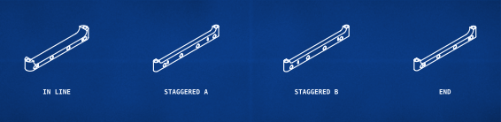
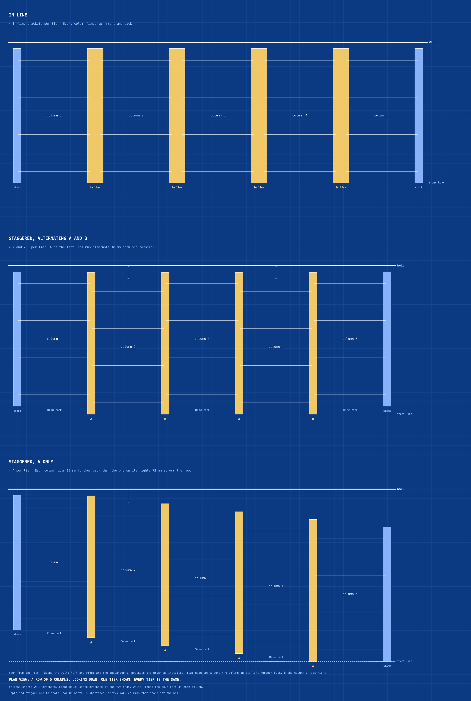
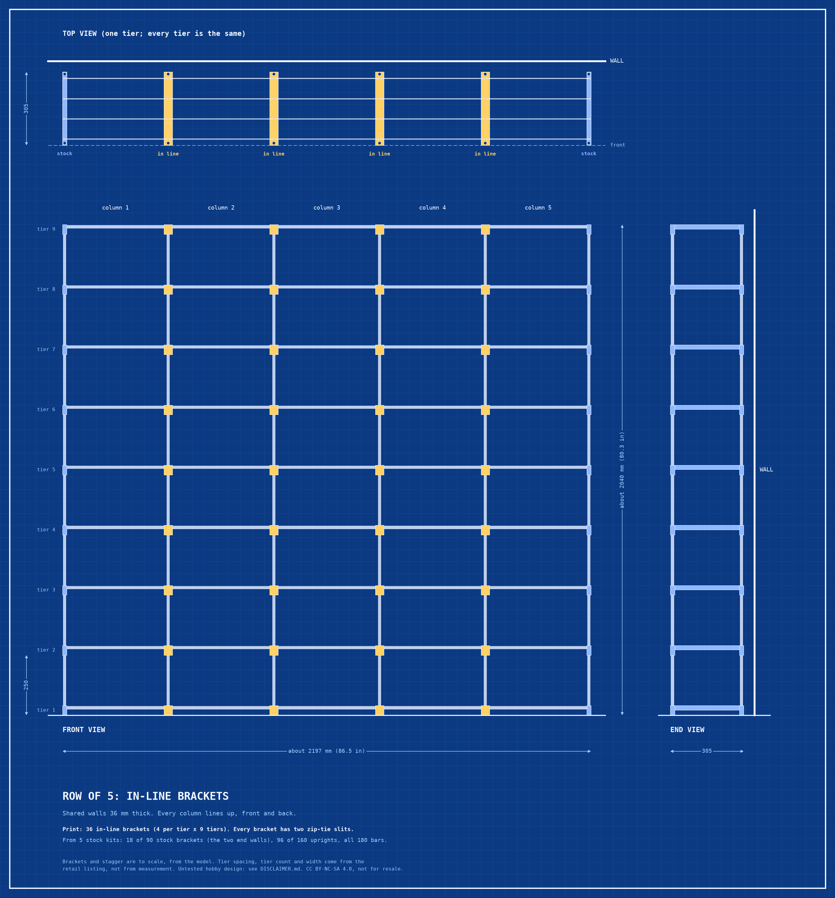
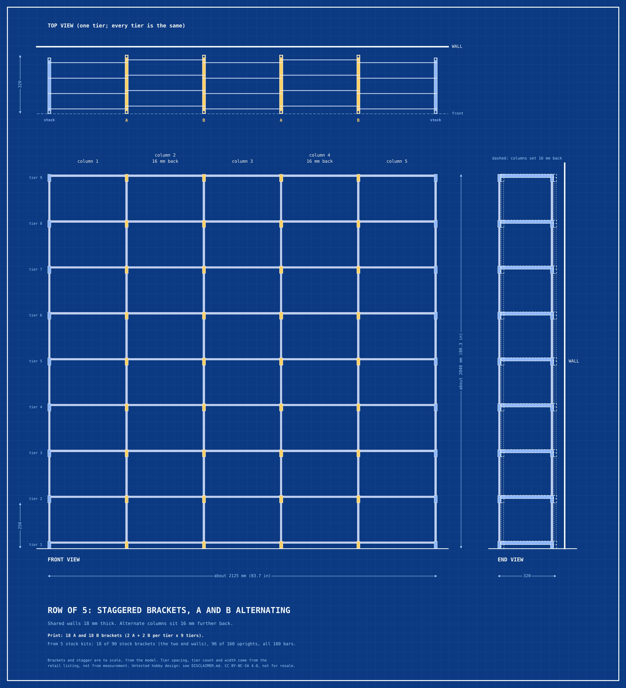

# Shared-wall bracket

Lets two columns of the rack stand side by side and share one centre wall,
instead of standing as two separate towers.

<!-- blueprint-preview:preview -->
[](preview.svg)

<sub>Preview generated from `shared_wall_bracket.py` by [common-blueprint-generator](https://github.com/csmarshall/common-blueprint-generator) on every change to the model</sub>
<!-- /blueprint-preview -->

An interactive 3D view is [at the bottom of this page](#interactive-3d-view).
GitHub also shows a rotatable viewer when you open any file in `models/` ending in `.stl`.

The stock bracket has bar sockets on one face only. This part is two stock
brackets back to back in one piece, with bar sockets on both faces and a single
centred row of upright sockets. Nine make a full-height shared wall, and free
up nine stock brackets and a set of uprights from the second kit.

> **Use at your own risk.** Untested hobby design, no warranty, no load rating.
> See the [disclaimer](../DISCLAIMER.md).

## Two layouts


| | In line | Staggered |
|---|---|---|
| Size | 36 x 305 x 40 mm | 18 x 322 x 40 mm (the stock bracket's width) |
| Rail height | 18 mm, as stock | 27 mm |
| Ends | Fully rounded, a 20 mm radius across the whole width | Fully rounded around the upright sockets, as stock |
| Bar sockets | 16 mm deep, as measured on the stock part; the two faces end to end with a 4 mm web between, as thick as the upright divider | 16 mm deep, as measured on the stock part; one face's set is shifted 18 mm along the bracket so the two pass side by side |
| Columns | Line up front and back | Neighbouring columns stand 18 mm apart front to back |
| Parts | One design | A mirror-image pair, A and B; one end bracket for either end of a row |
| Solid volume | 191.5 cm3 | 134.8 cm3 |
| Printed, estimated (ABS, 5 walls, 15% infill) | about 112 g (scaled from the volume) | about 96 g |
| Rail bending strength, vertical | 1.00 | 1.13 |
| Rail stiffness, vertical | 1.00 | 1.69 |
| Rail stiffness, sideways | 1.00 | 0.19 |
| Wall around upright sockets (13.2 mm bore) | 2.4 mm at the end, 11.4 mm at the sides | 2.4 mm all round |

**Why the staggered rail is taller.** A shared wall carries two columns. The
staggered rail is half as wide as the in-line one (18 mm against 36), and
bending strength goes with width x height squared, so its rail is 27 mm tall
where the stock rail is 18: 18 x 27 squared is 12% more than 36 x 18 squared.
(The in-line bracket was 40 wide when the 27 mm was chosen, which it matched
exactly; the in-line bracket is now 36 wide, so the staggered rail has margin.)
The extra 9 mm is on the
side away from the flat edge, in the open space between the two legs. The bar
bar centres stay 9 mm from the flat edge and the upright divider does not move, so
bars and tiers still line up with the stock walls.

**Where the staggered bracket is not as strong.** Sideways it is much less
stiff, and its upright sockets have a 2.4 mm wall all round (13.2 mm bore) where the
in-line bracket has 11.4 mm at the sides. The bars brace the wall sideways and
the stock brackets work with that same wall, but the in-line bracket has more
margin. These figures are section-property ratios, not test results; neither
layout has been load tested.

**Staggered A and B.** Installed, the flat edge is on top: the side nearest the
bars is the top of a bracket, and the legs stand down (the models and drawings
show the part as printed, flat edge down). Seen from the room, an A bracket
sets the column on its left 18 mm further back; a B bracket sets the column on
its right further back. A and B are mirror images, so no way of turning an A
gives a B; turning a bracket end for end changes nothing. Use the B models.

**Tethering a staggered wall.** Every bracket has two zip-tie slits; see
[Tie slits](#tie-slits). Thread the tie through either slit of a top-tier
bracket and through the [wall plate](../anti-tip-wall-plate/). There is an end
bracket for each end of the row, so a staggered row can be tethered at its ends
as well as at its shared walls.

### A row of columns



For a row of five columns, each tier needs four shared-wall brackets and two
stock brackets at the ends:

- **In line:** 4 in-line brackets. Every column lines up.
- **Staggered, alternating:** A, B, A, B from the left, 2 A and 2 B. Columns 1,
  3 and 5 sit 18 mm back, against the wall; columns 2 and 4 stand 18 mm out.
- **Staggered, A only:** 4 A. Each column steps a further 18 mm back than the
  one on its right, 72 mm across the row.

**Staggered rows: use an odd number of columns, three or more.** Alternate
the brackets so every tier has the same number of A and B. The two end columns
then stand the same distance from the wall. With an even number of columns, or
with two columns on a single bracket, one end of the row sits 18 mm further
out than the other. Start with A at the left (A, B, A, B, ...), as seen from
the room, so the end columns are the ones nearest the wall; that is where the
end brackets go. An end bracket's sockets face left once it is installed, so
use it as modelled at the right end of the row and turned end for end at the
left end, where its sockets sit 1 mm off (27 mm from the front instead of 26),
as a stock bracket's do when turned around.

In the staggered layouts some columns stand off the wall. The zip-tie tether
bridges that gap; add a spacer only if you want every column bearing on the
wall. `make_layout_diagram.py --columns N` redraws the diagram for any row.

### Assembly sheets

Top, front and end views of a full nine-tier row of five, with a parts count,
for each layout:

[](row_of_five_in_line.png)

[](row_of_five_staggered.png)

The brackets and the stagger are to scale, from the model. The rack's tier
spacing, tier count and width come from the retail listing, not from
measurement, so treat the overall sizes as approximate. Per row of five and
tier, the in-line sheet counts 4 in-line brackets and the staggered sheet 2 A
and 2 B; both use two stock brackets at the ends, and every bracket has the two
zip-tie slits. Over nine tiers that is 36 in-line brackets, or 18 A and 18 B,
from five stock kits (18 of 90 stock brackets, 96 of 160 uprights, all 180
bars). `make_row_sheets.py` redraws both, and takes `--columns` and `--tiers`;
it shares `make_layout_diagram.py`'s A/B column offsets.

## Status

- Geometry is built from caliper measurements of a stock bracket (see the
  [top-level README](../README.md#does-your-rack-match)).
- **Socket size comes from a test print; the brackets themselves have not been printed.** Sockets are 13.2 mm for a 13.0 mm tube. A printed gauge (Snapmaker U1, PolyLite ABS, nozzle 260 C, bed 100 C) gave a firm push fit at CAD 13.2 on a 13.0 mm tube in both the bar and the upright direction, and 13.6 was loose. That is one printer, one filament and one print, so print `models/fit_test_coupon_v2.stl` first and adjust `--fit-clearance` if yours differs, but only downwards: the 18 mm thick end and staggered brackets leave exactly 2.4 mm beside an upright socket at 0.2 mm clearance, and that 2.4 mm floor is deliberate, so a larger clearance aborts the build unless the brackets are made thicker (a redesign). Nothing has been load tested.
- Two values are judged from photos, not measured: the 20 mm inside corner
  radius and the upright socket centre at 9 mm from the end.
- The `.3mf` projects were generated by script and pass a strict 3MF read, but
  have **not been opened in Snapmaker Orca**. Check the wall count, wall
  generator and slot 1 filament after loading.

## Load warning

The shared uprights carry both columns, roughly double the stock load on those
two tubes. Reviews of this rack report tubes buckling and the tower tipping at
nine loaded tiers. Anchor the rack to a wall and keep heavy spools low. Every
bracket has two zip-tie slits through its rail, in the style of a furniture
anti-tip kit: on the top tier, run a zip tie through a slit and through the
[anti-tip wall plate](../anti-tip-wall-plate/) screwed to the wall.

## Files

| Path | What it is |
|---|---|
| `shared_wall_bracket.py` | Parametric CadQuery source. Writes STEP and STL. |
| `models/shared_wall_bracket_v2.*` | The in-line bracket (STL, STEP, Snapmaker U1 project). |
| `models/shared_wall_bracket_staggered_a.*`, `_b.*` | The staggered bracket, A and its mirror image B. |
| `models/end_bracket.*` | A stock-size bracket for the end of a row, sockets on one face only (the +X face of the model, which faces left once installed). As modelled it is the right end of a row; turned end for end it is the left end, with its sockets 1 mm further along (27 mm from the front end instead of 26), as a stock bracket's are when turned around. |
| `models/shared_wall_bracket_3bar.*`, `models/shared_wall_bracket_staggered_3bar_a.*`, `_b.*`, `models/end_bracket_3bar.*` | The 3-bar versions of the in-line, staggered A/B and end brackets (STL and STEP, no U1 projects). See [Three bars](#three-bars-a-shallower-rack). |
| `models/fit_test_coupon_v2.*` | One upright socket, one bar socket and one tie slit, for tuning fit. |
| `blueprint.svg` | Dimensioned drawing of the in-line bracket, generated by `make_blueprint.py` on [common-blueprint-generator](https://github.com/csmarshall/common-blueprint-generator). |
| `blueprint_staggered.svg`, `blueprint_end.svg`, `blueprint_coupon.svg` | The drawings of the staggered A/B brackets, the end brackets and the fit test coupon, from `make_blueprint_staggered.py`, `make_blueprint_end.py` and `make_blueprint_coupon.py`. They share `sheet_parts.py` and `../tools/blueprint_helpers.py`. |
| `make_preview.py`, `preview.svg` | The header image at the top of this page: the four printed parts, drawn by common-blueprint-generator's `preview()` from the same parameters. The Publish workflow redraws it. |
| `make_layout_diagram.py` | Draws `row_of_five.png`, the plan view of a row of columns. |
| `make_row_sheets.py` | Draws `row_of_five_in_line.png` and `row_of_five_staggered.png`, the assembly sheets. |
| `make_readme_stl.py` | Rewrites the small viewer mesh embedded at the bottom of this page. |
| `legacy/` | First version, drawn from listing photos before measuring. Not for printing. |

## Drawing

<!-- blueprint:blueprint -->
[](blueprint.svg)

<sub>Drawing generated from `shared_wall_bracket.py` by [common-blueprint-generator](https://github.com/csmarshall/common-blueprint-generator) on every change to the model</sub>
<!-- /blueprint -->

Top, front, bottom and end views, a section through a bar socket, an
isometric, and a detail of a tie slit. Every view is projected
from the CAD model, and the dimensions come from the same parameters, so the
sheet matches what is printed. The Publish workflow redraws it whenever the
model changes.

### Staggered bracket, A and B

Both faces of A, the plan, a section through a bar socket, and a detail of a
tie slit. B is A's mirror image and is described on the sheet, not drawn.

<!-- blueprint:blueprint_staggered -->
[](blueprint_staggered.svg)

<sub>Drawing generated from `shared_wall_bracket.py` by [common-blueprint-generator](https://github.com/csmarshall/common-blueprint-generator) on every change to the model</sub>
<!-- /blueprint -->

### End bracket

The end bracket, with a section and a detail of a tie slit. One part serves
both ends of a row.

<!-- blueprint:blueprint_end -->
[](blueprint_end.svg)

<sub>Drawing generated from `shared_wall_bracket.py` by [common-blueprint-generator](https://github.com/csmarshall/common-blueprint-generator) on every change to the model</sub>
<!-- /blueprint -->

### Fit test coupon

<!-- blueprint:blueprint_coupon -->
[](blueprint_coupon.svg)

<sub>Drawing generated from `shared_wall_bracket.py` by [common-blueprint-generator](https://github.com/csmarshall/common-blueprint-generator) on every change to the model</sub>
<!-- /blueprint -->

## Design

The drawing and the points below describe the in-line bracket. The staggered
one shares its leg height, bar socket position and divider.

- 36 x 305 x 40 mm: two 16 mm bar sockets and a 4 mm centre web, as thick as
  the upright divider.
- A 4 mm vent runs through the web between each pair of opposite bar sockets,
  like the hole in the upright divider, so a bar is not pushed in against
  trapped air. The bar still seats on the web, with 4.6 mm of plastic around the
  vent (13.2 mm socket, 4 mm vent).
- The upright divider is 4 mm to match the stock part. It sets tier height, so
  it must not change, or the centre wall drifts out of level with the outer
  walls on every tier.
- Bar positions and height match the stock bracket, because the far end of
  every bar sits in a stock bracket.
- Seen from above, each end is rounded off completely, like the stock part: a
  18 mm radius across the 36 mm width. The wall at the tip of the upright
  socket is 2.4 mm, and the bar sockets all open on the straight sides.

## Three bars, a shallower rack

Every bracket also comes in a 3-bar version, for a rack 84 mm shallower. It drops the third bar hole and moves the fourth into its place, so the bars sit at 26, 110 and 194 mm from the front end and the bracket is 221 mm long instead of 305 (staggered: 238 mm instead of 322, with sockets at 26/110/194 and 44/128/212). The bar tubes, uprights, leg height and socket sizes are unchanged. The rear leg, upright sockets and rear tie slit follow the new length (slits at 40 and 181 mm; 60 and 178 mm on the staggered bracket), and the tie slit strength check passes on all four.

- Each tier holds one fewer spool position.
- A 3-bar row needs 3-bar brackets at every wall, the ends included: stock 305 mm brackets cannot be mixed in. Print the 3-bar end bracket for the row ends.
- The bar positions stay measured from the same end as on the stock part (26 mm from one end, 27 from the other), so the 3-bar end bracket still turns end for end.
- At 221 mm (in-line and end) and 238 mm (staggered) every 3-bar part fits a 270 mm bed straight, without the 45 degree turn the 305 mm brackets need.
- The anti-tip wall plate does not depend on bracket length.

The files are `models/shared_wall_bracket_3bar.*`, `models/shared_wall_bracket_staggered_3bar_a.*` and `_b.*`, and `models/end_bracket_3bar.*`. In `shared_wall_bracket.py` it is one parameter, `Params(bars=3)` (also `Params.staggered(bars=3)` and `Params.end(bars=3)`), which derives the bar positions and length from the stock pattern (84 mm pitch, 305 mm stock length); `bars` must be 3 or 4. `python3 test_bars.py` checks the derived numbers.

## Tie slits

Every bracket, and the fit-test coupon, has them: two obround slots, 9 mm tall
by 3.2 mm, rounded top and bottom, through the rail from face to face and
centred 40 mm from each end on the in-line and end brackets (60 mm on the
staggered bracket, where the other face's first bar socket sits further in),
halfway up the rail. Each slit keeps 3 mm of solid plastic between its mouth
and the nearest bar socket's mouth: that needs 38.8 mm from the front end and
39.8 mm from the back (the stock pattern puts the last socket 27 mm from its
end), so 40 mm. The slit is still behind the first bar on its face, so a tie
pulled toward the wall passes over or under that bar. Each mouth has a 0.8 mm
45 degree lead-in on both faces, like the sockets. A tie up to 7.6 x 1.9 mm
goes through either slit and through the
[wall plate](../anti-tip-wall-plate/).

The size is the tallest that does not weaken the rail. `Params.tie_slit_height`
is checked every time a model is built (`check_tie_slit_strength`): the rail's
cross-section at a slit must be no weaker than at its weakest bar socket, in
area, vertical second moment and sideways second moment, and must keep 3 mm of
solid rail above and below the slit's mouth. The build stops with the numbers
if it is not. On the in-line bracket the limit is about 10 mm; on the
staggered bracket it is about 9.9 mm, from sideways bending. These are
section-property checks, not stress or load tests, and they say nothing about
the stress concentration at the slit's rounded ends. None has been load tested.

The brackets still print flat edge down with no supports: a slit is 3.2 mm
wide with a rounded top, which should bridge unsupported, but that has not been
printed yet; the fit-test coupon carries a slit so the first test print checks
it. The tether leaves a gap to the wall, so the rack does not have to sit
flush.

## Printing

### Settings to change from the slicer's defaults

If you **import** an STL, or import a `.3mf` instead of opening it as a
project, none of these are set for you. Set them by hand. The location is
where each one sits in Snapmaker Orca and OrcaSlicer.

| Setting | Set it to | Where (tab / group) | U1 stock value |
|---|---|---|---|
| Wall loops | **5** | Strength / Walls | 2 |
| Wall generator | **Arachne** | Quality / Wall generator | Classic |
| Sparse infill pattern | **Gyroid** | Strength / Infill | Grid |
| Sparse infill density | **15%** | Strength / Infill | 15% (unchanged) |
| Bottom shell layers | **5** | Strength / Top/bottom shells | 3 |
| Brim type | **Outer brim only** | Others / Brim | Auto |
| Brim width | **5 to 10 mm** (see below) | Others / Brim | 5 mm |
| Filament | **ABS, ASA or PETG. Not PLA.** | Filament slot | PLA |
| Layer height | 0.20 mm | Quality / Layer height | 0.20 mm (unchanged) |

Then, on the plate:

1. Lay the part with its **flat edge on the bed** (the long straight edge, with
   the legs pointing up). No supports. Installed, the part is the other way up:
   flat edge on top.
2. **Rotate it 45 degrees** about the vertical and centre it. It only fits a
   270 mm bed corner to corner, one per plate.
3. A 10 mm brim fits a 270 x 270 mm bed on every version: it leaves 8.5 mm to
   the bed edge on the staggered brackets, the tightest.

The reasons for each value are in [Why these settings](#why-these-settings).
The `.3mf` projects in `models/` carry all of this, but only when opened with
**File > Open Project**.

### Notes


- Orientation: flat edge on the bed, no supports (installed, the flat edge is on top).
- Snapmaker U1 (270 x 270 mm bed): every version only fits rotated 45 degrees,
  one per plate. Clear to the bed edge: in line 21.9 mm, staggered 18.5 mm, end
  brackets 24.5 mm. With the 10 mm brim in the project files they clear the bed
  edge by 11.9, 8.5 and 14.5 mm.
- 5 wall loops with the Arachne wall generator, so the 2.4 mm socket walls (bar hole to flat edge and rail top, upright side wall, upright to bracket end) print as solid perimeters.
- 15% gyroid infill and 5 bottom shell layers. See
  [Why these settings](#why-these-settings).
- **Not PLA.** The bracket is under constant load, and PLA slowly deforms
  under constant load and softens when warm.
- PETG or ABS. A 305 mm ABS part is prone to warping; use a brim and keep
  draughts off it.

## Why these settings

Snapmaker Orca is a fork of OrcaSlicer, so the OrcaSlicer wiki is the reference
for these settings. The stock U1 `0.20mm Standard` process uses 2 wall loops,
the Classic wall generator, 15% grid infill and 3 bottom shell layers.

| Setting | Stock | Here | Basis |
|---|---|---|---|
| Wall loops | 2 | 5 | Calculated. Each socket wall gets loops from both faces, so loops needed = (wall / 2) / line width. At the stock 0.42 mm outer and 0.45 mm inner line widths, 5 loops fill the thickest socket wall (3.85 mm). |
| Wall generator | Classic | Arachne | Varies line width to close the slivers a fixed-width wall would leave. |
| Infill pattern | Grid | Gyroid | Documented. The [OrcaSlicer patterns page](https://www.orcaslicer.com/wiki/print_settings/strength/strength_settings_patterns.html) says grid's overlapping points may cause noise or artifacts, and describes gyroid as isotropic, with curved geometry that helps reduce warping. |
| Bottom shell layers | 3 | 5 | Precaution, not documented behaviour. The [shells page](https://www.orcaslicer.com/wiki/print_settings/strength/strength_settings_top_bottom_shells.html) says more shell layers increase part strength. The specific aim is to make the 2.4 mm wall between the bed face and each bar socket print fully solid; check that in the slicer preview. |
| Brim | Slicer default | Outer, 10 mm | A long ABS part lifts at the ends. The width is what fits inside the bed margin. |

With 5 wall loops the walls carry nearly all the load, so the infill choice is
mostly about print reliability.

## Opening the U1 projects

Use **File > Open Project** (or drag the `.3mf` in and choose to open it as a
project). **Import** loads the geometry only and discards every setting in the
file, including the ones stored on the part.

## Regenerating

From this folder, with the virtual environment from the top-level README active:

```sh
pip install -r ../requirements.txt "common-blueprint-generator @ git+https://github.com/csmarshall/common-blueprint-generator"
python3 shared_wall_bracket.py --out models             # rebuilds every STL and STEP
python3 shared_wall_bracket.py --fit-clearance 0.15      # tighter sockets (0.2 is the maximum: the 2.4 mm wall floor)
python3 make_blueprint.py                                # redraws blueprint.svg and the embed above
python3 make_blueprint_staggered.py                      # likewise for the staggered A/B sheet
python3 make_blueprint_end.py                            # the end bracket sheet
python3 make_blueprint_coupon.py                         # the fit test coupon sheet
python3 make_preview.py                                  # redraws preview.svg, the header image
python3 make_layout_diagram.py                           # redraws row_of_five.png
python3 make_readme_stl.py                               # refreshes the 3D view below
```

To rebuild a U1 project you also need the `Snapmaker` folder from
[snapmaker-profiles](https://github.com/Snapmaker/snapmaker-profiles):

```sh
python3 ../tools/make_u1_project.py \
  --stl out_v2/shared_wall_bracket_v2.stl \
  --profiles /path/to/snapmaker-profiles/Snapmaker \
  --out models/shared_wall_bracket_v2_U1_ABS.3mf \
  --brim-width 10
```

The project selects the stock `Snapmaker U1 (0.4 nozzle)` printer, the
`0.20mm Standard` process and `Generic ABS @U1 0.4 nozzle` in slot 1. It
overrides wall loops (5), wall generator (Arachne), infill (15% gyroid) and
bottom shell layers (5), and adds a 10 mm outer brim (`--brim-width`).
These settings are written both to the process and to the part itself.

## Interactive 3D view

Drag to rotate. This is a simplified mesh for viewing only (square corners, no
lead-in chamfers, slit lead-ins or vent holes); print from the files in `models/`. If no
viewer appears here, open
[`models/shared_wall_bracket_v2.stl`](models/shared_wall_bracket_v2.stl), which
GitHub displays in its own 3D viewer.

```stl
solid shared_wall_bracket
facet normal -0.00 -0.00 -1.00
outer loop
vertex 5.8 5.9 0.0
vertex 18.0 0.0 0.0
vertex 3.7 3.6 0.0
endloop
endfacet
facet normal 0.00 0.00 -1.00
outer loop
vertex 0.8 2.4 0.0
vertex 3.7 3.6 0.0
vertex 18.0 0.0 0.0
endloop
endfacet
facet normal -0.00 -0.00 -1.00
outer loop
vertex 6.6 9.0 0.0
vertex 18.0 0.0 0.0
vertex 5.8 5.9 0.0
endloop
endfacet
facet normal -0.00 -0.00 -1.00
outer loop
vertex 5.8 12.1 0.0
vertex 18.0 0.0 0.0
vertex 6.6 9.0 0.0
endloop
endfacet
facet normal -0.00 -0.00 -1.00
outer loop
vertex 3.7 14.4 0.0
vertex 18.0 0.0 0.0
vertex 5.8 12.1 0.0
endloop
endfacet
facet normal 0.00 -0.00 -1.00
outer loop
vertex -18.0 0.0 0.0
vertex -6.4 10.6 0.0
vertex -6.4 7.4 0.0
endloop
endfacet
facet normal 0.00 0.00 -1.00
outer loop
vertex -18.0 0.0 0.0
vertex -6.4 7.4 0.0
vertex -4.9 4.6 0.0
endloop
endfacet
facet normal 0.00 0.00 -1.00
outer loop
vertex -18.0 0.0 0.0
vertex -4.9 4.6 0.0
vertex -2.3 2.8 0.0
endloop
endfacet
facet normal 0.00 0.00 -1.00
outer loop
vertex -18.0 0.0 0.0
vertex -2.3 2.8 0.0
vertex 0.8 2.4 0.0
endloop
endfacet
facet normal 0.00 0.00 -1.00
outer loop
vertex -18.0 0.0 0.0
vertex 0.8 2.4 0.0
vertex 18.0 0.0 0.0
endloop
endfacet
facet normal 0.00 0.00 -1.00
outer loop
vertex -4.9 13.4 0.0
vertex -6.4 10.6 0.0
vertex -18.0 0.0 0.0
endloop
endfacet
facet normal -0.00 -0.00 -1.00
outer loop
vertex 3.7 290.6 0.0
vertex 18.0 0.0 0.0
vertex 3.7 14.4 0.0
endloop
endfacet
facet normal -0.00 -0.00 -1.00
outer loop
vertex 18.0 305.0 0.0
vertex 18.0 0.0 0.0
vertex 3.7 290.6 0.0
endloop
endfacet
facet normal 0.00 -0.00 -1.00
outer loop
vertex 5.8 292.9 0.0
vertex 18.0 305.0 0.0
vertex 3.7 290.6 0.0
endloop
endfacet
facet normal -0.00 -0.00 -1.00
outer loop
vertex 0.8 289.4 0.0
vertex 3.7 14.4 0.0
vertex 0.8 15.6 0.0
endloop
endfacet
facet normal 0.00 -0.00 -1.00
outer loop
vertex 0.8 289.4 0.0
vertex 0.8 15.6 0.0
vertex -2.3 15.2 0.0
endloop
endfacet
facet normal 0.00 0.00 -1.00
outer loop
vertex 0.8 289.4 0.0
vertex 3.7 290.6 0.0
vertex 3.7 14.4 0.0
endloop
endfacet
facet normal 0.00 -0.00 -1.00
outer loop
vertex 6.6 296.0 0.0
vertex 18.0 305.0 0.0
vertex 5.8 292.9 0.0
endloop
endfacet
facet normal 0.00 -0.00 -1.00
outer loop
vertex -2.3 289.8 0.0
vertex 0.8 289.4 0.0
vertex -2.3 15.2 0.0
endloop
endfacet
facet normal 0.00 -0.00 -1.00
outer loop
vertex 5.8 299.1 0.0
vertex 18.0 305.0 0.0
vertex 6.6 296.0 0.0
endloop
endfacet
facet normal 0.00 -0.00 -1.00
outer loop
vertex -4.9 291.6 0.0
vertex -2.3 15.2 0.0
vertex -4.9 13.4 0.0
endloop
endfacet
facet normal 0.00 0.00 -1.00
outer loop
vertex -4.9 291.6 0.0
vertex -2.3 289.8 0.0
vertex -2.3 15.2 0.0
endloop
endfacet
facet normal 0.00 -0.00 -1.00
outer loop
vertex 3.7 301.4 0.0
vertex 18.0 305.0 0.0
vertex 5.8 299.1 0.0
endloop
endfacet
facet normal 0.00 -0.00 -1.00
outer loop
vertex 0.8 302.6 0.0
vertex 18.0 305.0 0.0
vertex 3.7 301.4 0.0
endloop
endfacet
facet normal 0.00 -0.00 -1.00
outer loop
vertex -18.0 305.0 0.0
vertex 0.8 302.6 0.0
vertex -2.3 302.2 0.0
endloop
endfacet
facet normal 0.00 -0.00 -1.00
outer loop
vertex -18.0 305.0 0.0
vertex -2.3 302.2 0.0
vertex -4.9 300.4 0.0
endloop
endfacet
facet normal 0.00 -0.00 -1.00
outer loop
vertex -18.0 305.0 0.0
vertex -4.9 300.4 0.0
vertex -6.4 297.6 0.0
endloop
endfacet
facet normal 0.00 -0.00 -1.00
outer loop
vertex -18.0 305.0 0.0
vertex -6.4 297.6 0.0
vertex -6.4 294.4 0.0
endloop
endfacet
facet normal 0.00 0.00 -1.00
outer loop
vertex -18.0 305.0 0.0
vertex -6.4 294.4 0.0
vertex -4.9 291.6 0.0
endloop
endfacet
facet normal 0.00 -0.00 -1.00
outer loop
vertex -18.0 305.0 0.0
vertex 18.0 305.0 0.0
vertex 0.8 302.6 0.0
endloop
endfacet
facet normal 0.00 -0.00 -1.00
outer loop
vertex -18.0 305.0 0.0
vertex -4.9 13.4 0.0
vertex -18.0 0.0 0.0
endloop
endfacet
facet normal 0.00 0.00 -1.00
outer loop
vertex -18.0 305.0 0.0
vertex -4.9 291.6 0.0
vertex -4.9 13.4 0.0
endloop
endfacet
facet normal 0.00 -1.00 0.00
outer loop
vertex -18.0 0.0 0.0
vertex 18.0 0.0 40.0
vertex -18.0 0.0 40.0
endloop
endfacet
facet normal 0.00 -1.00 0.00
outer loop
vertex -18.0 0.0 0.0
vertex 18.0 0.0 0.0
vertex 18.0 0.0 40.0
endloop
endfacet
facet normal 1.00 0.00 0.00
outer loop
vertex 18.0 283.8 5.9
vertex 18.0 281.7 3.6
vertex 18.0 305.0 0.0
endloop
endfacet
facet normal 1.00 -0.00 -0.00
outer loop
vertex 18.0 278.8 2.4
vertex 18.0 305.0 0.0
vertex 18.0 281.7 3.6
endloop
endfacet
facet normal 1.00 0.00 0.00
outer loop
vertex 18.0 284.6 9.0
vertex 18.0 283.8 5.9
vertex 18.0 305.0 0.0
endloop
endfacet
facet normal 1.00 0.00 0.00
outer loop
vertex 18.0 283.8 12.1
vertex 18.0 284.6 9.0
vertex 18.0 305.0 0.0
endloop
endfacet
facet normal 1.00 -0.00 -0.00
outer loop
vertex 18.0 266.4 5.4
vertex 18.0 273.1 4.6
vertex 18.0 271.6 7.4
endloop
endfacet
facet normal 1.00 0.00 0.00
outer loop
vertex 18.0 266.4 5.4
vertex 18.0 266.0 4.8
vertex 18.0 273.1 4.6
endloop
endfacet
facet normal 1.00 -0.00 -0.00
outer loop
vertex 18.0 265.4 4.5
vertex 18.0 275.7 2.8
vertex 18.0 273.1 4.6
endloop
endfacet
facet normal 1.00 0.00 -0.00
outer loop
vertex 18.0 265.4 4.5
vertex 18.0 273.1 4.6
vertex 18.0 266.0 4.8
endloop
endfacet
facet normal 1.00 -0.00 0.00
outer loop
vertex 18.0 266.6 6.1
vertex 18.0 266.4 5.4
vertex 18.0 271.6 7.4
endloop
endfacet
facet normal 1.00 -0.00 -0.00
outer loop
vertex 18.0 264.6 4.5
vertex 18.0 275.7 2.8
vertex 18.0 265.4 4.5
endloop
endfacet
facet normal 1.00 0.00 0.00
outer loop
vertex 18.0 281.1 23.9
vertex 18.0 281.7 14.4
vertex 18.0 283.8 12.1
endloop
endfacet
facet normal 1.00 0.00 0.00
outer loop
vertex 18.0 281.1 23.9
vertex 18.0 278.8 15.6
vertex 18.0 281.7 14.4
endloop
endfacet
facet normal 1.00 -0.00 0.00
outer loop
vertex 18.0 285.5 30.3
vertex 18.0 305.0 0.0
vertex 18.0 305.0 40.0
endloop
endfacet
facet normal 1.00 0.00 0.00
outer loop
vertex 18.0 285.5 30.3
vertex 18.0 283.8 12.1
vertex 18.0 305.0 0.0
endloop
endfacet
facet normal 1.00 0.00 0.00
outer loop
vertex 18.0 285.5 30.3
vertex 18.0 281.1 23.9
vertex 18.0 283.8 12.1
endloop
endfacet
facet normal 1.00 -0.00 0.00
outer loop
vertex 18.0 274.7 19.5
vertex 18.0 275.7 15.2
vertex 18.0 278.8 15.6
endloop
endfacet
facet normal 1.00 -0.00 0.00
outer loop
vertex 18.0 274.7 19.5
vertex 18.0 273.1 13.4
vertex 18.0 275.7 15.2
endloop
endfacet
facet normal 1.00 -0.00 0.00
outer loop
vertex 18.0 274.7 19.5
vertex 18.0 278.8 15.6
vertex 18.0 281.1 23.9
endloop
endfacet
facet normal 1.00 -0.00 0.00
outer loop
vertex 18.0 266.6 11.9
vertex 18.0 271.6 7.4
vertex 18.0 271.6 10.6
endloop
endfacet
facet normal 1.00 -0.00 0.00
outer loop
vertex 18.0 266.6 11.9
vertex 18.0 266.6 6.1
vertex 18.0 271.6 7.4
endloop
endfacet
facet normal 1.00 -0.00 0.00
outer loop
vertex 18.0 266.4 12.6
vertex 18.0 271.6 10.6
vertex 18.0 273.1 13.4
endloop
endfacet
facet normal 1.00 0.00 0.00
outer loop
vertex 18.0 266.4 12.6
vertex 18.0 266.6 11.9
vertex 18.0 271.6 10.6
endloop
endfacet
facet normal 1.00 -0.00 0.00
outer loop
vertex 18.0 287.0 38.0
vertex 18.0 285.5 30.3
vertex 18.0 305.0 40.0
endloop
endfacet
facet normal 1.00 -0.00 0.00
outer loop
vertex 18.0 267.0 18.0
vertex 18.0 263.6 12.6
vertex 18.0 264.0 13.2
endloop
endfacet
facet normal 1.00 -0.00 0.00
outer loop
vertex 18.0 267.0 18.0
vertex 18.0 264.0 13.2
vertex 18.0 264.6 13.5
endloop
endfacet
facet normal 1.00 -0.00 0.00
outer loop
vertex 18.0 267.0 18.0
vertex 18.0 264.6 13.5
vertex 18.0 265.4 13.5
endloop
endfacet
facet normal 1.00 0.00 0.00
outer loop
vertex 18.0 267.0 18.0
vertex 18.0 265.4 13.5
vertex 18.0 266.0 13.2
endloop
endfacet
facet normal 1.00 0.00 0.00
outer loop
vertex 18.0 267.0 18.0
vertex 18.0 266.0 13.2
vertex 18.0 266.4 12.6
endloop
endfacet
facet normal 1.00 -0.00 0.00
outer loop
vertex 18.0 267.0 18.0
vertex 18.0 266.4 12.6
vertex 18.0 273.1 13.4
endloop
endfacet
facet normal 1.00 -0.00 0.00
outer loop
vertex 18.0 267.0 18.0
vertex 18.0 273.1 13.4
vertex 18.0 274.7 19.5
endloop
endfacet
facet normal 1.00 -0.00 0.00
outer loop
vertex 18.0 287.0 40.0
vertex 18.0 287.0 38.0
vertex 18.0 305.0 40.0
endloop
endfacet
facet normal 1.00 0.00 -0.00
outer loop
vertex 18.0 197.7 3.6
vertex 18.0 264.6 4.5
vertex 18.0 264.0 4.8
endloop
endfacet
facet normal 1.00 -0.00 0.00
outer loop
vertex 18.0 199.8 5.9
vertex 18.0 197.7 3.6
vertex 18.0 264.0 4.8
endloop
endfacet
facet normal 1.00 -0.00 -0.00
outer loop
vertex 18.0 199.8 5.9
vertex 18.0 264.0 4.8
vertex 18.0 263.6 5.4
endloop
endfacet
facet normal 1.00 -0.00 -0.00
outer loop
vertex 18.0 199.8 5.9
vertex 18.0 263.6 5.4
vertex 18.0 263.4 6.1
endloop
endfacet
facet normal 1.00 0.00 -0.00
outer loop
vertex 18.0 194.8 2.4
vertex 18.0 264.6 4.5
vertex 18.0 197.7 3.6
endloop
endfacet
facet normal 1.00 -0.00 0.00
outer loop
vertex 18.0 200.6 9.0
vertex 18.0 263.4 6.1
vertex 18.0 263.4 11.9
endloop
endfacet
facet normal 1.00 -0.00 0.00
outer loop
vertex 18.0 200.6 9.0
vertex 18.0 199.8 5.9
vertex 18.0 263.4 6.1
endloop
endfacet
facet normal 1.00 -0.00 0.00
outer loop
vertex 18.0 199.8 12.1
vertex 18.0 263.4 11.9
vertex 18.0 263.6 12.6
endloop
endfacet
facet normal 1.00 0.00 0.00
outer loop
vertex 18.0 199.8 12.1
vertex 18.0 263.6 12.6
vertex 18.0 267.0 18.0
endloop
endfacet
facet normal 1.00 -0.00 0.00
outer loop
vertex 18.0 199.8 12.1
vertex 18.0 200.6 9.0
vertex 18.0 263.4 11.9
endloop
endfacet
facet normal 1.00 -0.00 0.00
outer loop
vertex 18.0 197.7 14.4
vertex 18.0 199.8 12.1
vertex 18.0 267.0 18.0
endloop
endfacet
facet normal 1.00 -0.00 -0.00
outer loop
vertex 18.0 113.7 3.6
vertex 18.0 191.7 2.8
vertex 18.0 189.1 4.6
endloop
endfacet
facet normal 1.00 -0.00 0.00
outer loop
vertex 18.0 115.8 5.9
vertex 18.0 113.7 3.6
vertex 18.0 189.1 4.6
endloop
endfacet
facet normal 1.00 -0.00 -0.00
outer loop
vertex 18.0 115.8 5.9
vertex 18.0 189.1 4.6
vertex 18.0 187.6 7.4
endloop
endfacet
facet normal 1.00 0.00 -0.00
outer loop
vertex 18.0 110.8 2.4
vertex 18.0 191.7 2.8
vertex 18.0 113.7 3.6
endloop
endfacet
facet normal 1.00 -0.00 0.00
outer loop
vertex 18.0 116.6 9.0
vertex 18.0 115.8 5.9
vertex 18.0 187.6 7.4
endloop
endfacet
facet normal 1.00 -0.00 0.00
outer loop
vertex 18.0 116.6 9.0
vertex 18.0 187.6 7.4
vertex 18.0 187.6 10.6
endloop
endfacet
facet normal 1.00 -0.00 0.00
outer loop
vertex 18.0 115.8 12.1
vertex 18.0 116.6 9.0
vertex 18.0 187.6 10.6
endloop
endfacet
facet normal 1.00 -0.00 0.00
outer loop
vertex 18.0 115.8 12.1
vertex 18.0 187.6 10.6
vertex 18.0 189.1 13.4
endloop
endfacet
facet normal 1.00 -0.00 0.00
outer loop
vertex 18.0 113.7 14.4
vertex 18.0 115.8 12.1
vertex 18.0 189.1 13.4
endloop
endfacet
facet normal 1.00 -0.00 0.00
outer loop
vertex 18.0 113.7 14.4
vertex 18.0 189.1 13.4
vertex 18.0 191.7 15.2
endloop
endfacet
facet normal 1.00 -0.00 0.00
outer loop
vertex 18.0 110.8 15.6
vertex 18.0 113.7 14.4
vertex 18.0 191.7 15.2
endloop
endfacet
facet normal 1.00 -0.00 -0.00
outer loop
vertex 18.0 41.0 4.8
vertex 18.0 107.7 2.8
vertex 18.0 105.1 4.6
endloop
endfacet
facet normal 1.00 0.00 0.00
outer loop
vertex 18.0 41.4 5.4
vertex 18.0 41.0 4.8
vertex 18.0 105.1 4.6
endloop
endfacet
facet normal 1.00 -0.00 -0.00
outer loop
vertex 18.0 41.4 5.4
vertex 18.0 105.1 4.6
vertex 18.0 103.6 7.4
endloop
endfacet
facet normal 1.00 -0.00 -0.00
outer loop
vertex 18.0 40.4 4.5
vertex 18.0 107.7 2.8
vertex 18.0 41.0 4.8
endloop
endfacet
facet normal 1.00 -0.00 0.00
outer loop
vertex 18.0 41.6 6.1
vertex 18.0 41.4 5.4
vertex 18.0 103.6 7.4
endloop
endfacet
facet normal 1.00 -0.00 0.00
outer loop
vertex 18.0 41.6 11.9
vertex 18.0 41.6 6.1
vertex 18.0 103.6 7.4
endloop
endfacet
facet normal 1.00 -0.00 0.00
outer loop
vertex 18.0 41.6 11.9
vertex 18.0 103.6 7.4
vertex 18.0 103.6 10.6
endloop
endfacet
facet normal 1.00 0.00 0.00
outer loop
vertex 18.0 41.4 12.6
vertex 18.0 41.6 11.9
vertex 18.0 103.6 10.6
endloop
endfacet
facet normal 1.00 -0.00 0.00
outer loop
vertex 18.0 41.4 12.6
vertex 18.0 103.6 10.6
vertex 18.0 105.1 13.4
endloop
endfacet
facet normal 1.00 0.00 -0.00
outer loop
vertex 18.0 29.7 3.6
vertex 18.0 39.6 4.5
vertex 18.0 39.0 4.8
endloop
endfacet
facet normal 1.00 -0.00 0.00
outer loop
vertex 18.0 31.8 5.9
vertex 18.0 29.7 3.6
vertex 18.0 39.0 4.8
endloop
endfacet
facet normal 1.00 -0.00 -0.00
outer loop
vertex 18.0 31.8 5.9
vertex 18.0 39.0 4.8
vertex 18.0 38.6 5.4
endloop
endfacet
facet normal 1.00 -0.00 -0.00
outer loop
vertex 18.0 31.8 5.9
vertex 18.0 38.6 5.4
vertex 18.0 38.4 6.1
endloop
endfacet
facet normal 1.00 0.00 -0.00
outer loop
vertex 18.0 26.8 2.4
vertex 18.0 107.7 2.8
vertex 18.0 40.4 4.5
endloop
endfacet
facet normal 1.00 0.00 -0.00
outer loop
vertex 18.0 26.8 2.4
vertex 18.0 39.6 4.5
vertex 18.0 29.7 3.6
endloop
endfacet
facet normal 1.00 0.00 -0.00
outer loop
vertex 18.0 26.8 2.4
vertex 18.0 40.4 4.5
vertex 18.0 39.6 4.5
endloop
endfacet
facet normal 1.00 -0.00 0.00
outer loop
vertex 18.0 32.6 9.0
vertex 18.0 31.8 5.9
vertex 18.0 38.4 6.1
endloop
endfacet
facet normal 1.00 -0.00 0.00
outer loop
vertex 18.0 32.6 9.0
vertex 18.0 38.4 6.1
vertex 18.0 38.4 11.9
endloop
endfacet
facet normal 1.00 -0.00 0.00
outer loop
vertex 18.0 38.0 18.0
vertex 18.0 41.4 12.6
vertex 18.0 105.1 13.4
endloop
endfacet
facet normal 1.00 -0.00 0.00
outer loop
vertex 18.0 38.0 18.0
vertex 18.0 105.1 13.4
vertex 18.0 107.7 15.2
endloop
endfacet
facet normal 1.00 -0.00 0.00
outer loop
vertex 18.0 38.0 18.0
vertex 18.0 38.6 12.6
vertex 18.0 39.0 13.2
endloop
endfacet
facet normal 1.00 -0.00 0.00
outer loop
vertex 18.0 38.0 18.0
vertex 18.0 39.0 13.2
vertex 18.0 39.6 13.5
endloop
endfacet
facet normal 1.00 -0.00 0.00
outer loop
vertex 18.0 38.0 18.0
vertex 18.0 39.6 13.5
vertex 18.0 40.4 13.5
endloop
endfacet
facet normal 1.00 0.00 0.00
outer loop
vertex 18.0 38.0 18.0
vertex 18.0 40.4 13.5
vertex 18.0 41.0 13.2
endloop
endfacet
facet normal 1.00 0.00 0.00
outer loop
vertex 18.0 38.0 18.0
vertex 18.0 41.0 13.2
vertex 18.0 41.4 12.6
endloop
endfacet
facet normal 1.00 0.00 -0.00
outer loop
vertex 18.0 31.8 12.1
vertex 18.0 38.6 12.6
vertex 18.0 38.0 18.0
endloop
endfacet
facet normal 1.00 -0.00 0.00
outer loop
vertex 18.0 31.8 12.1
vertex 18.0 32.6 9.0
vertex 18.0 38.4 11.9
endloop
endfacet
facet normal 1.00 -0.00 0.00
outer loop
vertex 18.0 31.8 12.1
vertex 18.0 38.4 11.9
vertex 18.0 38.6 12.6
endloop
endfacet
facet normal 1.00 -0.00 0.00
outer loop
vertex 18.0 29.7 14.4
vertex 18.0 31.8 12.1
vertex 18.0 38.0 18.0
endloop
endfacet
facet normal 1.00 -0.00 0.00
outer loop
vertex 18.0 30.3 19.5
vertex 18.0 29.7 14.4
vertex 18.0 38.0 18.0
endloop
endfacet
facet normal 1.00 0.00 0.00
outer loop
vertex 18.0 30.3 19.5
vertex 18.0 26.8 15.6
vertex 18.0 29.7 14.4
endloop
endfacet
facet normal 1.00 -0.00 0.00
outer loop
vertex 18.0 23.9 23.9
vertex 18.0 26.8 15.6
vertex 18.0 30.3 19.5
endloop
endfacet
facet normal 1.00 -0.00 0.00
outer loop
vertex 18.0 23.9 23.9
vertex 18.0 23.7 15.2
vertex 18.0 26.8 15.6
endloop
endfacet
facet normal 1.00 -0.00 0.00
outer loop
vertex 18.0 23.9 23.9
vertex 18.0 21.1 13.4
vertex 18.0 23.7 15.2
endloop
endfacet
facet normal 1.00 0.00 0.00
outer loop
vertex 18.0 0.0 0.0
vertex 18.0 19.6 7.4
vertex 18.0 19.6 10.6
endloop
endfacet
facet normal 1.00 0.00 -0.00
outer loop
vertex 18.0 0.0 0.0
vertex 18.0 21.1 4.6
vertex 18.0 19.6 7.4
endloop
endfacet
facet normal 1.00 0.00 -0.00
outer loop
vertex 18.0 0.0 0.0
vertex 18.0 23.7 2.8
vertex 18.0 21.1 4.6
endloop
endfacet
facet normal 1.00 0.00 -0.00
outer loop
vertex 18.0 0.0 0.0
vertex 18.0 26.8 2.4
vertex 18.0 23.7 2.8
endloop
endfacet
facet normal 1.00 -0.00 0.00
outer loop
vertex 18.0 19.5 30.3
vertex 18.0 19.6 10.6
vertex 18.0 21.1 13.4
endloop
endfacet
facet normal 1.00 -0.00 0.00
outer loop
vertex 18.0 19.5 30.3
vertex 18.0 21.1 13.4
vertex 18.0 23.9 23.9
endloop
endfacet
facet normal 1.00 -0.00 -0.00
outer loop
vertex 18.0 0.0 40.0
vertex 18.0 19.5 30.3
vertex 18.0 18.0 38.0
endloop
endfacet
facet normal 1.00 -0.00 0.00
outer loop
vertex 18.0 0.0 40.0
vertex 18.0 18.0 38.0
vertex 18.0 18.0 40.0
endloop
endfacet
facet normal 1.00 -0.00 0.00
outer loop
vertex 18.0 0.0 40.0
vertex 18.0 0.0 0.0
vertex 18.0 19.6 10.6
endloop
endfacet
facet normal 1.00 -0.00 -0.00
outer loop
vertex 18.0 0.0 40.0
vertex 18.0 19.6 10.6
vertex 18.0 19.5 30.3
endloop
endfacet
facet normal 1.00 0.00 -0.00
outer loop
vertex 18.0 0.0 0.0
vertex 18.0 305.0 0.0
vertex 18.0 278.8 2.4
endloop
endfacet
facet normal 1.00 0.00 -0.00
outer loop
vertex 18.0 0.0 0.0
vertex 18.0 278.8 2.4
vertex 18.0 275.7 2.8
endloop
endfacet
facet normal 1.00 0.00 -0.00
outer loop
vertex 18.0 0.0 0.0
vertex 18.0 275.7 2.8
vertex 18.0 194.8 2.4
endloop
endfacet
facet normal 1.00 0.00 -0.00
outer loop
vertex 18.0 194.8 2.4
vertex 18.0 275.7 2.8
vertex 18.0 264.6 4.5
endloop
endfacet
facet normal 1.00 0.00 -0.00
outer loop
vertex 18.0 0.0 0.0
vertex 18.0 194.8 2.4
vertex 18.0 191.7 2.8
endloop
endfacet
facet normal 1.00 0.00 -0.00
outer loop
vertex 18.0 0.0 0.0
vertex 18.0 191.7 2.8
vertex 18.0 110.8 2.4
endloop
endfacet
facet normal 1.00 0.00 -0.00
outer loop
vertex 18.0 0.0 0.0
vertex 18.0 110.8 2.4
vertex 18.0 107.7 2.8
endloop
endfacet
facet normal 1.00 0.00 -0.00
outer loop
vertex 18.0 0.0 0.0
vertex 18.0 107.7 2.8
vertex 18.0 26.8 2.4
endloop
endfacet
facet normal 1.00 0.00 0.00
outer loop
vertex 18.0 267.0 18.0
vertex 18.0 38.0 18.0
vertex 18.0 110.8 15.6
endloop
endfacet
facet normal 1.00 0.00 0.00
outer loop
vertex 18.0 110.8 15.6
vertex 18.0 38.0 18.0
vertex 18.0 107.7 15.2
endloop
endfacet
facet normal 1.00 -0.00 0.00
outer loop
vertex 18.0 267.0 18.0
vertex 18.0 110.8 15.6
vertex 18.0 194.8 15.6
endloop
endfacet
facet normal 1.00 0.00 0.00
outer loop
vertex 18.0 194.8 15.6
vertex 18.0 110.8 15.6
vertex 18.0 191.7 15.2
endloop
endfacet
facet normal 1.00 0.00 0.00
outer loop
vertex 18.0 267.0 18.0
vertex 18.0 194.8 15.6
vertex 18.0 197.7 14.4
endloop
endfacet
facet normal -1.00 -0.00 -0.00
outer loop
vertex -18.0 283.8 5.9
vertex -18.0 305.0 0.0
vertex -18.0 281.7 3.6
endloop
endfacet
facet normal -1.00 0.00 0.00
outer loop
vertex -18.0 278.8 2.4
vertex -18.0 281.7 3.6
vertex -18.0 305.0 0.0
endloop
endfacet
facet normal -1.00 -0.00 -0.00
outer loop
vertex -18.0 284.6 9.0
vertex -18.0 305.0 0.0
vertex -18.0 283.8 5.9
endloop
endfacet
facet normal -1.00 -0.00 -0.00
outer loop
vertex -18.0 283.8 12.1
vertex -18.0 305.0 0.0
vertex -18.0 284.6 9.0
endloop
endfacet
facet normal -1.00 0.00 0.00
outer loop
vertex -18.0 266.4 5.4
vertex -18.0 271.6 7.4
vertex -18.0 273.1 4.6
endloop
endfacet
facet normal -1.00 -0.00 -0.00
outer loop
vertex -18.0 266.4 5.4
vertex -18.0 273.1 4.6
vertex -18.0 266.0 4.8
endloop
endfacet
facet normal -1.00 0.00 0.00
outer loop
vertex -18.0 265.4 4.5
vertex -18.0 273.1 4.6
vertex -18.0 275.7 2.8
endloop
endfacet
facet normal -1.00 0.00 0.00
outer loop
vertex -18.0 265.4 4.5
vertex -18.0 266.0 4.8
vertex -18.0 273.1 4.6
endloop
endfacet
facet normal -1.00 0.00 -0.00
outer loop
vertex -18.0 266.6 6.1
vertex -18.0 271.6 7.4
vertex -18.0 266.4 5.4
endloop
endfacet
facet normal -1.00 0.00 0.00
outer loop
vertex -18.0 264.6 4.5
vertex -18.0 265.4 4.5
vertex -18.0 275.7 2.8
endloop
endfacet
facet normal -1.00 -0.00 -0.00
outer loop
vertex -18.0 281.1 23.9
vertex -18.0 283.8 12.1
vertex -18.0 281.7 14.4
endloop
endfacet
facet normal -1.00 -0.00 -0.00
outer loop
vertex -18.0 281.1 23.9
vertex -18.0 281.7 14.4
vertex -18.0 278.8 15.6
endloop
endfacet
facet normal -1.00 0.00 0.00
outer loop
vertex -18.0 285.5 30.3
vertex -18.0 305.0 40.0
vertex -18.0 305.0 0.0
endloop
endfacet
facet normal -1.00 -0.00 -0.00
outer loop
vertex -18.0 285.5 30.3
vertex -18.0 305.0 0.0
vertex -18.0 283.8 12.1
endloop
endfacet
facet normal -1.00 -0.00 0.00
outer loop
vertex -18.0 285.5 30.3
vertex -18.0 283.8 12.1
vertex -18.0 281.1 23.9
endloop
endfacet
facet normal -1.00 0.00 -0.00
outer loop
vertex -18.0 274.7 19.5
vertex -18.0 278.8 15.6
vertex -18.0 275.7 15.2
endloop
endfacet
facet normal -1.00 0.00 -0.00
outer loop
vertex -18.0 274.7 19.5
vertex -18.0 275.7 15.2
vertex -18.0 273.1 13.4
endloop
endfacet
facet normal -1.00 0.00 -0.00
outer loop
vertex -18.0 274.7 19.5
vertex -18.0 281.1 23.9
vertex -18.0 278.8 15.6
endloop
endfacet
facet normal -1.00 0.00 0.00
outer loop
vertex -18.0 266.6 11.9
vertex -18.0 271.6 10.6
vertex -18.0 271.6 7.4
endloop
endfacet
facet normal -1.00 0.00 -0.00
outer loop
vertex -18.0 266.6 11.9
vertex -18.0 271.6 7.4
vertex -18.0 266.6 6.1
endloop
endfacet
facet normal -1.00 0.00 -0.00
outer loop
vertex -18.0 266.4 12.6
vertex -18.0 273.1 13.4
vertex -18.0 271.6 10.6
endloop
endfacet
facet normal -1.00 -0.00 -0.00
outer loop
vertex -18.0 266.4 12.6
vertex -18.0 271.6 10.6
vertex -18.0 266.6 11.9
endloop
endfacet
facet normal -1.00 0.00 -0.00
outer loop
vertex -18.0 287.0 38.0
vertex -18.0 305.0 40.0
vertex -18.0 285.5 30.3
endloop
endfacet
facet normal -1.00 0.00 0.00
outer loop
vertex -18.0 267.0 18.0
vertex -18.0 264.0 13.2
vertex -18.0 263.6 12.6
endloop
endfacet
facet normal -1.00 0.00 0.00
outer loop
vertex -18.0 267.0 18.0
vertex -18.0 264.6 13.5
vertex -18.0 264.0 13.2
endloop
endfacet
facet normal -1.00 -0.00 0.00
outer loop
vertex -18.0 267.0 18.0
vertex -18.0 265.4 13.5
vertex -18.0 264.6 13.5
endloop
endfacet
facet normal -1.00 -0.00 0.00
outer loop
vertex -18.0 267.0 18.0
vertex -18.0 266.0 13.2
vertex -18.0 265.4 13.5
endloop
endfacet
facet normal -1.00 -0.00 0.00
outer loop
vertex -18.0 267.0 18.0
vertex -18.0 266.4 12.6
vertex -18.0 266.0 13.2
endloop
endfacet
facet normal -1.00 0.00 -0.00
outer loop
vertex -18.0 267.0 18.0
vertex -18.0 273.1 13.4
vertex -18.0 266.4 12.6
endloop
endfacet
facet normal -1.00 0.00 -0.00
outer loop
vertex -18.0 267.0 18.0
vertex -18.0 274.7 19.5
vertex -18.0 273.1 13.4
endloop
endfacet
facet normal -1.00 0.00 -0.00
outer loop
vertex -18.0 287.0 40.0
vertex -18.0 305.0 40.0
vertex -18.0 287.0 38.0
endloop
endfacet
facet normal -1.00 0.00 0.00
outer loop
vertex -18.0 197.7 3.6
vertex -18.0 264.0 4.8
vertex -18.0 264.6 4.5
endloop
endfacet
facet normal -1.00 0.00 -0.00
outer loop
vertex -18.0 199.8 5.9
vertex -18.0 264.0 4.8
vertex -18.0 197.7 3.6
endloop
endfacet
facet normal -1.00 0.00 0.00
outer loop
vertex -18.0 199.8 5.9
vertex -18.0 263.6 5.4
vertex -18.0 264.0 4.8
endloop
endfacet
facet normal -1.00 0.00 0.00
outer loop
vertex -18.0 199.8 5.9
vertex -18.0 263.4 6.1
vertex -18.0 263.6 5.4
endloop
endfacet
facet normal -1.00 0.00 0.00
outer loop
vertex -18.0 194.8 2.4
vertex -18.0 197.7 3.6
vertex -18.0 264.6 4.5
endloop
endfacet
facet normal -1.00 0.00 0.00
outer loop
vertex -18.0 200.6 9.0
vertex -18.0 263.4 11.9
vertex -18.0 263.4 6.1
endloop
endfacet
facet normal -1.00 0.00 -0.00
outer loop
vertex -18.0 200.6 9.0
vertex -18.0 263.4 6.1
vertex -18.0 199.8 5.9
endloop
endfacet
facet normal -1.00 0.00 -0.00
outer loop
vertex -18.0 199.8 12.1
vertex -18.0 263.6 12.6
vertex -18.0 263.4 11.9
endloop
endfacet
facet normal -1.00 0.00 -0.00
outer loop
vertex -18.0 199.8 12.1
vertex -18.0 267.0 18.0
vertex -18.0 263.6 12.6
endloop
endfacet
facet normal -1.00 0.00 -0.00
outer loop
vertex -18.0 199.8 12.1
vertex -18.0 263.4 11.9
vertex -18.0 200.6 9.0
endloop
endfacet
facet normal -1.00 0.00 -0.00
outer loop
vertex -18.0 197.7 14.4
vertex -18.0 267.0 18.0
vertex -18.0 199.8 12.1
endloop
endfacet
facet normal -1.00 0.00 0.00
outer loop
vertex -18.0 113.7 3.6
vertex -18.0 189.1 4.6
vertex -18.0 191.7 2.8
endloop
endfacet
facet normal -1.00 0.00 -0.00
outer loop
vertex -18.0 115.8 5.9
vertex -18.0 189.1 4.6
vertex -18.0 113.7 3.6
endloop
endfacet
facet normal -1.00 0.00 0.00
outer loop
vertex -18.0 115.8 5.9
vertex -18.0 187.6 7.4
vertex -18.0 189.1 4.6
endloop
endfacet
facet normal -1.00 0.00 0.00
outer loop
vertex -18.0 110.8 2.4
vertex -18.0 113.7 3.6
vertex -18.0 191.7 2.8
endloop
endfacet
facet normal -1.00 0.00 -0.00
outer loop
vertex -18.0 116.6 9.0
vertex -18.0 187.6 7.4
vertex -18.0 115.8 5.9
endloop
endfacet
facet normal -1.00 0.00 0.00
outer loop
vertex -18.0 116.6 9.0
vertex -18.0 187.6 10.6
vertex -18.0 187.6 7.4
endloop
endfacet
facet normal -1.00 0.00 -0.00
outer loop
vertex -18.0 115.8 12.1
vertex -18.0 187.6 10.6
vertex -18.0 116.6 9.0
endloop
endfacet
facet normal -1.00 0.00 -0.00
outer loop
vertex -18.0 115.8 12.1
vertex -18.0 189.1 13.4
vertex -18.0 187.6 10.6
endloop
endfacet
facet normal -1.00 0.00 -0.00
outer loop
vertex -18.0 113.7 14.4
vertex -18.0 189.1 13.4
vertex -18.0 115.8 12.1
endloop
endfacet
facet normal -1.00 0.00 -0.00
outer loop
vertex -18.0 113.7 14.4
vertex -18.0 191.7 15.2
vertex -18.0 189.1 13.4
endloop
endfacet
facet normal -1.00 0.00 -0.00
outer loop
vertex -18.0 110.8 15.6
vertex -18.0 191.7 15.2
vertex -18.0 113.7 14.4
endloop
endfacet
facet normal -1.00 0.00 0.00
outer loop
vertex -18.0 41.0 4.8
vertex -18.0 105.1 4.6
vertex -18.0 107.7 2.8
endloop
endfacet
facet normal -1.00 -0.00 -0.00
outer loop
vertex -18.0 41.4 5.4
vertex -18.0 105.1 4.6
vertex -18.0 41.0 4.8
endloop
endfacet
facet normal -1.00 0.00 0.00
outer loop
vertex -18.0 41.4 5.4
vertex -18.0 103.6 7.4
vertex -18.0 105.1 4.6
endloop
endfacet
facet normal -1.00 0.00 0.00
outer loop
vertex -18.0 40.4 4.5
vertex -18.0 41.0 4.8
vertex -18.0 107.7 2.8
endloop
endfacet
facet normal -1.00 0.00 -0.00
outer loop
vertex -18.0 41.6 6.1
vertex -18.0 103.6 7.4
vertex -18.0 41.4 5.4
endloop
endfacet
facet normal -1.00 0.00 -0.00
outer loop
vertex -18.0 41.6 11.9
vertex -18.0 103.6 7.4
vertex -18.0 41.6 6.1
endloop
endfacet
facet normal -1.00 0.00 0.00
outer loop
vertex -18.0 41.6 11.9
vertex -18.0 103.6 10.6
vertex -18.0 103.6 7.4
endloop
endfacet
facet normal -1.00 -0.00 -0.00
outer loop
vertex -18.0 41.4 12.6
vertex -18.0 103.6 10.6
vertex -18.0 41.6 11.9
endloop
endfacet
facet normal -1.00 0.00 -0.00
outer loop
vertex -18.0 41.4 12.6
vertex -18.0 105.1 13.4
vertex -18.0 103.6 10.6
endloop
endfacet
facet normal -1.00 0.00 0.00
outer loop
vertex -18.0 29.7 3.6
vertex -18.0 39.0 4.8
vertex -18.0 39.6 4.5
endloop
endfacet
facet normal -1.00 0.00 -0.00
outer loop
vertex -18.0 31.8 5.9
vertex -18.0 39.0 4.8
vertex -18.0 29.7 3.6
endloop
endfacet
facet normal -1.00 0.00 0.00
outer loop
vertex -18.0 31.8 5.9
vertex -18.0 38.6 5.4
vertex -18.0 39.0 4.8
endloop
endfacet
facet normal -1.00 0.00 0.00
outer loop
vertex -18.0 31.8 5.9
vertex -18.0 38.4 6.1
vertex -18.0 38.6 5.4
endloop
endfacet
facet normal -1.00 0.00 0.00
outer loop
vertex -18.0 26.8 2.4
vertex -18.0 40.4 4.5
vertex -18.0 107.7 2.8
endloop
endfacet
facet normal -1.00 0.00 0.00
outer loop
vertex -18.0 26.8 2.4
vertex -18.0 29.7 3.6
vertex -18.0 39.6 4.5
endloop
endfacet
facet normal -1.00 0.00 0.00
outer loop
vertex -18.0 26.8 2.4
vertex -18.0 39.6 4.5
vertex -18.0 40.4 4.5
endloop
endfacet
facet normal -1.00 0.00 -0.00
outer loop
vertex -18.0 32.6 9.0
vertex -18.0 38.4 6.1
vertex -18.0 31.8 5.9
endloop
endfacet
facet normal -1.00 0.00 0.00
outer loop
vertex -18.0 32.6 9.0
vertex -18.0 38.4 11.9
vertex -18.0 38.4 6.1
endloop
endfacet
facet normal -1.00 0.00 -0.00
outer loop
vertex -18.0 38.0 18.0
vertex -18.0 105.1 13.4
vertex -18.0 41.4 12.6
endloop
endfacet
facet normal -1.00 0.00 -0.00
outer loop
vertex -18.0 38.0 18.0
vertex -18.0 107.7 15.2
vertex -18.0 105.1 13.4
endloop
endfacet
facet normal -1.00 0.00 -0.00
outer loop
vertex -18.0 38.0 18.0
vertex -18.0 39.0 13.2
vertex -18.0 38.6 12.6
endloop
endfacet
facet normal -1.00 0.00 -0.00
outer loop
vertex -18.0 38.0 18.0
vertex -18.0 39.6 13.5
vertex -18.0 39.0 13.2
endloop
endfacet
facet normal -1.00 -0.00 -0.00
outer loop
vertex -18.0 38.0 18.0
vertex -18.0 40.4 13.5
vertex -18.0 39.6 13.5
endloop
endfacet
facet normal -1.00 -0.00 -0.00
outer loop
vertex -18.0 38.0 18.0
vertex -18.0 41.0 13.2
vertex -18.0 40.4 13.5
endloop
endfacet
facet normal -1.00 -0.00 -0.00
outer loop
vertex -18.0 38.0 18.0
vertex -18.0 41.4 12.6
vertex -18.0 41.0 13.2
endloop
endfacet
facet normal -1.00 0.00 0.00
outer loop
vertex -18.0 31.8 12.1
vertex -18.0 38.0 18.0
vertex -18.0 38.6 12.6
endloop
endfacet
facet normal -1.00 0.00 -0.00
outer loop
vertex -18.0 31.8 12.1
vertex -18.0 38.4 11.9
vertex -18.0 32.6 9.0
endloop
endfacet
facet normal -1.00 0.00 -0.00
outer loop
vertex -18.0 31.8 12.1
vertex -18.0 38.6 12.6
vertex -18.0 38.4 11.9
endloop
endfacet
facet normal -1.00 0.00 -0.00
outer loop
vertex -18.0 29.7 14.4
vertex -18.0 38.0 18.0
vertex -18.0 31.8 12.1
endloop
endfacet
facet normal -1.00 0.00 -0.00
outer loop
vertex -18.0 30.3 19.5
vertex -18.0 38.0 18.0
vertex -18.0 29.7 14.4
endloop
endfacet
facet normal -1.00 -0.00 0.00
outer loop
vertex -18.0 30.3 19.5
vertex -18.0 29.7 14.4
vertex -18.0 26.8 15.6
endloop
endfacet
facet normal -1.00 0.00 -0.00
outer loop
vertex -18.0 23.9 23.9
vertex -18.0 30.3 19.5
vertex -18.0 26.8 15.6
endloop
endfacet
facet normal -1.00 0.00 -0.00
outer loop
vertex -18.0 23.9 23.9
vertex -18.0 26.8 15.6
vertex -18.0 23.7 15.2
endloop
endfacet
facet normal -1.00 0.00 0.00
outer loop
vertex -18.0 23.9 23.9
vertex -18.0 23.7 15.2
vertex -18.0 21.1 13.4
endloop
endfacet
facet normal -1.00 0.00 0.00
outer loop
vertex -18.0 0.0 0.0
vertex -18.0 19.6 10.6
vertex -18.0 19.6 7.4
endloop
endfacet
facet normal -1.00 0.00 0.00
outer loop
vertex -18.0 0.0 0.0
vertex -18.0 19.6 7.4
vertex -18.0 21.1 4.6
endloop
endfacet
facet normal -1.00 0.00 0.00
outer loop
vertex -18.0 0.0 0.0
vertex -18.0 21.1 4.6
vertex -18.0 23.7 2.8
endloop
endfacet
facet normal -1.00 0.00 0.00
outer loop
vertex -18.0 0.0 0.0
vertex -18.0 23.7 2.8
vertex -18.0 26.8 2.4
endloop
endfacet
facet normal -1.00 0.00 -0.00
outer loop
vertex -18.0 19.5 30.3
vertex -18.0 21.1 13.4
vertex -18.0 19.6 10.6
endloop
endfacet
facet normal -1.00 0.00 -0.00
outer loop
vertex -18.0 19.5 30.3
vertex -18.0 23.9 23.9
vertex -18.0 21.1 13.4
endloop
endfacet
facet normal -1.00 0.00 0.00
outer loop
vertex -18.0 0.0 40.0
vertex -18.0 18.0 38.0
vertex -18.0 19.5 30.3
endloop
endfacet
facet normal -1.00 0.00 0.00
outer loop
vertex -18.0 0.0 40.0
vertex -18.0 18.0 40.0
vertex -18.0 18.0 38.0
endloop
endfacet
facet normal -1.00 0.00 -0.00
outer loop
vertex -18.0 0.0 40.0
vertex -18.0 19.6 10.6
vertex -18.0 0.0 0.0
endloop
endfacet
facet normal -1.00 0.00 0.00
outer loop
vertex -18.0 0.0 40.0
vertex -18.0 19.5 30.3
vertex -18.0 19.6 10.6
endloop
endfacet
facet normal -1.00 0.00 0.00
outer loop
vertex -18.0 0.0 0.0
vertex -18.0 278.8 2.4
vertex -18.0 305.0 0.0
endloop
endfacet
facet normal -1.00 0.00 0.00
outer loop
vertex -18.0 0.0 0.0
vertex -18.0 275.7 2.8
vertex -18.0 278.8 2.4
endloop
endfacet
facet normal -1.00 0.00 0.00
outer loop
vertex -18.0 0.0 0.0
vertex -18.0 194.8 2.4
vertex -18.0 275.7 2.8
endloop
endfacet
facet normal -1.00 0.00 0.00
outer loop
vertex -18.0 194.8 2.4
vertex -18.0 264.6 4.5
vertex -18.0 275.7 2.8
endloop
endfacet
facet normal -1.00 0.00 0.00
outer loop
vertex -18.0 0.0 0.0
vertex -18.0 191.7 2.8
vertex -18.0 194.8 2.4
endloop
endfacet
facet normal -1.00 0.00 0.00
outer loop
vertex -18.0 0.0 0.0
vertex -18.0 110.8 2.4
vertex -18.0 191.7 2.8
endloop
endfacet
facet normal -1.00 0.00 0.00
outer loop
vertex -18.0 0.0 0.0
vertex -18.0 107.7 2.8
vertex -18.0 110.8 2.4
endloop
endfacet
facet normal -1.00 0.00 0.00
outer loop
vertex -18.0 0.0 0.0
vertex -18.0 26.8 2.4
vertex -18.0 107.7 2.8
endloop
endfacet
facet normal -1.00 -0.00 0.00
outer loop
vertex -18.0 267.0 18.0
vertex -18.0 110.8 15.6
vertex -18.0 38.0 18.0
endloop
endfacet
facet normal -1.00 -0.00 0.00
outer loop
vertex -18.0 110.8 15.6
vertex -18.0 107.7 15.2
vertex -18.0 38.0 18.0
endloop
endfacet
facet normal -1.00 -0.00 0.00
outer loop
vertex -18.0 267.0 18.0
vertex -18.0 194.8 15.6
vertex -18.0 110.8 15.6
endloop
endfacet
facet normal -1.00 -0.00 0.00
outer loop
vertex -18.0 194.8 15.6
vertex -18.0 191.7 15.2
vertex -18.0 110.8 15.6
endloop
endfacet
facet normal -1.00 -0.00 0.00
outer loop
vertex -18.0 267.0 18.0
vertex -18.0 197.7 14.4
vertex -18.0 194.8 15.6
endloop
endfacet
facet normal -0.00 1.00 0.00
outer loop
vertex -18.0 305.0 40.0
vertex 18.0 305.0 40.0
vertex 18.0 305.0 0.0
endloop
endfacet
facet normal 0.00 1.00 0.00
outer loop
vertex -18.0 305.0 40.0
vertex 18.0 305.0 0.0
vertex -18.0 305.0 0.0
endloop
endfacet
facet normal -0.97 -0.24 0.00
outer loop
vertex 5.8 12.1 0.0
vertex 6.6 9.0 0.0
vertex 6.6 9.0 18.0
endloop
endfacet
facet normal -0.97 -0.24 0.00
outer loop
vertex 5.8 12.1 0.0
vertex 6.6 9.0 18.0
vertex 5.8 12.1 18.0
endloop
endfacet
facet normal -0.75 -0.66 0.00
outer loop
vertex 3.7 14.4 0.0
vertex 5.8 12.1 18.0
vertex 3.7 14.4 18.0
endloop
endfacet
facet normal -0.75 -0.66 0.00
outer loop
vertex 3.7 14.4 0.0
vertex 5.8 12.1 0.0
vertex 5.8 12.1 18.0
endloop
endfacet
facet normal -0.35 -0.94 0.00
outer loop
vertex 0.8 15.6 0.0
vertex 3.7 14.4 18.0
vertex 0.8 15.6 18.0
endloop
endfacet
facet normal -0.35 -0.94 0.00
outer loop
vertex 0.8 15.6 0.0
vertex 3.7 14.4 0.0
vertex 3.7 14.4 18.0
endloop
endfacet
facet normal 0.12 -0.99 0.00
outer loop
vertex -2.3 15.2 0.0
vertex 0.8 15.6 18.0
vertex -2.3 15.2 18.0
endloop
endfacet
facet normal 0.12 -0.99 0.00
outer loop
vertex -2.3 15.2 0.0
vertex 0.8 15.6 0.0
vertex 0.8 15.6 18.0
endloop
endfacet
facet normal 0.57 -0.82 0.00
outer loop
vertex -4.9 13.4 0.0
vertex -2.3 15.2 18.0
vertex -4.9 13.4 18.0
endloop
endfacet
facet normal 0.57 -0.82 0.00
outer loop
vertex -4.9 13.4 0.0
vertex -2.3 15.2 0.0
vertex -2.3 15.2 18.0
endloop
endfacet
facet normal 0.89 -0.46 0.00
outer loop
vertex -6.4 10.6 0.0
vertex -4.9 13.4 18.0
vertex -6.4 10.6 18.0
endloop
endfacet
facet normal 0.89 -0.46 0.00
outer loop
vertex -6.4 10.6 0.0
vertex -4.9 13.4 0.0
vertex -4.9 13.4 18.0
endloop
endfacet
facet normal 1.00 -0.00 0.00
outer loop
vertex -6.4 7.4 0.0
vertex -6.4 10.6 18.0
vertex -6.4 7.4 18.0
endloop
endfacet
facet normal 1.00 -0.00 0.00
outer loop
vertex -6.4 7.4 0.0
vertex -6.4 10.6 0.0
vertex -6.4 10.6 18.0
endloop
endfacet
facet normal 0.89 0.46 0.00
outer loop
vertex -4.9 4.6 0.0
vertex -6.4 7.4 18.0
vertex -4.9 4.6 18.0
endloop
endfacet
facet normal 0.89 0.46 -0.00
outer loop
vertex -4.9 4.6 0.0
vertex -6.4 7.4 0.0
vertex -6.4 7.4 18.0
endloop
endfacet
facet normal 0.57 0.82 0.00
outer loop
vertex -2.3 2.8 0.0
vertex -4.9 4.6 18.0
vertex -2.3 2.8 18.0
endloop
endfacet
facet normal 0.57 0.82 -0.00
outer loop
vertex -2.3 2.8 0.0
vertex -4.9 4.6 0.0
vertex -4.9 4.6 18.0
endloop
endfacet
facet normal 0.12 0.99 0.00
outer loop
vertex 0.8 2.4 0.0
vertex -2.3 2.8 18.0
vertex 0.8 2.4 18.0
endloop
endfacet
facet normal 0.12 0.99 -0.00
outer loop
vertex 0.8 2.4 0.0
vertex -2.3 2.8 0.0
vertex -2.3 2.8 18.0
endloop
endfacet
facet normal -0.35 0.94 0.00
outer loop
vertex 3.7 3.6 0.0
vertex 0.8 2.4 18.0
vertex 3.7 3.6 18.0
endloop
endfacet
facet normal -0.75 0.66 0.00
outer loop
vertex 3.7 3.6 0.0
vertex 3.7 3.6 18.0
vertex 5.8 5.9 18.0
endloop
endfacet
facet normal -0.35 0.94 0.00
outer loop
vertex 3.7 3.6 0.0
vertex 0.8 2.4 0.0
vertex 0.8 2.4 18.0
endloop
endfacet
facet normal -0.97 0.24 0.00
outer loop
vertex 5.8 5.9 0.0
vertex 5.8 5.9 18.0
vertex 6.6 9.0 18.0
endloop
endfacet
facet normal -0.75 0.66 0.00
outer loop
vertex 5.8 5.9 0.0
vertex 3.7 3.6 0.0
vertex 5.8 5.9 18.0
endloop
endfacet
facet normal -0.97 0.24 0.00
outer loop
vertex 6.6 9.0 0.0
vertex 5.8 5.9 0.0
vertex 6.6 9.0 18.0
endloop
endfacet
facet normal -0.97 -0.24 0.00
outer loop
vertex 5.8 299.1 0.0
vertex 6.6 296.0 0.0
vertex 6.6 296.0 18.0
endloop
endfacet
facet normal -0.97 -0.24 0.00
outer loop
vertex 5.8 299.1 0.0
vertex 6.6 296.0 18.0
vertex 5.8 299.1 18.0
endloop
endfacet
facet normal -0.75 -0.66 0.00
outer loop
vertex 3.7 301.4 0.0
vertex 5.8 299.1 18.0
vertex 3.7 301.4 18.0
endloop
endfacet
facet normal -0.75 -0.66 0.00
outer loop
vertex 3.7 301.4 0.0
vertex 5.8 299.1 0.0
vertex 5.8 299.1 18.0
endloop
endfacet
facet normal -0.35 -0.94 0.00
outer loop
vertex 0.8 302.6 0.0
vertex 3.7 301.4 18.0
vertex 0.8 302.6 18.0
endloop
endfacet
facet normal -0.35 -0.94 0.00
outer loop
vertex 0.8 302.6 0.0
vertex 3.7 301.4 0.0
vertex 3.7 301.4 18.0
endloop
endfacet
facet normal 0.12 -0.99 0.00
outer loop
vertex -2.3 302.2 0.0
vertex 0.8 302.6 18.0
vertex -2.3 302.2 18.0
endloop
endfacet
facet normal 0.12 -0.99 0.00
outer loop
vertex -2.3 302.2 0.0
vertex 0.8 302.6 0.0
vertex 0.8 302.6 18.0
endloop
endfacet
facet normal 0.57 -0.82 0.00
outer loop
vertex -4.9 300.4 0.0
vertex -2.3 302.2 18.0
vertex -4.9 300.4 18.0
endloop
endfacet
facet normal 0.57 -0.82 0.00
outer loop
vertex -4.9 300.4 0.0
vertex -2.3 302.2 0.0
vertex -2.3 302.2 18.0
endloop
endfacet
facet normal 0.89 -0.46 0.00
outer loop
vertex -6.4 297.6 0.0
vertex -4.9 300.4 18.0
vertex -6.4 297.6 18.0
endloop
endfacet
facet normal 0.89 -0.46 0.00
outer loop
vertex -6.4 297.6 0.0
vertex -4.9 300.4 0.0
vertex -4.9 300.4 18.0
endloop
endfacet
facet normal 1.00 -0.00 0.00
outer loop
vertex -6.4 294.4 0.0
vertex -6.4 297.6 18.0
vertex -6.4 294.4 18.0
endloop
endfacet
facet normal 1.00 -0.00 0.00
outer loop
vertex -6.4 294.4 0.0
vertex -6.4 297.6 0.0
vertex -6.4 297.6 18.0
endloop
endfacet
facet normal 0.89 0.46 0.00
outer loop
vertex -4.9 291.6 0.0
vertex -6.4 294.4 18.0
vertex -4.9 291.6 18.0
endloop
endfacet
facet normal 0.89 0.46 -0.00
outer loop
vertex -4.9 291.6 0.0
vertex -6.4 294.4 0.0
vertex -6.4 294.4 18.0
endloop
endfacet
facet normal 0.57 0.82 0.00
outer loop
vertex -2.3 289.8 0.0
vertex -4.9 291.6 18.0
vertex -2.3 289.8 18.0
endloop
endfacet
facet normal 0.57 0.82 -0.00
outer loop
vertex -2.3 289.8 0.0
vertex -4.9 291.6 0.0
vertex -4.9 291.6 18.0
endloop
endfacet
facet normal 0.12 0.99 0.00
outer loop
vertex 0.8 289.4 0.0
vertex -2.3 289.8 18.0
vertex 0.8 289.4 18.0
endloop
endfacet
facet normal 0.12 0.99 -0.00
outer loop
vertex 0.8 289.4 0.0
vertex -2.3 289.8 0.0
vertex -2.3 289.8 18.0
endloop
endfacet
facet normal -0.35 0.94 0.00
outer loop
vertex 3.7 290.6 0.0
vertex 0.8 289.4 18.0
vertex 3.7 290.6 18.0
endloop
endfacet
facet normal -0.75 0.66 0.00
outer loop
vertex 3.7 290.6 0.0
vertex 3.7 290.6 18.0
vertex 5.8 292.9 18.0
endloop
endfacet
facet normal -0.35 0.94 0.00
outer loop
vertex 3.7 290.6 0.0
vertex 0.8 289.4 0.0
vertex 0.8 289.4 18.0
endloop
endfacet
facet normal -0.97 0.24 0.00
outer loop
vertex 5.8 292.9 0.0
vertex 5.8 292.9 18.0
vertex 6.6 296.0 18.0
endloop
endfacet
facet normal -0.75 0.66 0.00
outer loop
vertex 5.8 292.9 0.0
vertex 3.7 290.6 0.0
vertex 5.8 292.9 18.0
endloop
endfacet
facet normal -0.97 0.24 0.00
outer loop
vertex 6.6 296.0 0.0
vertex 5.8 292.9 0.0
vertex 6.6 296.0 18.0
endloop
endfacet
facet normal 0.00 -0.00 1.00
outer loop
vertex 5.8 12.1 40.0
vertex 18.0 18.0 40.0
vertex 3.7 14.4 40.0
endloop
endfacet
facet normal -0.00 0.00 1.00
outer loop
vertex 0.8 15.6 40.0
vertex 3.7 14.4 40.0
vertex 18.0 18.0 40.0
endloop
endfacet
facet normal -0.00 0.00 1.00
outer loop
vertex 6.6 9.0 40.0
vertex 18.0 0.0 40.0
vertex 18.0 18.0 40.0
endloop
endfacet
facet normal 0.00 -0.00 1.00
outer loop
vertex 6.6 9.0 40.0
vertex 18.0 18.0 40.0
vertex 5.8 12.1 40.0
endloop
endfacet
facet normal -0.00 -0.00 1.00
outer loop
vertex 5.8 5.9 40.0
vertex 18.0 0.0 40.0
vertex 6.6 9.0 40.0
endloop
endfacet
facet normal -0.00 -0.00 1.00
outer loop
vertex 3.7 3.6 40.0
vertex 18.0 0.0 40.0
vertex 5.8 5.9 40.0
endloop
endfacet
facet normal -0.00 -0.00 1.00
outer loop
vertex 0.8 2.4 40.0
vertex 18.0 0.0 40.0
vertex 3.7 3.6 40.0
endloop
endfacet
facet normal -0.00 0.00 1.00
outer loop
vertex -18.0 18.0 40.0
vertex -2.3 15.2 40.0
vertex 0.8 15.6 40.0
endloop
endfacet
facet normal -0.00 0.00 1.00
outer loop
vertex -18.0 18.0 40.0
vertex -4.9 13.4 40.0
vertex -2.3 15.2 40.0
endloop
endfacet
facet normal -0.00 0.00 1.00
outer loop
vertex -18.0 18.0 40.0
vertex -6.4 10.6 40.0
vertex -4.9 13.4 40.0
endloop
endfacet
facet normal -0.00 0.00 1.00
outer loop
vertex -18.0 18.0 40.0
vertex -6.4 7.4 40.0
vertex -6.4 10.6 40.0
endloop
endfacet
facet normal 0.00 -0.00 1.00
outer loop
vertex -18.0 0.0 40.0
vertex -4.9 4.6 40.0
vertex -6.4 7.4 40.0
endloop
endfacet
facet normal 0.00 -0.00 1.00
outer loop
vertex -18.0 0.0 40.0
vertex -2.3 2.8 40.0
vertex -4.9 4.6 40.0
endloop
endfacet
facet normal 0.00 -0.00 1.00
outer loop
vertex -18.0 0.0 40.0
vertex 0.8 2.4 40.0
vertex -2.3 2.8 40.0
endloop
endfacet
facet normal 0.00 -0.00 1.00
outer loop
vertex -18.0 0.0 40.0
vertex -6.4 7.4 40.0
vertex -18.0 18.0 40.0
endloop
endfacet
facet normal -0.00 0.00 1.00
outer loop
vertex -18.0 18.0 40.0
vertex 0.8 15.6 40.0
vertex 18.0 18.0 40.0
endloop
endfacet
facet normal 0.00 0.00 1.00
outer loop
vertex 18.0 0.0 40.0
vertex 0.8 2.4 40.0
vertex -18.0 0.0 40.0
endloop
endfacet
facet normal 0.00 -0.00 1.00
outer loop
vertex 5.8 299.1 40.0
vertex 18.0 305.0 40.0
vertex 3.7 301.4 40.0
endloop
endfacet
facet normal -0.00 0.00 1.00
outer loop
vertex 0.8 302.6 40.0
vertex 3.7 301.4 40.0
vertex 18.0 305.0 40.0
endloop
endfacet
facet normal -0.00 0.00 1.00
outer loop
vertex 6.6 296.0 40.0
vertex 18.0 287.0 40.0
vertex 18.0 305.0 40.0
endloop
endfacet
facet normal 0.00 -0.00 1.00
outer loop
vertex 6.6 296.0 40.0
vertex 18.0 305.0 40.0
vertex 5.8 299.1 40.0
endloop
endfacet
facet normal -0.00 -0.00 1.00
outer loop
vertex 5.8 292.9 40.0
vertex 18.0 287.0 40.0
vertex 6.6 296.0 40.0
endloop
endfacet
facet normal -0.00 -0.00 1.00
outer loop
vertex 3.7 290.6 40.0
vertex 18.0 287.0 40.0
vertex 5.8 292.9 40.0
endloop
endfacet
facet normal -0.00 -0.00 1.00
outer loop
vertex 0.8 289.4 40.0
vertex 18.0 287.0 40.0
vertex 3.7 290.6 40.0
endloop
endfacet
facet normal -0.00 0.00 1.00
outer loop
vertex -18.0 305.0 40.0
vertex -2.3 302.2 40.0
vertex 0.8 302.6 40.0
endloop
endfacet
facet normal -0.00 0.00 1.00
outer loop
vertex -18.0 305.0 40.0
vertex -4.9 300.4 40.0
vertex -2.3 302.2 40.0
endloop
endfacet
facet normal -0.00 0.00 1.00
outer loop
vertex -18.0 305.0 40.0
vertex -6.4 297.6 40.0
vertex -4.9 300.4 40.0
endloop
endfacet
facet normal -0.00 0.00 1.00
outer loop
vertex -18.0 305.0 40.0
vertex -6.4 294.4 40.0
vertex -6.4 297.6 40.0
endloop
endfacet
facet normal 0.00 -0.00 1.00
outer loop
vertex -18.0 287.0 40.0
vertex -4.9 291.6 40.0
vertex -6.4 294.4 40.0
endloop
endfacet
facet normal 0.00 -0.00 1.00
outer loop
vertex -18.0 287.0 40.0
vertex -2.3 289.8 40.0
vertex -4.9 291.6 40.0
endloop
endfacet
facet normal 0.00 -0.00 1.00
outer loop
vertex -18.0 287.0 40.0
vertex 0.8 289.4 40.0
vertex -2.3 289.8 40.0
endloop
endfacet
facet normal 0.00 -0.00 1.00
outer loop
vertex -18.0 287.0 40.0
vertex -6.4 294.4 40.0
vertex -18.0 305.0 40.0
endloop
endfacet
facet normal 0.00 0.00 1.00
outer loop
vertex 18.0 287.0 40.0
vertex 0.8 289.4 40.0
vertex -18.0 287.0 40.0
endloop
endfacet
facet normal -0.00 0.00 1.00
outer loop
vertex -18.0 305.0 40.0
vertex 0.8 302.6 40.0
vertex 18.0 305.0 40.0
endloop
endfacet
facet normal -0.00 1.00 0.00
outer loop
vertex -18.0 18.0 38.0
vertex 18.0 18.0 40.0
vertex 18.0 18.0 38.0
endloop
endfacet
facet normal -0.00 1.00 0.00
outer loop
vertex -18.0 18.0 40.0
vertex 18.0 18.0 40.0
vertex -18.0 18.0 38.0
endloop
endfacet
facet normal 0.00 -1.00 0.00
outer loop
vertex -18.0 287.0 40.0
vertex 18.0 287.0 38.0
vertex 18.0 287.0 40.0
endloop
endfacet
facet normal 0.00 -1.00 0.00
outer loop
vertex -18.0 287.0 38.0
vertex 18.0 287.0 38.0
vertex -18.0 287.0 40.0
endloop
endfacet
facet normal 0.00 0.20 0.98
outer loop
vertex -18.0 38.0 18.0
vertex 18.0 30.3 19.5
vertex 18.0 38.0 18.0
endloop
endfacet
facet normal 0.00 0.56 0.83
outer loop
vertex -18.0 30.3 19.5
vertex 18.0 23.9 23.9
vertex 18.0 30.3 19.5
endloop
endfacet
facet normal -0.00 0.20 0.98
outer loop
vertex -18.0 30.3 19.5
vertex 18.0 30.3 19.5
vertex -18.0 38.0 18.0
endloop
endfacet
facet normal -0.00 0.56 0.83
outer loop
vertex -18.0 23.9 23.9
vertex 18.0 23.9 23.9
vertex -18.0 30.3 19.5
endloop
endfacet
facet normal -0.00 0.83 0.56
outer loop
vertex -18.0 19.5 30.3
vertex 18.0 19.5 30.3
vertex 18.0 23.9 23.9
endloop
endfacet
facet normal 0.00 0.83 0.56
outer loop
vertex -18.0 19.5 30.3
vertex 18.0 23.9 23.9
vertex -18.0 23.9 23.9
endloop
endfacet
facet normal -0.00 0.98 0.20
outer loop
vertex -18.0 18.0 38.0
vertex 18.0 18.0 38.0
vertex 18.0 19.5 30.3
endloop
endfacet
facet normal 0.00 0.98 0.20
outer loop
vertex -18.0 18.0 38.0
vertex 18.0 19.5 30.3
vertex -18.0 19.5 30.3
endloop
endfacet
facet normal 0.00 -0.98 0.20
outer loop
vertex -18.0 287.0 38.0
vertex 18.0 285.5 30.3
vertex 18.0 287.0 38.0
endloop
endfacet
facet normal 0.00 -0.83 0.56
outer loop
vertex -18.0 285.5 30.3
vertex 18.0 281.1 23.9
vertex 18.0 285.5 30.3
endloop
endfacet
facet normal 0.00 -0.98 0.20
outer loop
vertex -18.0 285.5 30.3
vertex 18.0 285.5 30.3
vertex -18.0 287.0 38.0
endloop
endfacet
facet normal 0.00 -0.83 0.56
outer loop
vertex -18.0 281.1 23.9
vertex 18.0 281.1 23.9
vertex -18.0 285.5 30.3
endloop
endfacet
facet normal 0.00 -0.56 0.83
outer loop
vertex -18.0 274.7 19.5
vertex 18.0 274.7 19.5
vertex 18.0 281.1 23.9
endloop
endfacet
facet normal 0.00 -0.56 0.83
outer loop
vertex -18.0 274.7 19.5
vertex 18.0 281.1 23.9
vertex -18.0 281.1 23.9
endloop
endfacet
facet normal 0.00 -0.20 0.98
outer loop
vertex -18.0 267.0 18.0
vertex 18.0 267.0 18.0
vertex 18.0 274.7 19.5
endloop
endfacet
facet normal 0.00 -0.20 0.98
outer loop
vertex -18.0 267.0 18.0
vertex 18.0 274.7 19.5
vertex -18.0 274.7 19.5
endloop
endfacet
facet normal 0.00 -0.00 1.00
outer loop
vertex 18.0 38.0 18.0
vertex 18.0 267.0 18.0
vertex -18.0 267.0 18.0
endloop
endfacet
facet normal 0.00 -0.00 1.00
outer loop
vertex -18.0 38.0 18.0
vertex 18.0 38.0 18.0
vertex -18.0 267.0 18.0
endloop
endfacet
facet normal 0.00 -0.97 -0.24
outer loop
vertex 2.0 284.6 9.0
vertex 18.0 284.6 9.0
vertex 18.0 283.8 12.1
endloop
endfacet
facet normal 0.00 -0.75 -0.66
outer loop
vertex 2.0 283.8 12.1
vertex 18.0 283.8 12.1
vertex 18.0 281.7 14.4
endloop
endfacet
facet normal 0.00 -0.97 -0.24
outer loop
vertex 2.0 283.8 12.1
vertex 2.0 284.6 9.0
vertex 18.0 283.8 12.1
endloop
endfacet
facet normal 0.00 -0.75 -0.66
outer loop
vertex 2.0 281.7 14.4
vertex 2.0 283.8 12.1
vertex 18.0 281.7 14.4
endloop
endfacet
facet normal 0.00 -0.35 -0.94
outer loop
vertex 2.0 278.8 15.6
vertex 18.0 281.7 14.4
vertex 18.0 278.8 15.6
endloop
endfacet
facet normal 0.00 -0.35 -0.94
outer loop
vertex 2.0 278.8 15.6
vertex 2.0 281.7 14.4
vertex 18.0 281.7 14.4
endloop
endfacet
facet normal 0.00 0.12 -0.99
outer loop
vertex 2.0 275.7 15.2
vertex 18.0 278.8 15.6
vertex 18.0 275.7 15.2
endloop
endfacet
facet normal 0.00 0.12 -0.99
outer loop
vertex 2.0 275.7 15.2
vertex 2.0 278.8 15.6
vertex 18.0 278.8 15.6
endloop
endfacet
facet normal 0.00 0.57 -0.82
outer loop
vertex 2.0 273.1 13.4
vertex 18.0 275.7 15.2
vertex 18.0 273.1 13.4
endloop
endfacet
facet normal 0.00 0.57 -0.82
outer loop
vertex 2.0 273.1 13.4
vertex 2.0 275.7 15.2
vertex 18.0 275.7 15.2
endloop
endfacet
facet normal 0.00 0.89 -0.46
outer loop
vertex 2.0 271.6 10.6
vertex 18.0 273.1 13.4
vertex 18.0 271.6 10.6
endloop
endfacet
facet normal 0.00 0.89 -0.46
outer loop
vertex 2.0 271.6 10.6
vertex 2.0 273.1 13.4
vertex 18.0 273.1 13.4
endloop
endfacet
facet normal -0.00 1.00 0.00
outer loop
vertex 2.0 271.6 7.4
vertex 18.0 271.6 10.6
vertex 18.0 271.6 7.4
endloop
endfacet
facet normal 0.00 1.00 0.00
outer loop
vertex 2.0 271.6 7.4
vertex 2.0 271.6 10.6
vertex 18.0 271.6 10.6
endloop
endfacet
facet normal 0.00 0.89 0.46
outer loop
vertex 2.0 273.1 4.6
vertex 18.0 271.6 7.4
vertex 18.0 273.1 4.6
endloop
endfacet
facet normal -0.00 0.89 0.46
outer loop
vertex 2.0 273.1 4.6
vertex 2.0 271.6 7.4
vertex 18.0 271.6 7.4
endloop
endfacet
facet normal 0.00 0.57 0.82
outer loop
vertex 2.0 275.7 2.8
vertex 18.0 273.1 4.6
vertex 18.0 275.7 2.8
endloop
endfacet
facet normal -0.00 0.57 0.82
outer loop
vertex 2.0 275.7 2.8
vertex 2.0 273.1 4.6
vertex 18.0 273.1 4.6
endloop
endfacet
facet normal 0.00 0.12 0.99
outer loop
vertex 2.0 278.8 2.4
vertex 18.0 275.7 2.8
vertex 18.0 278.8 2.4
endloop
endfacet
facet normal -0.00 0.12 0.99
outer loop
vertex 2.0 278.8 2.4
vertex 2.0 275.7 2.8
vertex 18.0 275.7 2.8
endloop
endfacet
facet normal 0.00 -0.35 0.94
outer loop
vertex 2.0 281.7 3.6
vertex 18.0 278.8 2.4
vertex 18.0 281.7 3.6
endloop
endfacet
facet normal 0.00 -0.35 0.94
outer loop
vertex 2.0 281.7 3.6
vertex 2.0 278.8 2.4
vertex 18.0 278.8 2.4
endloop
endfacet
facet normal 0.00 -0.75 0.66
outer loop
vertex 2.0 283.8 5.9
vertex 18.0 281.7 3.6
vertex 18.0 283.8 5.9
endloop
endfacet
facet normal 0.00 -0.75 0.66
outer loop
vertex 2.0 283.8 5.9
vertex 2.0 281.7 3.6
vertex 18.0 281.7 3.6
endloop
endfacet
facet normal 0.00 -0.97 0.24
outer loop
vertex 2.0 284.6 9.0
vertex 18.0 283.8 5.9
vertex 18.0 284.6 9.0
endloop
endfacet
facet normal 0.00 -0.97 0.24
outer loop
vertex 2.0 284.6 9.0
vertex 2.0 283.8 5.9
vertex 18.0 283.8 5.9
endloop
endfacet
facet normal 0.00 1.00 0.00
outer loop
vertex -18.0 263.4 11.9
vertex 18.0 263.4 6.1
vertex -18.0 263.4 6.1
endloop
endfacet
facet normal -0.00 1.00 0.00
outer loop
vertex -18.0 263.4 11.9
vertex 18.0 263.4 11.9
vertex 18.0 263.4 6.1
endloop
endfacet
facet normal 0.00 -0.97 0.22
outer loop
vertex -18.0 266.4 5.4
vertex 18.0 266.6 6.1
vertex -18.0 266.6 6.1
endloop
endfacet
facet normal 0.00 -0.97 0.22
outer loop
vertex -18.0 266.4 5.4
vertex 18.0 266.4 5.4
vertex 18.0 266.6 6.1
endloop
endfacet
facet normal 0.00 -0.78 0.62
outer loop
vertex -18.0 266.4 5.4
vertex 18.0 266.0 4.8
vertex 18.0 266.4 5.4
endloop
endfacet
facet normal 0.00 -0.78 0.62
outer loop
vertex -18.0 266.0 4.8
vertex 18.0 266.0 4.8
vertex -18.0 266.4 5.4
endloop
endfacet
facet normal 0.00 -0.43 0.90
outer loop
vertex -18.0 265.4 4.5
vertex 18.0 265.4 4.5
vertex 18.0 266.0 4.8
endloop
endfacet
facet normal 0.00 -0.43 0.90
outer loop
vertex -18.0 265.4 4.5
vertex 18.0 266.0 4.8
vertex -18.0 266.0 4.8
endloop
endfacet
facet normal 0.00 0.00 1.00
outer loop
vertex -18.0 264.6 4.5
vertex 18.0 264.6 4.5
vertex 18.0 265.4 4.5
endloop
endfacet
facet normal 0.00 0.43 0.90
outer loop
vertex -18.0 264.6 4.5
vertex 18.0 264.0 4.8
vertex 18.0 264.6 4.5
endloop
endfacet
facet normal 0.00 -0.00 1.00
outer loop
vertex -18.0 264.6 4.5
vertex 18.0 265.4 4.5
vertex -18.0 265.4 4.5
endloop
endfacet
facet normal 0.00 0.78 0.62
outer loop
vertex -18.0 264.0 4.8
vertex 18.0 263.6 5.4
vertex 18.0 264.0 4.8
endloop
endfacet
facet normal -0.00 0.43 0.90
outer loop
vertex -18.0 264.0 4.8
vertex 18.0 264.0 4.8
vertex -18.0 264.6 4.5
endloop
endfacet
facet normal 0.00 0.97 0.22
outer loop
vertex -18.0 263.6 5.4
vertex 18.0 263.4 6.1
vertex 18.0 263.6 5.4
endloop
endfacet
facet normal -0.00 0.78 0.62
outer loop
vertex -18.0 263.6 5.4
vertex 18.0 263.6 5.4
vertex -18.0 264.0 4.8
endloop
endfacet
facet normal -0.00 0.97 0.22
outer loop
vertex -18.0 263.4 6.1
vertex 18.0 263.4 6.1
vertex -18.0 263.6 5.4
endloop
endfacet
facet normal 0.00 -1.00 0.00
outer loop
vertex -18.0 266.6 6.1
vertex 18.0 266.6 11.9
vertex -18.0 266.6 11.9
endloop
endfacet
facet normal 0.00 -1.00 0.00
outer loop
vertex -18.0 266.6 6.1
vertex 18.0 266.6 6.1
vertex 18.0 266.6 11.9
endloop
endfacet
facet normal 0.00 0.97 -0.22
outer loop
vertex -18.0 263.6 12.6
vertex 18.0 263.4 11.9
vertex -18.0 263.4 11.9
endloop
endfacet
facet normal 0.00 0.97 -0.22
outer loop
vertex -18.0 263.6 12.6
vertex 18.0 263.6 12.6
vertex 18.0 263.4 11.9
endloop
endfacet
facet normal 0.00 0.78 -0.62
outer loop
vertex -18.0 263.6 12.6
vertex 18.0 264.0 13.2
vertex 18.0 263.6 12.6
endloop
endfacet
facet normal 0.00 0.78 -0.62
outer loop
vertex -18.0 264.0 13.2
vertex 18.0 264.0 13.2
vertex -18.0 263.6 12.6
endloop
endfacet
facet normal 0.00 0.43 -0.90
outer loop
vertex -18.0 264.6 13.5
vertex 18.0 264.6 13.5
vertex 18.0 264.0 13.2
endloop
endfacet
facet normal 0.00 0.43 -0.90
outer loop
vertex -18.0 264.6 13.5
vertex 18.0 264.0 13.2
vertex -18.0 264.0 13.2
endloop
endfacet
facet normal 0.00 0.00 -1.00
outer loop
vertex -18.0 265.4 13.5
vertex 18.0 265.4 13.5
vertex 18.0 264.6 13.5
endloop
endfacet
facet normal 0.00 -0.43 -0.90
outer loop
vertex -18.0 265.4 13.5
vertex 18.0 266.0 13.2
vertex 18.0 265.4 13.5
endloop
endfacet
facet normal -0.00 -0.00 -1.00
outer loop
vertex -18.0 265.4 13.5
vertex 18.0 264.6 13.5
vertex -18.0 264.6 13.5
endloop
endfacet
facet normal 0.00 -0.78 -0.62
outer loop
vertex -18.0 266.0 13.2
vertex 18.0 266.4 12.6
vertex 18.0 266.0 13.2
endloop
endfacet
facet normal 0.00 -0.43 -0.90
outer loop
vertex -18.0 266.0 13.2
vertex 18.0 266.0 13.2
vertex -18.0 265.4 13.5
endloop
endfacet
facet normal 0.00 -0.97 -0.22
outer loop
vertex -18.0 266.4 12.6
vertex 18.0 266.6 11.9
vertex 18.0 266.4 12.6
endloop
endfacet
facet normal 0.00 -0.78 -0.62
outer loop
vertex -18.0 266.4 12.6
vertex 18.0 266.4 12.6
vertex -18.0 266.0 13.2
endloop
endfacet
facet normal 0.00 -0.97 -0.22
outer loop
vertex -18.0 266.6 11.9
vertex 18.0 266.6 11.9
vertex -18.0 266.4 12.6
endloop
endfacet
facet normal 0.00 -0.97 -0.24
outer loop
vertex 2.0 200.6 9.0
vertex 18.0 200.6 9.0
vertex 18.0 199.8 12.1
endloop
endfacet
facet normal 0.00 -0.75 -0.66
outer loop
vertex 2.0 199.8 12.1
vertex 18.0 199.8 12.1
vertex 18.0 197.7 14.4
endloop
endfacet
facet normal 0.00 -0.97 -0.24
outer loop
vertex 2.0 199.8 12.1
vertex 2.0 200.6 9.0
vertex 18.0 199.8 12.1
endloop
endfacet
facet normal 0.00 -0.75 -0.66
outer loop
vertex 2.0 197.7 14.4
vertex 2.0 199.8 12.1
vertex 18.0 197.7 14.4
endloop
endfacet
facet normal 0.00 -0.35 -0.94
outer loop
vertex 2.0 194.8 15.6
vertex 18.0 197.7 14.4
vertex 18.0 194.8 15.6
endloop
endfacet
facet normal 0.00 -0.35 -0.94
outer loop
vertex 2.0 194.8 15.6
vertex 2.0 197.7 14.4
vertex 18.0 197.7 14.4
endloop
endfacet
facet normal 0.00 0.12 -0.99
outer loop
vertex 2.0 191.7 15.2
vertex 18.0 194.8 15.6
vertex 18.0 191.7 15.2
endloop
endfacet
facet normal 0.00 0.12 -0.99
outer loop
vertex 2.0 191.7 15.2
vertex 2.0 194.8 15.6
vertex 18.0 194.8 15.6
endloop
endfacet
facet normal 0.00 0.57 -0.82
outer loop
vertex 2.0 189.1 13.4
vertex 18.0 191.7 15.2
vertex 18.0 189.1 13.4
endloop
endfacet
facet normal 0.00 0.57 -0.82
outer loop
vertex 2.0 189.1 13.4
vertex 2.0 191.7 15.2
vertex 18.0 191.7 15.2
endloop
endfacet
facet normal 0.00 0.89 -0.46
outer loop
vertex 2.0 187.6 10.6
vertex 18.0 189.1 13.4
vertex 18.0 187.6 10.6
endloop
endfacet
facet normal 0.00 0.89 -0.46
outer loop
vertex 2.0 187.6 10.6
vertex 2.0 189.1 13.4
vertex 18.0 189.1 13.4
endloop
endfacet
facet normal -0.00 1.00 0.00
outer loop
vertex 2.0 187.6 7.4
vertex 18.0 187.6 10.6
vertex 18.0 187.6 7.4
endloop
endfacet
facet normal 0.00 1.00 0.00
outer loop
vertex 2.0 187.6 7.4
vertex 2.0 187.6 10.6
vertex 18.0 187.6 10.6
endloop
endfacet
facet normal 0.00 0.89 0.46
outer loop
vertex 2.0 189.1 4.6
vertex 18.0 187.6 7.4
vertex 18.0 189.1 4.6
endloop
endfacet
facet normal -0.00 0.89 0.46
outer loop
vertex 2.0 189.1 4.6
vertex 2.0 187.6 7.4
vertex 18.0 187.6 7.4
endloop
endfacet
facet normal 0.00 0.57 0.82
outer loop
vertex 2.0 191.7 2.8
vertex 18.0 189.1 4.6
vertex 18.0 191.7 2.8
endloop
endfacet
facet normal -0.00 0.57 0.82
outer loop
vertex 2.0 191.7 2.8
vertex 2.0 189.1 4.6
vertex 18.0 189.1 4.6
endloop
endfacet
facet normal 0.00 0.12 0.99
outer loop
vertex 2.0 194.8 2.4
vertex 18.0 191.7 2.8
vertex 18.0 194.8 2.4
endloop
endfacet
facet normal -0.00 0.12 0.99
outer loop
vertex 2.0 194.8 2.4
vertex 2.0 191.7 2.8
vertex 18.0 191.7 2.8
endloop
endfacet
facet normal 0.00 -0.35 0.94
outer loop
vertex 2.0 197.7 3.6
vertex 18.0 194.8 2.4
vertex 18.0 197.7 3.6
endloop
endfacet
facet normal 0.00 -0.35 0.94
outer loop
vertex 2.0 197.7 3.6
vertex 2.0 194.8 2.4
vertex 18.0 194.8 2.4
endloop
endfacet
facet normal 0.00 -0.75 0.66
outer loop
vertex 2.0 199.8 5.9
vertex 18.0 197.7 3.6
vertex 18.0 199.8 5.9
endloop
endfacet
facet normal 0.00 -0.75 0.66
outer loop
vertex 2.0 199.8 5.9
vertex 2.0 197.7 3.6
vertex 18.0 197.7 3.6
endloop
endfacet
facet normal 0.00 -0.97 0.24
outer loop
vertex 2.0 200.6 9.0
vertex 18.0 199.8 5.9
vertex 18.0 200.6 9.0
endloop
endfacet
facet normal 0.00 -0.97 0.24
outer loop
vertex 2.0 200.6 9.0
vertex 2.0 199.8 5.9
vertex 18.0 199.8 5.9
endloop
endfacet
facet normal 0.00 -0.97 -0.24
outer loop
vertex 2.0 116.6 9.0
vertex 18.0 116.6 9.0
vertex 18.0 115.8 12.1
endloop
endfacet
facet normal 0.00 -0.75 -0.66
outer loop
vertex 2.0 115.8 12.1
vertex 18.0 115.8 12.1
vertex 18.0 113.7 14.4
endloop
endfacet
facet normal 0.00 -0.97 -0.24
outer loop
vertex 2.0 115.8 12.1
vertex 2.0 116.6 9.0
vertex 18.0 115.8 12.1
endloop
endfacet
facet normal 0.00 -0.75 -0.66
outer loop
vertex 2.0 113.7 14.4
vertex 2.0 115.8 12.1
vertex 18.0 113.7 14.4
endloop
endfacet
facet normal 0.00 -0.35 -0.94
outer loop
vertex 2.0 110.8 15.6
vertex 18.0 113.7 14.4
vertex 18.0 110.8 15.6
endloop
endfacet
facet normal 0.00 -0.35 -0.94
outer loop
vertex 2.0 110.8 15.6
vertex 2.0 113.7 14.4
vertex 18.0 113.7 14.4
endloop
endfacet
facet normal 0.00 0.12 -0.99
outer loop
vertex 2.0 107.7 15.2
vertex 18.0 110.8 15.6
vertex 18.0 107.7 15.2
endloop
endfacet
facet normal 0.00 0.12 -0.99
outer loop
vertex 2.0 107.7 15.2
vertex 2.0 110.8 15.6
vertex 18.0 110.8 15.6
endloop
endfacet
facet normal 0.00 0.57 -0.82
outer loop
vertex 2.0 105.1 13.4
vertex 18.0 107.7 15.2
vertex 18.0 105.1 13.4
endloop
endfacet
facet normal 0.00 0.57 -0.82
outer loop
vertex 2.0 105.1 13.4
vertex 2.0 107.7 15.2
vertex 18.0 107.7 15.2
endloop
endfacet
facet normal 0.00 0.89 -0.46
outer loop
vertex 2.0 103.6 10.6
vertex 18.0 105.1 13.4
vertex 18.0 103.6 10.6
endloop
endfacet
facet normal 0.00 0.89 -0.46
outer loop
vertex 2.0 103.6 10.6
vertex 2.0 105.1 13.4
vertex 18.0 105.1 13.4
endloop
endfacet
facet normal -0.00 1.00 0.00
outer loop
vertex 2.0 103.6 7.4
vertex 18.0 103.6 10.6
vertex 18.0 103.6 7.4
endloop
endfacet
facet normal 0.00 1.00 0.00
outer loop
vertex 2.0 103.6 7.4
vertex 2.0 103.6 10.6
vertex 18.0 103.6 10.6
endloop
endfacet
facet normal 0.00 0.89 0.46
outer loop
vertex 2.0 105.1 4.6
vertex 18.0 103.6 7.4
vertex 18.0 105.1 4.6
endloop
endfacet
facet normal -0.00 0.89 0.46
outer loop
vertex 2.0 105.1 4.6
vertex 2.0 103.6 7.4
vertex 18.0 103.6 7.4
endloop
endfacet
facet normal 0.00 0.57 0.82
outer loop
vertex 2.0 107.7 2.8
vertex 18.0 105.1 4.6
vertex 18.0 107.7 2.8
endloop
endfacet
facet normal -0.00 0.57 0.82
outer loop
vertex 2.0 107.7 2.8
vertex 2.0 105.1 4.6
vertex 18.0 105.1 4.6
endloop
endfacet
facet normal 0.00 0.12 0.99
outer loop
vertex 2.0 110.8 2.4
vertex 18.0 107.7 2.8
vertex 18.0 110.8 2.4
endloop
endfacet
facet normal -0.00 0.12 0.99
outer loop
vertex 2.0 110.8 2.4
vertex 2.0 107.7 2.8
vertex 18.0 107.7 2.8
endloop
endfacet
facet normal 0.00 -0.35 0.94
outer loop
vertex 2.0 113.7 3.6
vertex 18.0 110.8 2.4
vertex 18.0 113.7 3.6
endloop
endfacet
facet normal 0.00 -0.35 0.94
outer loop
vertex 2.0 113.7 3.6
vertex 2.0 110.8 2.4
vertex 18.0 110.8 2.4
endloop
endfacet
facet normal 0.00 -0.75 0.66
outer loop
vertex 2.0 115.8 5.9
vertex 18.0 113.7 3.6
vertex 18.0 115.8 5.9
endloop
endfacet
facet normal 0.00 -0.75 0.66
outer loop
vertex 2.0 115.8 5.9
vertex 2.0 113.7 3.6
vertex 18.0 113.7 3.6
endloop
endfacet
facet normal 0.00 -0.97 0.24
outer loop
vertex 2.0 116.6 9.0
vertex 18.0 115.8 5.9
vertex 18.0 116.6 9.0
endloop
endfacet
facet normal 0.00 -0.97 0.24
outer loop
vertex 2.0 116.6 9.0
vertex 2.0 115.8 5.9
vertex 18.0 115.8 5.9
endloop
endfacet
facet normal 0.00 1.00 0.00
outer loop
vertex -18.0 38.4 11.9
vertex 18.0 38.4 6.1
vertex -18.0 38.4 6.1
endloop
endfacet
facet normal -0.00 1.00 0.00
outer loop
vertex -18.0 38.4 11.9
vertex 18.0 38.4 11.9
vertex 18.0 38.4 6.1
endloop
endfacet
facet normal 0.00 0.97 -0.22
outer loop
vertex -18.0 38.6 12.6
vertex 18.0 38.4 11.9
vertex -18.0 38.4 11.9
endloop
endfacet
facet normal 0.00 0.97 -0.22
outer loop
vertex -18.0 38.6 12.6
vertex 18.0 38.6 12.6
vertex 18.0 38.4 11.9
endloop
endfacet
facet normal 0.00 0.78 -0.62
outer loop
vertex -18.0 38.6 12.6
vertex 18.0 39.0 13.2
vertex 18.0 38.6 12.6
endloop
endfacet
facet normal 0.00 0.78 -0.62
outer loop
vertex -18.0 39.0 13.2
vertex 18.0 39.0 13.2
vertex -18.0 38.6 12.6
endloop
endfacet
facet normal 0.00 0.43 -0.90
outer loop
vertex -18.0 39.6 13.5
vertex 18.0 39.6 13.5
vertex 18.0 39.0 13.2
endloop
endfacet
facet normal 0.00 0.43 -0.90
outer loop
vertex -18.0 39.6 13.5
vertex 18.0 39.0 13.2
vertex -18.0 39.0 13.2
endloop
endfacet
facet normal 0.00 0.00 -1.00
outer loop
vertex -18.0 40.4 13.5
vertex 18.0 40.4 13.5
vertex 18.0 39.6 13.5
endloop
endfacet
facet normal 0.00 -0.43 -0.90
outer loop
vertex -18.0 40.4 13.5
vertex 18.0 41.0 13.2
vertex 18.0 40.4 13.5
endloop
endfacet
facet normal -0.00 -0.00 -1.00
outer loop
vertex -18.0 40.4 13.5
vertex 18.0 39.6 13.5
vertex -18.0 39.6 13.5
endloop
endfacet
facet normal 0.00 -0.78 -0.62
outer loop
vertex -18.0 41.0 13.2
vertex 18.0 41.4 12.6
vertex 18.0 41.0 13.2
endloop
endfacet
facet normal 0.00 -0.43 -0.90
outer loop
vertex -18.0 41.0 13.2
vertex 18.0 41.0 13.2
vertex -18.0 40.4 13.5
endloop
endfacet
facet normal 0.00 -0.97 -0.22
outer loop
vertex -18.0 41.4 12.6
vertex 18.0 41.6 11.9
vertex 18.0 41.4 12.6
endloop
endfacet
facet normal 0.00 -0.78 -0.62
outer loop
vertex -18.0 41.4 12.6
vertex 18.0 41.4 12.6
vertex -18.0 41.0 13.2
endloop
endfacet
facet normal 0.00 -0.97 -0.22
outer loop
vertex -18.0 41.6 11.9
vertex 18.0 41.6 11.9
vertex -18.0 41.4 12.6
endloop
endfacet
facet normal 0.00 -0.97 0.22
outer loop
vertex -18.0 41.4 5.4
vertex 18.0 41.6 6.1
vertex -18.0 41.6 6.1
endloop
endfacet
facet normal 0.00 -0.97 0.22
outer loop
vertex -18.0 41.4 5.4
vertex 18.0 41.4 5.4
vertex 18.0 41.6 6.1
endloop
endfacet
facet normal 0.00 -0.78 0.62
outer loop
vertex -18.0 41.4 5.4
vertex 18.0 41.0 4.8
vertex 18.0 41.4 5.4
endloop
endfacet
facet normal 0.00 -0.78 0.62
outer loop
vertex -18.0 41.0 4.8
vertex 18.0 41.0 4.8
vertex -18.0 41.4 5.4
endloop
endfacet
facet normal 0.00 -0.43 0.90
outer loop
vertex -18.0 40.4 4.5
vertex 18.0 40.4 4.5
vertex 18.0 41.0 4.8
endloop
endfacet
facet normal 0.00 -0.43 0.90
outer loop
vertex -18.0 40.4 4.5
vertex 18.0 41.0 4.8
vertex -18.0 41.0 4.8
endloop
endfacet
facet normal 0.00 0.00 1.00
outer loop
vertex -18.0 39.6 4.5
vertex 18.0 39.6 4.5
vertex 18.0 40.4 4.5
endloop
endfacet
facet normal 0.00 0.43 0.90
outer loop
vertex -18.0 39.6 4.5
vertex 18.0 39.0 4.8
vertex 18.0 39.6 4.5
endloop
endfacet
facet normal 0.00 -0.00 1.00
outer loop
vertex -18.0 39.6 4.5
vertex 18.0 40.4 4.5
vertex -18.0 40.4 4.5
endloop
endfacet
facet normal 0.00 0.78 0.62
outer loop
vertex -18.0 39.0 4.8
vertex 18.0 38.6 5.4
vertex 18.0 39.0 4.8
endloop
endfacet
facet normal -0.00 0.43 0.90
outer loop
vertex -18.0 39.0 4.8
vertex 18.0 39.0 4.8
vertex -18.0 39.6 4.5
endloop
endfacet
facet normal 0.00 0.97 0.22
outer loop
vertex -18.0 38.6 5.4
vertex 18.0 38.4 6.1
vertex 18.0 38.6 5.4
endloop
endfacet
facet normal -0.00 0.78 0.62
outer loop
vertex -18.0 38.6 5.4
vertex 18.0 38.6 5.4
vertex -18.0 39.0 4.8
endloop
endfacet
facet normal -0.00 0.97 0.22
outer loop
vertex -18.0 38.4 6.1
vertex 18.0 38.4 6.1
vertex -18.0 38.6 5.4
endloop
endfacet
facet normal 0.00 -1.00 0.00
outer loop
vertex -18.0 41.6 6.1
vertex 18.0 41.6 11.9
vertex -18.0 41.6 11.9
endloop
endfacet
facet normal 0.00 -1.00 0.00
outer loop
vertex -18.0 41.6 6.1
vertex 18.0 41.6 6.1
vertex 18.0 41.6 11.9
endloop
endfacet
facet normal 0.00 -0.97 -0.24
outer loop
vertex 2.0 32.6 9.0
vertex 18.0 32.6 9.0
vertex 18.0 31.8 12.1
endloop
endfacet
facet normal 0.00 -0.75 -0.66
outer loop
vertex 2.0 31.8 12.1
vertex 18.0 31.8 12.1
vertex 18.0 29.7 14.4
endloop
endfacet
facet normal 0.00 -0.97 -0.24
outer loop
vertex 2.0 31.8 12.1
vertex 2.0 32.6 9.0
vertex 18.0 31.8 12.1
endloop
endfacet
facet normal 0.00 -0.75 -0.66
outer loop
vertex 2.0 29.7 14.4
vertex 2.0 31.8 12.1
vertex 18.0 29.7 14.4
endloop
endfacet
facet normal 0.00 -0.35 -0.94
outer loop
vertex 2.0 26.8 15.6
vertex 18.0 29.7 14.4
vertex 18.0 26.8 15.6
endloop
endfacet
facet normal 0.00 -0.35 -0.94
outer loop
vertex 2.0 26.8 15.6
vertex 2.0 29.7 14.4
vertex 18.0 29.7 14.4
endloop
endfacet
facet normal 0.00 0.12 -0.99
outer loop
vertex 2.0 23.7 15.2
vertex 18.0 26.8 15.6
vertex 18.0 23.7 15.2
endloop
endfacet
facet normal 0.00 0.12 -0.99
outer loop
vertex 2.0 23.7 15.2
vertex 2.0 26.8 15.6
vertex 18.0 26.8 15.6
endloop
endfacet
facet normal 0.00 0.57 -0.82
outer loop
vertex 2.0 21.1 13.4
vertex 18.0 23.7 15.2
vertex 18.0 21.1 13.4
endloop
endfacet
facet normal 0.00 0.57 -0.82
outer loop
vertex 2.0 21.1 13.4
vertex 2.0 23.7 15.2
vertex 18.0 23.7 15.2
endloop
endfacet
facet normal 0.00 0.89 -0.46
outer loop
vertex 2.0 19.6 10.6
vertex 18.0 21.1 13.4
vertex 18.0 19.6 10.6
endloop
endfacet
facet normal 0.00 0.89 -0.46
outer loop
vertex 2.0 19.6 10.6
vertex 2.0 21.1 13.4
vertex 18.0 21.1 13.4
endloop
endfacet
facet normal -0.00 1.00 0.00
outer loop
vertex 2.0 19.6 7.4
vertex 18.0 19.6 10.6
vertex 18.0 19.6 7.4
endloop
endfacet
facet normal 0.00 1.00 0.00
outer loop
vertex 2.0 19.6 7.4
vertex 2.0 19.6 10.6
vertex 18.0 19.6 10.6
endloop
endfacet
facet normal 0.00 0.89 0.46
outer loop
vertex 2.0 21.1 4.6
vertex 18.0 19.6 7.4
vertex 18.0 21.1 4.6
endloop
endfacet
facet normal -0.00 0.89 0.46
outer loop
vertex 2.0 21.1 4.6
vertex 2.0 19.6 7.4
vertex 18.0 19.6 7.4
endloop
endfacet
facet normal 0.00 0.57 0.82
outer loop
vertex 2.0 23.7 2.8
vertex 18.0 21.1 4.6
vertex 18.0 23.7 2.8
endloop
endfacet
facet normal -0.00 0.57 0.82
outer loop
vertex 2.0 23.7 2.8
vertex 2.0 21.1 4.6
vertex 18.0 21.1 4.6
endloop
endfacet
facet normal 0.00 0.12 0.99
outer loop
vertex 2.0 26.8 2.4
vertex 18.0 23.7 2.8
vertex 18.0 26.8 2.4
endloop
endfacet
facet normal -0.00 0.12 0.99
outer loop
vertex 2.0 26.8 2.4
vertex 2.0 23.7 2.8
vertex 18.0 23.7 2.8
endloop
endfacet
facet normal 0.00 -0.35 0.94
outer loop
vertex 2.0 29.7 3.6
vertex 18.0 26.8 2.4
vertex 18.0 29.7 3.6
endloop
endfacet
facet normal 0.00 -0.35 0.94
outer loop
vertex 2.0 29.7 3.6
vertex 2.0 26.8 2.4
vertex 18.0 26.8 2.4
endloop
endfacet
facet normal 0.00 -0.75 0.66
outer loop
vertex 2.0 31.8 5.9
vertex 18.0 29.7 3.6
vertex 18.0 31.8 5.9
endloop
endfacet
facet normal 0.00 -0.75 0.66
outer loop
vertex 2.0 31.8 5.9
vertex 2.0 29.7 3.6
vertex 18.0 29.7 3.6
endloop
endfacet
facet normal 0.00 -0.97 0.24
outer loop
vertex 2.0 32.6 9.0
vertex 18.0 31.8 5.9
vertex 18.0 32.6 9.0
endloop
endfacet
facet normal 0.00 -0.97 0.24
outer loop
vertex 2.0 32.6 9.0
vertex 2.0 31.8 5.9
vertex 18.0 31.8 5.9
endloop
endfacet
facet normal 0.00 -0.97 -0.24
outer loop
vertex -2.0 284.6 9.0
vertex -18.0 283.8 12.1
vertex -18.0 284.6 9.0
endloop
endfacet
facet normal 0.00 -0.75 -0.66
outer loop
vertex -2.0 283.8 12.1
vertex -18.0 281.7 14.4
vertex -18.0 283.8 12.1
endloop
endfacet
facet normal -0.00 -0.97 -0.24
outer loop
vertex -2.0 283.8 12.1
vertex -18.0 283.8 12.1
vertex -2.0 284.6 9.0
endloop
endfacet
facet normal -0.00 -0.75 -0.66
outer loop
vertex -2.0 281.7 14.4
vertex -18.0 281.7 14.4
vertex -2.0 283.8 12.1
endloop
endfacet
facet normal -0.00 -0.35 -0.94
outer loop
vertex -2.0 278.8 15.6
vertex -18.0 278.8 15.6
vertex -18.0 281.7 14.4
endloop
endfacet
facet normal 0.00 -0.35 -0.94
outer loop
vertex -2.0 278.8 15.6
vertex -18.0 281.7 14.4
vertex -2.0 281.7 14.4
endloop
endfacet
facet normal 0.00 0.12 -0.99
outer loop
vertex -2.0 275.7 15.2
vertex -18.0 275.7 15.2
vertex -18.0 278.8 15.6
endloop
endfacet
facet normal 0.00 0.12 -0.99
outer loop
vertex -2.0 275.7 15.2
vertex -18.0 278.8 15.6
vertex -2.0 278.8 15.6
endloop
endfacet
facet normal 0.00 0.57 -0.82
outer loop
vertex -2.0 273.1 13.4
vertex -18.0 273.1 13.4
vertex -18.0 275.7 15.2
endloop
endfacet
facet normal 0.00 0.57 -0.82
outer loop
vertex -2.0 273.1 13.4
vertex -18.0 275.7 15.2
vertex -2.0 275.7 15.2
endloop
endfacet
facet normal 0.00 0.89 -0.46
outer loop
vertex -2.0 271.6 10.6
vertex -18.0 271.6 10.6
vertex -18.0 273.1 13.4
endloop
endfacet
facet normal 0.00 0.89 -0.46
outer loop
vertex -2.0 271.6 10.6
vertex -18.0 273.1 13.4
vertex -2.0 273.1 13.4
endloop
endfacet
facet normal 0.00 1.00 -0.00
outer loop
vertex -2.0 271.6 7.4
vertex -18.0 271.6 7.4
vertex -18.0 271.6 10.6
endloop
endfacet
facet normal 0.00 1.00 -0.00
outer loop
vertex -2.0 271.6 7.4
vertex -18.0 271.6 10.6
vertex -2.0 271.6 10.6
endloop
endfacet
facet normal 0.00 0.89 0.46
outer loop
vertex -2.0 273.1 4.6
vertex -18.0 273.1 4.6
vertex -18.0 271.6 7.4
endloop
endfacet
facet normal -0.00 0.89 0.46
outer loop
vertex -2.0 273.1 4.6
vertex -18.0 271.6 7.4
vertex -2.0 271.6 7.4
endloop
endfacet
facet normal 0.00 0.57 0.82
outer loop
vertex -2.0 275.7 2.8
vertex -18.0 275.7 2.8
vertex -18.0 273.1 4.6
endloop
endfacet
facet normal -0.00 0.57 0.82
outer loop
vertex -2.0 275.7 2.8
vertex -18.0 273.1 4.6
vertex -2.0 273.1 4.6
endloop
endfacet
facet normal 0.00 0.12 0.99
outer loop
vertex -2.0 278.8 2.4
vertex -18.0 278.8 2.4
vertex -18.0 275.7 2.8
endloop
endfacet
facet normal -0.00 0.12 0.99
outer loop
vertex -2.0 278.8 2.4
vertex -18.0 275.7 2.8
vertex -2.0 275.7 2.8
endloop
endfacet
facet normal 0.00 -0.35 0.94
outer loop
vertex -2.0 281.7 3.6
vertex -18.0 281.7 3.6
vertex -18.0 278.8 2.4
endloop
endfacet
facet normal 0.00 -0.35 0.94
outer loop
vertex -2.0 281.7 3.6
vertex -18.0 278.8 2.4
vertex -2.0 278.8 2.4
endloop
endfacet
facet normal 0.00 -0.75 0.66
outer loop
vertex -2.0 283.8 5.9
vertex -18.0 283.8 5.9
vertex -18.0 281.7 3.6
endloop
endfacet
facet normal 0.00 -0.75 0.66
outer loop
vertex -2.0 283.8 5.9
vertex -18.0 281.7 3.6
vertex -2.0 281.7 3.6
endloop
endfacet
facet normal 0.00 -0.97 0.24
outer loop
vertex -2.0 284.6 9.0
vertex -18.0 284.6 9.0
vertex -18.0 283.8 5.9
endloop
endfacet
facet normal 0.00 -0.97 0.24
outer loop
vertex -2.0 284.6 9.0
vertex -18.0 283.8 5.9
vertex -2.0 283.8 5.9
endloop
endfacet
facet normal 0.00 -0.97 -0.24
outer loop
vertex -2.0 200.6 9.0
vertex -18.0 199.8 12.1
vertex -18.0 200.6 9.0
endloop
endfacet
facet normal 0.00 -0.75 -0.66
outer loop
vertex -2.0 199.8 12.1
vertex -18.0 197.7 14.4
vertex -18.0 199.8 12.1
endloop
endfacet
facet normal -0.00 -0.97 -0.24
outer loop
vertex -2.0 199.8 12.1
vertex -18.0 199.8 12.1
vertex -2.0 200.6 9.0
endloop
endfacet
facet normal -0.00 -0.75 -0.66
outer loop
vertex -2.0 197.7 14.4
vertex -18.0 197.7 14.4
vertex -2.0 199.8 12.1
endloop
endfacet
facet normal -0.00 -0.35 -0.94
outer loop
vertex -2.0 194.8 15.6
vertex -18.0 194.8 15.6
vertex -18.0 197.7 14.4
endloop
endfacet
facet normal 0.00 -0.35 -0.94
outer loop
vertex -2.0 194.8 15.6
vertex -18.0 197.7 14.4
vertex -2.0 197.7 14.4
endloop
endfacet
facet normal 0.00 0.12 -0.99
outer loop
vertex -2.0 191.7 15.2
vertex -18.0 191.7 15.2
vertex -18.0 194.8 15.6
endloop
endfacet
facet normal 0.00 0.12 -0.99
outer loop
vertex -2.0 191.7 15.2
vertex -18.0 194.8 15.6
vertex -2.0 194.8 15.6
endloop
endfacet
facet normal 0.00 0.57 -0.82
outer loop
vertex -2.0 189.1 13.4
vertex -18.0 189.1 13.4
vertex -18.0 191.7 15.2
endloop
endfacet
facet normal 0.00 0.57 -0.82
outer loop
vertex -2.0 189.1 13.4
vertex -18.0 191.7 15.2
vertex -2.0 191.7 15.2
endloop
endfacet
facet normal 0.00 0.89 -0.46
outer loop
vertex -2.0 187.6 10.6
vertex -18.0 187.6 10.6
vertex -18.0 189.1 13.4
endloop
endfacet
facet normal 0.00 0.89 -0.46
outer loop
vertex -2.0 187.6 10.6
vertex -18.0 189.1 13.4
vertex -2.0 189.1 13.4
endloop
endfacet
facet normal 0.00 1.00 -0.00
outer loop
vertex -2.0 187.6 7.4
vertex -18.0 187.6 7.4
vertex -18.0 187.6 10.6
endloop
endfacet
facet normal 0.00 1.00 -0.00
outer loop
vertex -2.0 187.6 7.4
vertex -18.0 187.6 10.6
vertex -2.0 187.6 10.6
endloop
endfacet
facet normal 0.00 0.89 0.46
outer loop
vertex -2.0 189.1 4.6
vertex -18.0 189.1 4.6
vertex -18.0 187.6 7.4
endloop
endfacet
facet normal -0.00 0.89 0.46
outer loop
vertex -2.0 189.1 4.6
vertex -18.0 187.6 7.4
vertex -2.0 187.6 7.4
endloop
endfacet
facet normal 0.00 0.57 0.82
outer loop
vertex -2.0 191.7 2.8
vertex -18.0 191.7 2.8
vertex -18.0 189.1 4.6
endloop
endfacet
facet normal -0.00 0.57 0.82
outer loop
vertex -2.0 191.7 2.8
vertex -18.0 189.1 4.6
vertex -2.0 189.1 4.6
endloop
endfacet
facet normal 0.00 0.12 0.99
outer loop
vertex -2.0 194.8 2.4
vertex -18.0 194.8 2.4
vertex -18.0 191.7 2.8
endloop
endfacet
facet normal -0.00 0.12 0.99
outer loop
vertex -2.0 194.8 2.4
vertex -18.0 191.7 2.8
vertex -2.0 191.7 2.8
endloop
endfacet
facet normal 0.00 -0.35 0.94
outer loop
vertex -2.0 197.7 3.6
vertex -18.0 197.7 3.6
vertex -18.0 194.8 2.4
endloop
endfacet
facet normal 0.00 -0.35 0.94
outer loop
vertex -2.0 197.7 3.6
vertex -18.0 194.8 2.4
vertex -2.0 194.8 2.4
endloop
endfacet
facet normal 0.00 -0.75 0.66
outer loop
vertex -2.0 199.8 5.9
vertex -18.0 199.8 5.9
vertex -18.0 197.7 3.6
endloop
endfacet
facet normal 0.00 -0.75 0.66
outer loop
vertex -2.0 199.8 5.9
vertex -18.0 197.7 3.6
vertex -2.0 197.7 3.6
endloop
endfacet
facet normal 0.00 -0.97 0.24
outer loop
vertex -2.0 200.6 9.0
vertex -18.0 200.6 9.0
vertex -18.0 199.8 5.9
endloop
endfacet
facet normal 0.00 -0.97 0.24
outer loop
vertex -2.0 200.6 9.0
vertex -18.0 199.8 5.9
vertex -2.0 199.8 5.9
endloop
endfacet
facet normal 0.00 -0.97 -0.24
outer loop
vertex -2.0 116.6 9.0
vertex -18.0 115.8 12.1
vertex -18.0 116.6 9.0
endloop
endfacet
facet normal 0.00 -0.75 -0.66
outer loop
vertex -2.0 115.8 12.1
vertex -18.0 113.7 14.4
vertex -18.0 115.8 12.1
endloop
endfacet
facet normal -0.00 -0.97 -0.24
outer loop
vertex -2.0 115.8 12.1
vertex -18.0 115.8 12.1
vertex -2.0 116.6 9.0
endloop
endfacet
facet normal -0.00 -0.75 -0.66
outer loop
vertex -2.0 113.7 14.4
vertex -18.0 113.7 14.4
vertex -2.0 115.8 12.1
endloop
endfacet
facet normal -0.00 -0.35 -0.94
outer loop
vertex -2.0 110.8 15.6
vertex -18.0 110.8 15.6
vertex -18.0 113.7 14.4
endloop
endfacet
facet normal 0.00 -0.35 -0.94
outer loop
vertex -2.0 110.8 15.6
vertex -18.0 113.7 14.4
vertex -2.0 113.7 14.4
endloop
endfacet
facet normal 0.00 0.12 -0.99
outer loop
vertex -2.0 107.7 15.2
vertex -18.0 107.7 15.2
vertex -18.0 110.8 15.6
endloop
endfacet
facet normal 0.00 0.12 -0.99
outer loop
vertex -2.0 107.7 15.2
vertex -18.0 110.8 15.6
vertex -2.0 110.8 15.6
endloop
endfacet
facet normal 0.00 0.57 -0.82
outer loop
vertex -2.0 105.1 13.4
vertex -18.0 105.1 13.4
vertex -18.0 107.7 15.2
endloop
endfacet
facet normal 0.00 0.57 -0.82
outer loop
vertex -2.0 105.1 13.4
vertex -18.0 107.7 15.2
vertex -2.0 107.7 15.2
endloop
endfacet
facet normal 0.00 0.89 -0.46
outer loop
vertex -2.0 103.6 10.6
vertex -18.0 103.6 10.6
vertex -18.0 105.1 13.4
endloop
endfacet
facet normal 0.00 0.89 -0.46
outer loop
vertex -2.0 103.6 10.6
vertex -18.0 105.1 13.4
vertex -2.0 105.1 13.4
endloop
endfacet
facet normal 0.00 1.00 -0.00
outer loop
vertex -2.0 103.6 7.4
vertex -18.0 103.6 7.4
vertex -18.0 103.6 10.6
endloop
endfacet
facet normal 0.00 1.00 -0.00
outer loop
vertex -2.0 103.6 7.4
vertex -18.0 103.6 10.6
vertex -2.0 103.6 10.6
endloop
endfacet
facet normal 0.00 0.89 0.46
outer loop
vertex -2.0 105.1 4.6
vertex -18.0 105.1 4.6
vertex -18.0 103.6 7.4
endloop
endfacet
facet normal -0.00 0.89 0.46
outer loop
vertex -2.0 105.1 4.6
vertex -18.0 103.6 7.4
vertex -2.0 103.6 7.4
endloop
endfacet
facet normal 0.00 0.57 0.82
outer loop
vertex -2.0 107.7 2.8
vertex -18.0 107.7 2.8
vertex -18.0 105.1 4.6
endloop
endfacet
facet normal -0.00 0.57 0.82
outer loop
vertex -2.0 107.7 2.8
vertex -18.0 105.1 4.6
vertex -2.0 105.1 4.6
endloop
endfacet
facet normal 0.00 0.12 0.99
outer loop
vertex -2.0 110.8 2.4
vertex -18.0 110.8 2.4
vertex -18.0 107.7 2.8
endloop
endfacet
facet normal -0.00 0.12 0.99
outer loop
vertex -2.0 110.8 2.4
vertex -18.0 107.7 2.8
vertex -2.0 107.7 2.8
endloop
endfacet
facet normal 0.00 -0.35 0.94
outer loop
vertex -2.0 113.7 3.6
vertex -18.0 113.7 3.6
vertex -18.0 110.8 2.4
endloop
endfacet
facet normal 0.00 -0.35 0.94
outer loop
vertex -2.0 113.7 3.6
vertex -18.0 110.8 2.4
vertex -2.0 110.8 2.4
endloop
endfacet
facet normal 0.00 -0.75 0.66
outer loop
vertex -2.0 115.8 5.9
vertex -18.0 115.8 5.9
vertex -18.0 113.7 3.6
endloop
endfacet
facet normal 0.00 -0.75 0.66
outer loop
vertex -2.0 115.8 5.9
vertex -18.0 113.7 3.6
vertex -2.0 113.7 3.6
endloop
endfacet
facet normal 0.00 -0.97 0.24
outer loop
vertex -2.0 116.6 9.0
vertex -18.0 116.6 9.0
vertex -18.0 115.8 5.9
endloop
endfacet
facet normal 0.00 -0.97 0.24
outer loop
vertex -2.0 116.6 9.0
vertex -18.0 115.8 5.9
vertex -2.0 115.8 5.9
endloop
endfacet
facet normal 0.00 -0.97 -0.24
outer loop
vertex -2.0 32.6 9.0
vertex -18.0 31.8 12.1
vertex -18.0 32.6 9.0
endloop
endfacet
facet normal 0.00 -0.75 -0.66
outer loop
vertex -2.0 31.8 12.1
vertex -18.0 29.7 14.4
vertex -18.0 31.8 12.1
endloop
endfacet
facet normal -0.00 -0.97 -0.24
outer loop
vertex -2.0 31.8 12.1
vertex -18.0 31.8 12.1
vertex -2.0 32.6 9.0
endloop
endfacet
facet normal -0.00 -0.75 -0.66
outer loop
vertex -2.0 29.7 14.4
vertex -18.0 29.7 14.4
vertex -2.0 31.8 12.1
endloop
endfacet
facet normal -0.00 -0.35 -0.94
outer loop
vertex -2.0 26.8 15.6
vertex -18.0 26.8 15.6
vertex -18.0 29.7 14.4
endloop
endfacet
facet normal 0.00 -0.35 -0.94
outer loop
vertex -2.0 26.8 15.6
vertex -18.0 29.7 14.4
vertex -2.0 29.7 14.4
endloop
endfacet
facet normal 0.00 0.12 -0.99
outer loop
vertex -2.0 23.7 15.2
vertex -18.0 23.7 15.2
vertex -18.0 26.8 15.6
endloop
endfacet
facet normal 0.00 0.12 -0.99
outer loop
vertex -2.0 23.7 15.2
vertex -18.0 26.8 15.6
vertex -2.0 26.8 15.6
endloop
endfacet
facet normal 0.00 0.57 -0.82
outer loop
vertex -2.0 21.1 13.4
vertex -18.0 21.1 13.4
vertex -18.0 23.7 15.2
endloop
endfacet
facet normal 0.00 0.57 -0.82
outer loop
vertex -2.0 21.1 13.4
vertex -18.0 23.7 15.2
vertex -2.0 23.7 15.2
endloop
endfacet
facet normal 0.00 0.89 -0.46
outer loop
vertex -2.0 19.6 10.6
vertex -18.0 19.6 10.6
vertex -18.0 21.1 13.4
endloop
endfacet
facet normal 0.00 0.89 -0.46
outer loop
vertex -2.0 19.6 10.6
vertex -18.0 21.1 13.4
vertex -2.0 21.1 13.4
endloop
endfacet
facet normal 0.00 1.00 -0.00
outer loop
vertex -2.0 19.6 7.4
vertex -18.0 19.6 7.4
vertex -18.0 19.6 10.6
endloop
endfacet
facet normal 0.00 1.00 -0.00
outer loop
vertex -2.0 19.6 7.4
vertex -18.0 19.6 10.6
vertex -2.0 19.6 10.6
endloop
endfacet
facet normal 0.00 0.89 0.46
outer loop
vertex -2.0 21.1 4.6
vertex -18.0 21.1 4.6
vertex -18.0 19.6 7.4
endloop
endfacet
facet normal -0.00 0.89 0.46
outer loop
vertex -2.0 21.1 4.6
vertex -18.0 19.6 7.4
vertex -2.0 19.6 7.4
endloop
endfacet
facet normal 0.00 0.57 0.82
outer loop
vertex -2.0 23.7 2.8
vertex -18.0 23.7 2.8
vertex -18.0 21.1 4.6
endloop
endfacet
facet normal -0.00 0.57 0.82
outer loop
vertex -2.0 23.7 2.8
vertex -18.0 21.1 4.6
vertex -2.0 21.1 4.6
endloop
endfacet
facet normal 0.00 0.12 0.99
outer loop
vertex -2.0 26.8 2.4
vertex -18.0 26.8 2.4
vertex -18.0 23.7 2.8
endloop
endfacet
facet normal -0.00 0.12 0.99
outer loop
vertex -2.0 26.8 2.4
vertex -18.0 23.7 2.8
vertex -2.0 23.7 2.8
endloop
endfacet
facet normal 0.00 -0.35 0.94
outer loop
vertex -2.0 29.7 3.6
vertex -18.0 29.7 3.6
vertex -18.0 26.8 2.4
endloop
endfacet
facet normal 0.00 -0.35 0.94
outer loop
vertex -2.0 29.7 3.6
vertex -18.0 26.8 2.4
vertex -2.0 26.8 2.4
endloop
endfacet
facet normal 0.00 -0.75 0.66
outer loop
vertex -2.0 31.8 5.9
vertex -18.0 31.8 5.9
vertex -18.0 29.7 3.6
endloop
endfacet
facet normal 0.00 -0.75 0.66
outer loop
vertex -2.0 31.8 5.9
vertex -18.0 29.7 3.6
vertex -2.0 29.7 3.6
endloop
endfacet
facet normal 0.00 -0.97 0.24
outer loop
vertex -2.0 32.6 9.0
vertex -18.0 32.6 9.0
vertex -18.0 31.8 5.9
endloop
endfacet
facet normal 0.00 -0.97 0.24
outer loop
vertex -2.0 32.6 9.0
vertex -18.0 31.8 5.9
vertex -2.0 31.8 5.9
endloop
endfacet
facet normal -0.00 0.00 -1.00
outer loop
vertex -2.3 15.2 18.0
vertex -6.4 10.6 18.0
vertex -4.9 13.4 18.0
endloop
endfacet
facet normal -0.00 0.00 -1.00
outer loop
vertex -2.3 15.2 18.0
vertex -6.4 7.4 18.0
vertex -6.4 10.6 18.0
endloop
endfacet
facet normal -0.00 0.00 -1.00
outer loop
vertex -2.3 15.2 18.0
vertex -4.9 4.6 18.0
vertex -6.4 7.4 18.0
endloop
endfacet
facet normal -0.00 0.00 -1.00
outer loop
vertex -2.3 15.2 18.0
vertex -2.3 2.8 18.0
vertex -4.9 4.6 18.0
endloop
endfacet
facet normal -0.00 -0.00 -1.00
outer loop
vertex -2.3 15.2 18.0
vertex 0.8 2.4 18.0
vertex -2.3 2.8 18.0
endloop
endfacet
facet normal 0.00 0.00 -1.00
outer loop
vertex 3.7 14.4 18.0
vertex 5.8 12.1 18.0
vertex 6.6 9.0 18.0
endloop
endfacet
facet normal 0.00 0.00 -1.00
outer loop
vertex 3.7 14.4 18.0
vertex -2.3 15.2 18.0
vertex 0.8 15.6 18.0
endloop
endfacet
facet normal 0.00 0.00 -1.00
outer loop
vertex 3.7 14.4 18.0
vertex 3.7 3.6 18.0
vertex 0.8 2.4 18.0
endloop
endfacet
facet normal 0.00 -0.00 -1.00
outer loop
vertex 3.7 14.4 18.0
vertex 5.8 5.9 18.0
vertex 3.7 3.6 18.0
endloop
endfacet
facet normal 0.00 -0.00 -1.00
outer loop
vertex 3.7 14.4 18.0
vertex 6.6 9.0 18.0
vertex 5.8 5.9 18.0
endloop
endfacet
facet normal -0.00 0.00 -1.00
outer loop
vertex 3.7 14.4 18.0
vertex 0.8 2.4 18.0
vertex -2.3 15.2 18.0
endloop
endfacet
facet normal -0.00 0.00 -1.00
outer loop
vertex 3.7 290.6 18.0
vertex 0.8 289.4 18.0
vertex -2.3 289.8 18.0
endloop
endfacet
facet normal -0.00 0.00 -1.00
outer loop
vertex 5.8 292.9 18.0
vertex -4.9 291.6 18.0
vertex -6.4 294.4 18.0
endloop
endfacet
facet normal -0.00 0.00 -1.00
outer loop
vertex 5.8 292.9 18.0
vertex -2.3 289.8 18.0
vertex -4.9 291.6 18.0
endloop
endfacet
facet normal 0.00 0.00 -1.00
outer loop
vertex 5.8 292.9 18.0
vertex 3.7 290.6 18.0
vertex -2.3 289.8 18.0
endloop
endfacet
facet normal -0.00 0.00 -1.00
outer loop
vertex 6.6 296.0 18.0
vertex -6.4 294.4 18.0
vertex -6.4 297.6 18.0
endloop
endfacet
facet normal -0.00 0.00 -1.00
outer loop
vertex 6.6 296.0 18.0
vertex 5.8 292.9 18.0
vertex -6.4 294.4 18.0
endloop
endfacet
facet normal -0.00 0.00 -1.00
outer loop
vertex 5.8 299.1 18.0
vertex -6.4 297.6 18.0
vertex -4.9 300.4 18.0
endloop
endfacet
facet normal -0.00 -0.00 -1.00
outer loop
vertex 5.8 299.1 18.0
vertex 6.6 296.0 18.0
vertex -6.4 297.6 18.0
endloop
endfacet
facet normal 0.00 0.00 -1.00
outer loop
vertex 3.7 301.4 18.0
vertex -2.3 302.2 18.0
vertex 0.8 302.6 18.0
endloop
endfacet
facet normal -0.00 0.00 -1.00
outer loop
vertex 3.7 301.4 18.0
vertex -4.9 300.4 18.0
vertex -2.3 302.2 18.0
endloop
endfacet
facet normal -0.00 -0.00 -1.00
outer loop
vertex 3.7 301.4 18.0
vertex 5.8 299.1 18.0
vertex -4.9 300.4 18.0
endloop
endfacet
facet normal -0.97 -0.24 0.00
outer loop
vertex 5.8 12.1 22.0
vertex 6.6 9.0 22.0
vertex 6.6 9.0 40.0
endloop
endfacet
facet normal -0.97 -0.24 0.00
outer loop
vertex 5.8 12.1 22.0
vertex 6.6 9.0 40.0
vertex 5.8 12.1 40.0
endloop
endfacet
facet normal -0.75 -0.66 0.00
outer loop
vertex 5.8 12.1 22.0
vertex 5.8 12.1 40.0
vertex 3.7 14.4 40.0
endloop
endfacet
facet normal -0.75 -0.66 0.00
outer loop
vertex 3.7 14.4 22.0
vertex 5.8 12.1 22.0
vertex 3.7 14.4 40.0
endloop
endfacet
facet normal -0.35 -0.94 0.00
outer loop
vertex 0.8 15.6 22.0
vertex 3.7 14.4 40.0
vertex 0.8 15.6 40.0
endloop
endfacet
facet normal -0.35 -0.94 0.00
outer loop
vertex 0.8 15.6 22.0
vertex 3.7 14.4 22.0
vertex 3.7 14.4 40.0
endloop
endfacet
facet normal 0.12 -0.99 0.00
outer loop
vertex -2.3 15.2 22.0
vertex 0.8 15.6 40.0
vertex -2.3 15.2 40.0
endloop
endfacet
facet normal 0.12 -0.99 0.00
outer loop
vertex -2.3 15.2 22.0
vertex 0.8 15.6 22.0
vertex 0.8 15.6 40.0
endloop
endfacet
facet normal 0.57 -0.82 0.00
outer loop
vertex -4.9 13.4 22.0
vertex -2.3 15.2 40.0
vertex -4.9 13.4 40.0
endloop
endfacet
facet normal 0.89 -0.46 0.00
outer loop
vertex -4.9 13.4 22.0
vertex -4.9 13.4 40.0
vertex -6.4 10.6 40.0
endloop
endfacet
facet normal 0.57 -0.82 0.00
outer loop
vertex -4.9 13.4 22.0
vertex -2.3 15.2 22.0
vertex -2.3 15.2 40.0
endloop
endfacet
facet normal 0.89 -0.46 0.00
outer loop
vertex -6.4 10.6 22.0
vertex -4.9 13.4 22.0
vertex -6.4 10.6 40.0
endloop
endfacet
facet normal 1.00 -0.00 0.00
outer loop
vertex -6.4 7.4 22.0
vertex -6.4 10.6 40.0
vertex -6.4 7.4 40.0
endloop
endfacet
facet normal 1.00 -0.00 0.00
outer loop
vertex -6.4 7.4 22.0
vertex -6.4 10.6 22.0
vertex -6.4 10.6 40.0
endloop
endfacet
facet normal 0.89 0.46 0.00
outer loop
vertex -4.9 4.6 22.0
vertex -6.4 7.4 40.0
vertex -4.9 4.6 40.0
endloop
endfacet
facet normal 0.89 0.46 -0.00
outer loop
vertex -4.9 4.6 22.0
vertex -6.4 7.4 22.0
vertex -6.4 7.4 40.0
endloop
endfacet
facet normal 0.57 0.82 0.00
outer loop
vertex -2.3 2.8 22.0
vertex -4.9 4.6 40.0
vertex -2.3 2.8 40.0
endloop
endfacet
facet normal 0.12 0.99 -0.00
outer loop
vertex -2.3 2.8 22.0
vertex -2.3 2.8 40.0
vertex 0.8 2.4 40.0
endloop
endfacet
facet normal 0.57 0.82 -0.00
outer loop
vertex -2.3 2.8 22.0
vertex -4.9 4.6 22.0
vertex -4.9 4.6 40.0
endloop
endfacet
facet normal -0.35 0.94 0.00
outer loop
vertex 0.8 2.4 22.0
vertex 0.8 2.4 40.0
vertex 3.7 3.6 40.0
endloop
endfacet
facet normal 0.12 0.99 0.00
outer loop
vertex 0.8 2.4 22.0
vertex -2.3 2.8 22.0
vertex 0.8 2.4 40.0
endloop
endfacet
facet normal -0.35 0.94 0.00
outer loop
vertex 3.7 3.6 22.0
vertex 0.8 2.4 22.0
vertex 3.7 3.6 40.0
endloop
endfacet
facet normal -0.75 0.66 0.00
outer loop
vertex 5.8 5.9 22.0
vertex 3.7 3.6 40.0
vertex 5.8 5.9 40.0
endloop
endfacet
facet normal -0.75 0.66 0.00
outer loop
vertex 5.8 5.9 22.0
vertex 3.7 3.6 22.0
vertex 3.7 3.6 40.0
endloop
endfacet
facet normal -0.97 0.24 0.00
outer loop
vertex 6.6 9.0 22.0
vertex 5.8 5.9 40.0
vertex 6.6 9.0 40.0
endloop
endfacet
facet normal -0.97 0.24 0.00
outer loop
vertex 6.6 9.0 22.0
vertex 5.8 5.9 22.0
vertex 5.8 5.9 40.0
endloop
endfacet
facet normal -0.97 -0.24 0.00
outer loop
vertex 5.8 299.1 22.0
vertex 6.6 296.0 22.0
vertex 6.6 296.0 40.0
endloop
endfacet
facet normal -0.97 -0.24 0.00
outer loop
vertex 5.8 299.1 22.0
vertex 6.6 296.0 40.0
vertex 5.8 299.1 40.0
endloop
endfacet
facet normal -0.75 -0.66 0.00
outer loop
vertex 5.8 299.1 22.0
vertex 5.8 299.1 40.0
vertex 3.7 301.4 40.0
endloop
endfacet
facet normal -0.75 -0.66 0.00
outer loop
vertex 3.7 301.4 22.0
vertex 5.8 299.1 22.0
vertex 3.7 301.4 40.0
endloop
endfacet
facet normal -0.35 -0.94 0.00
outer loop
vertex 0.8 302.6 22.0
vertex 3.7 301.4 40.0
vertex 0.8 302.6 40.0
endloop
endfacet
facet normal -0.35 -0.94 0.00
outer loop
vertex 0.8 302.6 22.0
vertex 3.7 301.4 22.0
vertex 3.7 301.4 40.0
endloop
endfacet
facet normal 0.12 -0.99 0.00
outer loop
vertex -2.3 302.2 22.0
vertex 0.8 302.6 40.0
vertex -2.3 302.2 40.0
endloop
endfacet
facet normal 0.12 -0.99 0.00
outer loop
vertex -2.3 302.2 22.0
vertex 0.8 302.6 22.0
vertex 0.8 302.6 40.0
endloop
endfacet
facet normal 0.57 -0.82 0.00
outer loop
vertex -4.9 300.4 22.0
vertex -2.3 302.2 40.0
vertex -4.9 300.4 40.0
endloop
endfacet
facet normal 0.89 -0.46 0.00
outer loop
vertex -4.9 300.4 22.0
vertex -4.9 300.4 40.0
vertex -6.4 297.6 40.0
endloop
endfacet
facet normal 0.57 -0.82 0.00
outer loop
vertex -4.9 300.4 22.0
vertex -2.3 302.2 22.0
vertex -2.3 302.2 40.0
endloop
endfacet
facet normal 0.89 -0.46 0.00
outer loop
vertex -6.4 297.6 22.0
vertex -4.9 300.4 22.0
vertex -6.4 297.6 40.0
endloop
endfacet
facet normal 1.00 -0.00 0.00
outer loop
vertex -6.4 294.4 22.0
vertex -6.4 297.6 40.0
vertex -6.4 294.4 40.0
endloop
endfacet
facet normal 1.00 -0.00 0.00
outer loop
vertex -6.4 294.4 22.0
vertex -6.4 297.6 22.0
vertex -6.4 297.6 40.0
endloop
endfacet
facet normal 0.89 0.46 0.00
outer loop
vertex -4.9 291.6 22.0
vertex -6.4 294.4 40.0
vertex -4.9 291.6 40.0
endloop
endfacet
facet normal 0.89 0.46 -0.00
outer loop
vertex -4.9 291.6 22.0
vertex -6.4 294.4 22.0
vertex -6.4 294.4 40.0
endloop
endfacet
facet normal 0.57 0.82 0.00
outer loop
vertex -2.3 289.8 22.0
vertex -4.9 291.6 40.0
vertex -2.3 289.8 40.0
endloop
endfacet
facet normal 0.12 0.99 -0.00
outer loop
vertex -2.3 289.8 22.0
vertex -2.3 289.8 40.0
vertex 0.8 289.4 40.0
endloop
endfacet
facet normal 0.57 0.82 -0.00
outer loop
vertex -2.3 289.8 22.0
vertex -4.9 291.6 22.0
vertex -4.9 291.6 40.0
endloop
endfacet
facet normal -0.35 0.94 0.00
outer loop
vertex 0.8 289.4 22.0
vertex 0.8 289.4 40.0
vertex 3.7 290.6 40.0
endloop
endfacet
facet normal 0.12 0.99 0.00
outer loop
vertex 0.8 289.4 22.0
vertex -2.3 289.8 22.0
vertex 0.8 289.4 40.0
endloop
endfacet
facet normal -0.35 0.94 0.00
outer loop
vertex 3.7 290.6 22.0
vertex 0.8 289.4 22.0
vertex 3.7 290.6 40.0
endloop
endfacet
facet normal -0.75 0.66 0.00
outer loop
vertex 5.8 292.9 22.0
vertex 3.7 290.6 40.0
vertex 5.8 292.9 40.0
endloop
endfacet
facet normal -0.75 0.66 0.00
outer loop
vertex 5.8 292.9 22.0
vertex 3.7 290.6 22.0
vertex 3.7 290.6 40.0
endloop
endfacet
facet normal -0.97 0.24 0.00
outer loop
vertex 6.6 296.0 22.0
vertex 5.8 292.9 40.0
vertex 6.6 296.0 40.0
endloop
endfacet
facet normal -0.97 0.24 0.00
outer loop
vertex 6.6 296.0 22.0
vertex 5.8 292.9 22.0
vertex 5.8 292.9 40.0
endloop
endfacet
facet normal 1.00 -0.00 -0.00
outer loop
vertex 2.0 281.7 14.4
vertex 2.0 284.6 9.0
vertex 2.0 283.8 12.1
endloop
endfacet
facet normal 1.00 -0.00 0.00
outer loop
vertex 2.0 281.7 14.4
vertex 2.0 283.8 5.9
vertex 2.0 284.6 9.0
endloop
endfacet
facet normal 1.00 -0.00 0.00
outer loop
vertex 2.0 278.8 15.6
vertex 2.0 278.8 2.4
vertex 2.0 281.7 3.6
endloop
endfacet
facet normal 1.00 -0.00 0.00
outer loop
vertex 2.0 278.8 15.6
vertex 2.0 281.7 3.6
vertex 2.0 283.8 5.9
endloop
endfacet
facet normal 1.00 -0.00 -0.00
outer loop
vertex 2.0 278.8 15.6
vertex 2.0 283.8 5.9
vertex 2.0 281.7 14.4
endloop
endfacet
facet normal 1.00 0.00 0.00
outer loop
vertex 2.0 271.6 10.6
vertex 2.0 271.6 7.4
vertex 2.0 273.1 4.6
endloop
endfacet
facet normal 1.00 0.00 0.00
outer loop
vertex 2.0 271.6 10.6
vertex 2.0 273.1 4.6
vertex 2.0 275.7 2.8
endloop
endfacet
facet normal 1.00 0.00 -0.00
outer loop
vertex 2.0 273.1 13.4
vertex 2.0 278.8 15.6
vertex 2.0 275.7 15.2
endloop
endfacet
facet normal 1.00 0.00 0.00
outer loop
vertex 2.0 273.1 13.4
vertex 2.0 275.7 2.8
vertex 2.0 278.8 2.4
endloop
endfacet
facet normal 1.00 0.00 0.00
outer loop
vertex 2.0 273.1 13.4
vertex 2.0 271.6 10.6
vertex 2.0 275.7 2.8
endloop
endfacet
facet normal 1.00 -0.00 0.00
outer loop
vertex 2.0 273.1 13.4
vertex 2.0 278.8 2.4
vertex 2.0 278.8 15.6
endloop
endfacet
facet normal 1.00 0.00 0.00
outer loop
vertex 2.0 189.1 4.6
vertex 2.0 191.7 2.8
vertex 2.0 194.8 2.4
endloop
endfacet
facet normal 1.00 -0.00 0.00
outer loop
vertex 2.0 189.1 4.6
vertex 2.0 194.8 2.4
vertex 2.0 197.7 3.6
endloop
endfacet
facet normal 1.00 -0.00 -0.00
outer loop
vertex 2.0 194.8 15.6
vertex 2.0 200.6 9.0
vertex 2.0 199.8 12.1
endloop
endfacet
facet normal 1.00 -0.00 -0.00
outer loop
vertex 2.0 194.8 15.6
vertex 2.0 199.8 12.1
vertex 2.0 197.7 14.4
endloop
endfacet
facet normal 1.00 -0.00 0.00
outer loop
vertex 2.0 194.8 15.6
vertex 2.0 197.7 3.6
vertex 2.0 199.8 5.9
endloop
endfacet
facet normal 1.00 -0.00 0.00
outer loop
vertex 2.0 194.8 15.6
vertex 2.0 199.8 5.9
vertex 2.0 200.6 9.0
endloop
endfacet
facet normal 1.00 0.00 0.00
outer loop
vertex 2.0 187.6 10.6
vertex 2.0 187.6 7.4
vertex 2.0 189.1 4.6
endloop
endfacet
facet normal 1.00 -0.00 -0.00
outer loop
vertex 2.0 191.7 15.2
vertex 2.0 197.7 3.6
vertex 2.0 194.8 15.6
endloop
endfacet
facet normal 1.00 0.00 0.00
outer loop
vertex 2.0 189.1 13.4
vertex 2.0 189.1 4.6
vertex 2.0 197.7 3.6
endloop
endfacet
facet normal 1.00 -0.00 -0.00
outer loop
vertex 2.0 189.1 13.4
vertex 2.0 197.7 3.6
vertex 2.0 191.7 15.2
endloop
endfacet
facet normal 1.00 0.00 0.00
outer loop
vertex 2.0 189.1 13.4
vertex 2.0 187.6 10.6
vertex 2.0 189.1 4.6
endloop
endfacet
facet normal 1.00 0.00 0.00
outer loop
vertex 2.0 105.1 4.6
vertex 2.0 107.7 2.8
vertex 2.0 110.8 2.4
endloop
endfacet
facet normal 1.00 -0.00 0.00
outer loop
vertex 2.0 105.1 4.6
vertex 2.0 110.8 2.4
vertex 2.0 113.7 3.6
endloop
endfacet
facet normal 1.00 -0.00 -0.00
outer loop
vertex 2.0 110.8 15.6
vertex 2.0 116.6 9.0
vertex 2.0 115.8 12.1
endloop
endfacet
facet normal 1.00 -0.00 -0.00
outer loop
vertex 2.0 110.8 15.6
vertex 2.0 115.8 12.1
vertex 2.0 113.7 14.4
endloop
endfacet
facet normal 1.00 -0.00 0.00
outer loop
vertex 2.0 110.8 15.6
vertex 2.0 113.7 3.6
vertex 2.0 115.8 5.9
endloop
endfacet
facet normal 1.00 -0.00 0.00
outer loop
vertex 2.0 110.8 15.6
vertex 2.0 115.8 5.9
vertex 2.0 116.6 9.0
endloop
endfacet
facet normal 1.00 0.00 0.00
outer loop
vertex 2.0 103.6 10.6
vertex 2.0 103.6 7.4
vertex 2.0 105.1 4.6
endloop
endfacet
facet normal 1.00 -0.00 -0.00
outer loop
vertex 2.0 107.7 15.2
vertex 2.0 113.7 3.6
vertex 2.0 110.8 15.6
endloop
endfacet
facet normal 1.00 0.00 0.00
outer loop
vertex 2.0 105.1 13.4
vertex 2.0 105.1 4.6
vertex 2.0 113.7 3.6
endloop
endfacet
facet normal 1.00 -0.00 -0.00
outer loop
vertex 2.0 105.1 13.4
vertex 2.0 113.7 3.6
vertex 2.0 107.7 15.2
endloop
endfacet
facet normal 1.00 0.00 0.00
outer loop
vertex 2.0 105.1 13.4
vertex 2.0 103.6 10.6
vertex 2.0 105.1 4.6
endloop
endfacet
facet normal 1.00 -0.00 -0.00
outer loop
vertex 2.0 29.7 14.4
vertex 2.0 32.6 9.0
vertex 2.0 31.8 12.1
endloop
endfacet
facet normal 1.00 -0.00 0.00
outer loop
vertex 2.0 29.7 14.4
vertex 2.0 29.7 3.6
vertex 2.0 31.8 5.9
endloop
endfacet
facet normal 1.00 -0.00 0.00
outer loop
vertex 2.0 29.7 14.4
vertex 2.0 31.8 5.9
vertex 2.0 32.6 9.0
endloop
endfacet
facet normal 1.00 0.00 0.00
outer loop
vertex 2.0 19.6 7.4
vertex 2.0 21.1 4.6
vertex 2.0 23.7 2.8
endloop
endfacet
facet normal 1.00 -0.00 -0.00
outer loop
vertex 2.0 23.7 15.2
vertex 2.0 29.7 14.4
vertex 2.0 26.8 15.6
endloop
endfacet
facet normal 1.00 0.00 0.00
outer loop
vertex 2.0 21.1 13.4
vertex 2.0 19.6 10.6
vertex 2.0 19.6 7.4
endloop
endfacet
facet normal 1.00 0.00 0.00
outer loop
vertex 2.0 21.1 13.4
vertex 2.0 23.7 2.8
vertex 2.0 26.8 2.4
endloop
endfacet
facet normal 1.00 -0.00 0.00
outer loop
vertex 2.0 21.1 13.4
vertex 2.0 26.8 2.4
vertex 2.0 29.7 3.6
endloop
endfacet
facet normal 1.00 -0.00 0.00
outer loop
vertex 2.0 21.1 13.4
vertex 2.0 29.7 3.6
vertex 2.0 29.7 14.4
endloop
endfacet
facet normal 1.00 0.00 0.00
outer loop
vertex 2.0 21.1 13.4
vertex 2.0 19.6 7.4
vertex 2.0 23.7 2.8
endloop
endfacet
facet normal 1.00 0.00 -0.00
outer loop
vertex 2.0 21.1 13.4
vertex 2.0 29.7 14.4
vertex 2.0 23.7 15.2
endloop
endfacet
facet normal -1.00 0.00 0.00
outer loop
vertex -2.0 281.7 14.4
vertex -2.0 283.8 12.1
vertex -2.0 284.6 9.0
endloop
endfacet
facet normal -1.00 0.00 -0.00
outer loop
vertex -2.0 281.7 14.4
vertex -2.0 284.6 9.0
vertex -2.0 283.8 5.9
endloop
endfacet
facet normal -1.00 0.00 -0.00
outer loop
vertex -2.0 278.8 15.6
vertex -2.0 281.7 3.6
vertex -2.0 278.8 2.4
endloop
endfacet
facet normal -1.00 0.00 -0.00
outer loop
vertex -2.0 278.8 15.6
vertex -2.0 283.8 5.9
vertex -2.0 281.7 3.6
endloop
endfacet
facet normal -1.00 0.00 0.00
outer loop
vertex -2.0 278.8 15.6
vertex -2.0 281.7 14.4
vertex -2.0 283.8 5.9
endloop
endfacet
facet normal -1.00 -0.00 -0.00
outer loop
vertex -2.0 271.6 10.6
vertex -2.0 273.1 4.6
vertex -2.0 271.6 7.4
endloop
endfacet
facet normal -1.00 -0.00 -0.00
outer loop
vertex -2.0 271.6 10.6
vertex -2.0 275.7 2.8
vertex -2.0 273.1 4.6
endloop
endfacet
facet normal -1.00 0.00 0.00
outer loop
vertex -2.0 273.1 13.4
vertex -2.0 275.7 15.2
vertex -2.0 278.8 15.6
endloop
endfacet
facet normal -1.00 -0.00 -0.00
outer loop
vertex -2.0 273.1 13.4
vertex -2.0 278.8 2.4
vertex -2.0 275.7 2.8
endloop
endfacet
facet normal -1.00 -0.00 -0.00
outer loop
vertex -2.0 273.1 13.4
vertex -2.0 275.7 2.8
vertex -2.0 271.6 10.6
endloop
endfacet
facet normal -1.00 0.00 0.00
outer loop
vertex -2.0 273.1 13.4
vertex -2.0 278.8 15.6
vertex -2.0 278.8 2.4
endloop
endfacet
facet normal -1.00 -0.00 -0.00
outer loop
vertex -2.0 189.1 4.6
vertex -2.0 194.8 2.4
vertex -2.0 191.7 2.8
endloop
endfacet
facet normal -1.00 0.00 -0.00
outer loop
vertex -2.0 189.1 4.6
vertex -2.0 197.7 3.6
vertex -2.0 194.8 2.4
endloop
endfacet
facet normal -1.00 0.00 0.00
outer loop
vertex -2.0 194.8 15.6
vertex -2.0 199.8 12.1
vertex -2.0 200.6 9.0
endloop
endfacet
facet normal -1.00 0.00 0.00
outer loop
vertex -2.0 194.8 15.6
vertex -2.0 197.7 14.4
vertex -2.0 199.8 12.1
endloop
endfacet
facet normal -1.00 0.00 -0.00
outer loop
vertex -2.0 194.8 15.6
vertex -2.0 199.8 5.9
vertex -2.0 197.7 3.6
endloop
endfacet
facet normal -1.00 0.00 -0.00
outer loop
vertex -2.0 194.8 15.6
vertex -2.0 200.6 9.0
vertex -2.0 199.8 5.9
endloop
endfacet
facet normal -1.00 -0.00 -0.00
outer loop
vertex -2.0 187.6 10.6
vertex -2.0 189.1 4.6
vertex -2.0 187.6 7.4
endloop
endfacet
facet normal -1.00 0.00 0.00
outer loop
vertex -2.0 191.7 15.2
vertex -2.0 194.8 15.6
vertex -2.0 197.7 3.6
endloop
endfacet
facet normal -1.00 -0.00 -0.00
outer loop
vertex -2.0 189.1 13.4
vertex -2.0 197.7 3.6
vertex -2.0 189.1 4.6
endloop
endfacet
facet normal -1.00 0.00 0.00
outer loop
vertex -2.0 189.1 13.4
vertex -2.0 191.7 15.2
vertex -2.0 197.7 3.6
endloop
endfacet
facet normal -1.00 -0.00 0.00
outer loop
vertex -2.0 189.1 13.4
vertex -2.0 189.1 4.6
vertex -2.0 187.6 10.6
endloop
endfacet
facet normal -1.00 -0.00 -0.00
outer loop
vertex -2.0 105.1 4.6
vertex -2.0 110.8 2.4
vertex -2.0 107.7 2.8
endloop
endfacet
facet normal -1.00 0.00 -0.00
outer loop
vertex -2.0 105.1 4.6
vertex -2.0 113.7 3.6
vertex -2.0 110.8 2.4
endloop
endfacet
facet normal -1.00 0.00 0.00
outer loop
vertex -2.0 110.8 15.6
vertex -2.0 115.8 12.1
vertex -2.0 116.6 9.0
endloop
endfacet
facet normal -1.00 0.00 0.00
outer loop
vertex -2.0 110.8 15.6
vertex -2.0 113.7 14.4
vertex -2.0 115.8 12.1
endloop
endfacet
facet normal -1.00 0.00 -0.00
outer loop
vertex -2.0 110.8 15.6
vertex -2.0 115.8 5.9
vertex -2.0 113.7 3.6
endloop
endfacet
facet normal -1.00 0.00 -0.00
outer loop
vertex -2.0 110.8 15.6
vertex -2.0 116.6 9.0
vertex -2.0 115.8 5.9
endloop
endfacet
facet normal -1.00 -0.00 -0.00
outer loop
vertex -2.0 103.6 10.6
vertex -2.0 105.1 4.6
vertex -2.0 103.6 7.4
endloop
endfacet
facet normal -1.00 0.00 0.00
outer loop
vertex -2.0 107.7 15.2
vertex -2.0 110.8 15.6
vertex -2.0 113.7 3.6
endloop
endfacet
facet normal -1.00 -0.00 -0.00
outer loop
vertex -2.0 105.1 13.4
vertex -2.0 113.7 3.6
vertex -2.0 105.1 4.6
endloop
endfacet
facet normal -1.00 0.00 0.00
outer loop
vertex -2.0 105.1 13.4
vertex -2.0 107.7 15.2
vertex -2.0 113.7 3.6
endloop
endfacet
facet normal -1.00 -0.00 -0.00
outer loop
vertex -2.0 105.1 13.4
vertex -2.0 105.1 4.6
vertex -2.0 103.6 10.6
endloop
endfacet
facet normal -1.00 0.00 0.00
outer loop
vertex -2.0 29.7 14.4
vertex -2.0 31.8 12.1
vertex -2.0 32.6 9.0
endloop
endfacet
facet normal -1.00 0.00 -0.00
outer loop
vertex -2.0 29.7 14.4
vertex -2.0 31.8 5.9
vertex -2.0 29.7 3.6
endloop
endfacet
facet normal -1.00 0.00 -0.00
outer loop
vertex -2.0 29.7 14.4
vertex -2.0 32.6 9.0
vertex -2.0 31.8 5.9
endloop
endfacet
facet normal -1.00 -0.00 -0.00
outer loop
vertex -2.0 19.6 7.4
vertex -2.0 23.7 2.8
vertex -2.0 21.1 4.6
endloop
endfacet
facet normal -1.00 0.00 0.00
outer loop
vertex -2.0 23.7 15.2
vertex -2.0 26.8 15.6
vertex -2.0 29.7 14.4
endloop
endfacet
facet normal -1.00 -0.00 0.00
outer loop
vertex -2.0 21.1 13.4
vertex -2.0 19.6 7.4
vertex -2.0 19.6 10.6
endloop
endfacet
facet normal -1.00 -0.00 -0.00
outer loop
vertex -2.0 21.1 13.4
vertex -2.0 26.8 2.4
vertex -2.0 23.7 2.8
endloop
endfacet
facet normal -1.00 0.00 -0.00
outer loop
vertex -2.0 21.1 13.4
vertex -2.0 29.7 3.6
vertex -2.0 26.8 2.4
endloop
endfacet
facet normal -1.00 0.00 -0.00
outer loop
vertex -2.0 21.1 13.4
vertex -2.0 29.7 14.4
vertex -2.0 29.7 3.6
endloop
endfacet
facet normal -1.00 -0.00 -0.00
outer loop
vertex -2.0 21.1 13.4
vertex -2.0 23.7 2.8
vertex -2.0 19.6 7.4
endloop
endfacet
facet normal -1.00 0.00 0.00
outer loop
vertex -2.0 21.1 13.4
vertex -2.0 23.7 15.2
vertex -2.0 29.7 14.4
endloop
endfacet
facet normal 0.00 0.00 1.00
outer loop
vertex -2.3 15.2 22.0
vertex -4.9 13.4 22.0
vertex -6.4 10.6 22.0
endloop
endfacet
facet normal 0.00 0.00 1.00
outer loop
vertex -2.3 15.2 22.0
vertex -6.4 10.6 22.0
vertex -6.4 7.4 22.0
endloop
endfacet
facet normal 0.00 0.00 1.00
outer loop
vertex -2.3 15.2 22.0
vertex -6.4 7.4 22.0
vertex -4.9 4.6 22.0
endloop
endfacet
facet normal 0.00 0.00 1.00
outer loop
vertex -2.3 15.2 22.0
vertex -4.9 4.6 22.0
vertex -2.3 2.8 22.0
endloop
endfacet
facet normal 0.00 0.00 1.00
outer loop
vertex -2.3 15.2 22.0
vertex -2.3 2.8 22.0
vertex 0.8 2.4 22.0
endloop
endfacet
facet normal -0.00 -0.00 1.00
outer loop
vertex 3.7 14.4 22.0
vertex 6.6 9.0 22.0
vertex 5.8 12.1 22.0
endloop
endfacet
facet normal 0.00 0.00 1.00
outer loop
vertex 3.7 14.4 22.0
vertex 0.8 15.6 22.0
vertex -2.3 15.2 22.0
endloop
endfacet
facet normal -0.00 0.00 1.00
outer loop
vertex 3.7 14.4 22.0
vertex 0.8 2.4 22.0
vertex 3.7 3.6 22.0
endloop
endfacet
facet normal -0.00 0.00 1.00
outer loop
vertex 3.7 14.4 22.0
vertex 3.7 3.6 22.0
vertex 5.8 5.9 22.0
endloop
endfacet
facet normal -0.00 0.00 1.00
outer loop
vertex 3.7 14.4 22.0
vertex 5.8 5.9 22.0
vertex 6.6 9.0 22.0
endloop
endfacet
facet normal 0.00 0.00 1.00
outer loop
vertex 3.7 14.4 22.0
vertex -2.3 15.2 22.0
vertex 0.8 2.4 22.0
endloop
endfacet
facet normal 0.00 0.00 1.00
outer loop
vertex 3.7 290.6 22.0
vertex -2.3 289.8 22.0
vertex 0.8 289.4 22.0
endloop
endfacet
facet normal 0.00 0.00 1.00
outer loop
vertex 5.8 292.9 22.0
vertex -6.4 294.4 22.0
vertex -4.9 291.6 22.0
endloop
endfacet
facet normal 0.00 0.00 1.00
outer loop
vertex 5.8 292.9 22.0
vertex -4.9 291.6 22.0
vertex -2.3 289.8 22.0
endloop
endfacet
facet normal -0.00 0.00 1.00
outer loop
vertex 5.8 292.9 22.0
vertex -2.3 289.8 22.0
vertex 3.7 290.6 22.0
endloop
endfacet
facet normal 0.00 0.00 1.00
outer loop
vertex 6.6 296.0 22.0
vertex -6.4 297.6 22.0
vertex -6.4 294.4 22.0
endloop
endfacet
facet normal 0.00 0.00 1.00
outer loop
vertex 6.6 296.0 22.0
vertex -6.4 294.4 22.0
vertex 5.8 292.9 22.0
endloop
endfacet
facet normal 0.00 0.00 1.00
outer loop
vertex 5.8 299.1 22.0
vertex -4.9 300.4 22.0
vertex -6.4 297.6 22.0
endloop
endfacet
facet normal 0.00 0.00 1.00
outer loop
vertex 5.8 299.1 22.0
vertex -6.4 297.6 22.0
vertex 6.6 296.0 22.0
endloop
endfacet
facet normal 0.00 0.00 1.00
outer loop
vertex 3.7 301.4 22.0
vertex 0.8 302.6 22.0
vertex -2.3 302.2 22.0
endloop
endfacet
facet normal 0.00 0.00 1.00
outer loop
vertex 3.7 301.4 22.0
vertex -2.3 302.2 22.0
vertex -4.9 300.4 22.0
endloop
endfacet
facet normal 0.00 0.00 1.00
outer loop
vertex 3.7 301.4 22.0
vertex -4.9 300.4 22.0
vertex 5.8 299.1 22.0
endloop
endfacet
endsolid shared_wall_bracket
```
