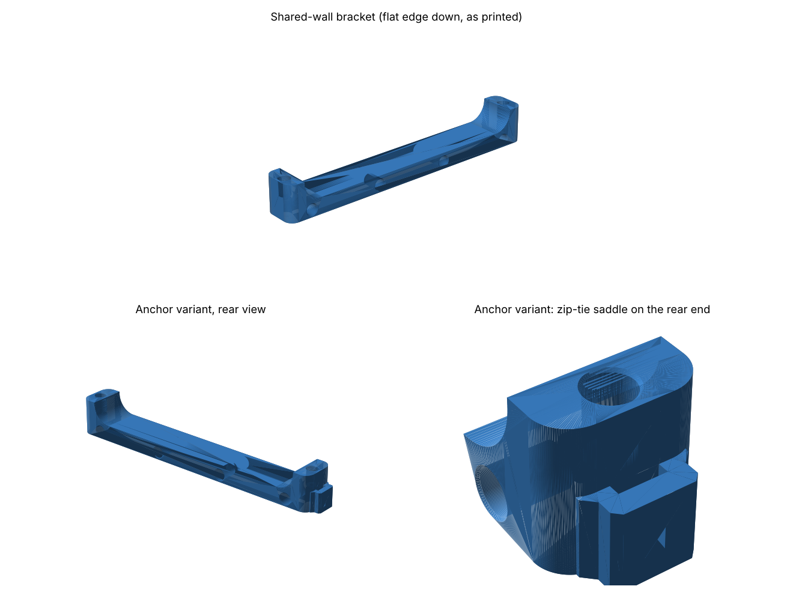

# Shared-wall bracket

Lets two columns of the rack stand side by side and share one centre wall,
instead of standing as two separate towers.



An interactive 3D view is [at the bottom of this page](#interactive-3d-view).
GitHub also shows a rotatable viewer when you open any file in `models/` ending in `.stl`.

The stock bracket has bar sockets on one face only. This part is two stock
brackets back to back in one piece, with bar sockets on both faces and a single
centred row of upright sockets. Nine make a full-height shared wall, and free
up nine stock brackets and a set of uprights from the second kit.

> **Use at your own risk.** Untested hobby design, no warranty, no load rating.
> See the [disclaimer](../DISCLAIMER.md).

## Status

- Geometry is built from caliper measurements of a stock bracket (see the
  [top-level README](../README.md#does-your-rack-match)).
- **Socket fit is untested.** Sockets are 12.3 mm for a 12 mm tube. Print
  `models/fit_test_coupon_v2.stl` first and adjust `--fit-clearance`.
- Two values are judged from photos, not measured: the 20 mm inside corner
  radius and the upright socket centre at 9 mm from the end.
- The `.3mf` projects were generated by script and pass a strict 3MF read, but
  have **not been opened in Snapmaker Orca**. Check the wall count, wall
  generator and slot 1 filament after loading.

## Load warning

The shared uprights carry both columns, roughly double the stock load on those
two tubes. Reviews of this rack report tubes buckling and the tower tipping at
nine loaded tiers. Anchor the rack to a wall and keep heavy spools low. The
[anti-tip wall plate](../anti-tip-wall-plate/) tethers a rear upright to the
wall with a zip tie; the anchor variant here is the alternative when the rack
sits flush against the wall.

## Files

| Path | What it is |
|---|---|
| `shared_wall_bracket.py` | Parametric CadQuery source. Writes STEP and STL. |
| `models/shared_wall_bracket_v2.*` | The bracket (STL, STEP, Snapmaker U1 project). |
| `models/shared_wall_bracket_v2_anchor.*` | Variant with two rear screw ears for wall anchoring. |
| `models/fit_test_coupon_v2.*` | One upright socket and one bar socket, for tuning fit. |
| `legacy/` | First version, drawn from listing photos before measuring. Not for printing. |

## Design

- 40 x 305 x 40 mm: two 18 mm bar sockets and a 4 mm centre web.
- The upright divider is 4 mm to match the stock part. It sets tier height, so
  it must not change, or the centre wall drifts out of level with the outer
  walls on every tier.
- Bar positions and height match the stock bracket, because the far end of
  every bar sits in a stock bracket.
- Outer vertical corners are rounded at 10 mm. No edge next to a socket mouth
  is rounded, so every socket wall keeps its full thickness.

## Printing

- Orientation: flat edge on the bed, no supports.
- Snapmaker U1 (270 x 270 mm bed): the part only fits rotated 45 degrees, one
  per plate, with about 17 mm clear to the bed edge (9 mm for the anchor
  variant).
- 5 wall loops with the Arachne wall generator, so the 1.85, 2.85 and 3.85 mm
  socket walls print as solid perimeters. 15% infill.
- PETG or ABS. A 305 mm ABS part is prone to warping; use a brim and keep
  draughts off it.

## Regenerating

From this folder, with the virtual environment from the top-level README active:

```sh
python3 shared_wall_bracket.py --log-level INFO          # writes out_v2/
python3 shared_wall_bracket.py --fit-clearance 0.35      # looser sockets
```

To rebuild a U1 project you also need the `Snapmaker` folder from
[snapmaker-profiles](https://github.com/Snapmaker/snapmaker-profiles):

```sh
python3 ../tools/make_u1_project.py \
  --stl out_v2/shared_wall_bracket_v2.stl \
  --profiles /path/to/snapmaker-profiles/Snapmaker \
  --out models/shared_wall_bracket_v2_U1_ABS.3mf
```

The project selects the stock `Snapmaker U1 (0.4 nozzle)` printer, the
`0.20mm Standard` process and `Generic ABS @U1 0.4 nozzle` in slot 1, and
overrides only wall loops, wall generator and infill density.

## Interactive 3D view

Drag to rotate. This is a simplified mesh for viewing only (no lead-in chamfers
or vent holes); print from the files in `models/`.

```stl
solid shared_wall_bracket
facet normal 0 0 0
outer loop
vertex 3.5 3.9 0.0
vertex 4.6 4.9 0.0
vertex 10.0 -0.0 0.0
endloop
endfacet
facet normal 0 0 0
outer loop
vertex 5.4 6.1 0.0
vertex 10.0 -0.0 0.0
vertex 4.6 4.9 0.0
endloop
endfacet
facet normal 0 0 0
outer loop
vertex 2.2 3.2 0.0
vertex 3.5 3.9 0.0
vertex 10.0 -0.0 0.0
endloop
endfacet
facet normal 0 0 0
outer loop
vertex 6.0 7.5 0.0
vertex 16.2 2.2 0.0
vertex 14.3 1.0 0.0
endloop
endfacet
facet normal 0 0 0
outer loop
vertex 6.0 7.5 0.0
vertex 14.3 1.0 0.0
vertex 12.2 0.3 0.0
endloop
endfacet
facet normal 0 0 0
outer loop
vertex 6.0 7.5 0.0
vertex 12.2 0.3 0.0
vertex 10.0 -0.0 0.0
endloop
endfacet
facet normal 0 0 0
outer loop
vertex 6.0 7.5 0.0
vertex 10.0 -0.0 0.0
vertex 5.4 6.1 0.0
endloop
endfacet
facet normal 0 0 0
outer loop
vertex 0.7 2.9 0.0
vertex 2.2 3.2 0.0
vertex 10.0 -0.0 0.0
endloop
endfacet
facet normal 0 0 0
outer loop
vertex 6.2 9.0 0.0
vertex 20.0 10.0 0.0
vertex 19.7 7.8 0.0
endloop
endfacet
facet normal 0 0 0
outer loop
vertex 6.2 9.0 0.0
vertex 19.7 7.8 0.0
vertex 19.0 5.7 0.0
endloop
endfacet
facet normal 0 0 0
outer loop
vertex 6.2 9.0 0.0
vertex 19.0 5.7 0.0
vertex 17.8 3.8 0.0
endloop
endfacet
facet normal 0 0 0
outer loop
vertex 6.2 9.0 0.0
vertex 17.8 3.8 0.0
vertex 16.2 2.2 0.0
endloop
endfacet
facet normal 0 0 0
outer loop
vertex 6.2 9.0 0.0
vertex 16.2 2.2 0.0
vertex 6.0 7.5 0.0
endloop
endfacet
facet normal 0 0 0
outer loop
vertex 6.0 10.5 0.0
vertex 20.0 10.0 0.0
vertex 6.2 9.0 0.0
endloop
endfacet
facet normal 0 0 0
outer loop
vertex 5.4 11.9 0.0
vertex 20.0 10.0 0.0
vertex 6.0 10.5 0.0
endloop
endfacet
facet normal 0 0 0
outer loop
vertex 4.6 13.1 0.0
vertex 20.0 10.0 0.0
vertex 5.4 11.9 0.0
endloop
endfacet
facet normal 0 0 0
outer loop
vertex -10.0 -0.0 0.0
vertex 0.7 2.9 0.0
vertex 10.0 -0.0 0.0
endloop
endfacet
facet normal 0 0 0
outer loop
vertex -10.0 -0.0 0.0
vertex -4.6 4.9 0.0
vertex -3.5 3.9 0.0
endloop
endfacet
facet normal 0 0 0
outer loop
vertex -10.0 -0.0 0.0
vertex -3.5 3.9 0.0
vertex -2.2 3.2 0.0
endloop
endfacet
facet normal 0 0 0
outer loop
vertex -10.0 -0.0 0.0
vertex -2.2 3.2 0.0
vertex -0.7 2.9 0.0
endloop
endfacet
facet normal 0 0 0
outer loop
vertex -10.0 -0.0 0.0
vertex -0.7 2.9 0.0
vertex 0.7 2.9 0.0
endloop
endfacet
facet normal 0 0 0
outer loop
vertex 3.5 14.1 0.0
vertex 20.0 10.0 0.0
vertex 4.6 13.1 0.0
endloop
endfacet
facet normal 0 0 0
outer loop
vertex -5.4 6.1 0.0
vertex -4.6 4.9 0.0
vertex -10.0 -0.0 0.0
endloop
endfacet
facet normal 0 0 0
outer loop
vertex 2.2 14.8 0.0
vertex 20.0 10.0 0.0
vertex 3.5 14.1 0.0
endloop
endfacet
facet normal 0 0 0
outer loop
vertex -6.0 7.5 0.0
vertex -10.0 -0.0 0.0
vertex -12.2 0.3 0.0
endloop
endfacet
facet normal 0 0 0
outer loop
vertex -6.0 7.5 0.0
vertex -5.4 6.1 0.0
vertex -10.0 -0.0 0.0
endloop
endfacet
facet normal 0 0 0
outer loop
vertex -14.3 1.0 0.0
vertex -6.0 7.5 0.0
vertex -12.2 0.3 0.0
endloop
endfacet
facet normal 0 0 0
outer loop
vertex -16.2 2.2 0.0
vertex -6.0 7.5 0.0
vertex -14.3 1.0 0.0
endloop
endfacet
facet normal 0 0 0
outer loop
vertex -16.2 2.2 0.0
vertex -6.2 9.0 0.0
vertex -6.0 7.5 0.0
endloop
endfacet
facet normal 0 0 0
outer loop
vertex -17.8 3.8 0.0
vertex -6.2 9.0 0.0
vertex -16.2 2.2 0.0
endloop
endfacet
facet normal 0 0 0
outer loop
vertex -19.0 5.7 0.0
vertex -6.2 9.0 0.0
vertex -17.8 3.8 0.0
endloop
endfacet
facet normal 0 0 0
outer loop
vertex -19.7 7.8 0.0
vertex -6.2 9.0 0.0
vertex -19.0 5.7 0.0
endloop
endfacet
facet normal 0 0 0
outer loop
vertex -20.0 10.0 0.0
vertex -2.2 14.8 0.0
vertex -3.5 14.1 0.0
endloop
endfacet
facet normal 0 0 0
outer loop
vertex -20.0 10.0 0.0
vertex -3.5 14.1 0.0
vertex -4.6 13.1 0.0
endloop
endfacet
facet normal 0 0 0
outer loop
vertex -20.0 10.0 0.0
vertex -4.6 13.1 0.0
vertex -5.4 11.9 0.0
endloop
endfacet
facet normal 0 0 0
outer loop
vertex -20.0 10.0 0.0
vertex -5.4 11.9 0.0
vertex -6.0 10.5 0.0
endloop
endfacet
facet normal 0 0 0
outer loop
vertex -20.0 10.0 0.0
vertex -6.0 10.5 0.0
vertex -6.2 9.0 0.0
endloop
endfacet
facet normal 0 0 0
outer loop
vertex -20.0 10.0 0.0
vertex -6.2 9.0 0.0
vertex -19.7 7.8 0.0
endloop
endfacet
facet normal 0 0 0
outer loop
vertex 20.0 295.0 0.0
vertex 20.0 10.0 0.0
vertex 2.2 14.8 0.0
endloop
endfacet
facet normal 0 0 0
outer loop
vertex 3.5 290.9 0.0
vertex 4.6 291.9 0.0
vertex 20.0 295.0 0.0
endloop
endfacet
facet normal 0 0 0
outer loop
vertex 5.4 293.1 0.0
vertex 20.0 295.0 0.0
vertex 4.6 291.9 0.0
endloop
endfacet
facet normal 0 0 0
outer loop
vertex 2.2 290.2 0.0
vertex 20.0 295.0 0.0
vertex 2.2 14.8 0.0
endloop
endfacet
facet normal 0 0 0
outer loop
vertex 2.2 290.2 0.0
vertex 3.5 290.9 0.0
vertex 20.0 295.0 0.0
endloop
endfacet
facet normal 0 0 0
outer loop
vertex 6.0 294.5 0.0
vertex 20.0 295.0 0.0
vertex 5.4 293.1 0.0
endloop
endfacet
facet normal 0 0 0
outer loop
vertex 0.7 289.9 0.0
vertex 2.2 14.8 0.0
vertex 0.7 15.1 0.0
endloop
endfacet
facet normal 0 0 0
outer loop
vertex 0.7 289.9 0.0
vertex 2.2 290.2 0.0
vertex 2.2 14.8 0.0
endloop
endfacet
facet normal 0 0 0
outer loop
vertex 6.2 296.0 0.0
vertex 16.2 302.8 0.0
vertex 17.8 301.2 0.0
endloop
endfacet
facet normal 0 0 0
outer loop
vertex 6.2 296.0 0.0
vertex 17.8 301.2 0.0
vertex 19.0 299.3 0.0
endloop
endfacet
facet normal 0 0 0
outer loop
vertex 6.2 296.0 0.0
vertex 19.0 299.3 0.0
vertex 19.7 297.2 0.0
endloop
endfacet
facet normal 0 0 0
outer loop
vertex 6.2 296.0 0.0
vertex 19.7 297.2 0.0
vertex 20.0 295.0 0.0
endloop
endfacet
facet normal 0 0 0
outer loop
vertex 6.2 296.0 0.0
vertex 20.0 295.0 0.0
vertex 6.0 294.5 0.0
endloop
endfacet
facet normal 0 0 0
outer loop
vertex -0.7 289.9 0.0
vertex 0.7 15.1 0.0
vertex -0.7 15.1 0.0
endloop
endfacet
facet normal 0 0 0
outer loop
vertex -0.7 289.9 0.0
vertex 0.7 289.9 0.0
vertex 0.7 15.1 0.0
endloop
endfacet
facet normal 0 0 0
outer loop
vertex 6.0 297.5 0.0
vertex 14.3 304.0 0.0
vertex 16.2 302.8 0.0
endloop
endfacet
facet normal 0 0 0
outer loop
vertex 6.0 297.5 0.0
vertex 16.2 302.8 0.0
vertex 6.2 296.0 0.0
endloop
endfacet
facet normal 0 0 0
outer loop
vertex -2.2 290.2 0.0
vertex -0.7 15.1 0.0
vertex -2.2 14.8 0.0
endloop
endfacet
facet normal 0 0 0
outer loop
vertex -2.2 290.2 0.0
vertex -2.2 14.8 0.0
vertex -20.0 10.0 0.0
endloop
endfacet
facet normal 0 0 0
outer loop
vertex -2.2 290.2 0.0
vertex -0.7 289.9 0.0
vertex -0.7 15.1 0.0
endloop
endfacet
facet normal 0 0 0
outer loop
vertex 12.2 304.7 0.0
vertex 14.3 304.0 0.0
vertex 6.0 297.5 0.0
endloop
endfacet
facet normal 0 0 0
outer loop
vertex 10.0 305.0 0.0
vertex 12.2 304.7 0.0
vertex 6.0 297.5 0.0
endloop
endfacet
facet normal 0 0 0
outer loop
vertex 10.0 305.0 0.0
vertex 6.0 297.5 0.0
vertex 5.4 298.9 0.0
endloop
endfacet
facet normal 0 0 0
outer loop
vertex 4.6 300.1 0.0
vertex 10.0 305.0 0.0
vertex 5.4 298.9 0.0
endloop
endfacet
facet normal 0 0 0
outer loop
vertex 3.5 301.1 0.0
vertex 10.0 305.0 0.0
vertex 4.6 300.1 0.0
endloop
endfacet
facet normal 0 0 0
outer loop
vertex 2.2 301.8 0.0
vertex 10.0 305.0 0.0
vertex 3.5 301.1 0.0
endloop
endfacet
facet normal 0 0 0
outer loop
vertex 0.7 302.1 0.0
vertex 10.0 305.0 0.0
vertex 2.2 301.8 0.0
endloop
endfacet
facet normal 0 0 0
outer loop
vertex -10.0 305.0 0.0
vertex 10.0 305.0 0.0
vertex 0.7 302.1 0.0
endloop
endfacet
facet normal 0 0 0
outer loop
vertex -10.0 305.0 0.0
vertex 0.7 302.1 0.0
vertex -0.7 302.1 0.0
endloop
endfacet
facet normal 0 0 0
outer loop
vertex -10.0 305.0 0.0
vertex -0.7 302.1 0.0
vertex -2.2 301.8 0.0
endloop
endfacet
facet normal 0 0 0
outer loop
vertex -10.0 305.0 0.0
vertex -2.2 301.8 0.0
vertex -3.5 301.1 0.0
endloop
endfacet
facet normal 0 0 0
outer loop
vertex -10.0 305.0 0.0
vertex -3.5 301.1 0.0
vertex -4.6 300.1 0.0
endloop
endfacet
facet normal 0 0 0
outer loop
vertex -10.0 305.0 0.0
vertex -4.6 300.1 0.0
vertex -5.4 298.9 0.0
endloop
endfacet
facet normal 0 0 0
outer loop
vertex -10.0 305.0 0.0
vertex -5.4 298.9 0.0
vertex -6.0 297.5 0.0
endloop
endfacet
facet normal 0 0 0
outer loop
vertex -20.0 295.0 0.0
vertex -6.2 296.0 0.0
vertex -6.0 294.5 0.0
endloop
endfacet
facet normal 0 0 0
outer loop
vertex -20.0 295.0 0.0
vertex -6.0 294.5 0.0
vertex -5.4 293.1 0.0
endloop
endfacet
facet normal 0 0 0
outer loop
vertex -20.0 295.0 0.0
vertex -5.4 293.1 0.0
vertex -4.6 291.9 0.0
endloop
endfacet
facet normal 0 0 0
outer loop
vertex -20.0 295.0 0.0
vertex -4.6 291.9 0.0
vertex -3.5 290.9 0.0
endloop
endfacet
facet normal 0 0 0
outer loop
vertex -20.0 295.0 0.0
vertex -3.5 290.9 0.0
vertex -2.2 290.2 0.0
endloop
endfacet
facet normal 0 0 0
outer loop
vertex -20.0 295.0 0.0
vertex -2.2 290.2 0.0
vertex -20.0 10.0 0.0
endloop
endfacet
facet normal 0 0 0
outer loop
vertex -19.7 297.2 0.0
vertex -6.2 296.0 0.0
vertex -20.0 295.0 0.0
endloop
endfacet
facet normal 0 0 0
outer loop
vertex -12.2 304.7 0.0
vertex -10.0 305.0 0.0
vertex -6.0 297.5 0.0
endloop
endfacet
facet normal 0 0 0
outer loop
vertex -19.0 299.3 0.0
vertex -6.2 296.0 0.0
vertex -19.7 297.2 0.0
endloop
endfacet
facet normal 0 0 0
outer loop
vertex -14.3 304.0 0.0
vertex -12.2 304.7 0.0
vertex -6.0 297.5 0.0
endloop
endfacet
facet normal 0 0 0
outer loop
vertex -17.8 301.2 0.0
vertex -6.2 296.0 0.0
vertex -19.0 299.3 0.0
endloop
endfacet
facet normal 0 0 0
outer loop
vertex -16.2 302.8 0.0
vertex -14.3 304.0 0.0
vertex -6.0 297.5 0.0
endloop
endfacet
facet normal 0 0 0
outer loop
vertex -16.2 302.8 0.0
vertex -6.2 296.0 0.0
vertex -17.8 301.2 0.0
endloop
endfacet
facet normal 0 0 0
outer loop
vertex -16.2 302.8 0.0
vertex -6.0 297.5 0.0
vertex -6.2 296.0 0.0
endloop
endfacet
facet normal 0 0 0
outer loop
vertex -10.0 -0.0 0.0
vertex 10.0 -0.0 40.0
vertex -10.0 -0.0 40.0
endloop
endfacet
facet normal 0 0 0
outer loop
vertex -10.0 -0.0 0.0
vertex 10.0 -0.0 0.0
vertex 10.0 -0.0 40.0
endloop
endfacet
facet normal 0 0 0
outer loop
vertex 19.7 7.8 0.0
vertex 20.0 10.0 40.0
vertex 19.7 7.8 40.0
endloop
endfacet
facet normal 0 0 0
outer loop
vertex 19.7 7.8 0.0
vertex 20.0 10.0 0.0
vertex 20.0 10.0 40.0
endloop
endfacet
facet normal 0 0 0
outer loop
vertex 19.0 5.7 0.0
vertex 19.7 7.8 40.0
vertex 19.0 5.7 40.0
endloop
endfacet
facet normal 0 0 0
outer loop
vertex 19.0 5.7 0.0
vertex 19.0 5.7 40.0
vertex 17.8 3.8 40.0
endloop
endfacet
facet normal 0 0 0
outer loop
vertex 19.0 5.7 0.0
vertex 19.7 7.8 0.0
vertex 19.7 7.8 40.0
endloop
endfacet
facet normal 0 0 0
outer loop
vertex 17.8 3.8 0.0
vertex 19.0 5.7 0.0
vertex 17.8 3.8 40.0
endloop
endfacet
facet normal 0 0 0
outer loop
vertex 16.2 2.2 0.0
vertex 17.8 3.8 40.0
vertex 16.2 2.2 40.0
endloop
endfacet
facet normal 0 0 0
outer loop
vertex 16.2 2.2 0.0
vertex 17.8 3.8 0.0
vertex 17.8 3.8 40.0
endloop
endfacet
facet normal 0 0 0
outer loop
vertex 14.3 1.0 0.0
vertex 16.2 2.2 40.0
vertex 14.3 1.0 40.0
endloop
endfacet
facet normal 0 0 0
outer loop
vertex 14.3 1.0 0.0
vertex 14.3 1.0 40.0
vertex 12.2 0.3 40.0
endloop
endfacet
facet normal 0 0 0
outer loop
vertex 14.3 1.0 0.0
vertex 16.2 2.2 0.0
vertex 16.2 2.2 40.0
endloop
endfacet
facet normal 0 0 0
outer loop
vertex 12.2 0.3 0.0
vertex 14.3 1.0 0.0
vertex 12.2 0.3 40.0
endloop
endfacet
facet normal 0 0 0
outer loop
vertex 10.0 -0.0 0.0
vertex 12.2 0.3 40.0
vertex 10.0 -0.0 40.0
endloop
endfacet
facet normal 0 0 0
outer loop
vertex 10.0 -0.0 0.0
vertex 12.2 0.3 0.0
vertex 12.2 0.3 40.0
endloop
endfacet
facet normal 0 0 0
outer loop
vertex -19.7 7.8 0.0
vertex -19.7 7.8 40.0
vertex -20.0 10.0 40.0
endloop
endfacet
facet normal 0 0 0
outer loop
vertex -19.7 7.8 0.0
vertex -20.0 10.0 40.0
vertex -20.0 10.0 0.0
endloop
endfacet
facet normal 0 0 0
outer loop
vertex -19.0 5.7 0.0
vertex -19.0 5.7 40.0
vertex -19.7 7.8 40.0
endloop
endfacet
facet normal 0 0 0
outer loop
vertex -19.0 5.7 0.0
vertex -17.8 3.8 40.0
vertex -19.0 5.7 40.0
endloop
endfacet
facet normal 0 0 0
outer loop
vertex -19.0 5.7 0.0
vertex -19.7 7.8 40.0
vertex -19.7 7.8 0.0
endloop
endfacet
facet normal 0 0 0
outer loop
vertex -17.8 3.8 0.0
vertex -17.8 3.8 40.0
vertex -19.0 5.7 0.0
endloop
endfacet
facet normal 0 0 0
outer loop
vertex -16.2 2.2 0.0
vertex -16.2 2.2 40.0
vertex -17.8 3.8 40.0
endloop
endfacet
facet normal 0 0 0
outer loop
vertex -16.2 2.2 0.0
vertex -17.8 3.8 40.0
vertex -17.8 3.8 0.0
endloop
endfacet
facet normal 0 0 0
outer loop
vertex -14.3 1.0 0.0
vertex -14.3 1.0 40.0
vertex -16.2 2.2 40.0
endloop
endfacet
facet normal 0 0 0
outer loop
vertex -14.3 1.0 0.0
vertex -12.2 0.3 40.0
vertex -14.3 1.0 40.0
endloop
endfacet
facet normal 0 0 0
outer loop
vertex -14.3 1.0 0.0
vertex -16.2 2.2 40.0
vertex -16.2 2.2 0.0
endloop
endfacet
facet normal 0 0 0
outer loop
vertex -12.2 0.3 0.0
vertex -12.2 0.3 40.0
vertex -14.3 1.0 0.0
endloop
endfacet
facet normal 0 0 0
outer loop
vertex -10.0 -0.0 0.0
vertex -10.0 -0.0 40.0
vertex -12.2 0.3 40.0
endloop
endfacet
facet normal 0 0 0
outer loop
vertex -10.0 -0.0 0.0
vertex -12.2 0.3 40.0
vertex -12.2 0.3 0.0
endloop
endfacet
facet normal 0 0 0
outer loop
vertex 20.0 281.5 2.9
vertex 20.0 295.0 0.0
vertex 20.0 282.6 3.9
endloop
endfacet
facet normal 0 0 0
outer loop
vertex 20.0 283.4 5.1
vertex 20.0 282.6 3.9
vertex 20.0 295.0 0.0
endloop
endfacet
facet normal 0 0 0
outer loop
vertex 20.0 280.2 2.2
vertex 20.0 295.0 0.0
vertex 20.0 281.5 2.9
endloop
endfacet
facet normal 0 0 0
outer loop
vertex 20.0 284.0 6.5
vertex 20.0 283.4 5.1
vertex 20.0 295.0 0.0
endloop
endfacet
facet normal 0 0 0
outer loop
vertex 20.0 278.7 1.9
vertex 20.0 295.0 0.0
vertex 20.0 280.2 2.2
endloop
endfacet
facet normal 0 0 0
outer loop
vertex 20.0 284.1 8.0
vertex 20.0 284.0 6.5
vertex 20.0 295.0 0.0
endloop
endfacet
facet normal 0 0 0
outer loop
vertex 20.0 277.3 1.9
vertex 20.0 295.0 0.0
vertex 20.0 278.7 1.9
endloop
endfacet
facet normal 0 0 0
outer loop
vertex 20.0 284.0 9.5
vertex 20.0 284.1 8.0
vertex 20.0 295.0 0.0
endloop
endfacet
facet normal 0 0 0
outer loop
vertex 20.0 283.4 10.9
vertex 20.0 284.0 9.5
vertex 20.0 295.0 0.0
endloop
endfacet
facet normal 0 0 0
outer loop
vertex 20.0 279.5 22.4
vertex 20.0 280.2 13.8
vertex 20.0 281.5 13.1
endloop
endfacet
facet normal 0 0 0
outer loop
vertex 20.0 279.5 22.4
vertex 20.0 278.7 14.1
vertex 20.0 280.2 13.8
endloop
endfacet
facet normal 0 0 0
outer loop
vertex 20.0 282.6 25.5
vertex 20.0 282.6 12.1
vertex 20.0 283.4 10.9
endloop
endfacet
facet normal 0 0 0
outer loop
vertex 20.0 282.6 25.5
vertex 20.0 281.5 13.1
vertex 20.0 282.6 12.1
endloop
endfacet
facet normal 0 0 0
outer loop
vertex 20.0 282.6 25.5
vertex 20.0 279.5 22.4
vertex 20.0 281.5 13.1
endloop
endfacet
facet normal 0 0 0
outer loop
vertex 20.0 275.7 20.0
vertex 20.0 277.3 14.1
vertex 20.0 278.7 14.1
endloop
endfacet
facet normal 0 0 0
outer loop
vertex 20.0 275.7 20.0
vertex 20.0 275.8 13.8
vertex 20.0 277.3 14.1
endloop
endfacet
facet normal 0 0 0
outer loop
vertex 20.0 275.7 20.0
vertex 20.0 278.7 14.1
vertex 20.0 279.5 22.4
endloop
endfacet
facet normal 0 0 0
outer loop
vertex 20.0 285.0 29.3
vertex 20.0 283.4 10.9
vertex 20.0 295.0 0.0
endloop
endfacet
facet normal 0 0 0
outer loop
vertex 20.0 285.0 29.3
vertex 20.0 282.6 25.5
vertex 20.0 283.4 10.9
endloop
endfacet
facet normal 0 0 0
outer loop
vertex 20.0 295.0 40.0
vertex 20.0 285.0 29.3
vertex 20.0 295.0 0.0
endloop
endfacet
facet normal 0 0 0
outer loop
vertex 20.0 271.5 18.5
vertex 20.0 274.5 13.1
vertex 20.0 275.8 13.8
endloop
endfacet
facet normal 0 0 0
outer loop
vertex 20.0 271.5 18.5
vertex 20.0 273.4 12.1
vertex 20.0 274.5 13.1
endloop
endfacet
facet normal 0 0 0
outer loop
vertex 20.0 271.5 18.5
vertex 20.0 275.8 13.8
vertex 20.0 275.7 20.0
endloop
endfacet
facet normal 0 0 0
outer loop
vertex 20.0 286.5 33.5
vertex 20.0 285.0 29.3
vertex 20.0 295.0 40.0
endloop
endfacet
facet normal 0 0 0
outer loop
vertex 20.0 287.0 38.0
vertex 20.0 286.5 33.5
vertex 20.0 295.0 40.0
endloop
endfacet
facet normal 0 0 0
outer loop
vertex 20.0 267.0 18.0
vertex 20.0 272.6 10.9
vertex 20.0 273.4 12.1
endloop
endfacet
facet normal 0 0 0
outer loop
vertex 20.0 267.0 18.0
vertex 20.0 272.0 9.5
vertex 20.0 272.6 10.9
endloop
endfacet
facet normal 0 0 0
outer loop
vertex 20.0 267.0 18.0
vertex 20.0 271.9 8.0
vertex 20.0 272.0 9.5
endloop
endfacet
facet normal 0 0 0
outer loop
vertex 20.0 267.0 18.0
vertex 20.0 272.0 6.5
vertex 20.0 271.9 8.0
endloop
endfacet
facet normal 0 0 0
outer loop
vertex 20.0 267.0 18.0
vertex 20.0 273.4 12.1
vertex 20.0 271.5 18.5
endloop
endfacet
facet normal 0 0 0
outer loop
vertex 20.0 287.0 40.0
vertex 20.0 287.0 38.0
vertex 20.0 295.0 40.0
endloop
endfacet
facet normal 0 0 0
outer loop
vertex 20.0 197.5 2.9
vertex 20.0 273.4 3.9
vertex 20.0 198.6 3.9
endloop
endfacet
facet normal 0 0 0
outer loop
vertex 20.0 197.5 2.9
vertex 20.0 274.5 2.9
vertex 20.0 273.4 3.9
endloop
endfacet
facet normal 0 0 0
outer loop
vertex 20.0 199.4 5.1
vertex 20.0 198.6 3.9
vertex 20.0 273.4 3.9
endloop
endfacet
facet normal 0 0 0
outer loop
vertex 20.0 199.4 5.1
vertex 20.0 273.4 3.9
vertex 20.0 272.6 5.1
endloop
endfacet
facet normal 0 0 0
outer loop
vertex 20.0 196.2 2.2
vertex 20.0 274.5 2.9
vertex 20.0 197.5 2.9
endloop
endfacet
facet normal 0 0 0
outer loop
vertex 20.0 196.2 2.2
vertex 20.0 275.8 2.2
vertex 20.0 274.5 2.9
endloop
endfacet
facet normal 0 0 0
outer loop
vertex 20.0 196.2 2.2
vertex 20.0 277.3 1.9
vertex 20.0 275.8 2.2
endloop
endfacet
facet normal 0 0 0
outer loop
vertex 20.0 200.0 6.5
vertex 20.0 272.0 6.5
vertex 20.0 267.0 18.0
endloop
endfacet
facet normal 0 0 0
outer loop
vertex 20.0 200.0 6.5
vertex 20.0 199.4 5.1
vertex 20.0 272.6 5.1
endloop
endfacet
facet normal 0 0 0
outer loop
vertex 20.0 200.0 6.5
vertex 20.0 272.6 5.1
vertex 20.0 272.0 6.5
endloop
endfacet
facet normal 0 0 0
outer loop
vertex 20.0 194.7 1.9
vertex 20.0 277.3 1.9
vertex 20.0 196.2 2.2
endloop
endfacet
facet normal 0 0 0
outer loop
vertex 20.0 200.2 8.0
vertex 20.0 200.0 6.5
vertex 20.0 267.0 18.0
endloop
endfacet
facet normal 0 0 0
outer loop
vertex 20.0 200.0 9.5
vertex 20.0 200.2 8.0
vertex 20.0 267.0 18.0
endloop
endfacet
facet normal 0 0 0
outer loop
vertex 20.0 199.4 10.9
vertex 20.0 200.0 9.5
vertex 20.0 267.0 18.0
endloop
endfacet
facet normal 0 0 0
outer loop
vertex 20.0 198.6 12.1
vertex 20.0 199.4 10.9
vertex 20.0 267.0 18.0
endloop
endfacet
facet normal 0 0 0
outer loop
vertex 20.0 197.5 13.1
vertex 20.0 198.6 12.1
vertex 20.0 267.0 18.0
endloop
endfacet
facet normal 0 0 0
outer loop
vertex 20.0 196.2 13.8
vertex 20.0 197.5 13.1
vertex 20.0 267.0 18.0
endloop
endfacet
facet normal 0 0 0
outer loop
vertex 20.0 113.5 2.9
vertex 20.0 189.4 3.9
vertex 20.0 114.6 3.9
endloop
endfacet
facet normal 0 0 0
outer loop
vertex 20.0 113.5 2.9
vertex 20.0 190.5 2.9
vertex 20.0 189.4 3.9
endloop
endfacet
facet normal 0 0 0
outer loop
vertex 20.0 113.5 2.9
vertex 20.0 191.8 2.2
vertex 20.0 190.5 2.9
endloop
endfacet
facet normal 0 0 0
outer loop
vertex 20.0 115.4 5.1
vertex 20.0 114.6 3.9
vertex 20.0 189.4 3.9
endloop
endfacet
facet normal 0 0 0
outer loop
vertex 20.0 115.4 5.1
vertex 20.0 189.4 3.9
vertex 20.0 188.6 5.1
endloop
endfacet
facet normal 0 0 0
outer loop
vertex 20.0 112.2 2.2
vertex 20.0 191.8 2.2
vertex 20.0 113.5 2.9
endloop
endfacet
facet normal 0 0 0
outer loop
vertex 20.0 112.2 2.2
vertex 20.0 193.3 1.9
vertex 20.0 191.8 2.2
endloop
endfacet
facet normal 0 0 0
outer loop
vertex 20.0 116.0 6.5
vertex 20.0 115.4 5.1
vertex 20.0 188.6 5.1
endloop
endfacet
facet normal 0 0 0
outer loop
vertex 20.0 116.0 6.5
vertex 20.0 188.0 6.5
vertex 20.0 187.8 8.0
endloop
endfacet
facet normal 0 0 0
outer loop
vertex 20.0 116.0 6.5
vertex 20.0 188.6 5.1
vertex 20.0 188.0 6.5
endloop
endfacet
facet normal 0 0 0
outer loop
vertex 20.0 110.7 1.9
vertex 20.0 193.3 1.9
vertex 20.0 112.2 2.2
endloop
endfacet
facet normal 0 0 0
outer loop
vertex 20.0 116.2 8.0
vertex 20.0 116.0 6.5
vertex 20.0 187.8 8.0
endloop
endfacet
facet normal 0 0 0
outer loop
vertex 20.0 116.2 8.0
vertex 20.0 187.8 8.0
vertex 20.0 188.0 9.5
endloop
endfacet
facet normal 0 0 0
outer loop
vertex 20.0 116.0 9.5
vertex 20.0 116.2 8.0
vertex 20.0 188.0 9.5
endloop
endfacet
facet normal 0 0 0
outer loop
vertex 20.0 115.4 10.9
vertex 20.0 188.0 9.5
vertex 20.0 188.6 10.9
endloop
endfacet
facet normal 0 0 0
outer loop
vertex 20.0 115.4 10.9
vertex 20.0 116.0 9.5
vertex 20.0 188.0 9.5
endloop
endfacet
facet normal 0 0 0
outer loop
vertex 20.0 114.6 12.1
vertex 20.0 115.4 10.9
vertex 20.0 188.6 10.9
endloop
endfacet
facet normal 0 0 0
outer loop
vertex 20.0 114.6 12.1
vertex 20.0 189.4 12.1
vertex 20.0 190.5 13.1
endloop
endfacet
facet normal 0 0 0
outer loop
vertex 20.0 114.6 12.1
vertex 20.0 188.6 10.9
vertex 20.0 189.4 12.1
endloop
endfacet
facet normal 0 0 0
outer loop
vertex 20.0 113.5 13.1
vertex 20.0 114.6 12.1
vertex 20.0 190.5 13.1
endloop
endfacet
facet normal 0 0 0
outer loop
vertex 20.0 112.2 13.8
vertex 20.0 190.5 13.1
vertex 20.0 191.8 13.8
endloop
endfacet
facet normal 0 0 0
outer loop
vertex 20.0 112.2 13.8
vertex 20.0 113.5 13.1
vertex 20.0 190.5 13.1
endloop
endfacet
facet normal 0 0 0
outer loop
vertex 20.0 110.7 14.1
vertex 20.0 191.8 13.8
vertex 20.0 193.3 14.1
endloop
endfacet
facet normal 0 0 0
outer loop
vertex 20.0 110.7 14.1
vertex 20.0 112.2 13.8
vertex 20.0 191.8 13.8
endloop
endfacet
facet normal 0 0 0
outer loop
vertex 20.0 30.6 3.9
vertex 20.0 106.5 2.9
vertex 20.0 105.4 3.9
endloop
endfacet
facet normal 0 0 0
outer loop
vertex 20.0 29.5 2.9
vertex 20.0 106.5 2.9
vertex 20.0 30.6 3.9
endloop
endfacet
facet normal 0 0 0
outer loop
vertex 20.0 31.4 5.1
vertex 20.0 30.6 3.9
vertex 20.0 105.4 3.9
endloop
endfacet
facet normal 0 0 0
outer loop
vertex 20.0 31.4 5.1
vertex 20.0 104.6 5.1
vertex 20.0 104.0 6.5
endloop
endfacet
facet normal 0 0 0
outer loop
vertex 20.0 31.4 5.1
vertex 20.0 105.4 3.9
vertex 20.0 104.6 5.1
endloop
endfacet
facet normal 0 0 0
outer loop
vertex 20.0 28.2 2.2
vertex 20.0 106.5 2.9
vertex 20.0 29.5 2.9
endloop
endfacet
facet normal 0 0 0
outer loop
vertex 20.0 28.2 2.2
vertex 20.0 107.8 2.2
vertex 20.0 106.5 2.9
endloop
endfacet
facet normal 0 0 0
outer loop
vertex 20.0 32.0 6.5
vertex 20.0 31.4 5.1
vertex 20.0 104.0 6.5
endloop
endfacet
facet normal 0 0 0
outer loop
vertex 20.0 26.7 1.9
vertex 20.0 107.8 2.2
vertex 20.0 28.2 2.2
endloop
endfacet
facet normal 0 0 0
outer loop
vertex 20.0 26.7 1.9
vertex 20.0 109.3 1.9
vertex 20.0 107.8 2.2
endloop
endfacet
facet normal 0 0 0
outer loop
vertex 20.0 38.0 18.0
vertex 20.0 32.0 9.5
vertex 20.0 32.1 8.0
endloop
endfacet
facet normal 0 0 0
outer loop
vertex 20.0 38.0 18.0
vertex 20.0 31.4 10.9
vertex 20.0 32.0 9.5
endloop
endfacet
facet normal 0 0 0
outer loop
vertex 20.0 38.0 18.0
vertex 20.0 32.1 8.0
vertex 20.0 32.0 6.5
endloop
endfacet
facet normal 0 0 0
outer loop
vertex 20.0 38.0 18.0
vertex 20.0 106.5 13.1
vertex 20.0 107.8 13.8
endloop
endfacet
facet normal 0 0 0
outer loop
vertex 20.0 38.0 18.0
vertex 20.0 105.4 12.1
vertex 20.0 106.5 13.1
endloop
endfacet
facet normal 0 0 0
outer loop
vertex 20.0 38.0 18.0
vertex 20.0 104.6 10.9
vertex 20.0 105.4 12.1
endloop
endfacet
facet normal 0 0 0
outer loop
vertex 20.0 38.0 18.0
vertex 20.0 104.0 9.5
vertex 20.0 104.6 10.9
endloop
endfacet
facet normal 0 0 0
outer loop
vertex 20.0 38.0 18.0
vertex 20.0 103.8 8.0
vertex 20.0 104.0 9.5
endloop
endfacet
facet normal 0 0 0
outer loop
vertex 20.0 38.0 18.0
vertex 20.0 104.0 6.5
vertex 20.0 103.8 8.0
endloop
endfacet
facet normal 0 0 0
outer loop
vertex 20.0 38.0 18.0
vertex 20.0 32.0 6.5
vertex 20.0 104.0 6.5
endloop
endfacet
facet normal 0 0 0
outer loop
vertex 20.0 33.5 18.5
vertex 20.0 30.6 12.1
vertex 20.0 31.4 10.9
endloop
endfacet
facet normal 0 0 0
outer loop
vertex 20.0 33.5 18.5
vertex 20.0 29.5 13.1
vertex 20.0 30.6 12.1
endloop
endfacet
facet normal 0 0 0
outer loop
vertex 20.0 33.5 18.5
vertex 20.0 31.4 10.9
vertex 20.0 38.0 18.0
endloop
endfacet
facet normal 0 0 0
outer loop
vertex 20.0 10.0 0.0
vertex 20.0 19.9 8.0
vertex 20.0 20.0 9.5
endloop
endfacet
facet normal 0 0 0
outer loop
vertex 20.0 10.0 0.0
vertex 20.0 20.0 6.5
vertex 20.0 19.9 8.0
endloop
endfacet
facet normal 0 0 0
outer loop
vertex 20.0 10.0 0.0
vertex 20.0 20.6 5.1
vertex 20.0 20.0 6.5
endloop
endfacet
facet normal 0 0 0
outer loop
vertex 20.0 10.0 0.0
vertex 20.0 21.4 3.9
vertex 20.0 20.6 5.1
endloop
endfacet
facet normal 0 0 0
outer loop
vertex 20.0 10.0 0.0
vertex 20.0 22.5 2.9
vertex 20.0 21.4 3.9
endloop
endfacet
facet normal 0 0 0
outer loop
vertex 20.0 10.0 0.0
vertex 20.0 23.8 2.2
vertex 20.0 22.5 2.9
endloop
endfacet
facet normal 0 0 0
outer loop
vertex 20.0 10.0 0.0
vertex 20.0 25.3 1.9
vertex 20.0 23.8 2.2
endloop
endfacet
facet normal 0 0 0
outer loop
vertex 20.0 10.0 0.0
vertex 20.0 26.7 1.9
vertex 20.0 25.3 1.9
endloop
endfacet
facet normal 0 0 0
outer loop
vertex 20.0 20.6 10.9
vertex 20.0 10.0 0.0
vertex 20.0 20.0 9.5
endloop
endfacet
facet normal 0 0 0
outer loop
vertex 20.0 29.3 20.0
vertex 20.0 28.2 13.8
vertex 20.0 29.5 13.1
endloop
endfacet
facet normal 0 0 0
outer loop
vertex 20.0 29.3 20.0
vertex 20.0 26.7 14.1
vertex 20.0 28.2 13.8
endloop
endfacet
facet normal 0 0 0
outer loop
vertex 20.0 29.3 20.0
vertex 20.0 25.3 14.1
vertex 20.0 26.7 14.1
endloop
endfacet
facet normal 0 0 0
outer loop
vertex 20.0 29.3 20.0
vertex 20.0 29.5 13.1
vertex 20.0 33.5 18.5
endloop
endfacet
facet normal 0 0 0
outer loop
vertex 20.0 25.5 22.4
vertex 20.0 23.8 13.8
vertex 20.0 25.3 14.1
endloop
endfacet
facet normal 0 0 0
outer loop
vertex 20.0 25.5 22.4
vertex 20.0 22.5 13.1
vertex 20.0 23.8 13.8
endloop
endfacet
facet normal 0 0 0
outer loop
vertex 20.0 25.5 22.4
vertex 20.0 25.3 14.1
vertex 20.0 29.3 20.0
endloop
endfacet
facet normal 0 0 0
outer loop
vertex 20.0 22.4 25.5
vertex 20.0 21.4 12.1
vertex 20.0 22.5 13.1
endloop
endfacet
facet normal 0 0 0
outer loop
vertex 20.0 22.4 25.5
vertex 20.0 20.6 10.9
vertex 20.0 21.4 12.1
endloop
endfacet
facet normal 0 0 0
outer loop
vertex 20.0 22.4 25.5
vertex 20.0 22.5 13.1
vertex 20.0 25.5 22.4
endloop
endfacet
facet normal 0 0 0
outer loop
vertex 20.0 20.0 29.3
vertex 20.0 10.0 0.0
vertex 20.0 20.6 10.9
endloop
endfacet
facet normal 0 0 0
outer loop
vertex 20.0 20.0 29.3
vertex 20.0 20.6 10.9
vertex 20.0 22.4 25.5
endloop
endfacet
facet normal 0 0 0
outer loop
vertex 20.0 10.0 40.0
vertex 20.0 20.0 29.3
vertex 20.0 18.5 33.5
endloop
endfacet
facet normal 0 0 0
outer loop
vertex 20.0 10.0 40.0
vertex 20.0 18.5 33.5
vertex 20.0 18.0 38.0
endloop
endfacet
facet normal 0 0 0
outer loop
vertex 20.0 10.0 40.0
vertex 20.0 18.0 38.0
vertex 20.0 18.0 40.0
endloop
endfacet
facet normal 0 0 0
outer loop
vertex 20.0 10.0 40.0
vertex 20.0 10.0 0.0
vertex 20.0 20.0 29.3
endloop
endfacet
facet normal 0 0 0
outer loop
vertex 20.0 10.0 0.0
vertex 20.0 295.0 0.0
vertex 20.0 194.7 1.9
endloop
endfacet
facet normal 0 0 0
outer loop
vertex 20.0 194.7 1.9
vertex 20.0 295.0 0.0
vertex 20.0 277.3 1.9
endloop
endfacet
facet normal 0 0 0
outer loop
vertex 20.0 10.0 0.0
vertex 20.0 194.7 1.9
vertex 20.0 193.3 1.9
endloop
endfacet
facet normal 0 0 0
outer loop
vertex 20.0 10.0 0.0
vertex 20.0 193.3 1.9
vertex 20.0 110.7 1.9
endloop
endfacet
facet normal 0 0 0
outer loop
vertex 20.0 10.0 0.0
vertex 20.0 110.7 1.9
vertex 20.0 109.3 1.9
endloop
endfacet
facet normal 0 0 0
outer loop
vertex 20.0 10.0 0.0
vertex 20.0 109.3 1.9
vertex 20.0 26.7 1.9
endloop
endfacet
facet normal 0 0 0
outer loop
vertex 20.0 267.0 18.0
vertex 20.0 38.0 18.0
vertex 20.0 109.3 14.1
endloop
endfacet
facet normal 0 0 0
outer loop
vertex 20.0 109.3 14.1
vertex 20.0 38.0 18.0
vertex 20.0 107.8 13.8
endloop
endfacet
facet normal 0 0 0
outer loop
vertex 20.0 267.0 18.0
vertex 20.0 109.3 14.1
vertex 20.0 110.7 14.1
endloop
endfacet
facet normal 0 0 0
outer loop
vertex 20.0 267.0 18.0
vertex 20.0 110.7 14.1
vertex 20.0 193.3 14.1
endloop
endfacet
facet normal 0 0 0
outer loop
vertex 20.0 267.0 18.0
vertex 20.0 193.3 14.1
vertex 20.0 194.7 14.1
endloop
endfacet
facet normal 0 0 0
outer loop
vertex 20.0 267.0 18.0
vertex 20.0 194.7 14.1
vertex 20.0 196.2 13.8
endloop
endfacet
facet normal 0 0 0
outer loop
vertex -20.0 281.5 2.9
vertex -20.0 282.6 3.9
vertex -20.0 295.0 0.0
endloop
endfacet
facet normal 0 0 0
outer loop
vertex -20.0 283.4 5.1
vertex -20.0 295.0 0.0
vertex -20.0 282.6 3.9
endloop
endfacet
facet normal 0 0 0
outer loop
vertex -20.0 280.2 2.2
vertex -20.0 281.5 2.9
vertex -20.0 295.0 0.0
endloop
endfacet
facet normal 0 0 0
outer loop
vertex -20.0 284.0 6.5
vertex -20.0 295.0 0.0
vertex -20.0 283.4 5.1
endloop
endfacet
facet normal 0 0 0
outer loop
vertex -20.0 278.7 1.9
vertex -20.0 280.2 2.2
vertex -20.0 295.0 0.0
endloop
endfacet
facet normal 0 0 0
outer loop
vertex -20.0 284.1 8.0
vertex -20.0 295.0 0.0
vertex -20.0 284.0 6.5
endloop
endfacet
facet normal 0 0 0
outer loop
vertex -20.0 277.3 1.9
vertex -20.0 278.7 1.9
vertex -20.0 295.0 0.0
endloop
endfacet
facet normal 0 0 0
outer loop
vertex -20.0 284.0 9.5
vertex -20.0 295.0 0.0
vertex -20.0 284.1 8.0
endloop
endfacet
facet normal 0 0 0
outer loop
vertex -20.0 283.4 10.9
vertex -20.0 295.0 0.0
vertex -20.0 284.0 9.5
endloop
endfacet
facet normal 0 0 0
outer loop
vertex -20.0 279.5 22.4
vertex -20.0 281.5 13.1
vertex -20.0 280.2 13.8
endloop
endfacet
facet normal 0 0 0
outer loop
vertex -20.0 279.5 22.4
vertex -20.0 280.2 13.8
vertex -20.0 278.7 14.1
endloop
endfacet
facet normal 0 0 0
outer loop
vertex -20.0 282.6 25.5
vertex -20.0 283.4 10.9
vertex -20.0 282.6 12.1
endloop
endfacet
facet normal 0 0 0
outer loop
vertex -20.0 282.6 25.5
vertex -20.0 282.6 12.1
vertex -20.0 281.5 13.1
endloop
endfacet
facet normal 0 0 0
outer loop
vertex -20.0 282.6 25.5
vertex -20.0 281.5 13.1
vertex -20.0 279.5 22.4
endloop
endfacet
facet normal 0 0 0
outer loop
vertex -20.0 275.7 20.0
vertex -20.0 278.7 14.1
vertex -20.0 277.3 14.1
endloop
endfacet
facet normal 0 0 0
outer loop
vertex -20.0 275.7 20.0
vertex -20.0 277.3 14.1
vertex -20.0 275.8 13.8
endloop
endfacet
facet normal 0 0 0
outer loop
vertex -20.0 275.7 20.0
vertex -20.0 279.5 22.4
vertex -20.0 278.7 14.1
endloop
endfacet
facet normal 0 0 0
outer loop
vertex -20.0 285.0 29.3
vertex -20.0 295.0 0.0
vertex -20.0 283.4 10.9
endloop
endfacet
facet normal 0 0 0
outer loop
vertex -20.0 285.0 29.3
vertex -20.0 283.4 10.9
vertex -20.0 282.6 25.5
endloop
endfacet
facet normal 0 0 0
outer loop
vertex -20.0 295.0 40.0
vertex -20.0 295.0 0.0
vertex -20.0 285.0 29.3
endloop
endfacet
facet normal 0 0 0
outer loop
vertex -20.0 271.5 18.5
vertex -20.0 275.8 13.8
vertex -20.0 274.5 13.1
endloop
endfacet
facet normal 0 0 0
outer loop
vertex -20.0 271.5 18.5
vertex -20.0 274.5 13.1
vertex -20.0 273.4 12.1
endloop
endfacet
facet normal 0 0 0
outer loop
vertex -20.0 271.5 18.5
vertex -20.0 275.7 20.0
vertex -20.0 275.8 13.8
endloop
endfacet
facet normal 0 0 0
outer loop
vertex -20.0 286.5 33.5
vertex -20.0 295.0 40.0
vertex -20.0 285.0 29.3
endloop
endfacet
facet normal 0 0 0
outer loop
vertex -20.0 287.0 38.0
vertex -20.0 295.0 40.0
vertex -20.0 286.5 33.5
endloop
endfacet
facet normal 0 0 0
outer loop
vertex -20.0 267.0 18.0
vertex -20.0 273.4 12.1
vertex -20.0 272.6 10.9
endloop
endfacet
facet normal 0 0 0
outer loop
vertex -20.0 267.0 18.0
vertex -20.0 272.6 10.9
vertex -20.0 272.0 9.5
endloop
endfacet
facet normal 0 0 0
outer loop
vertex -20.0 267.0 18.0
vertex -20.0 272.0 9.5
vertex -20.0 271.9 8.0
endloop
endfacet
facet normal 0 0 0
outer loop
vertex -20.0 267.0 18.0
vertex -20.0 271.9 8.0
vertex -20.0 272.0 6.5
endloop
endfacet
facet normal 0 0 0
outer loop
vertex -20.0 267.0 18.0
vertex -20.0 271.5 18.5
vertex -20.0 273.4 12.1
endloop
endfacet
facet normal 0 0 0
outer loop
vertex -20.0 287.0 40.0
vertex -20.0 295.0 40.0
vertex -20.0 287.0 38.0
endloop
endfacet
facet normal 0 0 0
outer loop
vertex -20.0 197.5 2.9
vertex -20.0 198.6 3.9
vertex -20.0 273.4 3.9
endloop
endfacet
facet normal 0 0 0
outer loop
vertex -20.0 197.5 2.9
vertex -20.0 273.4 3.9
vertex -20.0 274.5 2.9
endloop
endfacet
facet normal 0 0 0
outer loop
vertex -20.0 199.4 5.1
vertex -20.0 273.4 3.9
vertex -20.0 198.6 3.9
endloop
endfacet
facet normal 0 0 0
outer loop
vertex -20.0 199.4 5.1
vertex -20.0 272.6 5.1
vertex -20.0 273.4 3.9
endloop
endfacet
facet normal 0 0 0
outer loop
vertex -20.0 196.2 2.2
vertex -20.0 197.5 2.9
vertex -20.0 274.5 2.9
endloop
endfacet
facet normal 0 0 0
outer loop
vertex -20.0 196.2 2.2
vertex -20.0 274.5 2.9
vertex -20.0 275.8 2.2
endloop
endfacet
facet normal 0 0 0
outer loop
vertex -20.0 196.2 2.2
vertex -20.0 275.8 2.2
vertex -20.0 277.3 1.9
endloop
endfacet
facet normal 0 0 0
outer loop
vertex -20.0 200.0 6.5
vertex -20.0 267.0 18.0
vertex -20.0 272.0 6.5
endloop
endfacet
facet normal 0 0 0
outer loop
vertex -20.0 200.0 6.5
vertex -20.0 272.6 5.1
vertex -20.0 199.4 5.1
endloop
endfacet
facet normal 0 0 0
outer loop
vertex -20.0 200.0 6.5
vertex -20.0 272.0 6.5
vertex -20.0 272.6 5.1
endloop
endfacet
facet normal 0 0 0
outer loop
vertex -20.0 194.7 1.9
vertex -20.0 196.2 2.2
vertex -20.0 277.3 1.9
endloop
endfacet
facet normal 0 0 0
outer loop
vertex -20.0 200.2 8.0
vertex -20.0 267.0 18.0
vertex -20.0 200.0 6.5
endloop
endfacet
facet normal 0 0 0
outer loop
vertex -20.0 200.0 9.5
vertex -20.0 267.0 18.0
vertex -20.0 200.2 8.0
endloop
endfacet
facet normal 0 0 0
outer loop
vertex -20.0 199.4 10.9
vertex -20.0 267.0 18.0
vertex -20.0 200.0 9.5
endloop
endfacet
facet normal 0 0 0
outer loop
vertex -20.0 198.6 12.1
vertex -20.0 267.0 18.0
vertex -20.0 199.4 10.9
endloop
endfacet
facet normal 0 0 0
outer loop
vertex -20.0 197.5 13.1
vertex -20.0 267.0 18.0
vertex -20.0 198.6 12.1
endloop
endfacet
facet normal 0 0 0
outer loop
vertex -20.0 196.2 13.8
vertex -20.0 267.0 18.0
vertex -20.0 197.5 13.1
endloop
endfacet
facet normal 0 0 0
outer loop
vertex -20.0 113.5 2.9
vertex -20.0 114.6 3.9
vertex -20.0 189.4 3.9
endloop
endfacet
facet normal 0 0 0
outer loop
vertex -20.0 113.5 2.9
vertex -20.0 189.4 3.9
vertex -20.0 190.5 2.9
endloop
endfacet
facet normal 0 0 0
outer loop
vertex -20.0 113.5 2.9
vertex -20.0 190.5 2.9
vertex -20.0 191.8 2.2
endloop
endfacet
facet normal 0 0 0
outer loop
vertex -20.0 115.4 5.1
vertex -20.0 189.4 3.9
vertex -20.0 114.6 3.9
endloop
endfacet
facet normal 0 0 0
outer loop
vertex -20.0 115.4 5.1
vertex -20.0 188.6 5.1
vertex -20.0 189.4 3.9
endloop
endfacet
facet normal 0 0 0
outer loop
vertex -20.0 112.2 2.2
vertex -20.0 113.5 2.9
vertex -20.0 191.8 2.2
endloop
endfacet
facet normal 0 0 0
outer loop
vertex -20.0 112.2 2.2
vertex -20.0 191.8 2.2
vertex -20.0 193.3 1.9
endloop
endfacet
facet normal 0 0 0
outer loop
vertex -20.0 116.0 6.5
vertex -20.0 188.6 5.1
vertex -20.0 115.4 5.1
endloop
endfacet
facet normal 0 0 0
outer loop
vertex -20.0 116.0 6.5
vertex -20.0 187.8 8.0
vertex -20.0 188.0 6.5
endloop
endfacet
facet normal 0 0 0
outer loop
vertex -20.0 116.0 6.5
vertex -20.0 188.0 6.5
vertex -20.0 188.6 5.1
endloop
endfacet
facet normal 0 0 0
outer loop
vertex -20.0 110.7 1.9
vertex -20.0 112.2 2.2
vertex -20.0 193.3 1.9
endloop
endfacet
facet normal 0 0 0
outer loop
vertex -20.0 116.2 8.0
vertex -20.0 187.8 8.0
vertex -20.0 116.0 6.5
endloop
endfacet
facet normal 0 0 0
outer loop
vertex -20.0 116.2 8.0
vertex -20.0 188.0 9.5
vertex -20.0 187.8 8.0
endloop
endfacet
facet normal 0 0 0
outer loop
vertex -20.0 116.0 9.5
vertex -20.0 188.0 9.5
vertex -20.0 116.2 8.0
endloop
endfacet
facet normal 0 0 0
outer loop
vertex -20.0 115.4 10.9
vertex -20.0 188.6 10.9
vertex -20.0 188.0 9.5
endloop
endfacet
facet normal 0 0 0
outer loop
vertex -20.0 115.4 10.9
vertex -20.0 188.0 9.5
vertex -20.0 116.0 9.5
endloop
endfacet
facet normal 0 0 0
outer loop
vertex -20.0 114.6 12.1
vertex -20.0 188.6 10.9
vertex -20.0 115.4 10.9
endloop
endfacet
facet normal 0 0 0
outer loop
vertex -20.0 114.6 12.1
vertex -20.0 190.5 13.1
vertex -20.0 189.4 12.1
endloop
endfacet
facet normal 0 0 0
outer loop
vertex -20.0 114.6 12.1
vertex -20.0 189.4 12.1
vertex -20.0 188.6 10.9
endloop
endfacet
facet normal 0 0 0
outer loop
vertex -20.0 113.5 13.1
vertex -20.0 190.5 13.1
vertex -20.0 114.6 12.1
endloop
endfacet
facet normal 0 0 0
outer loop
vertex -20.0 112.2 13.8
vertex -20.0 191.8 13.8
vertex -20.0 190.5 13.1
endloop
endfacet
facet normal 0 0 0
outer loop
vertex -20.0 112.2 13.8
vertex -20.0 190.5 13.1
vertex -20.0 113.5 13.1
endloop
endfacet
facet normal 0 0 0
outer loop
vertex -20.0 110.7 14.1
vertex -20.0 193.3 14.1
vertex -20.0 191.8 13.8
endloop
endfacet
facet normal 0 0 0
outer loop
vertex -20.0 110.7 14.1
vertex -20.0 191.8 13.8
vertex -20.0 112.2 13.8
endloop
endfacet
facet normal 0 0 0
outer loop
vertex -20.0 30.6 3.9
vertex -20.0 105.4 3.9
vertex -20.0 106.5 2.9
endloop
endfacet
facet normal 0 0 0
outer loop
vertex -20.0 29.5 2.9
vertex -20.0 30.6 3.9
vertex -20.0 106.5 2.9
endloop
endfacet
facet normal 0 0 0
outer loop
vertex -20.0 31.4 5.1
vertex -20.0 105.4 3.9
vertex -20.0 30.6 3.9
endloop
endfacet
facet normal 0 0 0
outer loop
vertex -20.0 31.4 5.1
vertex -20.0 104.0 6.5
vertex -20.0 104.6 5.1
endloop
endfacet
facet normal 0 0 0
outer loop
vertex -20.0 31.4 5.1
vertex -20.0 104.6 5.1
vertex -20.0 105.4 3.9
endloop
endfacet
facet normal 0 0 0
outer loop
vertex -20.0 28.2 2.2
vertex -20.0 29.5 2.9
vertex -20.0 106.5 2.9
endloop
endfacet
facet normal 0 0 0
outer loop
vertex -20.0 28.2 2.2
vertex -20.0 106.5 2.9
vertex -20.0 107.8 2.2
endloop
endfacet
facet normal 0 0 0
outer loop
vertex -20.0 32.0 6.5
vertex -20.0 104.0 6.5
vertex -20.0 31.4 5.1
endloop
endfacet
facet normal 0 0 0
outer loop
vertex -20.0 26.7 1.9
vertex -20.0 28.2 2.2
vertex -20.0 107.8 2.2
endloop
endfacet
facet normal 0 0 0
outer loop
vertex -20.0 26.7 1.9
vertex -20.0 107.8 2.2
vertex -20.0 109.3 1.9
endloop
endfacet
facet normal 0 0 0
outer loop
vertex -20.0 38.0 18.0
vertex -20.0 32.1 8.0
vertex -20.0 32.0 9.5
endloop
endfacet
facet normal 0 0 0
outer loop
vertex -20.0 38.0 18.0
vertex -20.0 32.0 9.5
vertex -20.0 31.4 10.9
endloop
endfacet
facet normal 0 0 0
outer loop
vertex -20.0 38.0 18.0
vertex -20.0 32.0 6.5
vertex -20.0 32.1 8.0
endloop
endfacet
facet normal 0 0 0
outer loop
vertex -20.0 38.0 18.0
vertex -20.0 107.8 13.8
vertex -20.0 106.5 13.1
endloop
endfacet
facet normal 0 0 0
outer loop
vertex -20.0 38.0 18.0
vertex -20.0 106.5 13.1
vertex -20.0 105.4 12.1
endloop
endfacet
facet normal 0 0 0
outer loop
vertex -20.0 38.0 18.0
vertex -20.0 105.4 12.1
vertex -20.0 104.6 10.9
endloop
endfacet
facet normal 0 0 0
outer loop
vertex -20.0 38.0 18.0
vertex -20.0 104.6 10.9
vertex -20.0 104.0 9.5
endloop
endfacet
facet normal 0 0 0
outer loop
vertex -20.0 38.0 18.0
vertex -20.0 104.0 9.5
vertex -20.0 103.8 8.0
endloop
endfacet
facet normal 0 0 0
outer loop
vertex -20.0 38.0 18.0
vertex -20.0 103.8 8.0
vertex -20.0 104.0 6.5
endloop
endfacet
facet normal 0 0 0
outer loop
vertex -20.0 38.0 18.0
vertex -20.0 104.0 6.5
vertex -20.0 32.0 6.5
endloop
endfacet
facet normal 0 0 0
outer loop
vertex -20.0 33.5 18.5
vertex -20.0 31.4 10.9
vertex -20.0 30.6 12.1
endloop
endfacet
facet normal 0 0 0
outer loop
vertex -20.0 33.5 18.5
vertex -20.0 30.6 12.1
vertex -20.0 29.5 13.1
endloop
endfacet
facet normal 0 0 0
outer loop
vertex -20.0 33.5 18.5
vertex -20.0 38.0 18.0
vertex -20.0 31.4 10.9
endloop
endfacet
facet normal 0 0 0
outer loop
vertex -20.0 10.0 0.0
vertex -20.0 20.0 9.5
vertex -20.0 19.9 8.0
endloop
endfacet
facet normal 0 0 0
outer loop
vertex -20.0 10.0 0.0
vertex -20.0 19.9 8.0
vertex -20.0 20.0 6.5
endloop
endfacet
facet normal 0 0 0
outer loop
vertex -20.0 10.0 0.0
vertex -20.0 20.0 6.5
vertex -20.0 20.6 5.1
endloop
endfacet
facet normal 0 0 0
outer loop
vertex -20.0 10.0 0.0
vertex -20.0 20.6 5.1
vertex -20.0 21.4 3.9
endloop
endfacet
facet normal 0 0 0
outer loop
vertex -20.0 10.0 0.0
vertex -20.0 21.4 3.9
vertex -20.0 22.5 2.9
endloop
endfacet
facet normal 0 0 0
outer loop
vertex -20.0 10.0 0.0
vertex -20.0 22.5 2.9
vertex -20.0 23.8 2.2
endloop
endfacet
facet normal 0 0 0
outer loop
vertex -20.0 10.0 0.0
vertex -20.0 23.8 2.2
vertex -20.0 25.3 1.9
endloop
endfacet
facet normal 0 0 0
outer loop
vertex -20.0 10.0 0.0
vertex -20.0 25.3 1.9
vertex -20.0 26.7 1.9
endloop
endfacet
facet normal 0 0 0
outer loop
vertex -20.0 20.6 10.9
vertex -20.0 20.0 9.5
vertex -20.0 10.0 0.0
endloop
endfacet
facet normal 0 0 0
outer loop
vertex -20.0 29.3 20.0
vertex -20.0 29.5 13.1
vertex -20.0 28.2 13.8
endloop
endfacet
facet normal 0 0 0
outer loop
vertex -20.0 29.3 20.0
vertex -20.0 28.2 13.8
vertex -20.0 26.7 14.1
endloop
endfacet
facet normal 0 0 0
outer loop
vertex -20.0 29.3 20.0
vertex -20.0 26.7 14.1
vertex -20.0 25.3 14.1
endloop
endfacet
facet normal 0 0 0
outer loop
vertex -20.0 29.3 20.0
vertex -20.0 33.5 18.5
vertex -20.0 29.5 13.1
endloop
endfacet
facet normal 0 0 0
outer loop
vertex -20.0 25.5 22.4
vertex -20.0 25.3 14.1
vertex -20.0 23.8 13.8
endloop
endfacet
facet normal 0 0 0
outer loop
vertex -20.0 25.5 22.4
vertex -20.0 23.8 13.8
vertex -20.0 22.5 13.1
endloop
endfacet
facet normal 0 0 0
outer loop
vertex -20.0 25.5 22.4
vertex -20.0 29.3 20.0
vertex -20.0 25.3 14.1
endloop
endfacet
facet normal 0 0 0
outer loop
vertex -20.0 22.4 25.5
vertex -20.0 22.5 13.1
vertex -20.0 21.4 12.1
endloop
endfacet
facet normal 0 0 0
outer loop
vertex -20.0 22.4 25.5
vertex -20.0 21.4 12.1
vertex -20.0 20.6 10.9
endloop
endfacet
facet normal 0 0 0
outer loop
vertex -20.0 22.4 25.5
vertex -20.0 25.5 22.4
vertex -20.0 22.5 13.1
endloop
endfacet
facet normal 0 0 0
outer loop
vertex -20.0 20.0 29.3
vertex -20.0 20.6 10.9
vertex -20.0 10.0 0.0
endloop
endfacet
facet normal 0 0 0
outer loop
vertex -20.0 20.0 29.3
vertex -20.0 22.4 25.5
vertex -20.0 20.6 10.9
endloop
endfacet
facet normal 0 0 0
outer loop
vertex -20.0 10.0 40.0
vertex -20.0 18.5 33.5
vertex -20.0 20.0 29.3
endloop
endfacet
facet normal 0 0 0
outer loop
vertex -20.0 10.0 40.0
vertex -20.0 18.0 38.0
vertex -20.0 18.5 33.5
endloop
endfacet
facet normal 0 0 0
outer loop
vertex -20.0 10.0 40.0
vertex -20.0 18.0 40.0
vertex -20.0 18.0 38.0
endloop
endfacet
facet normal 0 0 0
outer loop
vertex -20.0 10.0 40.0
vertex -20.0 20.0 29.3
vertex -20.0 10.0 0.0
endloop
endfacet
facet normal 0 0 0
outer loop
vertex -20.0 10.0 0.0
vertex -20.0 194.7 1.9
vertex -20.0 295.0 0.0
endloop
endfacet
facet normal 0 0 0
outer loop
vertex -20.0 194.7 1.9
vertex -20.0 277.3 1.9
vertex -20.0 295.0 0.0
endloop
endfacet
facet normal 0 0 0
outer loop
vertex -20.0 10.0 0.0
vertex -20.0 193.3 1.9
vertex -20.0 194.7 1.9
endloop
endfacet
facet normal 0 0 0
outer loop
vertex -20.0 10.0 0.0
vertex -20.0 110.7 1.9
vertex -20.0 193.3 1.9
endloop
endfacet
facet normal 0 0 0
outer loop
vertex -20.0 10.0 0.0
vertex -20.0 109.3 1.9
vertex -20.0 110.7 1.9
endloop
endfacet
facet normal 0 0 0
outer loop
vertex -20.0 10.0 0.0
vertex -20.0 26.7 1.9
vertex -20.0 109.3 1.9
endloop
endfacet
facet normal 0 0 0
outer loop
vertex -20.0 267.0 18.0
vertex -20.0 109.3 14.1
vertex -20.0 38.0 18.0
endloop
endfacet
facet normal 0 0 0
outer loop
vertex -20.0 109.3 14.1
vertex -20.0 107.8 13.8
vertex -20.0 38.0 18.0
endloop
endfacet
facet normal 0 0 0
outer loop
vertex -20.0 267.0 18.0
vertex -20.0 110.7 14.1
vertex -20.0 109.3 14.1
endloop
endfacet
facet normal 0 0 0
outer loop
vertex -20.0 267.0 18.0
vertex -20.0 193.3 14.1
vertex -20.0 110.7 14.1
endloop
endfacet
facet normal 0 0 0
outer loop
vertex -20.0 267.0 18.0
vertex -20.0 194.7 14.1
vertex -20.0 193.3 14.1
endloop
endfacet
facet normal 0 0 0
outer loop
vertex -20.0 267.0 18.0
vertex -20.0 196.2 13.8
vertex -20.0 194.7 14.1
endloop
endfacet
facet normal 0 0 0
outer loop
vertex 12.2 304.7 40.0
vertex 12.2 304.7 0.0
vertex 10.0 305.0 0.0
endloop
endfacet
facet normal 0 0 0
outer loop
vertex 12.2 304.7 40.0
vertex 10.0 305.0 0.0
vertex 10.0 305.0 40.0
endloop
endfacet
facet normal 0 0 0
outer loop
vertex 14.3 304.0 40.0
vertex 14.3 304.0 0.0
vertex 12.2 304.7 0.0
endloop
endfacet
facet normal 0 0 0
outer loop
vertex 14.3 304.0 40.0
vertex 16.2 302.8 0.0
vertex 14.3 304.0 0.0
endloop
endfacet
facet normal 0 0 0
outer loop
vertex 14.3 304.0 40.0
vertex 12.2 304.7 0.0
vertex 12.2 304.7 40.0
endloop
endfacet
facet normal 0 0 0
outer loop
vertex 16.2 302.8 40.0
vertex 16.2 302.8 0.0
vertex 14.3 304.0 40.0
endloop
endfacet
facet normal 0 0 0
outer loop
vertex 17.8 301.2 40.0
vertex 17.8 301.2 0.0
vertex 16.2 302.8 0.0
endloop
endfacet
facet normal 0 0 0
outer loop
vertex 17.8 301.2 40.0
vertex 16.2 302.8 0.0
vertex 16.2 302.8 40.0
endloop
endfacet
facet normal 0 0 0
outer loop
vertex 19.0 299.3 40.0
vertex 19.0 299.3 0.0
vertex 17.8 301.2 0.0
endloop
endfacet
facet normal 0 0 0
outer loop
vertex 19.0 299.3 40.0
vertex 19.7 297.2 0.0
vertex 19.0 299.3 0.0
endloop
endfacet
facet normal 0 0 0
outer loop
vertex 19.0 299.3 40.0
vertex 17.8 301.2 0.0
vertex 17.8 301.2 40.0
endloop
endfacet
facet normal 0 0 0
outer loop
vertex 19.7 297.2 40.0
vertex 19.7 297.2 0.0
vertex 19.0 299.3 40.0
endloop
endfacet
facet normal 0 0 0
outer loop
vertex 20.0 295.0 40.0
vertex 20.0 295.0 0.0
vertex 19.7 297.2 0.0
endloop
endfacet
facet normal 0 0 0
outer loop
vertex 20.0 295.0 40.0
vertex 19.7 297.2 0.0
vertex 19.7 297.2 40.0
endloop
endfacet
facet normal 0 0 0
outer loop
vertex -19.7 297.2 40.0
vertex -19.7 297.2 0.0
vertex -20.0 295.0 0.0
endloop
endfacet
facet normal 0 0 0
outer loop
vertex -19.7 297.2 40.0
vertex -20.0 295.0 0.0
vertex -20.0 295.0 40.0
endloop
endfacet
facet normal 0 0 0
outer loop
vertex -19.0 299.3 40.0
vertex -19.0 299.3 0.0
vertex -19.7 297.2 0.0
endloop
endfacet
facet normal 0 0 0
outer loop
vertex -19.0 299.3 40.0
vertex -17.8 301.2 0.0
vertex -19.0 299.3 0.0
endloop
endfacet
facet normal 0 0 0
outer loop
vertex -19.0 299.3 40.0
vertex -19.7 297.2 0.0
vertex -19.7 297.2 40.0
endloop
endfacet
facet normal 0 0 0
outer loop
vertex -17.8 301.2 40.0
vertex -17.8 301.2 0.0
vertex -19.0 299.3 40.0
endloop
endfacet
facet normal 0 0 0
outer loop
vertex -16.2 302.8 40.0
vertex -16.2 302.8 0.0
vertex -17.8 301.2 0.0
endloop
endfacet
facet normal 0 0 0
outer loop
vertex -16.2 302.8 40.0
vertex -17.8 301.2 0.0
vertex -17.8 301.2 40.0
endloop
endfacet
facet normal 0 0 0
outer loop
vertex -14.3 304.0 40.0
vertex -14.3 304.0 0.0
vertex -16.2 302.8 0.0
endloop
endfacet
facet normal 0 0 0
outer loop
vertex -14.3 304.0 40.0
vertex -12.2 304.7 0.0
vertex -14.3 304.0 0.0
endloop
endfacet
facet normal 0 0 0
outer loop
vertex -14.3 304.0 40.0
vertex -16.2 302.8 0.0
vertex -16.2 302.8 40.0
endloop
endfacet
facet normal 0 0 0
outer loop
vertex -12.2 304.7 40.0
vertex -12.2 304.7 0.0
vertex -14.3 304.0 40.0
endloop
endfacet
facet normal 0 0 0
outer loop
vertex -10.0 305.0 40.0
vertex -10.0 305.0 0.0
vertex -12.2 304.7 0.0
endloop
endfacet
facet normal 0 0 0
outer loop
vertex -10.0 305.0 40.0
vertex -12.2 304.7 0.0
vertex -12.2 304.7 40.0
endloop
endfacet
facet normal 0 0 0
outer loop
vertex -10.0 305.0 40.0
vertex 10.0 305.0 0.0
vertex -10.0 305.0 0.0
endloop
endfacet
facet normal 0 0 0
outer loop
vertex -10.0 305.0 40.0
vertex 10.0 305.0 40.0
vertex 10.0 305.0 0.0
endloop
endfacet
facet normal 0 0 0
outer loop
vertex 6.0 10.5 0.0
vertex 6.2 9.0 0.0
vertex 6.2 9.0 18.0
endloop
endfacet
facet normal 0 0 0
outer loop
vertex 6.0 10.5 0.0
vertex 6.2 9.0 18.0
vertex 6.0 10.5 18.0
endloop
endfacet
facet normal 0 0 0
outer loop
vertex 5.4 11.9 0.0
vertex 6.0 10.5 18.0
vertex 5.4 11.9 18.0
endloop
endfacet
facet normal 0 0 0
outer loop
vertex 5.4 11.9 0.0
vertex 6.0 10.5 0.0
vertex 6.0 10.5 18.0
endloop
endfacet
facet normal 0 0 0
outer loop
vertex 4.6 13.1 0.0
vertex 5.4 11.9 18.0
vertex 4.6 13.1 18.0
endloop
endfacet
facet normal 0 0 0
outer loop
vertex 4.6 13.1 0.0
vertex 5.4 11.9 0.0
vertex 5.4 11.9 18.0
endloop
endfacet
facet normal 0 0 0
outer loop
vertex 3.5 14.1 0.0
vertex 4.6 13.1 18.0
vertex 3.5 14.1 18.0
endloop
endfacet
facet normal 0 0 0
outer loop
vertex 3.5 14.1 0.0
vertex 3.5 14.1 18.0
vertex 2.2 14.8 18.0
endloop
endfacet
facet normal 0 0 0
outer loop
vertex 3.5 14.1 0.0
vertex 4.6 13.1 0.0
vertex 4.6 13.1 18.0
endloop
endfacet
facet normal 0 0 0
outer loop
vertex 2.2 14.8 0.0
vertex 3.5 14.1 0.0
vertex 2.2 14.8 18.0
endloop
endfacet
facet normal 0 0 0
outer loop
vertex 0.7 15.1 0.0
vertex 2.2 14.8 18.0
vertex 0.7 15.1 18.0
endloop
endfacet
facet normal 0 0 0
outer loop
vertex 0.7 15.1 0.0
vertex 2.2 14.8 0.0
vertex 2.2 14.8 18.0
endloop
endfacet
facet normal 0 0 0
outer loop
vertex -0.7 15.1 0.0
vertex 0.7 15.1 18.0
vertex -0.7 15.1 18.0
endloop
endfacet
facet normal 0 0 0
outer loop
vertex -0.7 15.1 0.0
vertex 0.7 15.1 0.0
vertex 0.7 15.1 18.0
endloop
endfacet
facet normal 0 0 0
outer loop
vertex -2.2 14.8 0.0
vertex -0.7 15.1 18.0
vertex -2.2 14.8 18.0
endloop
endfacet
facet normal 0 0 0
outer loop
vertex -2.2 14.8 0.0
vertex -0.7 15.1 0.0
vertex -0.7 15.1 18.0
endloop
endfacet
facet normal 0 0 0
outer loop
vertex -3.5 14.1 0.0
vertex -2.2 14.8 18.0
vertex -3.5 14.1 18.0
endloop
endfacet
facet normal 0 0 0
outer loop
vertex -3.5 14.1 0.0
vertex -3.5 14.1 18.0
vertex -4.6 13.1 18.0
endloop
endfacet
facet normal 0 0 0
outer loop
vertex -3.5 14.1 0.0
vertex -2.2 14.8 0.0
vertex -2.2 14.8 18.0
endloop
endfacet
facet normal 0 0 0
outer loop
vertex -4.6 13.1 0.0
vertex -3.5 14.1 0.0
vertex -4.6 13.1 18.0
endloop
endfacet
facet normal 0 0 0
outer loop
vertex -5.4 11.9 0.0
vertex -4.6 13.1 0.0
vertex -4.6 13.1 18.0
endloop
endfacet
facet normal 0 0 0
outer loop
vertex -5.4 11.9 0.0
vertex -4.6 13.1 18.0
vertex -5.4 11.9 18.0
endloop
endfacet
facet normal 0 0 0
outer loop
vertex -5.4 11.9 0.0
vertex -5.4 11.9 18.0
vertex -6.0 10.5 18.0
endloop
endfacet
facet normal 0 0 0
outer loop
vertex -6.0 10.5 0.0
vertex -5.4 11.9 0.0
vertex -6.0 10.5 18.0
endloop
endfacet
facet normal 0 0 0
outer loop
vertex -6.0 10.5 0.0
vertex -6.0 10.5 18.0
vertex -6.2 9.0 18.0
endloop
endfacet
facet normal 0 0 0
outer loop
vertex -6.2 9.0 0.0
vertex -6.0 10.5 0.0
vertex -6.2 9.0 18.0
endloop
endfacet
facet normal 0 0 0
outer loop
vertex -6.0 7.5 0.0
vertex -6.2 9.0 0.0
vertex -6.2 9.0 18.0
endloop
endfacet
facet normal 0 0 0
outer loop
vertex -6.0 7.5 0.0
vertex -6.2 9.0 18.0
vertex -6.0 7.5 18.0
endloop
endfacet
facet normal 0 0 0
outer loop
vertex -5.4 6.1 0.0
vertex -6.0 7.5 18.0
vertex -5.4 6.1 18.0
endloop
endfacet
facet normal 0 0 0
outer loop
vertex -5.4 6.1 0.0
vertex -5.4 6.1 18.0
vertex -4.6 4.9 18.0
endloop
endfacet
facet normal 0 0 0
outer loop
vertex -5.4 6.1 0.0
vertex -6.0 7.5 0.0
vertex -6.0 7.5 18.0
endloop
endfacet
facet normal 0 0 0
outer loop
vertex -4.6 4.9 0.0
vertex -5.4 6.1 0.0
vertex -4.6 4.9 18.0
endloop
endfacet
facet normal 0 0 0
outer loop
vertex -3.5 3.9 0.0
vertex -4.6 4.9 18.0
vertex -3.5 3.9 18.0
endloop
endfacet
facet normal 0 0 0
outer loop
vertex -3.5 3.9 0.0
vertex -3.5 3.9 18.0
vertex -2.2 3.2 18.0
endloop
endfacet
facet normal 0 0 0
outer loop
vertex -3.5 3.9 0.0
vertex -4.6 4.9 0.0
vertex -4.6 4.9 18.0
endloop
endfacet
facet normal 0 0 0
outer loop
vertex -2.2 3.2 0.0
vertex -3.5 3.9 0.0
vertex -2.2 3.2 18.0
endloop
endfacet
facet normal 0 0 0
outer loop
vertex -0.7 2.9 0.0
vertex -2.2 3.2 18.0
vertex -0.7 2.9 18.0
endloop
endfacet
facet normal 0 0 0
outer loop
vertex -0.7 2.9 0.0
vertex -2.2 3.2 0.0
vertex -2.2 3.2 18.0
endloop
endfacet
facet normal 0 0 0
outer loop
vertex 0.7 2.9 0.0
vertex -0.7 2.9 18.0
vertex 0.7 2.9 18.0
endloop
endfacet
facet normal 0 0 0
outer loop
vertex 0.7 2.9 0.0
vertex 0.7 2.9 18.0
vertex 2.2 3.2 18.0
endloop
endfacet
facet normal 0 0 0
outer loop
vertex 0.7 2.9 0.0
vertex -0.7 2.9 0.0
vertex -0.7 2.9 18.0
endloop
endfacet
facet normal 0 0 0
outer loop
vertex 2.2 3.2 0.0
vertex 0.7 2.9 0.0
vertex 2.2 3.2 18.0
endloop
endfacet
facet normal 0 0 0
outer loop
vertex 3.5 3.9 0.0
vertex 2.2 3.2 18.0
vertex 3.5 3.9 18.0
endloop
endfacet
facet normal 0 0 0
outer loop
vertex 3.5 3.9 0.0
vertex 3.5 3.9 18.0
vertex 4.6 4.9 18.0
endloop
endfacet
facet normal 0 0 0
outer loop
vertex 3.5 3.9 0.0
vertex 2.2 3.2 0.0
vertex 2.2 3.2 18.0
endloop
endfacet
facet normal 0 0 0
outer loop
vertex 4.6 4.9 0.0
vertex 4.6 4.9 18.0
vertex 5.4 6.1 18.0
endloop
endfacet
facet normal 0 0 0
outer loop
vertex 4.6 4.9 0.0
vertex 3.5 3.9 0.0
vertex 4.6 4.9 18.0
endloop
endfacet
facet normal 0 0 0
outer loop
vertex 5.4 6.1 0.0
vertex 5.4 6.1 18.0
vertex 6.0 7.5 18.0
endloop
endfacet
facet normal 0 0 0
outer loop
vertex 5.4 6.1 0.0
vertex 4.6 4.9 0.0
vertex 5.4 6.1 18.0
endloop
endfacet
facet normal 0 0 0
outer loop
vertex 6.0 7.5 0.0
vertex 5.4 6.1 0.0
vertex 6.0 7.5 18.0
endloop
endfacet
facet normal 0 0 0
outer loop
vertex 6.2 9.0 0.0
vertex 6.0 7.5 18.0
vertex 6.2 9.0 18.0
endloop
endfacet
facet normal 0 0 0
outer loop
vertex 6.2 9.0 0.0
vertex 6.0 7.5 0.0
vertex 6.0 7.5 18.0
endloop
endfacet
facet normal 0 0 0
outer loop
vertex 6.0 297.5 0.0
vertex 6.2 296.0 0.0
vertex 6.2 296.0 18.0
endloop
endfacet
facet normal 0 0 0
outer loop
vertex 6.0 297.5 0.0
vertex 6.2 296.0 18.0
vertex 6.0 297.5 18.0
endloop
endfacet
facet normal 0 0 0
outer loop
vertex 5.4 298.9 0.0
vertex 6.0 297.5 18.0
vertex 5.4 298.9 18.0
endloop
endfacet
facet normal 0 0 0
outer loop
vertex 5.4 298.9 0.0
vertex 6.0 297.5 0.0
vertex 6.0 297.5 18.0
endloop
endfacet
facet normal 0 0 0
outer loop
vertex 4.6 300.1 0.0
vertex 5.4 298.9 18.0
vertex 4.6 300.1 18.0
endloop
endfacet
facet normal 0 0 0
outer loop
vertex 4.6 300.1 0.0
vertex 5.4 298.9 0.0
vertex 5.4 298.9 18.0
endloop
endfacet
facet normal 0 0 0
outer loop
vertex 3.5 301.1 0.0
vertex 4.6 300.1 18.0
vertex 3.5 301.1 18.0
endloop
endfacet
facet normal 0 0 0
outer loop
vertex 3.5 301.1 0.0
vertex 3.5 301.1 18.0
vertex 2.2 301.8 18.0
endloop
endfacet
facet normal 0 0 0
outer loop
vertex 3.5 301.1 0.0
vertex 4.6 300.1 0.0
vertex 4.6 300.1 18.0
endloop
endfacet
facet normal 0 0 0
outer loop
vertex 2.2 301.8 0.0
vertex 3.5 301.1 0.0
vertex 2.2 301.8 18.0
endloop
endfacet
facet normal 0 0 0
outer loop
vertex 0.7 302.1 0.0
vertex 2.2 301.8 18.0
vertex 0.7 302.1 18.0
endloop
endfacet
facet normal 0 0 0
outer loop
vertex 0.7 302.1 0.0
vertex 2.2 301.8 0.0
vertex 2.2 301.8 18.0
endloop
endfacet
facet normal 0 0 0
outer loop
vertex -0.7 302.1 0.0
vertex 0.7 302.1 18.0
vertex -0.7 302.1 18.0
endloop
endfacet
facet normal 0 0 0
outer loop
vertex -0.7 302.1 0.0
vertex 0.7 302.1 0.0
vertex 0.7 302.1 18.0
endloop
endfacet
facet normal 0 0 0
outer loop
vertex -2.2 301.8 0.0
vertex -0.7 302.1 18.0
vertex -2.2 301.8 18.0
endloop
endfacet
facet normal 0 0 0
outer loop
vertex -2.2 301.8 0.0
vertex -0.7 302.1 0.0
vertex -0.7 302.1 18.0
endloop
endfacet
facet normal 0 0 0
outer loop
vertex -3.5 301.1 0.0
vertex -2.2 301.8 18.0
vertex -3.5 301.1 18.0
endloop
endfacet
facet normal 0 0 0
outer loop
vertex -3.5 301.1 0.0
vertex -3.5 301.1 18.0
vertex -4.6 300.1 18.0
endloop
endfacet
facet normal 0 0 0
outer loop
vertex -3.5 301.1 0.0
vertex -2.2 301.8 0.0
vertex -2.2 301.8 18.0
endloop
endfacet
facet normal 0 0 0
outer loop
vertex -4.6 300.1 0.0
vertex -3.5 301.1 0.0
vertex -4.6 300.1 18.0
endloop
endfacet
facet normal 0 0 0
outer loop
vertex -5.4 298.9 0.0
vertex -4.6 300.1 0.0
vertex -4.6 300.1 18.0
endloop
endfacet
facet normal 0 0 0
outer loop
vertex -5.4 298.9 0.0
vertex -4.6 300.1 18.0
vertex -5.4 298.9 18.0
endloop
endfacet
facet normal 0 0 0
outer loop
vertex -5.4 298.9 0.0
vertex -5.4 298.9 18.0
vertex -6.0 297.5 18.0
endloop
endfacet
facet normal 0 0 0
outer loop
vertex -6.0 297.5 0.0
vertex -5.4 298.9 0.0
vertex -6.0 297.5 18.0
endloop
endfacet
facet normal 0 0 0
outer loop
vertex -6.0 297.5 0.0
vertex -6.0 297.5 18.0
vertex -6.2 296.0 18.0
endloop
endfacet
facet normal 0 0 0
outer loop
vertex -6.2 296.0 0.0
vertex -6.0 297.5 0.0
vertex -6.2 296.0 18.0
endloop
endfacet
facet normal 0 0 0
outer loop
vertex -6.0 294.5 0.0
vertex -6.2 296.0 0.0
vertex -6.2 296.0 18.0
endloop
endfacet
facet normal 0 0 0
outer loop
vertex -6.0 294.5 0.0
vertex -6.2 296.0 18.0
vertex -6.0 294.5 18.0
endloop
endfacet
facet normal 0 0 0
outer loop
vertex -5.4 293.1 0.0
vertex -6.0 294.5 18.0
vertex -5.4 293.1 18.0
endloop
endfacet
facet normal 0 0 0
outer loop
vertex -5.4 293.1 0.0
vertex -5.4 293.1 18.0
vertex -4.6 291.9 18.0
endloop
endfacet
facet normal 0 0 0
outer loop
vertex -5.4 293.1 0.0
vertex -6.0 294.5 0.0
vertex -6.0 294.5 18.0
endloop
endfacet
facet normal 0 0 0
outer loop
vertex -4.6 291.9 0.0
vertex -5.4 293.1 0.0
vertex -4.6 291.9 18.0
endloop
endfacet
facet normal 0 0 0
outer loop
vertex -3.5 290.9 0.0
vertex -4.6 291.9 18.0
vertex -3.5 290.9 18.0
endloop
endfacet
facet normal 0 0 0
outer loop
vertex -3.5 290.9 0.0
vertex -3.5 290.9 18.0
vertex -2.2 290.2 18.0
endloop
endfacet
facet normal 0 0 0
outer loop
vertex -3.5 290.9 0.0
vertex -4.6 291.9 0.0
vertex -4.6 291.9 18.0
endloop
endfacet
facet normal 0 0 0
outer loop
vertex -2.2 290.2 0.0
vertex -3.5 290.9 0.0
vertex -2.2 290.2 18.0
endloop
endfacet
facet normal 0 0 0
outer loop
vertex -0.7 289.9 0.0
vertex -2.2 290.2 18.0
vertex -0.7 289.9 18.0
endloop
endfacet
facet normal 0 0 0
outer loop
vertex -0.7 289.9 0.0
vertex -2.2 290.2 0.0
vertex -2.2 290.2 18.0
endloop
endfacet
facet normal 0 0 0
outer loop
vertex 0.7 289.9 0.0
vertex -0.7 289.9 18.0
vertex 0.7 289.9 18.0
endloop
endfacet
facet normal 0 0 0
outer loop
vertex 0.7 289.9 0.0
vertex 0.7 289.9 18.0
vertex 2.2 290.2 18.0
endloop
endfacet
facet normal 0 0 0
outer loop
vertex 0.7 289.9 0.0
vertex -0.7 289.9 0.0
vertex -0.7 289.9 18.0
endloop
endfacet
facet normal 0 0 0
outer loop
vertex 2.2 290.2 0.0
vertex 0.7 289.9 0.0
vertex 2.2 290.2 18.0
endloop
endfacet
facet normal 0 0 0
outer loop
vertex 3.5 290.9 0.0
vertex 2.2 290.2 18.0
vertex 3.5 290.9 18.0
endloop
endfacet
facet normal 0 0 0
outer loop
vertex 3.5 290.9 0.0
vertex 3.5 290.9 18.0
vertex 4.6 291.9 18.0
endloop
endfacet
facet normal 0 0 0
outer loop
vertex 3.5 290.9 0.0
vertex 2.2 290.2 0.0
vertex 2.2 290.2 18.0
endloop
endfacet
facet normal 0 0 0
outer loop
vertex 4.6 291.9 0.0
vertex 4.6 291.9 18.0
vertex 5.4 293.1 18.0
endloop
endfacet
facet normal 0 0 0
outer loop
vertex 4.6 291.9 0.0
vertex 3.5 290.9 0.0
vertex 4.6 291.9 18.0
endloop
endfacet
facet normal 0 0 0
outer loop
vertex 5.4 293.1 0.0
vertex 5.4 293.1 18.0
vertex 6.0 294.5 18.0
endloop
endfacet
facet normal 0 0 0
outer loop
vertex 5.4 293.1 0.0
vertex 4.6 291.9 0.0
vertex 5.4 293.1 18.0
endloop
endfacet
facet normal 0 0 0
outer loop
vertex 6.0 294.5 0.0
vertex 5.4 293.1 0.0
vertex 6.0 294.5 18.0
endloop
endfacet
facet normal 0 0 0
outer loop
vertex 6.2 296.0 0.0
vertex 6.0 294.5 18.0
vertex 6.2 296.0 18.0
endloop
endfacet
facet normal 0 0 0
outer loop
vertex 6.2 296.0 0.0
vertex 6.0 294.5 0.0
vertex 6.0 294.5 18.0
endloop
endfacet
facet normal 0 0 0
outer loop
vertex 3.5 14.1 40.0
vertex 4.6 13.1 40.0
vertex 20.0 18.0 40.0
endloop
endfacet
facet normal 0 0 0
outer loop
vertex 5.4 11.9 40.0
vertex 20.0 10.0 40.0
vertex 20.0 18.0 40.0
endloop
endfacet
facet normal 0 0 0
outer loop
vertex 5.4 11.9 40.0
vertex 20.0 18.0 40.0
vertex 4.6 13.1 40.0
endloop
endfacet
facet normal 0 0 0
outer loop
vertex 2.2 14.8 40.0
vertex 3.5 14.1 40.0
vertex 20.0 18.0 40.0
endloop
endfacet
facet normal 0 0 0
outer loop
vertex 6.0 10.5 40.0
vertex 20.0 10.0 40.0
vertex 5.4 11.9 40.0
endloop
endfacet
facet normal 0 0 0
outer loop
vertex 0.7 15.1 40.0
vertex 2.2 14.8 40.0
vertex 20.0 18.0 40.0
endloop
endfacet
facet normal 0 0 0
outer loop
vertex 6.2 9.0 40.0
vertex 19.7 7.8 40.0
vertex 20.0 10.0 40.0
endloop
endfacet
facet normal 0 0 0
outer loop
vertex 6.2 9.0 40.0
vertex 19.0 5.7 40.0
vertex 19.7 7.8 40.0
endloop
endfacet
facet normal 0 0 0
outer loop
vertex 6.2 9.0 40.0
vertex 17.8 3.8 40.0
vertex 19.0 5.7 40.0
endloop
endfacet
facet normal 0 0 0
outer loop
vertex 6.2 9.0 40.0
vertex 16.2 2.2 40.0
vertex 17.8 3.8 40.0
endloop
endfacet
facet normal 0 0 0
outer loop
vertex 6.2 9.0 40.0
vertex 20.0 10.0 40.0
vertex 6.0 10.5 40.0
endloop
endfacet
facet normal 0 0 0
outer loop
vertex 6.0 7.5 40.0
vertex 14.3 1.0 40.0
vertex 16.2 2.2 40.0
endloop
endfacet
facet normal 0 0 0
outer loop
vertex 6.0 7.5 40.0
vertex 16.2 2.2 40.0
vertex 6.2 9.0 40.0
endloop
endfacet
facet normal 0 0 0
outer loop
vertex 12.2 0.3 40.0
vertex 14.3 1.0 40.0
vertex 6.0 7.5 40.0
endloop
endfacet
facet normal 0 0 0
outer loop
vertex 10.0 -0.0 40.0
vertex 6.0 7.5 40.0
vertex 5.4 6.1 40.0
endloop
endfacet
facet normal 0 0 0
outer loop
vertex 10.0 -0.0 40.0
vertex 12.2 0.3 40.0
vertex 6.0 7.5 40.0
endloop
endfacet
facet normal 0 0 0
outer loop
vertex 4.6 4.9 40.0
vertex 10.0 -0.0 40.0
vertex 5.4 6.1 40.0
endloop
endfacet
facet normal 0 0 0
outer loop
vertex 3.5 3.9 40.0
vertex 10.0 -0.0 40.0
vertex 4.6 4.9 40.0
endloop
endfacet
facet normal 0 0 0
outer loop
vertex 2.2 3.2 40.0
vertex 10.0 -0.0 40.0
vertex 3.5 3.9 40.0
endloop
endfacet
facet normal 0 0 0
outer loop
vertex 0.7 2.9 40.0
vertex 10.0 -0.0 40.0
vertex 2.2 3.2 40.0
endloop
endfacet
facet normal 0 0 0
outer loop
vertex -20.0 18.0 40.0
vertex -2.2 14.8 40.0
vertex -0.7 15.1 40.0
endloop
endfacet
facet normal 0 0 0
outer loop
vertex -20.0 18.0 40.0
vertex -3.5 14.1 40.0
vertex -2.2 14.8 40.0
endloop
endfacet
facet normal 0 0 0
outer loop
vertex -20.0 18.0 40.0
vertex -4.6 13.1 40.0
vertex -3.5 14.1 40.0
endloop
endfacet
facet normal 0 0 0
outer loop
vertex -20.0 18.0 40.0
vertex -5.4 11.9 40.0
vertex -4.6 13.1 40.0
endloop
endfacet
facet normal 0 0 0
outer loop
vertex -20.0 10.0 40.0
vertex -5.4 11.9 40.0
vertex -20.0 18.0 40.0
endloop
endfacet
facet normal 0 0 0
outer loop
vertex -20.0 10.0 40.0
vertex -6.0 10.5 40.0
vertex -5.4 11.9 40.0
endloop
endfacet
facet normal 0 0 0
outer loop
vertex -20.0 10.0 40.0
vertex -6.2 9.0 40.0
vertex -6.0 10.5 40.0
endloop
endfacet
facet normal 0 0 0
outer loop
vertex -10.0 -0.0 40.0
vertex 10.0 -0.0 40.0
vertex 0.7 2.9 40.0
endloop
endfacet
facet normal 0 0 0
outer loop
vertex -10.0 -0.0 40.0
vertex -5.4 6.1 40.0
vertex -6.0 7.5 40.0
endloop
endfacet
facet normal 0 0 0
outer loop
vertex -10.0 -0.0 40.0
vertex -4.6 4.9 40.0
vertex -5.4 6.1 40.0
endloop
endfacet
facet normal 0 0 0
outer loop
vertex -10.0 -0.0 40.0
vertex -3.5 3.9 40.0
vertex -4.6 4.9 40.0
endloop
endfacet
facet normal 0 0 0
outer loop
vertex -10.0 -0.0 40.0
vertex -2.2 3.2 40.0
vertex -3.5 3.9 40.0
endloop
endfacet
facet normal 0 0 0
outer loop
vertex -10.0 -0.0 40.0
vertex -0.7 2.9 40.0
vertex -2.2 3.2 40.0
endloop
endfacet
facet normal 0 0 0
outer loop
vertex -10.0 -0.0 40.0
vertex 0.7 2.9 40.0
vertex -0.7 2.9 40.0
endloop
endfacet
facet normal 0 0 0
outer loop
vertex -19.7 7.8 40.0
vertex -6.2 9.0 40.0
vertex -20.0 10.0 40.0
endloop
endfacet
facet normal 0 0 0
outer loop
vertex -12.2 0.3 40.0
vertex -10.0 -0.0 40.0
vertex -6.0 7.5 40.0
endloop
endfacet
facet normal 0 0 0
outer loop
vertex -19.0 5.7 40.0
vertex -6.2 9.0 40.0
vertex -19.7 7.8 40.0
endloop
endfacet
facet normal 0 0 0
outer loop
vertex -14.3 1.0 40.0
vertex -12.2 0.3 40.0
vertex -6.0 7.5 40.0
endloop
endfacet
facet normal 0 0 0
outer loop
vertex -17.8 3.8 40.0
vertex -6.2 9.0 40.0
vertex -19.0 5.7 40.0
endloop
endfacet
facet normal 0 0 0
outer loop
vertex -16.2 2.2 40.0
vertex -14.3 1.0 40.0
vertex -6.0 7.5 40.0
endloop
endfacet
facet normal 0 0 0
outer loop
vertex -16.2 2.2 40.0
vertex -6.0 7.5 40.0
vertex -6.2 9.0 40.0
endloop
endfacet
facet normal 0 0 0
outer loop
vertex -16.2 2.2 40.0
vertex -6.2 9.0 40.0
vertex -17.8 3.8 40.0
endloop
endfacet
facet normal 0 0 0
outer loop
vertex -20.0 18.0 40.0
vertex 0.7 15.1 40.0
vertex 20.0 18.0 40.0
endloop
endfacet
facet normal 0 0 0
outer loop
vertex -20.0 18.0 40.0
vertex -0.7 15.1 40.0
vertex 0.7 15.1 40.0
endloop
endfacet
facet normal 0 0 0
outer loop
vertex 3.5 301.1 40.0
vertex 4.6 300.1 40.0
vertex 10.0 305.0 40.0
endloop
endfacet
facet normal 0 0 0
outer loop
vertex 5.4 298.9 40.0
vertex 10.0 305.0 40.0
vertex 4.6 300.1 40.0
endloop
endfacet
facet normal 0 0 0
outer loop
vertex 2.2 301.8 40.0
vertex 3.5 301.1 40.0
vertex 10.0 305.0 40.0
endloop
endfacet
facet normal 0 0 0
outer loop
vertex 6.0 297.5 40.0
vertex 12.2 304.7 40.0
vertex 10.0 305.0 40.0
endloop
endfacet
facet normal 0 0 0
outer loop
vertex 6.0 297.5 40.0
vertex 14.3 304.0 40.0
vertex 12.2 304.7 40.0
endloop
endfacet
facet normal 0 0 0
outer loop
vertex 6.0 297.5 40.0
vertex 16.2 302.8 40.0
vertex 14.3 304.0 40.0
endloop
endfacet
facet normal 0 0 0
outer loop
vertex 6.0 297.5 40.0
vertex 10.0 305.0 40.0
vertex 5.4 298.9 40.0
endloop
endfacet
facet normal 0 0 0
outer loop
vertex 0.7 302.1 40.0
vertex 2.2 301.8 40.0
vertex 10.0 305.0 40.0
endloop
endfacet
facet normal 0 0 0
outer loop
vertex 6.2 296.0 40.0
vertex 17.8 301.2 40.0
vertex 16.2 302.8 40.0
endloop
endfacet
facet normal 0 0 0
outer loop
vertex 6.2 296.0 40.0
vertex 19.0 299.3 40.0
vertex 17.8 301.2 40.0
endloop
endfacet
facet normal 0 0 0
outer loop
vertex 6.2 296.0 40.0
vertex 19.7 297.2 40.0
vertex 19.0 299.3 40.0
endloop
endfacet
facet normal 0 0 0
outer loop
vertex 6.2 296.0 40.0
vertex 20.0 295.0 40.0
vertex 19.7 297.2 40.0
endloop
endfacet
facet normal 0 0 0
outer loop
vertex 6.2 296.0 40.0
vertex 16.2 302.8 40.0
vertex 6.0 297.5 40.0
endloop
endfacet
facet normal 0 0 0
outer loop
vertex -0.7 302.1 40.0
vertex 0.7 302.1 40.0
vertex 10.0 305.0 40.0
endloop
endfacet
facet normal 0 0 0
outer loop
vertex 6.0 294.5 40.0
vertex 20.0 295.0 40.0
vertex 6.2 296.0 40.0
endloop
endfacet
facet normal 0 0 0
outer loop
vertex 5.4 293.1 40.0
vertex 20.0 287.0 40.0
vertex 20.0 295.0 40.0
endloop
endfacet
facet normal 0 0 0
outer loop
vertex 5.4 293.1 40.0
vertex 20.0 295.0 40.0
vertex 6.0 294.5 40.0
endloop
endfacet
facet normal 0 0 0
outer loop
vertex 4.6 291.9 40.0
vertex 20.0 287.0 40.0
vertex 5.4 293.1 40.0
endloop
endfacet
facet normal 0 0 0
outer loop
vertex -10.0 305.0 40.0
vertex -2.2 301.8 40.0
vertex -0.7 302.1 40.0
endloop
endfacet
facet normal 0 0 0
outer loop
vertex -10.0 305.0 40.0
vertex -3.5 301.1 40.0
vertex -2.2 301.8 40.0
endloop
endfacet
facet normal 0 0 0
outer loop
vertex -10.0 305.0 40.0
vertex -4.6 300.1 40.0
vertex -3.5 301.1 40.0
endloop
endfacet
facet normal 0 0 0
outer loop
vertex -10.0 305.0 40.0
vertex -0.7 302.1 40.0
vertex 10.0 305.0 40.0
endloop
endfacet
facet normal 0 0 0
outer loop
vertex 3.5 290.9 40.0
vertex 20.0 287.0 40.0
vertex 4.6 291.9 40.0
endloop
endfacet
facet normal 0 0 0
outer loop
vertex -5.4 298.9 40.0
vertex -4.6 300.1 40.0
vertex -10.0 305.0 40.0
endloop
endfacet
facet normal 0 0 0
outer loop
vertex 2.2 290.2 40.0
vertex 20.0 287.0 40.0
vertex 3.5 290.9 40.0
endloop
endfacet
facet normal 0 0 0
outer loop
vertex -6.0 297.5 40.0
vertex -10.0 305.0 40.0
vertex -12.2 304.7 40.0
endloop
endfacet
facet normal 0 0 0
outer loop
vertex -6.0 297.5 40.0
vertex -5.4 298.9 40.0
vertex -10.0 305.0 40.0
endloop
endfacet
facet normal 0 0 0
outer loop
vertex 0.7 289.9 40.0
vertex 20.0 287.0 40.0
vertex 2.2 290.2 40.0
endloop
endfacet
facet normal 0 0 0
outer loop
vertex -14.3 304.0 40.0
vertex -6.0 297.5 40.0
vertex -12.2 304.7 40.0
endloop
endfacet
facet normal 0 0 0
outer loop
vertex -16.2 302.8 40.0
vertex -6.0 297.5 40.0
vertex -14.3 304.0 40.0
endloop
endfacet
facet normal 0 0 0
outer loop
vertex -16.2 302.8 40.0
vertex -6.2 296.0 40.0
vertex -6.0 297.5 40.0
endloop
endfacet
facet normal 0 0 0
outer loop
vertex -17.8 301.2 40.0
vertex -6.2 296.0 40.0
vertex -16.2 302.8 40.0
endloop
endfacet
facet normal 0 0 0
outer loop
vertex -19.0 299.3 40.0
vertex -6.2 296.0 40.0
vertex -17.8 301.2 40.0
endloop
endfacet
facet normal 0 0 0
outer loop
vertex -19.7 297.2 40.0
vertex -6.2 296.0 40.0
vertex -19.0 299.3 40.0
endloop
endfacet
facet normal 0 0 0
outer loop
vertex -20.0 295.0 40.0
vertex -6.2 296.0 40.0
vertex -19.7 297.2 40.0
endloop
endfacet
facet normal 0 0 0
outer loop
vertex -20.0 295.0 40.0
vertex -6.0 294.5 40.0
vertex -6.2 296.0 40.0
endloop
endfacet
facet normal 0 0 0
outer loop
vertex -20.0 295.0 40.0
vertex -5.4 293.1 40.0
vertex -6.0 294.5 40.0
endloop
endfacet
facet normal 0 0 0
outer loop
vertex -20.0 287.0 40.0
vertex -5.4 293.1 40.0
vertex -20.0 295.0 40.0
endloop
endfacet
facet normal 0 0 0
outer loop
vertex -20.0 287.0 40.0
vertex -4.6 291.9 40.0
vertex -5.4 293.1 40.0
endloop
endfacet
facet normal 0 0 0
outer loop
vertex -20.0 287.0 40.0
vertex -3.5 290.9 40.0
vertex -4.6 291.9 40.0
endloop
endfacet
facet normal 0 0 0
outer loop
vertex -20.0 287.0 40.0
vertex -2.2 290.2 40.0
vertex -3.5 290.9 40.0
endloop
endfacet
facet normal 0 0 0
outer loop
vertex -20.0 287.0 40.0
vertex -0.7 289.9 40.0
vertex -2.2 290.2 40.0
endloop
endfacet
facet normal 0 0 0
outer loop
vertex 20.0 287.0 40.0
vertex 0.7 289.9 40.0
vertex -20.0 287.0 40.0
endloop
endfacet
facet normal 0 0 0
outer loop
vertex 0.7 289.9 40.0
vertex -0.7 289.9 40.0
vertex -20.0 287.0 40.0
endloop
endfacet
facet normal 0 0 0
outer loop
vertex -20.0 18.0 40.0
vertex 20.0 18.0 40.0
vertex 20.0 18.0 38.0
endloop
endfacet
facet normal 0 0 0
outer loop
vertex -20.0 18.0 40.0
vertex 20.0 18.0 38.0
vertex -20.0 18.0 38.0
endloop
endfacet
facet normal 0 0 0
outer loop
vertex -20.0 287.0 38.0
vertex 20.0 287.0 38.0
vertex 20.0 287.0 40.0
endloop
endfacet
facet normal 0 0 0
outer loop
vertex -20.0 287.0 38.0
vertex 20.0 287.0 40.0
vertex -20.0 287.0 40.0
endloop
endfacet
facet normal 0 0 0
outer loop
vertex -20.0 33.5 18.5
vertex 20.0 33.5 18.5
vertex 20.0 38.0 18.0
endloop
endfacet
facet normal 0 0 0
outer loop
vertex -20.0 33.5 18.5
vertex 20.0 38.0 18.0
vertex -20.0 38.0 18.0
endloop
endfacet
facet normal 0 0 0
outer loop
vertex -20.0 29.3 20.0
vertex 20.0 29.3 20.0
vertex 20.0 33.5 18.5
endloop
endfacet
facet normal 0 0 0
outer loop
vertex -20.0 29.3 20.0
vertex 20.0 25.5 22.4
vertex 20.0 29.3 20.0
endloop
endfacet
facet normal 0 0 0
outer loop
vertex -20.0 29.3 20.0
vertex 20.0 33.5 18.5
vertex -20.0 33.5 18.5
endloop
endfacet
facet normal 0 0 0
outer loop
vertex -20.0 25.5 22.4
vertex 20.0 25.5 22.4
vertex -20.0 29.3 20.0
endloop
endfacet
facet normal 0 0 0
outer loop
vertex -20.0 22.4 25.5
vertex 20.0 22.4 25.5
vertex 20.0 25.5 22.4
endloop
endfacet
facet normal 0 0 0
outer loop
vertex -20.0 22.4 25.5
vertex 20.0 25.5 22.4
vertex -20.0 25.5 22.4
endloop
endfacet
facet normal 0 0 0
outer loop
vertex -20.0 20.0 29.3
vertex 20.0 20.0 29.3
vertex 20.0 22.4 25.5
endloop
endfacet
facet normal 0 0 0
outer loop
vertex -20.0 20.0 29.3
vertex 20.0 18.5 33.5
vertex 20.0 20.0 29.3
endloop
endfacet
facet normal 0 0 0
outer loop
vertex -20.0 20.0 29.3
vertex 20.0 22.4 25.5
vertex -20.0 22.4 25.5
endloop
endfacet
facet normal 0 0 0
outer loop
vertex -20.0 18.5 33.5
vertex 20.0 18.5 33.5
vertex -20.0 20.0 29.3
endloop
endfacet
facet normal 0 0 0
outer loop
vertex -20.0 18.0 38.0
vertex 20.0 18.0 38.0
vertex 20.0 18.5 33.5
endloop
endfacet
facet normal 0 0 0
outer loop
vertex -20.0 18.0 38.0
vertex 20.0 18.5 33.5
vertex -20.0 18.5 33.5
endloop
endfacet
facet normal 0 0 0
outer loop
vertex -20.0 286.5 33.5
vertex 20.0 286.5 33.5
vertex 20.0 287.0 38.0
endloop
endfacet
facet normal 0 0 0
outer loop
vertex -20.0 286.5 33.5
vertex 20.0 287.0 38.0
vertex -20.0 287.0 38.0
endloop
endfacet
facet normal 0 0 0
outer loop
vertex -20.0 285.0 29.3
vertex 20.0 285.0 29.3
vertex 20.0 286.5 33.5
endloop
endfacet
facet normal 0 0 0
outer loop
vertex -20.0 285.0 29.3
vertex 20.0 282.6 25.5
vertex 20.0 285.0 29.3
endloop
endfacet
facet normal 0 0 0
outer loop
vertex -20.0 285.0 29.3
vertex 20.0 286.5 33.5
vertex -20.0 286.5 33.5
endloop
endfacet
facet normal 0 0 0
outer loop
vertex -20.0 282.6 25.5
vertex 20.0 282.6 25.5
vertex -20.0 285.0 29.3
endloop
endfacet
facet normal 0 0 0
outer loop
vertex -20.0 279.5 22.4
vertex 20.0 279.5 22.4
vertex 20.0 282.6 25.5
endloop
endfacet
facet normal 0 0 0
outer loop
vertex -20.0 279.5 22.4
vertex 20.0 282.6 25.5
vertex -20.0 282.6 25.5
endloop
endfacet
facet normal 0 0 0
outer loop
vertex -20.0 275.7 20.0
vertex 20.0 275.7 20.0
vertex 20.0 279.5 22.4
endloop
endfacet
facet normal 0 0 0
outer loop
vertex -20.0 275.7 20.0
vertex 20.0 271.5 18.5
vertex 20.0 275.7 20.0
endloop
endfacet
facet normal 0 0 0
outer loop
vertex -20.0 275.7 20.0
vertex 20.0 279.5 22.4
vertex -20.0 279.5 22.4
endloop
endfacet
facet normal 0 0 0
outer loop
vertex -20.0 271.5 18.5
vertex 20.0 271.5 18.5
vertex -20.0 275.7 20.0
endloop
endfacet
facet normal 0 0 0
outer loop
vertex -20.0 267.0 18.0
vertex 20.0 267.0 18.0
vertex 20.0 271.5 18.5
endloop
endfacet
facet normal 0 0 0
outer loop
vertex -20.0 267.0 18.0
vertex 20.0 271.5 18.5
vertex -20.0 271.5 18.5
endloop
endfacet
facet normal 0 0 0
outer loop
vertex -20.0 38.0 18.0
vertex 20.0 38.0 18.0
vertex 20.0 267.0 18.0
endloop
endfacet
facet normal 0 0 0
outer loop
vertex -20.0 38.0 18.0
vertex 20.0 267.0 18.0
vertex -20.0 267.0 18.0
endloop
endfacet
facet normal 0 0 0
outer loop
vertex 2.0 284.0 9.5
vertex 2.0 284.1 8.0
vertex 20.0 284.1 8.0
endloop
endfacet
facet normal 0 0 0
outer loop
vertex 2.0 284.0 9.5
vertex 20.0 284.1 8.0
vertex 20.0 284.0 9.5
endloop
endfacet
facet normal 0 0 0
outer loop
vertex 2.0 283.4 10.9
vertex 20.0 284.0 9.5
vertex 20.0 283.4 10.9
endloop
endfacet
facet normal 0 0 0
outer loop
vertex 2.0 283.4 10.9
vertex 2.0 284.0 9.5
vertex 20.0 284.0 9.5
endloop
endfacet
facet normal 0 0 0
outer loop
vertex 2.0 282.6 12.1
vertex 20.0 283.4 10.9
vertex 20.0 282.6 12.1
endloop
endfacet
facet normal 0 0 0
outer loop
vertex 2.0 282.6 12.1
vertex 2.0 283.4 10.9
vertex 20.0 283.4 10.9
endloop
endfacet
facet normal 0 0 0
outer loop
vertex 2.0 281.5 13.1
vertex 20.0 282.6 12.1
vertex 20.0 281.5 13.1
endloop
endfacet
facet normal 0 0 0
outer loop
vertex 2.0 281.5 13.1
vertex 20.0 281.5 13.1
vertex 20.0 280.2 13.8
endloop
endfacet
facet normal 0 0 0
outer loop
vertex 2.0 281.5 13.1
vertex 2.0 282.6 12.1
vertex 20.0 282.6 12.1
endloop
endfacet
facet normal 0 0 0
outer loop
vertex 2.0 280.2 13.8
vertex 2.0 281.5 13.1
vertex 20.0 280.2 13.8
endloop
endfacet
facet normal 0 0 0
outer loop
vertex 2.0 278.7 14.1
vertex 20.0 280.2 13.8
vertex 20.0 278.7 14.1
endloop
endfacet
facet normal 0 0 0
outer loop
vertex 2.0 278.7 14.1
vertex 2.0 280.2 13.8
vertex 20.0 280.2 13.8
endloop
endfacet
facet normal 0 0 0
outer loop
vertex 2.0 277.3 14.1
vertex 20.0 278.7 14.1
vertex 20.0 277.3 14.1
endloop
endfacet
facet normal 0 0 0
outer loop
vertex 2.0 277.3 14.1
vertex 2.0 278.7 14.1
vertex 20.0 278.7 14.1
endloop
endfacet
facet normal 0 0 0
outer loop
vertex 2.0 275.8 13.8
vertex 20.0 277.3 14.1
vertex 20.0 275.8 13.8
endloop
endfacet
facet normal 0 0 0
outer loop
vertex 2.0 275.8 13.8
vertex 2.0 277.3 14.1
vertex 20.0 277.3 14.1
endloop
endfacet
facet normal 0 0 0
outer loop
vertex 2.0 274.5 13.1
vertex 20.0 275.8 13.8
vertex 20.0 274.5 13.1
endloop
endfacet
facet normal 0 0 0
outer loop
vertex 2.0 274.5 13.1
vertex 20.0 274.5 13.1
vertex 20.0 273.4 12.1
endloop
endfacet
facet normal 0 0 0
outer loop
vertex 2.0 274.5 13.1
vertex 2.0 275.8 13.8
vertex 20.0 275.8 13.8
endloop
endfacet
facet normal 0 0 0
outer loop
vertex 2.0 273.4 12.1
vertex 2.0 274.5 13.1
vertex 20.0 273.4 12.1
endloop
endfacet
facet normal 0 0 0
outer loop
vertex 2.0 272.6 10.9
vertex 2.0 273.4 12.1
vertex 20.0 273.4 12.1
endloop
endfacet
facet normal 0 0 0
outer loop
vertex 2.0 272.6 10.9
vertex 20.0 273.4 12.1
vertex 20.0 272.6 10.9
endloop
endfacet
facet normal 0 0 0
outer loop
vertex 2.0 272.6 10.9
vertex 20.0 272.6 10.9
vertex 20.0 272.0 9.5
endloop
endfacet
facet normal 0 0 0
outer loop
vertex 2.0 272.0 9.5
vertex 2.0 272.6 10.9
vertex 20.0 272.0 9.5
endloop
endfacet
facet normal 0 0 0
outer loop
vertex 2.0 272.0 9.5
vertex 20.0 272.0 9.5
vertex 20.0 271.9 8.0
endloop
endfacet
facet normal 0 0 0
outer loop
vertex 2.0 271.9 8.0
vertex 2.0 272.0 9.5
vertex 20.0 271.9 8.0
endloop
endfacet
facet normal 0 0 0
outer loop
vertex 2.0 272.0 6.5
vertex 2.0 271.9 8.0
vertex 20.0 271.9 8.0
endloop
endfacet
facet normal 0 0 0
outer loop
vertex 2.0 272.0 6.5
vertex 20.0 271.9 8.0
vertex 20.0 272.0 6.5
endloop
endfacet
facet normal 0 0 0
outer loop
vertex 2.0 272.6 5.1
vertex 20.0 272.0 6.5
vertex 20.0 272.6 5.1
endloop
endfacet
facet normal 0 0 0
outer loop
vertex 2.0 272.6 5.1
vertex 20.0 272.6 5.1
vertex 20.0 273.4 3.9
endloop
endfacet
facet normal 0 0 0
outer loop
vertex 2.0 272.6 5.1
vertex 2.0 272.0 6.5
vertex 20.0 272.0 6.5
endloop
endfacet
facet normal 0 0 0
outer loop
vertex 2.0 273.4 3.9
vertex 2.0 272.6 5.1
vertex 20.0 273.4 3.9
endloop
endfacet
facet normal 0 0 0
outer loop
vertex 2.0 274.5 2.9
vertex 20.0 273.4 3.9
vertex 20.0 274.5 2.9
endloop
endfacet
facet normal 0 0 0
outer loop
vertex 2.0 274.5 2.9
vertex 20.0 274.5 2.9
vertex 20.0 275.8 2.2
endloop
endfacet
facet normal 0 0 0
outer loop
vertex 2.0 274.5 2.9
vertex 2.0 273.4 3.9
vertex 20.0 273.4 3.9
endloop
endfacet
facet normal 0 0 0
outer loop
vertex 2.0 275.8 2.2
vertex 2.0 274.5 2.9
vertex 20.0 275.8 2.2
endloop
endfacet
facet normal 0 0 0
outer loop
vertex 2.0 277.3 1.9
vertex 20.0 275.8 2.2
vertex 20.0 277.3 1.9
endloop
endfacet
facet normal 0 0 0
outer loop
vertex 2.0 277.3 1.9
vertex 2.0 275.8 2.2
vertex 20.0 275.8 2.2
endloop
endfacet
facet normal 0 0 0
outer loop
vertex 2.0 278.7 1.9
vertex 20.0 277.3 1.9
vertex 20.0 278.7 1.9
endloop
endfacet
facet normal 0 0 0
outer loop
vertex 2.0 278.7 1.9
vertex 20.0 278.7 1.9
vertex 20.0 280.2 2.2
endloop
endfacet
facet normal 0 0 0
outer loop
vertex 2.0 278.7 1.9
vertex 2.0 277.3 1.9
vertex 20.0 277.3 1.9
endloop
endfacet
facet normal 0 0 0
outer loop
vertex 2.0 280.2 2.2
vertex 2.0 278.7 1.9
vertex 20.0 280.2 2.2
endloop
endfacet
facet normal 0 0 0
outer loop
vertex 2.0 281.5 2.9
vertex 20.0 280.2 2.2
vertex 20.0 281.5 2.9
endloop
endfacet
facet normal 0 0 0
outer loop
vertex 2.0 281.5 2.9
vertex 20.0 281.5 2.9
vertex 20.0 282.6 3.9
endloop
endfacet
facet normal 0 0 0
outer loop
vertex 2.0 281.5 2.9
vertex 2.0 280.2 2.2
vertex 20.0 280.2 2.2
endloop
endfacet
facet normal 0 0 0
outer loop
vertex 2.0 282.6 3.9
vertex 20.0 282.6 3.9
vertex 20.0 283.4 5.1
endloop
endfacet
facet normal 0 0 0
outer loop
vertex 2.0 282.6 3.9
vertex 2.0 281.5 2.9
vertex 20.0 282.6 3.9
endloop
endfacet
facet normal 0 0 0
outer loop
vertex 2.0 283.4 5.1
vertex 20.0 283.4 5.1
vertex 20.0 284.0 6.5
endloop
endfacet
facet normal 0 0 0
outer loop
vertex 2.0 283.4 5.1
vertex 2.0 282.6 3.9
vertex 20.0 283.4 5.1
endloop
endfacet
facet normal 0 0 0
outer loop
vertex 2.0 284.0 6.5
vertex 2.0 283.4 5.1
vertex 20.0 284.0 6.5
endloop
endfacet
facet normal 0 0 0
outer loop
vertex 2.0 284.1 8.0
vertex 20.0 284.0 6.5
vertex 20.0 284.1 8.0
endloop
endfacet
facet normal 0 0 0
outer loop
vertex 2.0 284.1 8.0
vertex 2.0 284.0 6.5
vertex 20.0 284.0 6.5
endloop
endfacet
facet normal 0 0 0
outer loop
vertex 2.0 200.0 9.5
vertex 2.0 200.2 8.0
vertex 20.0 200.2 8.0
endloop
endfacet
facet normal 0 0 0
outer loop
vertex 2.0 200.0 9.5
vertex 20.0 200.2 8.0
vertex 20.0 200.0 9.5
endloop
endfacet
facet normal 0 0 0
outer loop
vertex 2.0 199.4 10.9
vertex 20.0 200.0 9.5
vertex 20.0 199.4 10.9
endloop
endfacet
facet normal 0 0 0
outer loop
vertex 2.0 199.4 10.9
vertex 2.0 200.0 9.5
vertex 20.0 200.0 9.5
endloop
endfacet
facet normal 0 0 0
outer loop
vertex 2.0 198.6 12.1
vertex 20.0 199.4 10.9
vertex 20.0 198.6 12.1
endloop
endfacet
facet normal 0 0 0
outer loop
vertex 2.0 198.6 12.1
vertex 2.0 199.4 10.9
vertex 20.0 199.4 10.9
endloop
endfacet
facet normal 0 0 0
outer loop
vertex 2.0 197.5 13.1
vertex 20.0 198.6 12.1
vertex 20.0 197.5 13.1
endloop
endfacet
facet normal 0 0 0
outer loop
vertex 2.0 197.5 13.1
vertex 20.0 197.5 13.1
vertex 20.0 196.2 13.8
endloop
endfacet
facet normal 0 0 0
outer loop
vertex 2.0 197.5 13.1
vertex 2.0 198.6 12.1
vertex 20.0 198.6 12.1
endloop
endfacet
facet normal 0 0 0
outer loop
vertex 2.0 196.2 13.8
vertex 2.0 197.5 13.1
vertex 20.0 196.2 13.8
endloop
endfacet
facet normal 0 0 0
outer loop
vertex 2.0 194.7 14.1
vertex 20.0 196.2 13.8
vertex 20.0 194.7 14.1
endloop
endfacet
facet normal 0 0 0
outer loop
vertex 2.0 194.7 14.1
vertex 2.0 196.2 13.8
vertex 20.0 196.2 13.8
endloop
endfacet
facet normal 0 0 0
outer loop
vertex 2.0 193.3 14.1
vertex 20.0 194.7 14.1
vertex 20.0 193.3 14.1
endloop
endfacet
facet normal 0 0 0
outer loop
vertex 2.0 193.3 14.1
vertex 2.0 194.7 14.1
vertex 20.0 194.7 14.1
endloop
endfacet
facet normal 0 0 0
outer loop
vertex 2.0 191.8 13.8
vertex 20.0 193.3 14.1
vertex 20.0 191.8 13.8
endloop
endfacet
facet normal 0 0 0
outer loop
vertex 2.0 191.8 13.8
vertex 2.0 193.3 14.1
vertex 20.0 193.3 14.1
endloop
endfacet
facet normal 0 0 0
outer loop
vertex 2.0 190.5 13.1
vertex 20.0 191.8 13.8
vertex 20.0 190.5 13.1
endloop
endfacet
facet normal 0 0 0
outer loop
vertex 2.0 190.5 13.1
vertex 20.0 190.5 13.1
vertex 20.0 189.4 12.1
endloop
endfacet
facet normal 0 0 0
outer loop
vertex 2.0 190.5 13.1
vertex 2.0 191.8 13.8
vertex 20.0 191.8 13.8
endloop
endfacet
facet normal 0 0 0
outer loop
vertex 2.0 189.4 12.1
vertex 2.0 190.5 13.1
vertex 20.0 189.4 12.1
endloop
endfacet
facet normal 0 0 0
outer loop
vertex 2.0 188.6 10.9
vertex 2.0 189.4 12.1
vertex 20.0 189.4 12.1
endloop
endfacet
facet normal 0 0 0
outer loop
vertex 2.0 188.6 10.9
vertex 20.0 189.4 12.1
vertex 20.0 188.6 10.9
endloop
endfacet
facet normal 0 0 0
outer loop
vertex 2.0 188.6 10.9
vertex 20.0 188.6 10.9
vertex 20.0 188.0 9.5
endloop
endfacet
facet normal 0 0 0
outer loop
vertex 2.0 188.0 9.5
vertex 2.0 188.6 10.9
vertex 20.0 188.0 9.5
endloop
endfacet
facet normal 0 0 0
outer loop
vertex 2.0 188.0 9.5
vertex 20.0 188.0 9.5
vertex 20.0 187.8 8.0
endloop
endfacet
facet normal 0 0 0
outer loop
vertex 2.0 187.8 8.0
vertex 2.0 188.0 9.5
vertex 20.0 187.8 8.0
endloop
endfacet
facet normal 0 0 0
outer loop
vertex 2.0 188.0 6.5
vertex 2.0 187.8 8.0
vertex 20.0 187.8 8.0
endloop
endfacet
facet normal 0 0 0
outer loop
vertex 2.0 188.0 6.5
vertex 20.0 187.8 8.0
vertex 20.0 188.0 6.5
endloop
endfacet
facet normal 0 0 0
outer loop
vertex 2.0 188.6 5.1
vertex 20.0 188.0 6.5
vertex 20.0 188.6 5.1
endloop
endfacet
facet normal 0 0 0
outer loop
vertex 2.0 188.6 5.1
vertex 20.0 188.6 5.1
vertex 20.0 189.4 3.9
endloop
endfacet
facet normal 0 0 0
outer loop
vertex 2.0 188.6 5.1
vertex 2.0 188.0 6.5
vertex 20.0 188.0 6.5
endloop
endfacet
facet normal 0 0 0
outer loop
vertex 2.0 189.4 3.9
vertex 2.0 188.6 5.1
vertex 20.0 189.4 3.9
endloop
endfacet
facet normal 0 0 0
outer loop
vertex 2.0 190.5 2.9
vertex 20.0 189.4 3.9
vertex 20.0 190.5 2.9
endloop
endfacet
facet normal 0 0 0
outer loop
vertex 2.0 190.5 2.9
vertex 20.0 190.5 2.9
vertex 20.0 191.8 2.2
endloop
endfacet
facet normal 0 0 0
outer loop
vertex 2.0 190.5 2.9
vertex 2.0 189.4 3.9
vertex 20.0 189.4 3.9
endloop
endfacet
facet normal 0 0 0
outer loop
vertex 2.0 191.8 2.2
vertex 2.0 190.5 2.9
vertex 20.0 191.8 2.2
endloop
endfacet
facet normal 0 0 0
outer loop
vertex 2.0 193.3 1.9
vertex 20.0 191.8 2.2
vertex 20.0 193.3 1.9
endloop
endfacet
facet normal 0 0 0
outer loop
vertex 2.0 193.3 1.9
vertex 2.0 191.8 2.2
vertex 20.0 191.8 2.2
endloop
endfacet
facet normal 0 0 0
outer loop
vertex 2.0 194.7 1.9
vertex 20.0 193.3 1.9
vertex 20.0 194.7 1.9
endloop
endfacet
facet normal 0 0 0
outer loop
vertex 2.0 194.7 1.9
vertex 20.0 194.7 1.9
vertex 20.0 196.2 2.2
endloop
endfacet
facet normal 0 0 0
outer loop
vertex 2.0 194.7 1.9
vertex 2.0 193.3 1.9
vertex 20.0 193.3 1.9
endloop
endfacet
facet normal 0 0 0
outer loop
vertex 2.0 196.2 2.2
vertex 2.0 194.7 1.9
vertex 20.0 196.2 2.2
endloop
endfacet
facet normal 0 0 0
outer loop
vertex 2.0 197.5 2.9
vertex 20.0 196.2 2.2
vertex 20.0 197.5 2.9
endloop
endfacet
facet normal 0 0 0
outer loop
vertex 2.0 197.5 2.9
vertex 20.0 197.5 2.9
vertex 20.0 198.6 3.9
endloop
endfacet
facet normal 0 0 0
outer loop
vertex 2.0 197.5 2.9
vertex 2.0 196.2 2.2
vertex 20.0 196.2 2.2
endloop
endfacet
facet normal 0 0 0
outer loop
vertex 2.0 198.6 3.9
vertex 20.0 198.6 3.9
vertex 20.0 199.4 5.1
endloop
endfacet
facet normal 0 0 0
outer loop
vertex 2.0 198.6 3.9
vertex 2.0 197.5 2.9
vertex 20.0 198.6 3.9
endloop
endfacet
facet normal 0 0 0
outer loop
vertex 2.0 199.4 5.1
vertex 20.0 199.4 5.1
vertex 20.0 200.0 6.5
endloop
endfacet
facet normal 0 0 0
outer loop
vertex 2.0 199.4 5.1
vertex 2.0 198.6 3.9
vertex 20.0 199.4 5.1
endloop
endfacet
facet normal 0 0 0
outer loop
vertex 2.0 200.0 6.5
vertex 2.0 199.4 5.1
vertex 20.0 200.0 6.5
endloop
endfacet
facet normal 0 0 0
outer loop
vertex 2.0 200.2 8.0
vertex 20.0 200.0 6.5
vertex 20.0 200.2 8.0
endloop
endfacet
facet normal 0 0 0
outer loop
vertex 2.0 200.2 8.0
vertex 2.0 200.0 6.5
vertex 20.0 200.0 6.5
endloop
endfacet
facet normal 0 0 0
outer loop
vertex 2.0 116.0 9.5
vertex 2.0 116.2 8.0
vertex 20.0 116.2 8.0
endloop
endfacet
facet normal 0 0 0
outer loop
vertex 2.0 116.0 9.5
vertex 20.0 116.2 8.0
vertex 20.0 116.0 9.5
endloop
endfacet
facet normal 0 0 0
outer loop
vertex 2.0 115.4 10.9
vertex 20.0 116.0 9.5
vertex 20.0 115.4 10.9
endloop
endfacet
facet normal 0 0 0
outer loop
vertex 2.0 115.4 10.9
vertex 2.0 116.0 9.5
vertex 20.0 116.0 9.5
endloop
endfacet
facet normal 0 0 0
outer loop
vertex 2.0 114.6 12.1
vertex 20.0 115.4 10.9
vertex 20.0 114.6 12.1
endloop
endfacet
facet normal 0 0 0
outer loop
vertex 2.0 114.6 12.1
vertex 2.0 115.4 10.9
vertex 20.0 115.4 10.9
endloop
endfacet
facet normal 0 0 0
outer loop
vertex 2.0 113.5 13.1
vertex 20.0 114.6 12.1
vertex 20.0 113.5 13.1
endloop
endfacet
facet normal 0 0 0
outer loop
vertex 2.0 113.5 13.1
vertex 20.0 113.5 13.1
vertex 20.0 112.2 13.8
endloop
endfacet
facet normal 0 0 0
outer loop
vertex 2.0 113.5 13.1
vertex 2.0 114.6 12.1
vertex 20.0 114.6 12.1
endloop
endfacet
facet normal 0 0 0
outer loop
vertex 2.0 112.2 13.8
vertex 2.0 113.5 13.1
vertex 20.0 112.2 13.8
endloop
endfacet
facet normal 0 0 0
outer loop
vertex 2.0 110.7 14.1
vertex 20.0 112.2 13.8
vertex 20.0 110.7 14.1
endloop
endfacet
facet normal 0 0 0
outer loop
vertex 2.0 110.7 14.1
vertex 2.0 112.2 13.8
vertex 20.0 112.2 13.8
endloop
endfacet
facet normal 0 0 0
outer loop
vertex 2.0 109.3 14.1
vertex 20.0 110.7 14.1
vertex 20.0 109.3 14.1
endloop
endfacet
facet normal 0 0 0
outer loop
vertex 2.0 109.3 14.1
vertex 2.0 110.7 14.1
vertex 20.0 110.7 14.1
endloop
endfacet
facet normal 0 0 0
outer loop
vertex 2.0 107.8 13.8
vertex 20.0 109.3 14.1
vertex 20.0 107.8 13.8
endloop
endfacet
facet normal 0 0 0
outer loop
vertex 2.0 107.8 13.8
vertex 2.0 109.3 14.1
vertex 20.0 109.3 14.1
endloop
endfacet
facet normal 0 0 0
outer loop
vertex 2.0 106.5 13.1
vertex 20.0 107.8 13.8
vertex 20.0 106.5 13.1
endloop
endfacet
facet normal 0 0 0
outer loop
vertex 2.0 106.5 13.1
vertex 20.0 106.5 13.1
vertex 20.0 105.4 12.1
endloop
endfacet
facet normal 0 0 0
outer loop
vertex 2.0 106.5 13.1
vertex 2.0 107.8 13.8
vertex 20.0 107.8 13.8
endloop
endfacet
facet normal 0 0 0
outer loop
vertex 2.0 105.4 12.1
vertex 2.0 106.5 13.1
vertex 20.0 105.4 12.1
endloop
endfacet
facet normal 0 0 0
outer loop
vertex 2.0 104.6 10.9
vertex 2.0 105.4 12.1
vertex 20.0 105.4 12.1
endloop
endfacet
facet normal 0 0 0
outer loop
vertex 2.0 104.6 10.9
vertex 20.0 105.4 12.1
vertex 20.0 104.6 10.9
endloop
endfacet
facet normal 0 0 0
outer loop
vertex 2.0 104.6 10.9
vertex 20.0 104.6 10.9
vertex 20.0 104.0 9.5
endloop
endfacet
facet normal 0 0 0
outer loop
vertex 2.0 104.0 9.5
vertex 2.0 104.6 10.9
vertex 20.0 104.0 9.5
endloop
endfacet
facet normal 0 0 0
outer loop
vertex 2.0 104.0 9.5
vertex 20.0 104.0 9.5
vertex 20.0 103.8 8.0
endloop
endfacet
facet normal 0 0 0
outer loop
vertex 2.0 103.8 8.0
vertex 2.0 104.0 9.5
vertex 20.0 103.8 8.0
endloop
endfacet
facet normal 0 0 0
outer loop
vertex 2.0 104.0 6.5
vertex 2.0 103.8 8.0
vertex 20.0 103.8 8.0
endloop
endfacet
facet normal 0 0 0
outer loop
vertex 2.0 104.0 6.5
vertex 20.0 103.8 8.0
vertex 20.0 104.0 6.5
endloop
endfacet
facet normal 0 0 0
outer loop
vertex 2.0 104.6 5.1
vertex 20.0 104.0 6.5
vertex 20.0 104.6 5.1
endloop
endfacet
facet normal 0 0 0
outer loop
vertex 2.0 104.6 5.1
vertex 20.0 104.6 5.1
vertex 20.0 105.4 3.9
endloop
endfacet
facet normal 0 0 0
outer loop
vertex 2.0 104.6 5.1
vertex 2.0 104.0 6.5
vertex 20.0 104.0 6.5
endloop
endfacet
facet normal 0 0 0
outer loop
vertex 2.0 105.4 3.9
vertex 2.0 104.6 5.1
vertex 20.0 105.4 3.9
endloop
endfacet
facet normal 0 0 0
outer loop
vertex 2.0 106.5 2.9
vertex 20.0 105.4 3.9
vertex 20.0 106.5 2.9
endloop
endfacet
facet normal 0 0 0
outer loop
vertex 2.0 106.5 2.9
vertex 20.0 106.5 2.9
vertex 20.0 107.8 2.2
endloop
endfacet
facet normal 0 0 0
outer loop
vertex 2.0 106.5 2.9
vertex 2.0 105.4 3.9
vertex 20.0 105.4 3.9
endloop
endfacet
facet normal 0 0 0
outer loop
vertex 2.0 107.8 2.2
vertex 2.0 106.5 2.9
vertex 20.0 107.8 2.2
endloop
endfacet
facet normal 0 0 0
outer loop
vertex 2.0 109.3 1.9
vertex 20.0 107.8 2.2
vertex 20.0 109.3 1.9
endloop
endfacet
facet normal 0 0 0
outer loop
vertex 2.0 109.3 1.9
vertex 2.0 107.8 2.2
vertex 20.0 107.8 2.2
endloop
endfacet
facet normal 0 0 0
outer loop
vertex 2.0 110.7 1.9
vertex 20.0 109.3 1.9
vertex 20.0 110.7 1.9
endloop
endfacet
facet normal 0 0 0
outer loop
vertex 2.0 110.7 1.9
vertex 20.0 110.7 1.9
vertex 20.0 112.2 2.2
endloop
endfacet
facet normal 0 0 0
outer loop
vertex 2.0 110.7 1.9
vertex 2.0 109.3 1.9
vertex 20.0 109.3 1.9
endloop
endfacet
facet normal 0 0 0
outer loop
vertex 2.0 112.2 2.2
vertex 2.0 110.7 1.9
vertex 20.0 112.2 2.2
endloop
endfacet
facet normal 0 0 0
outer loop
vertex 2.0 113.5 2.9
vertex 20.0 112.2 2.2
vertex 20.0 113.5 2.9
endloop
endfacet
facet normal 0 0 0
outer loop
vertex 2.0 113.5 2.9
vertex 20.0 113.5 2.9
vertex 20.0 114.6 3.9
endloop
endfacet
facet normal 0 0 0
outer loop
vertex 2.0 113.5 2.9
vertex 2.0 112.2 2.2
vertex 20.0 112.2 2.2
endloop
endfacet
facet normal 0 0 0
outer loop
vertex 2.0 114.6 3.9
vertex 20.0 114.6 3.9
vertex 20.0 115.4 5.1
endloop
endfacet
facet normal 0 0 0
outer loop
vertex 2.0 114.6 3.9
vertex 2.0 113.5 2.9
vertex 20.0 114.6 3.9
endloop
endfacet
facet normal 0 0 0
outer loop
vertex 2.0 115.4 5.1
vertex 20.0 115.4 5.1
vertex 20.0 116.0 6.5
endloop
endfacet
facet normal 0 0 0
outer loop
vertex 2.0 115.4 5.1
vertex 2.0 114.6 3.9
vertex 20.0 115.4 5.1
endloop
endfacet
facet normal 0 0 0
outer loop
vertex 2.0 116.0 6.5
vertex 2.0 115.4 5.1
vertex 20.0 116.0 6.5
endloop
endfacet
facet normal 0 0 0
outer loop
vertex 2.0 116.2 8.0
vertex 20.0 116.0 6.5
vertex 20.0 116.2 8.0
endloop
endfacet
facet normal 0 0 0
outer loop
vertex 2.0 116.2 8.0
vertex 2.0 116.0 6.5
vertex 20.0 116.0 6.5
endloop
endfacet
facet normal 0 0 0
outer loop
vertex 2.0 32.0 9.5
vertex 2.0 32.1 8.0
vertex 20.0 32.1 8.0
endloop
endfacet
facet normal 0 0 0
outer loop
vertex 2.0 32.0 9.5
vertex 20.0 32.1 8.0
vertex 20.0 32.0 9.5
endloop
endfacet
facet normal 0 0 0
outer loop
vertex 2.0 31.4 10.9
vertex 20.0 32.0 9.5
vertex 20.0 31.4 10.9
endloop
endfacet
facet normal 0 0 0
outer loop
vertex 2.0 31.4 10.9
vertex 2.0 32.0 9.5
vertex 20.0 32.0 9.5
endloop
endfacet
facet normal 0 0 0
outer loop
vertex 2.0 30.6 12.1
vertex 20.0 31.4 10.9
vertex 20.0 30.6 12.1
endloop
endfacet
facet normal 0 0 0
outer loop
vertex 2.0 30.6 12.1
vertex 2.0 31.4 10.9
vertex 20.0 31.4 10.9
endloop
endfacet
facet normal 0 0 0
outer loop
vertex 2.0 29.5 13.1
vertex 20.0 30.6 12.1
vertex 20.0 29.5 13.1
endloop
endfacet
facet normal 0 0 0
outer loop
vertex 2.0 29.5 13.1
vertex 20.0 29.5 13.1
vertex 20.0 28.2 13.8
endloop
endfacet
facet normal 0 0 0
outer loop
vertex 2.0 29.5 13.1
vertex 2.0 30.6 12.1
vertex 20.0 30.6 12.1
endloop
endfacet
facet normal 0 0 0
outer loop
vertex 2.0 28.2 13.8
vertex 2.0 29.5 13.1
vertex 20.0 28.2 13.8
endloop
endfacet
facet normal 0 0 0
outer loop
vertex 2.0 26.7 14.1
vertex 20.0 28.2 13.8
vertex 20.0 26.7 14.1
endloop
endfacet
facet normal 0 0 0
outer loop
vertex 2.0 26.7 14.1
vertex 2.0 28.2 13.8
vertex 20.0 28.2 13.8
endloop
endfacet
facet normal 0 0 0
outer loop
vertex 2.0 25.3 14.1
vertex 20.0 26.7 14.1
vertex 20.0 25.3 14.1
endloop
endfacet
facet normal 0 0 0
outer loop
vertex 2.0 25.3 14.1
vertex 2.0 26.7 14.1
vertex 20.0 26.7 14.1
endloop
endfacet
facet normal 0 0 0
outer loop
vertex 2.0 23.8 13.8
vertex 20.0 25.3 14.1
vertex 20.0 23.8 13.8
endloop
endfacet
facet normal 0 0 0
outer loop
vertex 2.0 23.8 13.8
vertex 2.0 25.3 14.1
vertex 20.0 25.3 14.1
endloop
endfacet
facet normal 0 0 0
outer loop
vertex 2.0 22.5 13.1
vertex 20.0 23.8 13.8
vertex 20.0 22.5 13.1
endloop
endfacet
facet normal 0 0 0
outer loop
vertex 2.0 22.5 13.1
vertex 20.0 22.5 13.1
vertex 20.0 21.4 12.1
endloop
endfacet
facet normal 0 0 0
outer loop
vertex 2.0 22.5 13.1
vertex 2.0 23.8 13.8
vertex 20.0 23.8 13.8
endloop
endfacet
facet normal 0 0 0
outer loop
vertex 2.0 21.4 12.1
vertex 2.0 22.5 13.1
vertex 20.0 21.4 12.1
endloop
endfacet
facet normal 0 0 0
outer loop
vertex 2.0 20.6 10.9
vertex 2.0 21.4 12.1
vertex 20.0 21.4 12.1
endloop
endfacet
facet normal 0 0 0
outer loop
vertex 2.0 20.6 10.9
vertex 20.0 21.4 12.1
vertex 20.0 20.6 10.9
endloop
endfacet
facet normal 0 0 0
outer loop
vertex 2.0 20.6 10.9
vertex 20.0 20.6 10.9
vertex 20.0 20.0 9.5
endloop
endfacet
facet normal 0 0 0
outer loop
vertex 2.0 20.0 9.5
vertex 2.0 20.6 10.9
vertex 20.0 20.0 9.5
endloop
endfacet
facet normal 0 0 0
outer loop
vertex 2.0 20.0 9.5
vertex 20.0 20.0 9.5
vertex 20.0 19.9 8.0
endloop
endfacet
facet normal 0 0 0
outer loop
vertex 2.0 19.9 8.0
vertex 2.0 20.0 9.5
vertex 20.0 19.9 8.0
endloop
endfacet
facet normal 0 0 0
outer loop
vertex 2.0 20.0 6.5
vertex 2.0 19.9 8.0
vertex 20.0 19.9 8.0
endloop
endfacet
facet normal 0 0 0
outer loop
vertex 2.0 20.0 6.5
vertex 20.0 19.9 8.0
vertex 20.0 20.0 6.5
endloop
endfacet
facet normal 0 0 0
outer loop
vertex 2.0 20.6 5.1
vertex 20.0 20.0 6.5
vertex 20.0 20.6 5.1
endloop
endfacet
facet normal 0 0 0
outer loop
vertex 2.0 20.6 5.1
vertex 20.0 20.6 5.1
vertex 20.0 21.4 3.9
endloop
endfacet
facet normal 0 0 0
outer loop
vertex 2.0 20.6 5.1
vertex 2.0 20.0 6.5
vertex 20.0 20.0 6.5
endloop
endfacet
facet normal 0 0 0
outer loop
vertex 2.0 21.4 3.9
vertex 2.0 20.6 5.1
vertex 20.0 21.4 3.9
endloop
endfacet
facet normal 0 0 0
outer loop
vertex 2.0 22.5 2.9
vertex 20.0 21.4 3.9
vertex 20.0 22.5 2.9
endloop
endfacet
facet normal 0 0 0
outer loop
vertex 2.0 22.5 2.9
vertex 20.0 22.5 2.9
vertex 20.0 23.8 2.2
endloop
endfacet
facet normal 0 0 0
outer loop
vertex 2.0 22.5 2.9
vertex 2.0 21.4 3.9
vertex 20.0 21.4 3.9
endloop
endfacet
facet normal 0 0 0
outer loop
vertex 2.0 23.8 2.2
vertex 2.0 22.5 2.9
vertex 20.0 23.8 2.2
endloop
endfacet
facet normal 0 0 0
outer loop
vertex 2.0 25.3 1.9
vertex 20.0 23.8 2.2
vertex 20.0 25.3 1.9
endloop
endfacet
facet normal 0 0 0
outer loop
vertex 2.0 25.3 1.9
vertex 2.0 23.8 2.2
vertex 20.0 23.8 2.2
endloop
endfacet
facet normal 0 0 0
outer loop
vertex 2.0 26.7 1.9
vertex 20.0 25.3 1.9
vertex 20.0 26.7 1.9
endloop
endfacet
facet normal 0 0 0
outer loop
vertex 2.0 26.7 1.9
vertex 20.0 26.7 1.9
vertex 20.0 28.2 2.2
endloop
endfacet
facet normal 0 0 0
outer loop
vertex 2.0 26.7 1.9
vertex 2.0 25.3 1.9
vertex 20.0 25.3 1.9
endloop
endfacet
facet normal 0 0 0
outer loop
vertex 2.0 28.2 2.2
vertex 2.0 26.7 1.9
vertex 20.0 28.2 2.2
endloop
endfacet
facet normal 0 0 0
outer loop
vertex 2.0 29.5 2.9
vertex 20.0 28.2 2.2
vertex 20.0 29.5 2.9
endloop
endfacet
facet normal 0 0 0
outer loop
vertex 2.0 29.5 2.9
vertex 20.0 29.5 2.9
vertex 20.0 30.6 3.9
endloop
endfacet
facet normal 0 0 0
outer loop
vertex 2.0 29.5 2.9
vertex 2.0 28.2 2.2
vertex 20.0 28.2 2.2
endloop
endfacet
facet normal 0 0 0
outer loop
vertex 2.0 30.6 3.9
vertex 20.0 30.6 3.9
vertex 20.0 31.4 5.1
endloop
endfacet
facet normal 0 0 0
outer loop
vertex 2.0 30.6 3.9
vertex 2.0 29.5 2.9
vertex 20.0 30.6 3.9
endloop
endfacet
facet normal 0 0 0
outer loop
vertex 2.0 31.4 5.1
vertex 20.0 31.4 5.1
vertex 20.0 32.0 6.5
endloop
endfacet
facet normal 0 0 0
outer loop
vertex 2.0 31.4 5.1
vertex 2.0 30.6 3.9
vertex 20.0 31.4 5.1
endloop
endfacet
facet normal 0 0 0
outer loop
vertex 2.0 32.0 6.5
vertex 2.0 31.4 5.1
vertex 20.0 32.0 6.5
endloop
endfacet
facet normal 0 0 0
outer loop
vertex 2.0 32.1 8.0
vertex 20.0 32.0 6.5
vertex 20.0 32.1 8.0
endloop
endfacet
facet normal 0 0 0
outer loop
vertex 2.0 32.1 8.0
vertex 2.0 32.0 6.5
vertex 20.0 32.0 6.5
endloop
endfacet
facet normal 0 0 0
outer loop
vertex -2.0 284.0 9.5
vertex -20.0 284.1 8.0
vertex -2.0 284.1 8.0
endloop
endfacet
facet normal 0 0 0
outer loop
vertex -2.0 284.0 9.5
vertex -20.0 284.0 9.5
vertex -20.0 284.1 8.0
endloop
endfacet
facet normal 0 0 0
outer loop
vertex -2.0 283.4 10.9
vertex -20.0 283.4 10.9
vertex -20.0 284.0 9.5
endloop
endfacet
facet normal 0 0 0
outer loop
vertex -2.0 283.4 10.9
vertex -20.0 284.0 9.5
vertex -2.0 284.0 9.5
endloop
endfacet
facet normal 0 0 0
outer loop
vertex -2.0 282.6 12.1
vertex -20.0 282.6 12.1
vertex -20.0 283.4 10.9
endloop
endfacet
facet normal 0 0 0
outer loop
vertex -2.0 282.6 12.1
vertex -20.0 283.4 10.9
vertex -2.0 283.4 10.9
endloop
endfacet
facet normal 0 0 0
outer loop
vertex -2.0 281.5 13.1
vertex -20.0 281.5 13.1
vertex -20.0 282.6 12.1
endloop
endfacet
facet normal 0 0 0
outer loop
vertex -2.0 281.5 13.1
vertex -20.0 280.2 13.8
vertex -20.0 281.5 13.1
endloop
endfacet
facet normal 0 0 0
outer loop
vertex -2.0 281.5 13.1
vertex -20.0 282.6 12.1
vertex -2.0 282.6 12.1
endloop
endfacet
facet normal 0 0 0
outer loop
vertex -2.0 280.2 13.8
vertex -20.0 280.2 13.8
vertex -2.0 281.5 13.1
endloop
endfacet
facet normal 0 0 0
outer loop
vertex -2.0 278.7 14.1
vertex -20.0 278.7 14.1
vertex -20.0 280.2 13.8
endloop
endfacet
facet normal 0 0 0
outer loop
vertex -2.0 278.7 14.1
vertex -20.0 280.2 13.8
vertex -2.0 280.2 13.8
endloop
endfacet
facet normal 0 0 0
outer loop
vertex -2.0 277.3 14.1
vertex -20.0 277.3 14.1
vertex -20.0 278.7 14.1
endloop
endfacet
facet normal 0 0 0
outer loop
vertex -2.0 277.3 14.1
vertex -20.0 278.7 14.1
vertex -2.0 278.7 14.1
endloop
endfacet
facet normal 0 0 0
outer loop
vertex -2.0 275.8 13.8
vertex -20.0 275.8 13.8
vertex -20.0 277.3 14.1
endloop
endfacet
facet normal 0 0 0
outer loop
vertex -2.0 275.8 13.8
vertex -20.0 277.3 14.1
vertex -2.0 277.3 14.1
endloop
endfacet
facet normal 0 0 0
outer loop
vertex -2.0 274.5 13.1
vertex -20.0 274.5 13.1
vertex -20.0 275.8 13.8
endloop
endfacet
facet normal 0 0 0
outer loop
vertex -2.0 274.5 13.1
vertex -20.0 273.4 12.1
vertex -20.0 274.5 13.1
endloop
endfacet
facet normal 0 0 0
outer loop
vertex -2.0 274.5 13.1
vertex -20.0 275.8 13.8
vertex -2.0 275.8 13.8
endloop
endfacet
facet normal 0 0 0
outer loop
vertex -2.0 273.4 12.1
vertex -20.0 273.4 12.1
vertex -2.0 274.5 13.1
endloop
endfacet
facet normal 0 0 0
outer loop
vertex -2.0 272.6 10.9
vertex -20.0 273.4 12.1
vertex -2.0 273.4 12.1
endloop
endfacet
facet normal 0 0 0
outer loop
vertex -2.0 272.6 10.9
vertex -20.0 272.6 10.9
vertex -20.0 273.4 12.1
endloop
endfacet
facet normal 0 0 0
outer loop
vertex -2.0 272.6 10.9
vertex -20.0 272.0 9.5
vertex -20.0 272.6 10.9
endloop
endfacet
facet normal 0 0 0
outer loop
vertex -2.0 272.0 9.5
vertex -20.0 272.0 9.5
vertex -2.0 272.6 10.9
endloop
endfacet
facet normal 0 0 0
outer loop
vertex -2.0 272.0 9.5
vertex -20.0 271.9 8.0
vertex -20.0 272.0 9.5
endloop
endfacet
facet normal 0 0 0
outer loop
vertex -2.0 271.9 8.0
vertex -20.0 271.9 8.0
vertex -2.0 272.0 9.5
endloop
endfacet
facet normal 0 0 0
outer loop
vertex -2.0 272.0 6.5
vertex -20.0 271.9 8.0
vertex -2.0 271.9 8.0
endloop
endfacet
facet normal 0 0 0
outer loop
vertex -2.0 272.0 6.5
vertex -20.0 272.0 6.5
vertex -20.0 271.9 8.0
endloop
endfacet
facet normal 0 0 0
outer loop
vertex -2.0 272.6 5.1
vertex -20.0 272.6 5.1
vertex -20.0 272.0 6.5
endloop
endfacet
facet normal 0 0 0
outer loop
vertex -2.0 272.6 5.1
vertex -20.0 273.4 3.9
vertex -20.0 272.6 5.1
endloop
endfacet
facet normal 0 0 0
outer loop
vertex -2.0 272.6 5.1
vertex -20.0 272.0 6.5
vertex -2.0 272.0 6.5
endloop
endfacet
facet normal 0 0 0
outer loop
vertex -2.0 273.4 3.9
vertex -20.0 273.4 3.9
vertex -2.0 272.6 5.1
endloop
endfacet
facet normal 0 0 0
outer loop
vertex -2.0 274.5 2.9
vertex -20.0 274.5 2.9
vertex -20.0 273.4 3.9
endloop
endfacet
facet normal 0 0 0
outer loop
vertex -2.0 274.5 2.9
vertex -20.0 275.8 2.2
vertex -20.0 274.5 2.9
endloop
endfacet
facet normal 0 0 0
outer loop
vertex -2.0 274.5 2.9
vertex -20.0 273.4 3.9
vertex -2.0 273.4 3.9
endloop
endfacet
facet normal 0 0 0
outer loop
vertex -2.0 275.8 2.2
vertex -20.0 275.8 2.2
vertex -2.0 274.5 2.9
endloop
endfacet
facet normal 0 0 0
outer loop
vertex -2.0 277.3 1.9
vertex -20.0 277.3 1.9
vertex -20.0 275.8 2.2
endloop
endfacet
facet normal 0 0 0
outer loop
vertex -2.0 277.3 1.9
vertex -20.0 275.8 2.2
vertex -2.0 275.8 2.2
endloop
endfacet
facet normal 0 0 0
outer loop
vertex -2.0 278.7 1.9
vertex -20.0 278.7 1.9
vertex -20.0 277.3 1.9
endloop
endfacet
facet normal 0 0 0
outer loop
vertex -2.0 278.7 1.9
vertex -20.0 280.2 2.2
vertex -20.0 278.7 1.9
endloop
endfacet
facet normal 0 0 0
outer loop
vertex -2.0 278.7 1.9
vertex -20.0 277.3 1.9
vertex -2.0 277.3 1.9
endloop
endfacet
facet normal 0 0 0
outer loop
vertex -2.0 280.2 2.2
vertex -20.0 280.2 2.2
vertex -2.0 278.7 1.9
endloop
endfacet
facet normal 0 0 0
outer loop
vertex -2.0 281.5 2.9
vertex -20.0 281.5 2.9
vertex -20.0 280.2 2.2
endloop
endfacet
facet normal 0 0 0
outer loop
vertex -2.0 281.5 2.9
vertex -20.0 282.6 3.9
vertex -20.0 281.5 2.9
endloop
endfacet
facet normal 0 0 0
outer loop
vertex -2.0 281.5 2.9
vertex -20.0 280.2 2.2
vertex -2.0 280.2 2.2
endloop
endfacet
facet normal 0 0 0
outer loop
vertex -2.0 282.6 3.9
vertex -20.0 283.4 5.1
vertex -20.0 282.6 3.9
endloop
endfacet
facet normal 0 0 0
outer loop
vertex -2.0 282.6 3.9
vertex -20.0 282.6 3.9
vertex -2.0 281.5 2.9
endloop
endfacet
facet normal 0 0 0
outer loop
vertex -2.0 283.4 5.1
vertex -20.0 284.0 6.5
vertex -20.0 283.4 5.1
endloop
endfacet
facet normal 0 0 0
outer loop
vertex -2.0 283.4 5.1
vertex -20.0 283.4 5.1
vertex -2.0 282.6 3.9
endloop
endfacet
facet normal 0 0 0
outer loop
vertex -2.0 284.0 6.5
vertex -20.0 284.0 6.5
vertex -2.0 283.4 5.1
endloop
endfacet
facet normal 0 0 0
outer loop
vertex -2.0 284.1 8.0
vertex -20.0 284.1 8.0
vertex -20.0 284.0 6.5
endloop
endfacet
facet normal 0 0 0
outer loop
vertex -2.0 284.1 8.0
vertex -20.0 284.0 6.5
vertex -2.0 284.0 6.5
endloop
endfacet
facet normal 0 0 0
outer loop
vertex -2.0 200.0 9.5
vertex -20.0 200.2 8.0
vertex -2.0 200.2 8.0
endloop
endfacet
facet normal 0 0 0
outer loop
vertex -2.0 200.0 9.5
vertex -20.0 200.0 9.5
vertex -20.0 200.2 8.0
endloop
endfacet
facet normal 0 0 0
outer loop
vertex -2.0 199.4 10.9
vertex -20.0 199.4 10.9
vertex -20.0 200.0 9.5
endloop
endfacet
facet normal 0 0 0
outer loop
vertex -2.0 199.4 10.9
vertex -20.0 200.0 9.5
vertex -2.0 200.0 9.5
endloop
endfacet
facet normal 0 0 0
outer loop
vertex -2.0 198.6 12.1
vertex -20.0 198.6 12.1
vertex -20.0 199.4 10.9
endloop
endfacet
facet normal 0 0 0
outer loop
vertex -2.0 198.6 12.1
vertex -20.0 199.4 10.9
vertex -2.0 199.4 10.9
endloop
endfacet
facet normal 0 0 0
outer loop
vertex -2.0 197.5 13.1
vertex -20.0 197.5 13.1
vertex -20.0 198.6 12.1
endloop
endfacet
facet normal 0 0 0
outer loop
vertex -2.0 197.5 13.1
vertex -20.0 196.2 13.8
vertex -20.0 197.5 13.1
endloop
endfacet
facet normal 0 0 0
outer loop
vertex -2.0 197.5 13.1
vertex -20.0 198.6 12.1
vertex -2.0 198.6 12.1
endloop
endfacet
facet normal 0 0 0
outer loop
vertex -2.0 196.2 13.8
vertex -20.0 196.2 13.8
vertex -2.0 197.5 13.1
endloop
endfacet
facet normal 0 0 0
outer loop
vertex -2.0 194.7 14.1
vertex -20.0 194.7 14.1
vertex -20.0 196.2 13.8
endloop
endfacet
facet normal 0 0 0
outer loop
vertex -2.0 194.7 14.1
vertex -20.0 196.2 13.8
vertex -2.0 196.2 13.8
endloop
endfacet
facet normal 0 0 0
outer loop
vertex -2.0 193.3 14.1
vertex -20.0 193.3 14.1
vertex -20.0 194.7 14.1
endloop
endfacet
facet normal 0 0 0
outer loop
vertex -2.0 193.3 14.1
vertex -20.0 194.7 14.1
vertex -2.0 194.7 14.1
endloop
endfacet
facet normal 0 0 0
outer loop
vertex -2.0 191.8 13.8
vertex -20.0 191.8 13.8
vertex -20.0 193.3 14.1
endloop
endfacet
facet normal 0 0 0
outer loop
vertex -2.0 191.8 13.8
vertex -20.0 193.3 14.1
vertex -2.0 193.3 14.1
endloop
endfacet
facet normal 0 0 0
outer loop
vertex -2.0 190.5 13.1
vertex -20.0 190.5 13.1
vertex -20.0 191.8 13.8
endloop
endfacet
facet normal 0 0 0
outer loop
vertex -2.0 190.5 13.1
vertex -20.0 189.4 12.1
vertex -20.0 190.5 13.1
endloop
endfacet
facet normal 0 0 0
outer loop
vertex -2.0 190.5 13.1
vertex -20.0 191.8 13.8
vertex -2.0 191.8 13.8
endloop
endfacet
facet normal 0 0 0
outer loop
vertex -2.0 189.4 12.1
vertex -20.0 189.4 12.1
vertex -2.0 190.5 13.1
endloop
endfacet
facet normal 0 0 0
outer loop
vertex -2.0 188.6 10.9
vertex -20.0 189.4 12.1
vertex -2.0 189.4 12.1
endloop
endfacet
facet normal 0 0 0
outer loop
vertex -2.0 188.6 10.9
vertex -20.0 188.6 10.9
vertex -20.0 189.4 12.1
endloop
endfacet
facet normal 0 0 0
outer loop
vertex -2.0 188.6 10.9
vertex -20.0 188.0 9.5
vertex -20.0 188.6 10.9
endloop
endfacet
facet normal 0 0 0
outer loop
vertex -2.0 188.0 9.5
vertex -20.0 188.0 9.5
vertex -2.0 188.6 10.9
endloop
endfacet
facet normal 0 0 0
outer loop
vertex -2.0 188.0 9.5
vertex -20.0 187.8 8.0
vertex -20.0 188.0 9.5
endloop
endfacet
facet normal 0 0 0
outer loop
vertex -2.0 187.8 8.0
vertex -20.0 187.8 8.0
vertex -2.0 188.0 9.5
endloop
endfacet
facet normal 0 0 0
outer loop
vertex -2.0 188.0 6.5
vertex -20.0 187.8 8.0
vertex -2.0 187.8 8.0
endloop
endfacet
facet normal 0 0 0
outer loop
vertex -2.0 188.0 6.5
vertex -20.0 188.0 6.5
vertex -20.0 187.8 8.0
endloop
endfacet
facet normal 0 0 0
outer loop
vertex -2.0 188.6 5.1
vertex -20.0 188.6 5.1
vertex -20.0 188.0 6.5
endloop
endfacet
facet normal 0 0 0
outer loop
vertex -2.0 188.6 5.1
vertex -20.0 189.4 3.9
vertex -20.0 188.6 5.1
endloop
endfacet
facet normal 0 0 0
outer loop
vertex -2.0 188.6 5.1
vertex -20.0 188.0 6.5
vertex -2.0 188.0 6.5
endloop
endfacet
facet normal 0 0 0
outer loop
vertex -2.0 189.4 3.9
vertex -20.0 189.4 3.9
vertex -2.0 188.6 5.1
endloop
endfacet
facet normal 0 0 0
outer loop
vertex -2.0 190.5 2.9
vertex -20.0 190.5 2.9
vertex -20.0 189.4 3.9
endloop
endfacet
facet normal 0 0 0
outer loop
vertex -2.0 190.5 2.9
vertex -20.0 191.8 2.2
vertex -20.0 190.5 2.9
endloop
endfacet
facet normal 0 0 0
outer loop
vertex -2.0 190.5 2.9
vertex -20.0 189.4 3.9
vertex -2.0 189.4 3.9
endloop
endfacet
facet normal 0 0 0
outer loop
vertex -2.0 191.8 2.2
vertex -20.0 191.8 2.2
vertex -2.0 190.5 2.9
endloop
endfacet
facet normal 0 0 0
outer loop
vertex -2.0 193.3 1.9
vertex -20.0 193.3 1.9
vertex -20.0 191.8 2.2
endloop
endfacet
facet normal 0 0 0
outer loop
vertex -2.0 193.3 1.9
vertex -20.0 191.8 2.2
vertex -2.0 191.8 2.2
endloop
endfacet
facet normal 0 0 0
outer loop
vertex -2.0 194.7 1.9
vertex -20.0 194.7 1.9
vertex -20.0 193.3 1.9
endloop
endfacet
facet normal 0 0 0
outer loop
vertex -2.0 194.7 1.9
vertex -20.0 196.2 2.2
vertex -20.0 194.7 1.9
endloop
endfacet
facet normal 0 0 0
outer loop
vertex -2.0 194.7 1.9
vertex -20.0 193.3 1.9
vertex -2.0 193.3 1.9
endloop
endfacet
facet normal 0 0 0
outer loop
vertex -2.0 196.2 2.2
vertex -20.0 196.2 2.2
vertex -2.0 194.7 1.9
endloop
endfacet
facet normal 0 0 0
outer loop
vertex -2.0 197.5 2.9
vertex -20.0 197.5 2.9
vertex -20.0 196.2 2.2
endloop
endfacet
facet normal 0 0 0
outer loop
vertex -2.0 197.5 2.9
vertex -20.0 198.6 3.9
vertex -20.0 197.5 2.9
endloop
endfacet
facet normal 0 0 0
outer loop
vertex -2.0 197.5 2.9
vertex -20.0 196.2 2.2
vertex -2.0 196.2 2.2
endloop
endfacet
facet normal 0 0 0
outer loop
vertex -2.0 198.6 3.9
vertex -20.0 199.4 5.1
vertex -20.0 198.6 3.9
endloop
endfacet
facet normal 0 0 0
outer loop
vertex -2.0 198.6 3.9
vertex -20.0 198.6 3.9
vertex -2.0 197.5 2.9
endloop
endfacet
facet normal 0 0 0
outer loop
vertex -2.0 199.4 5.1
vertex -20.0 200.0 6.5
vertex -20.0 199.4 5.1
endloop
endfacet
facet normal 0 0 0
outer loop
vertex -2.0 199.4 5.1
vertex -20.0 199.4 5.1
vertex -2.0 198.6 3.9
endloop
endfacet
facet normal 0 0 0
outer loop
vertex -2.0 200.0 6.5
vertex -20.0 200.0 6.5
vertex -2.0 199.4 5.1
endloop
endfacet
facet normal 0 0 0
outer loop
vertex -2.0 200.2 8.0
vertex -20.0 200.2 8.0
vertex -20.0 200.0 6.5
endloop
endfacet
facet normal 0 0 0
outer loop
vertex -2.0 200.2 8.0
vertex -20.0 200.0 6.5
vertex -2.0 200.0 6.5
endloop
endfacet
facet normal 0 0 0
outer loop
vertex -2.0 116.0 9.5
vertex -20.0 116.2 8.0
vertex -2.0 116.2 8.0
endloop
endfacet
facet normal 0 0 0
outer loop
vertex -2.0 116.0 9.5
vertex -20.0 116.0 9.5
vertex -20.0 116.2 8.0
endloop
endfacet
facet normal 0 0 0
outer loop
vertex -2.0 115.4 10.9
vertex -20.0 115.4 10.9
vertex -20.0 116.0 9.5
endloop
endfacet
facet normal 0 0 0
outer loop
vertex -2.0 115.4 10.9
vertex -20.0 116.0 9.5
vertex -2.0 116.0 9.5
endloop
endfacet
facet normal 0 0 0
outer loop
vertex -2.0 114.6 12.1
vertex -20.0 114.6 12.1
vertex -20.0 115.4 10.9
endloop
endfacet
facet normal 0 0 0
outer loop
vertex -2.0 114.6 12.1
vertex -20.0 115.4 10.9
vertex -2.0 115.4 10.9
endloop
endfacet
facet normal 0 0 0
outer loop
vertex -2.0 113.5 13.1
vertex -20.0 113.5 13.1
vertex -20.0 114.6 12.1
endloop
endfacet
facet normal 0 0 0
outer loop
vertex -2.0 113.5 13.1
vertex -20.0 112.2 13.8
vertex -20.0 113.5 13.1
endloop
endfacet
facet normal 0 0 0
outer loop
vertex -2.0 113.5 13.1
vertex -20.0 114.6 12.1
vertex -2.0 114.6 12.1
endloop
endfacet
facet normal 0 0 0
outer loop
vertex -2.0 112.2 13.8
vertex -20.0 112.2 13.8
vertex -2.0 113.5 13.1
endloop
endfacet
facet normal 0 0 0
outer loop
vertex -2.0 110.7 14.1
vertex -20.0 110.7 14.1
vertex -20.0 112.2 13.8
endloop
endfacet
facet normal 0 0 0
outer loop
vertex -2.0 110.7 14.1
vertex -20.0 112.2 13.8
vertex -2.0 112.2 13.8
endloop
endfacet
facet normal 0 0 0
outer loop
vertex -2.0 109.3 14.1
vertex -20.0 109.3 14.1
vertex -20.0 110.7 14.1
endloop
endfacet
facet normal 0 0 0
outer loop
vertex -2.0 109.3 14.1
vertex -20.0 110.7 14.1
vertex -2.0 110.7 14.1
endloop
endfacet
facet normal 0 0 0
outer loop
vertex -2.0 107.8 13.8
vertex -20.0 107.8 13.8
vertex -20.0 109.3 14.1
endloop
endfacet
facet normal 0 0 0
outer loop
vertex -2.0 107.8 13.8
vertex -20.0 109.3 14.1
vertex -2.0 109.3 14.1
endloop
endfacet
facet normal 0 0 0
outer loop
vertex -2.0 106.5 13.1
vertex -20.0 106.5 13.1
vertex -20.0 107.8 13.8
endloop
endfacet
facet normal 0 0 0
outer loop
vertex -2.0 106.5 13.1
vertex -20.0 105.4 12.1
vertex -20.0 106.5 13.1
endloop
endfacet
facet normal 0 0 0
outer loop
vertex -2.0 106.5 13.1
vertex -20.0 107.8 13.8
vertex -2.0 107.8 13.8
endloop
endfacet
facet normal 0 0 0
outer loop
vertex -2.0 105.4 12.1
vertex -20.0 105.4 12.1
vertex -2.0 106.5 13.1
endloop
endfacet
facet normal 0 0 0
outer loop
vertex -2.0 104.6 10.9
vertex -20.0 105.4 12.1
vertex -2.0 105.4 12.1
endloop
endfacet
facet normal 0 0 0
outer loop
vertex -2.0 104.6 10.9
vertex -20.0 104.6 10.9
vertex -20.0 105.4 12.1
endloop
endfacet
facet normal 0 0 0
outer loop
vertex -2.0 104.6 10.9
vertex -20.0 104.0 9.5
vertex -20.0 104.6 10.9
endloop
endfacet
facet normal 0 0 0
outer loop
vertex -2.0 104.0 9.5
vertex -20.0 104.0 9.5
vertex -2.0 104.6 10.9
endloop
endfacet
facet normal 0 0 0
outer loop
vertex -2.0 104.0 9.5
vertex -20.0 103.8 8.0
vertex -20.0 104.0 9.5
endloop
endfacet
facet normal 0 0 0
outer loop
vertex -2.0 103.8 8.0
vertex -20.0 103.8 8.0
vertex -2.0 104.0 9.5
endloop
endfacet
facet normal 0 0 0
outer loop
vertex -2.0 104.0 6.5
vertex -20.0 103.8 8.0
vertex -2.0 103.8 8.0
endloop
endfacet
facet normal 0 0 0
outer loop
vertex -2.0 104.0 6.5
vertex -20.0 104.0 6.5
vertex -20.0 103.8 8.0
endloop
endfacet
facet normal 0 0 0
outer loop
vertex -2.0 104.6 5.1
vertex -20.0 104.6 5.1
vertex -20.0 104.0 6.5
endloop
endfacet
facet normal 0 0 0
outer loop
vertex -2.0 104.6 5.1
vertex -20.0 105.4 3.9
vertex -20.0 104.6 5.1
endloop
endfacet
facet normal 0 0 0
outer loop
vertex -2.0 104.6 5.1
vertex -20.0 104.0 6.5
vertex -2.0 104.0 6.5
endloop
endfacet
facet normal 0 0 0
outer loop
vertex -2.0 105.4 3.9
vertex -20.0 105.4 3.9
vertex -2.0 104.6 5.1
endloop
endfacet
facet normal 0 0 0
outer loop
vertex -2.0 106.5 2.9
vertex -20.0 106.5 2.9
vertex -20.0 105.4 3.9
endloop
endfacet
facet normal 0 0 0
outer loop
vertex -2.0 106.5 2.9
vertex -20.0 107.8 2.2
vertex -20.0 106.5 2.9
endloop
endfacet
facet normal 0 0 0
outer loop
vertex -2.0 106.5 2.9
vertex -20.0 105.4 3.9
vertex -2.0 105.4 3.9
endloop
endfacet
facet normal 0 0 0
outer loop
vertex -2.0 107.8 2.2
vertex -20.0 107.8 2.2
vertex -2.0 106.5 2.9
endloop
endfacet
facet normal 0 0 0
outer loop
vertex -2.0 109.3 1.9
vertex -20.0 109.3 1.9
vertex -20.0 107.8 2.2
endloop
endfacet
facet normal 0 0 0
outer loop
vertex -2.0 109.3 1.9
vertex -20.0 107.8 2.2
vertex -2.0 107.8 2.2
endloop
endfacet
facet normal 0 0 0
outer loop
vertex -2.0 110.7 1.9
vertex -20.0 110.7 1.9
vertex -20.0 109.3 1.9
endloop
endfacet
facet normal 0 0 0
outer loop
vertex -2.0 110.7 1.9
vertex -20.0 112.2 2.2
vertex -20.0 110.7 1.9
endloop
endfacet
facet normal 0 0 0
outer loop
vertex -2.0 110.7 1.9
vertex -20.0 109.3 1.9
vertex -2.0 109.3 1.9
endloop
endfacet
facet normal 0 0 0
outer loop
vertex -2.0 112.2 2.2
vertex -20.0 112.2 2.2
vertex -2.0 110.7 1.9
endloop
endfacet
facet normal 0 0 0
outer loop
vertex -2.0 113.5 2.9
vertex -20.0 113.5 2.9
vertex -20.0 112.2 2.2
endloop
endfacet
facet normal 0 0 0
outer loop
vertex -2.0 113.5 2.9
vertex -20.0 114.6 3.9
vertex -20.0 113.5 2.9
endloop
endfacet
facet normal 0 0 0
outer loop
vertex -2.0 113.5 2.9
vertex -20.0 112.2 2.2
vertex -2.0 112.2 2.2
endloop
endfacet
facet normal 0 0 0
outer loop
vertex -2.0 114.6 3.9
vertex -20.0 115.4 5.1
vertex -20.0 114.6 3.9
endloop
endfacet
facet normal 0 0 0
outer loop
vertex -2.0 114.6 3.9
vertex -20.0 114.6 3.9
vertex -2.0 113.5 2.9
endloop
endfacet
facet normal 0 0 0
outer loop
vertex -2.0 115.4 5.1
vertex -20.0 116.0 6.5
vertex -20.0 115.4 5.1
endloop
endfacet
facet normal 0 0 0
outer loop
vertex -2.0 115.4 5.1
vertex -20.0 115.4 5.1
vertex -2.0 114.6 3.9
endloop
endfacet
facet normal 0 0 0
outer loop
vertex -2.0 116.0 6.5
vertex -20.0 116.0 6.5
vertex -2.0 115.4 5.1
endloop
endfacet
facet normal 0 0 0
outer loop
vertex -2.0 116.2 8.0
vertex -20.0 116.2 8.0
vertex -20.0 116.0 6.5
endloop
endfacet
facet normal 0 0 0
outer loop
vertex -2.0 116.2 8.0
vertex -20.0 116.0 6.5
vertex -2.0 116.0 6.5
endloop
endfacet
facet normal 0 0 0
outer loop
vertex -2.0 32.0 9.5
vertex -20.0 32.1 8.0
vertex -2.0 32.1 8.0
endloop
endfacet
facet normal 0 0 0
outer loop
vertex -2.0 32.0 9.5
vertex -20.0 32.0 9.5
vertex -20.0 32.1 8.0
endloop
endfacet
facet normal 0 0 0
outer loop
vertex -2.0 31.4 10.9
vertex -20.0 31.4 10.9
vertex -20.0 32.0 9.5
endloop
endfacet
facet normal 0 0 0
outer loop
vertex -2.0 31.4 10.9
vertex -20.0 32.0 9.5
vertex -2.0 32.0 9.5
endloop
endfacet
facet normal 0 0 0
outer loop
vertex -2.0 30.6 12.1
vertex -20.0 30.6 12.1
vertex -20.0 31.4 10.9
endloop
endfacet
facet normal 0 0 0
outer loop
vertex -2.0 30.6 12.1
vertex -20.0 31.4 10.9
vertex -2.0 31.4 10.9
endloop
endfacet
facet normal 0 0 0
outer loop
vertex -2.0 29.5 13.1
vertex -20.0 29.5 13.1
vertex -20.0 30.6 12.1
endloop
endfacet
facet normal 0 0 0
outer loop
vertex -2.0 29.5 13.1
vertex -20.0 28.2 13.8
vertex -20.0 29.5 13.1
endloop
endfacet
facet normal 0 0 0
outer loop
vertex -2.0 29.5 13.1
vertex -20.0 30.6 12.1
vertex -2.0 30.6 12.1
endloop
endfacet
facet normal 0 0 0
outer loop
vertex -2.0 28.2 13.8
vertex -20.0 28.2 13.8
vertex -2.0 29.5 13.1
endloop
endfacet
facet normal 0 0 0
outer loop
vertex -2.0 26.7 14.1
vertex -20.0 26.7 14.1
vertex -20.0 28.2 13.8
endloop
endfacet
facet normal 0 0 0
outer loop
vertex -2.0 26.7 14.1
vertex -20.0 28.2 13.8
vertex -2.0 28.2 13.8
endloop
endfacet
facet normal 0 0 0
outer loop
vertex -2.0 25.3 14.1
vertex -20.0 25.3 14.1
vertex -20.0 26.7 14.1
endloop
endfacet
facet normal 0 0 0
outer loop
vertex -2.0 25.3 14.1
vertex -20.0 26.7 14.1
vertex -2.0 26.7 14.1
endloop
endfacet
facet normal 0 0 0
outer loop
vertex -2.0 23.8 13.8
vertex -20.0 23.8 13.8
vertex -20.0 25.3 14.1
endloop
endfacet
facet normal 0 0 0
outer loop
vertex -2.0 23.8 13.8
vertex -20.0 25.3 14.1
vertex -2.0 25.3 14.1
endloop
endfacet
facet normal 0 0 0
outer loop
vertex -2.0 22.5 13.1
vertex -20.0 22.5 13.1
vertex -20.0 23.8 13.8
endloop
endfacet
facet normal 0 0 0
outer loop
vertex -2.0 22.5 13.1
vertex -20.0 21.4 12.1
vertex -20.0 22.5 13.1
endloop
endfacet
facet normal 0 0 0
outer loop
vertex -2.0 22.5 13.1
vertex -20.0 23.8 13.8
vertex -2.0 23.8 13.8
endloop
endfacet
facet normal 0 0 0
outer loop
vertex -2.0 21.4 12.1
vertex -20.0 21.4 12.1
vertex -2.0 22.5 13.1
endloop
endfacet
facet normal 0 0 0
outer loop
vertex -2.0 20.6 10.9
vertex -20.0 21.4 12.1
vertex -2.0 21.4 12.1
endloop
endfacet
facet normal 0 0 0
outer loop
vertex -2.0 20.6 10.9
vertex -20.0 20.6 10.9
vertex -20.0 21.4 12.1
endloop
endfacet
facet normal 0 0 0
outer loop
vertex -2.0 20.6 10.9
vertex -20.0 20.0 9.5
vertex -20.0 20.6 10.9
endloop
endfacet
facet normal 0 0 0
outer loop
vertex -2.0 20.0 9.5
vertex -20.0 20.0 9.5
vertex -2.0 20.6 10.9
endloop
endfacet
facet normal 0 0 0
outer loop
vertex -2.0 20.0 9.5
vertex -20.0 19.9 8.0
vertex -20.0 20.0 9.5
endloop
endfacet
facet normal 0 0 0
outer loop
vertex -2.0 19.9 8.0
vertex -20.0 19.9 8.0
vertex -2.0 20.0 9.5
endloop
endfacet
facet normal 0 0 0
outer loop
vertex -2.0 20.0 6.5
vertex -20.0 19.9 8.0
vertex -2.0 19.9 8.0
endloop
endfacet
facet normal 0 0 0
outer loop
vertex -2.0 20.0 6.5
vertex -20.0 20.0 6.5
vertex -20.0 19.9 8.0
endloop
endfacet
facet normal 0 0 0
outer loop
vertex -2.0 20.6 5.1
vertex -20.0 20.6 5.1
vertex -20.0 20.0 6.5
endloop
endfacet
facet normal 0 0 0
outer loop
vertex -2.0 20.6 5.1
vertex -20.0 21.4 3.9
vertex -20.0 20.6 5.1
endloop
endfacet
facet normal 0 0 0
outer loop
vertex -2.0 20.6 5.1
vertex -20.0 20.0 6.5
vertex -2.0 20.0 6.5
endloop
endfacet
facet normal 0 0 0
outer loop
vertex -2.0 21.4 3.9
vertex -20.0 21.4 3.9
vertex -2.0 20.6 5.1
endloop
endfacet
facet normal 0 0 0
outer loop
vertex -2.0 22.5 2.9
vertex -20.0 22.5 2.9
vertex -20.0 21.4 3.9
endloop
endfacet
facet normal 0 0 0
outer loop
vertex -2.0 22.5 2.9
vertex -20.0 23.8 2.2
vertex -20.0 22.5 2.9
endloop
endfacet
facet normal 0 0 0
outer loop
vertex -2.0 22.5 2.9
vertex -20.0 21.4 3.9
vertex -2.0 21.4 3.9
endloop
endfacet
facet normal 0 0 0
outer loop
vertex -2.0 23.8 2.2
vertex -20.0 23.8 2.2
vertex -2.0 22.5 2.9
endloop
endfacet
facet normal 0 0 0
outer loop
vertex -2.0 25.3 1.9
vertex -20.0 25.3 1.9
vertex -20.0 23.8 2.2
endloop
endfacet
facet normal 0 0 0
outer loop
vertex -2.0 25.3 1.9
vertex -20.0 23.8 2.2
vertex -2.0 23.8 2.2
endloop
endfacet
facet normal 0 0 0
outer loop
vertex -2.0 26.7 1.9
vertex -20.0 26.7 1.9
vertex -20.0 25.3 1.9
endloop
endfacet
facet normal 0 0 0
outer loop
vertex -2.0 26.7 1.9
vertex -20.0 28.2 2.2
vertex -20.0 26.7 1.9
endloop
endfacet
facet normal 0 0 0
outer loop
vertex -2.0 26.7 1.9
vertex -20.0 25.3 1.9
vertex -2.0 25.3 1.9
endloop
endfacet
facet normal 0 0 0
outer loop
vertex -2.0 28.2 2.2
vertex -20.0 28.2 2.2
vertex -2.0 26.7 1.9
endloop
endfacet
facet normal 0 0 0
outer loop
vertex -2.0 29.5 2.9
vertex -20.0 29.5 2.9
vertex -20.0 28.2 2.2
endloop
endfacet
facet normal 0 0 0
outer loop
vertex -2.0 29.5 2.9
vertex -20.0 30.6 3.9
vertex -20.0 29.5 2.9
endloop
endfacet
facet normal 0 0 0
outer loop
vertex -2.0 29.5 2.9
vertex -20.0 28.2 2.2
vertex -2.0 28.2 2.2
endloop
endfacet
facet normal 0 0 0
outer loop
vertex -2.0 30.6 3.9
vertex -20.0 31.4 5.1
vertex -20.0 30.6 3.9
endloop
endfacet
facet normal 0 0 0
outer loop
vertex -2.0 30.6 3.9
vertex -20.0 30.6 3.9
vertex -2.0 29.5 2.9
endloop
endfacet
facet normal 0 0 0
outer loop
vertex -2.0 31.4 5.1
vertex -20.0 32.0 6.5
vertex -20.0 31.4 5.1
endloop
endfacet
facet normal 0 0 0
outer loop
vertex -2.0 31.4 5.1
vertex -20.0 31.4 5.1
vertex -2.0 30.6 3.9
endloop
endfacet
facet normal 0 0 0
outer loop
vertex -2.0 32.0 6.5
vertex -20.0 32.0 6.5
vertex -2.0 31.4 5.1
endloop
endfacet
facet normal 0 0 0
outer loop
vertex -2.0 32.1 8.0
vertex -20.0 32.1 8.0
vertex -20.0 32.0 6.5
endloop
endfacet
facet normal 0 0 0
outer loop
vertex -2.0 32.1 8.0
vertex -20.0 32.0 6.5
vertex -2.0 32.0 6.5
endloop
endfacet
facet normal 0 0 0
outer loop
vertex -0.7 2.9 18.0
vertex -2.2 3.2 18.0
vertex -3.5 3.9 18.0
endloop
endfacet
facet normal 0 0 0
outer loop
vertex -6.2 9.0 18.0
vertex -5.4 6.1 18.0
vertex -6.0 7.5 18.0
endloop
endfacet
facet normal 0 0 0
outer loop
vertex -6.0 10.5 18.0
vertex -5.4 6.1 18.0
vertex -6.2 9.0 18.0
endloop
endfacet
facet normal 0 0 0
outer loop
vertex 3.5 3.9 18.0
vertex 0.7 2.9 18.0
vertex -0.7 2.9 18.0
endloop
endfacet
facet normal 0 0 0
outer loop
vertex 3.5 3.9 18.0
vertex 2.2 3.2 18.0
vertex 0.7 2.9 18.0
endloop
endfacet
facet normal 0 0 0
outer loop
vertex -4.6 13.1 18.0
vertex -6.0 10.5 18.0
vertex -5.4 11.9 18.0
endloop
endfacet
facet normal 0 0 0
outer loop
vertex 6.0 7.5 18.0
vertex 4.6 4.9 18.0
vertex 3.5 3.9 18.0
endloop
endfacet
facet normal 0 0 0
outer loop
vertex 6.0 7.5 18.0
vertex 5.4 6.1 18.0
vertex 4.6 4.9 18.0
endloop
endfacet
facet normal 0 0 0
outer loop
vertex -0.7 15.1 18.0
vertex -3.5 14.1 18.0
vertex -2.2 14.8 18.0
endloop
endfacet
facet normal 0 0 0
outer loop
vertex 6.0 10.5 18.0
vertex -3.5 3.9 18.0
vertex -4.6 4.9 18.0
endloop
endfacet
facet normal 0 0 0
outer loop
vertex 6.0 10.5 18.0
vertex 6.2 9.0 18.0
vertex 6.0 7.5 18.0
endloop
endfacet
facet normal 0 0 0
outer loop
vertex 6.0 10.5 18.0
vertex -0.7 2.9 18.0
vertex -3.5 3.9 18.0
endloop
endfacet
facet normal 0 0 0
outer loop
vertex 6.0 10.5 18.0
vertex 3.5 3.9 18.0
vertex -0.7 2.9 18.0
endloop
endfacet
facet normal 0 0 0
outer loop
vertex 6.0 10.5 18.0
vertex 6.0 7.5 18.0
vertex 3.5 3.9 18.0
endloop
endfacet
facet normal 0 0 0
outer loop
vertex 2.2 14.8 18.0
vertex -0.7 15.1 18.0
vertex 0.7 15.1 18.0
endloop
endfacet
facet normal 0 0 0
outer loop
vertex 2.2 14.8 18.0
vertex -3.5 14.1 18.0
vertex -0.7 15.1 18.0
endloop
endfacet
facet normal 0 0 0
outer loop
vertex 5.4 11.9 18.0
vertex -4.6 13.1 18.0
vertex -3.5 14.1 18.0
endloop
endfacet
facet normal 0 0 0
outer loop
vertex 5.4 11.9 18.0
vertex -4.6 4.9 18.0
vertex -5.4 6.1 18.0
endloop
endfacet
facet normal 0 0 0
outer loop
vertex 5.4 11.9 18.0
vertex -5.4 6.1 18.0
vertex -6.0 10.5 18.0
endloop
endfacet
facet normal 0 0 0
outer loop
vertex 5.4 11.9 18.0
vertex -6.0 10.5 18.0
vertex -4.6 13.1 18.0
endloop
endfacet
facet normal 0 0 0
outer loop
vertex 5.4 11.9 18.0
vertex 6.0 10.5 18.0
vertex -4.6 4.9 18.0
endloop
endfacet
facet normal 0 0 0
outer loop
vertex 4.6 13.1 18.0
vertex 2.2 14.8 18.0
vertex 3.5 14.1 18.0
endloop
endfacet
facet normal 0 0 0
outer loop
vertex 4.6 13.1 18.0
vertex -3.5 14.1 18.0
vertex 2.2 14.8 18.0
endloop
endfacet
facet normal 0 0 0
outer loop
vertex 4.6 13.1 18.0
vertex 5.4 11.9 18.0
vertex -3.5 14.1 18.0
endloop
endfacet
facet normal 0 0 0
outer loop
vertex 0.7 289.9 18.0
vertex -2.2 290.2 18.0
vertex -3.5 290.9 18.0
endloop
endfacet
facet normal 0 0 0
outer loop
vertex 0.7 289.9 18.0
vertex -0.7 289.9 18.0
vertex -2.2 290.2 18.0
endloop
endfacet
facet normal 0 0 0
outer loop
vertex 4.6 291.9 18.0
vertex -3.5 290.9 18.0
vertex -4.6 291.9 18.0
endloop
endfacet
facet normal 0 0 0
outer loop
vertex 4.6 291.9 18.0
vertex 2.2 290.2 18.0
vertex 0.7 289.9 18.0
endloop
endfacet
facet normal 0 0 0
outer loop
vertex 4.6 291.9 18.0
vertex 3.5 290.9 18.0
vertex 2.2 290.2 18.0
endloop
endfacet
facet normal 0 0 0
outer loop
vertex 4.6 291.9 18.0
vertex 0.7 289.9 18.0
vertex -3.5 290.9 18.0
endloop
endfacet
facet normal 0 0 0
outer loop
vertex 6.0 294.5 18.0
vertex -5.4 293.1 18.0
vertex -6.0 294.5 18.0
endloop
endfacet
facet normal 0 0 0
outer loop
vertex 6.0 294.5 18.0
vertex -4.6 291.9 18.0
vertex -5.4 293.1 18.0
endloop
endfacet
facet normal 0 0 0
outer loop
vertex 6.0 294.5 18.0
vertex 5.4 293.1 18.0
vertex 4.6 291.9 18.0
endloop
endfacet
facet normal 0 0 0
outer loop
vertex 6.0 294.5 18.0
vertex 4.6 291.9 18.0
vertex -4.6 291.9 18.0
endloop
endfacet
facet normal 0 0 0
outer loop
vertex 6.2 296.0 18.0
vertex -6.0 294.5 18.0
vertex -6.2 296.0 18.0
endloop
endfacet
facet normal 0 0 0
outer loop
vertex 6.2 296.0 18.0
vertex 6.0 294.5 18.0
vertex -6.0 294.5 18.0
endloop
endfacet
facet normal 0 0 0
outer loop
vertex 6.0 297.5 18.0
vertex -6.0 297.5 18.0
vertex -5.4 298.9 18.0
endloop
endfacet
facet normal 0 0 0
outer loop
vertex 6.0 297.5 18.0
vertex -6.2 296.0 18.0
vertex -6.0 297.5 18.0
endloop
endfacet
facet normal 0 0 0
outer loop
vertex 6.0 297.5 18.0
vertex 6.2 296.0 18.0
vertex -6.2 296.0 18.0
endloop
endfacet
facet normal 0 0 0
outer loop
vertex 2.2 301.8 18.0
vertex -0.7 302.1 18.0
vertex 0.7 302.1 18.0
endloop
endfacet
facet normal 0 0 0
outer loop
vertex 2.2 301.8 18.0
vertex -2.2 301.8 18.0
vertex -0.7 302.1 18.0
endloop
endfacet
facet normal 0 0 0
outer loop
vertex 2.2 301.8 18.0
vertex -3.5 301.1 18.0
vertex -2.2 301.8 18.0
endloop
endfacet
facet normal 0 0 0
outer loop
vertex 2.2 301.8 18.0
vertex -4.6 300.1 18.0
vertex -3.5 301.1 18.0
endloop
endfacet
facet normal 0 0 0
outer loop
vertex 2.2 301.8 18.0
vertex -5.4 298.9 18.0
vertex -4.6 300.1 18.0
endloop
endfacet
facet normal 0 0 0
outer loop
vertex 5.4 298.9 18.0
vertex 6.0 297.5 18.0
vertex -5.4 298.9 18.0
endloop
endfacet
facet normal 0 0 0
outer loop
vertex 4.6 300.1 18.0
vertex 2.2 301.8 18.0
vertex 3.5 301.1 18.0
endloop
endfacet
facet normal 0 0 0
outer loop
vertex 4.6 300.1 18.0
vertex -5.4 298.9 18.0
vertex 2.2 301.8 18.0
endloop
endfacet
facet normal 0 0 0
outer loop
vertex 4.6 300.1 18.0
vertex 5.4 298.9 18.0
vertex -5.4 298.9 18.0
endloop
endfacet
facet normal 0 0 0
outer loop
vertex 6.0 10.5 22.0
vertex 6.2 9.0 22.0
vertex 6.2 9.0 40.0
endloop
endfacet
facet normal 0 0 0
outer loop
vertex 6.0 10.5 22.0
vertex 6.2 9.0 40.0
vertex 6.0 10.5 40.0
endloop
endfacet
facet normal 0 0 0
outer loop
vertex 6.0 10.5 22.0
vertex 6.0 10.5 40.0
vertex 5.4 11.9 40.0
endloop
endfacet
facet normal 0 0 0
outer loop
vertex 5.4 11.9 22.0
vertex 5.4 11.9 40.0
vertex 4.6 13.1 40.0
endloop
endfacet
facet normal 0 0 0
outer loop
vertex 5.4 11.9 22.0
vertex 6.0 10.5 22.0
vertex 5.4 11.9 40.0
endloop
endfacet
facet normal 0 0 0
outer loop
vertex 4.6 13.1 22.0
vertex 4.6 13.1 40.0
vertex 3.5 14.1 40.0
endloop
endfacet
facet normal 0 0 0
outer loop
vertex 4.6 13.1 22.0
vertex 5.4 11.9 22.0
vertex 4.6 13.1 40.0
endloop
endfacet
facet normal 0 0 0
outer loop
vertex 3.5 14.1 22.0
vertex 4.6 13.1 22.0
vertex 3.5 14.1 40.0
endloop
endfacet
facet normal 0 0 0
outer loop
vertex 2.2 14.8 22.0
vertex 3.5 14.1 40.0
vertex 2.2 14.8 40.0
endloop
endfacet
facet normal 0 0 0
outer loop
vertex 2.2 14.8 22.0
vertex 3.5 14.1 22.0
vertex 3.5 14.1 40.0
endloop
endfacet
facet normal 0 0 0
outer loop
vertex 0.7 15.1 22.0
vertex 2.2 14.8 40.0
vertex 0.7 15.1 40.0
endloop
endfacet
facet normal 0 0 0
outer loop
vertex 0.7 15.1 22.0
vertex 2.2 14.8 22.0
vertex 2.2 14.8 40.0
endloop
endfacet
facet normal 0 0 0
outer loop
vertex -0.7 15.1 22.0
vertex 0.7 15.1 40.0
vertex -0.7 15.1 40.0
endloop
endfacet
facet normal 0 0 0
outer loop
vertex -0.7 15.1 22.0
vertex 0.7 15.1 22.0
vertex 0.7 15.1 40.0
endloop
endfacet
facet normal 0 0 0
outer loop
vertex -2.2 14.8 22.0
vertex -0.7 15.1 40.0
vertex -2.2 14.8 40.0
endloop
endfacet
facet normal 0 0 0
outer loop
vertex -2.2 14.8 22.0
vertex -0.7 15.1 22.0
vertex -0.7 15.1 40.0
endloop
endfacet
facet normal 0 0 0
outer loop
vertex -3.5 14.1 22.0
vertex -2.2 14.8 40.0
vertex -3.5 14.1 40.0
endloop
endfacet
facet normal 0 0 0
outer loop
vertex -3.5 14.1 22.0
vertex -2.2 14.8 22.0
vertex -2.2 14.8 40.0
endloop
endfacet
facet normal 0 0 0
outer loop
vertex -4.6 13.1 22.0
vertex -3.5 14.1 40.0
vertex -4.6 13.1 40.0
endloop
endfacet
facet normal 0 0 0
outer loop
vertex -4.6 13.1 22.0
vertex -4.6 13.1 40.0
vertex -5.4 11.9 40.0
endloop
endfacet
facet normal 0 0 0
outer loop
vertex -4.6 13.1 22.0
vertex -3.5 14.1 22.0
vertex -3.5 14.1 40.0
endloop
endfacet
facet normal 0 0 0
outer loop
vertex -5.4 11.9 22.0
vertex -4.6 13.1 22.0
vertex -5.4 11.9 40.0
endloop
endfacet
facet normal 0 0 0
outer loop
vertex -6.0 10.5 22.0
vertex -5.4 11.9 22.0
vertex -5.4 11.9 40.0
endloop
endfacet
facet normal 0 0 0
outer loop
vertex -6.0 10.5 22.0
vertex -5.4 11.9 40.0
vertex -6.0 10.5 40.0
endloop
endfacet
facet normal 0 0 0
outer loop
vertex -6.2 9.0 22.0
vertex -6.0 10.5 22.0
vertex -6.0 10.5 40.0
endloop
endfacet
facet normal 0 0 0
outer loop
vertex -6.2 9.0 22.0
vertex -6.0 10.5 40.0
vertex -6.2 9.0 40.0
endloop
endfacet
facet normal 0 0 0
outer loop
vertex -6.2 9.0 22.0
vertex -6.2 9.0 40.0
vertex -6.0 7.5 40.0
endloop
endfacet
facet normal 0 0 0
outer loop
vertex -6.0 7.5 22.0
vertex -6.2 9.0 22.0
vertex -6.0 7.5 40.0
endloop
endfacet
facet normal 0 0 0
outer loop
vertex -5.4 6.1 22.0
vertex -6.0 7.5 22.0
vertex -6.0 7.5 40.0
endloop
endfacet
facet normal 0 0 0
outer loop
vertex -5.4 6.1 22.0
vertex -6.0 7.5 40.0
vertex -5.4 6.1 40.0
endloop
endfacet
facet normal 0 0 0
outer loop
vertex -4.6 4.9 22.0
vertex -5.4 6.1 40.0
vertex -4.6 4.9 40.0
endloop
endfacet
facet normal 0 0 0
outer loop
vertex -4.6 4.9 22.0
vertex -5.4 6.1 22.0
vertex -5.4 6.1 40.0
endloop
endfacet
facet normal 0 0 0
outer loop
vertex -3.5 3.9 22.0
vertex -4.6 4.9 40.0
vertex -3.5 3.9 40.0
endloop
endfacet
facet normal 0 0 0
outer loop
vertex -3.5 3.9 22.0
vertex -4.6 4.9 22.0
vertex -4.6 4.9 40.0
endloop
endfacet
facet normal 0 0 0
outer loop
vertex -2.2 3.2 22.0
vertex -3.5 3.9 40.0
vertex -2.2 3.2 40.0
endloop
endfacet
facet normal 0 0 0
outer loop
vertex -2.2 3.2 22.0
vertex -2.2 3.2 40.0
vertex -0.7 2.9 40.0
endloop
endfacet
facet normal 0 0 0
outer loop
vertex -2.2 3.2 22.0
vertex -3.5 3.9 22.0
vertex -3.5 3.9 40.0
endloop
endfacet
facet normal 0 0 0
outer loop
vertex -0.7 2.9 22.0
vertex -2.2 3.2 22.0
vertex -0.7 2.9 40.0
endloop
endfacet
facet normal 0 0 0
outer loop
vertex 0.7 2.9 22.0
vertex -0.7 2.9 40.0
vertex 0.7 2.9 40.0
endloop
endfacet
facet normal 0 0 0
outer loop
vertex 0.7 2.9 22.0
vertex -0.7 2.9 22.0
vertex -0.7 2.9 40.0
endloop
endfacet
facet normal 0 0 0
outer loop
vertex 2.2 3.2 22.0
vertex 0.7 2.9 40.0
vertex 2.2 3.2 40.0
endloop
endfacet
facet normal 0 0 0
outer loop
vertex 2.2 3.2 22.0
vertex 2.2 3.2 40.0
vertex 3.5 3.9 40.0
endloop
endfacet
facet normal 0 0 0
outer loop
vertex 2.2 3.2 22.0
vertex 0.7 2.9 22.0
vertex 0.7 2.9 40.0
endloop
endfacet
facet normal 0 0 0
outer loop
vertex 3.5 3.9 22.0
vertex 3.5 3.9 40.0
vertex 4.6 4.9 40.0
endloop
endfacet
facet normal 0 0 0
outer loop
vertex 3.5 3.9 22.0
vertex 2.2 3.2 22.0
vertex 3.5 3.9 40.0
endloop
endfacet
facet normal 0 0 0
outer loop
vertex 4.6 4.9 22.0
vertex 3.5 3.9 22.0
vertex 4.6 4.9 40.0
endloop
endfacet
facet normal 0 0 0
outer loop
vertex 5.4 6.1 22.0
vertex 4.6 4.9 40.0
vertex 5.4 6.1 40.0
endloop
endfacet
facet normal 0 0 0
outer loop
vertex 5.4 6.1 22.0
vertex 5.4 6.1 40.0
vertex 6.0 7.5 40.0
endloop
endfacet
facet normal 0 0 0
outer loop
vertex 5.4 6.1 22.0
vertex 4.6 4.9 22.0
vertex 4.6 4.9 40.0
endloop
endfacet
facet normal 0 0 0
outer loop
vertex 6.0 7.5 22.0
vertex 5.4 6.1 22.0
vertex 6.0 7.5 40.0
endloop
endfacet
facet normal 0 0 0
outer loop
vertex 6.2 9.0 22.0
vertex 6.0 7.5 40.0
vertex 6.2 9.0 40.0
endloop
endfacet
facet normal 0 0 0
outer loop
vertex 6.2 9.0 22.0
vertex 6.0 7.5 22.0
vertex 6.0 7.5 40.0
endloop
endfacet
facet normal 0 0 0
outer loop
vertex 6.0 297.5 22.0
vertex 6.2 296.0 22.0
vertex 6.2 296.0 40.0
endloop
endfacet
facet normal 0 0 0
outer loop
vertex 6.0 297.5 22.0
vertex 6.2 296.0 40.0
vertex 6.0 297.5 40.0
endloop
endfacet
facet normal 0 0 0
outer loop
vertex 6.0 297.5 22.0
vertex 6.0 297.5 40.0
vertex 5.4 298.9 40.0
endloop
endfacet
facet normal 0 0 0
outer loop
vertex 5.4 298.9 22.0
vertex 5.4 298.9 40.0
vertex 4.6 300.1 40.0
endloop
endfacet
facet normal 0 0 0
outer loop
vertex 5.4 298.9 22.0
vertex 6.0 297.5 22.0
vertex 5.4 298.9 40.0
endloop
endfacet
facet normal 0 0 0
outer loop
vertex 4.6 300.1 22.0
vertex 4.6 300.1 40.0
vertex 3.5 301.1 40.0
endloop
endfacet
facet normal 0 0 0
outer loop
vertex 4.6 300.1 22.0
vertex 5.4 298.9 22.0
vertex 4.6 300.1 40.0
endloop
endfacet
facet normal 0 0 0
outer loop
vertex 3.5 301.1 22.0
vertex 4.6 300.1 22.0
vertex 3.5 301.1 40.0
endloop
endfacet
facet normal 0 0 0
outer loop
vertex 2.2 301.8 22.0
vertex 3.5 301.1 40.0
vertex 2.2 301.8 40.0
endloop
endfacet
facet normal 0 0 0
outer loop
vertex 2.2 301.8 22.0
vertex 3.5 301.1 22.0
vertex 3.5 301.1 40.0
endloop
endfacet
facet normal 0 0 0
outer loop
vertex 0.7 302.1 22.0
vertex 2.2 301.8 40.0
vertex 0.7 302.1 40.0
endloop
endfacet
facet normal 0 0 0
outer loop
vertex 0.7 302.1 22.0
vertex 2.2 301.8 22.0
vertex 2.2 301.8 40.0
endloop
endfacet
facet normal 0 0 0
outer loop
vertex -0.7 302.1 22.0
vertex 0.7 302.1 40.0
vertex -0.7 302.1 40.0
endloop
endfacet
facet normal 0 0 0
outer loop
vertex -0.7 302.1 22.0
vertex 0.7 302.1 22.0
vertex 0.7 302.1 40.0
endloop
endfacet
facet normal 0 0 0
outer loop
vertex -2.2 301.8 22.0
vertex -0.7 302.1 40.0
vertex -2.2 301.8 40.0
endloop
endfacet
facet normal 0 0 0
outer loop
vertex -2.2 301.8 22.0
vertex -0.7 302.1 22.0
vertex -0.7 302.1 40.0
endloop
endfacet
facet normal 0 0 0
outer loop
vertex -3.5 301.1 22.0
vertex -2.2 301.8 40.0
vertex -3.5 301.1 40.0
endloop
endfacet
facet normal 0 0 0
outer loop
vertex -3.5 301.1 22.0
vertex -2.2 301.8 22.0
vertex -2.2 301.8 40.0
endloop
endfacet
facet normal 0 0 0
outer loop
vertex -4.6 300.1 22.0
vertex -3.5 301.1 40.0
vertex -4.6 300.1 40.0
endloop
endfacet
facet normal 0 0 0
outer loop
vertex -4.6 300.1 22.0
vertex -4.6 300.1 40.0
vertex -5.4 298.9 40.0
endloop
endfacet
facet normal 0 0 0
outer loop
vertex -4.6 300.1 22.0
vertex -3.5 301.1 22.0
vertex -3.5 301.1 40.0
endloop
endfacet
facet normal 0 0 0
outer loop
vertex -5.4 298.9 22.0
vertex -4.6 300.1 22.0
vertex -5.4 298.9 40.0
endloop
endfacet
facet normal 0 0 0
outer loop
vertex -6.0 297.5 22.0
vertex -5.4 298.9 22.0
vertex -5.4 298.9 40.0
endloop
endfacet
facet normal 0 0 0
outer loop
vertex -6.0 297.5 22.0
vertex -5.4 298.9 40.0
vertex -6.0 297.5 40.0
endloop
endfacet
facet normal 0 0 0
outer loop
vertex -6.2 296.0 22.0
vertex -6.0 297.5 22.0
vertex -6.0 297.5 40.0
endloop
endfacet
facet normal 0 0 0
outer loop
vertex -6.2 296.0 22.0
vertex -6.0 297.5 40.0
vertex -6.2 296.0 40.0
endloop
endfacet
facet normal 0 0 0
outer loop
vertex -6.2 296.0 22.0
vertex -6.2 296.0 40.0
vertex -6.0 294.5 40.0
endloop
endfacet
facet normal 0 0 0
outer loop
vertex -6.0 294.5 22.0
vertex -6.2 296.0 22.0
vertex -6.0 294.5 40.0
endloop
endfacet
facet normal 0 0 0
outer loop
vertex -5.4 293.1 22.0
vertex -6.0 294.5 22.0
vertex -6.0 294.5 40.0
endloop
endfacet
facet normal 0 0 0
outer loop
vertex -5.4 293.1 22.0
vertex -6.0 294.5 40.0
vertex -5.4 293.1 40.0
endloop
endfacet
facet normal 0 0 0
outer loop
vertex -4.6 291.9 22.0
vertex -5.4 293.1 40.0
vertex -4.6 291.9 40.0
endloop
endfacet
facet normal 0 0 0
outer loop
vertex -4.6 291.9 22.0
vertex -5.4 293.1 22.0
vertex -5.4 293.1 40.0
endloop
endfacet
facet normal 0 0 0
outer loop
vertex -3.5 290.9 22.0
vertex -4.6 291.9 40.0
vertex -3.5 290.9 40.0
endloop
endfacet
facet normal 0 0 0
outer loop
vertex -3.5 290.9 22.0
vertex -4.6 291.9 22.0
vertex -4.6 291.9 40.0
endloop
endfacet
facet normal 0 0 0
outer loop
vertex -2.2 290.2 22.0
vertex -3.5 290.9 40.0
vertex -2.2 290.2 40.0
endloop
endfacet
facet normal 0 0 0
outer loop
vertex -2.2 290.2 22.0
vertex -2.2 290.2 40.0
vertex -0.7 289.9 40.0
endloop
endfacet
facet normal 0 0 0
outer loop
vertex -2.2 290.2 22.0
vertex -3.5 290.9 22.0
vertex -3.5 290.9 40.0
endloop
endfacet
facet normal 0 0 0
outer loop
vertex -0.7 289.9 22.0
vertex -2.2 290.2 22.0
vertex -0.7 289.9 40.0
endloop
endfacet
facet normal 0 0 0
outer loop
vertex 0.7 289.9 22.0
vertex -0.7 289.9 40.0
vertex 0.7 289.9 40.0
endloop
endfacet
facet normal 0 0 0
outer loop
vertex 0.7 289.9 22.0
vertex -0.7 289.9 22.0
vertex -0.7 289.9 40.0
endloop
endfacet
facet normal 0 0 0
outer loop
vertex 2.2 290.2 22.0
vertex 0.7 289.9 40.0
vertex 2.2 290.2 40.0
endloop
endfacet
facet normal 0 0 0
outer loop
vertex 2.2 290.2 22.0
vertex 2.2 290.2 40.0
vertex 3.5 290.9 40.0
endloop
endfacet
facet normal 0 0 0
outer loop
vertex 2.2 290.2 22.0
vertex 0.7 289.9 22.0
vertex 0.7 289.9 40.0
endloop
endfacet
facet normal 0 0 0
outer loop
vertex 3.5 290.9 22.0
vertex 3.5 290.9 40.0
vertex 4.6 291.9 40.0
endloop
endfacet
facet normal 0 0 0
outer loop
vertex 3.5 290.9 22.0
vertex 2.2 290.2 22.0
vertex 3.5 290.9 40.0
endloop
endfacet
facet normal 0 0 0
outer loop
vertex 4.6 291.9 22.0
vertex 3.5 290.9 22.0
vertex 4.6 291.9 40.0
endloop
endfacet
facet normal 0 0 0
outer loop
vertex 5.4 293.1 22.0
vertex 4.6 291.9 40.0
vertex 5.4 293.1 40.0
endloop
endfacet
facet normal 0 0 0
outer loop
vertex 5.4 293.1 22.0
vertex 5.4 293.1 40.0
vertex 6.0 294.5 40.0
endloop
endfacet
facet normal 0 0 0
outer loop
vertex 5.4 293.1 22.0
vertex 4.6 291.9 22.0
vertex 4.6 291.9 40.0
endloop
endfacet
facet normal 0 0 0
outer loop
vertex 6.0 294.5 22.0
vertex 5.4 293.1 22.0
vertex 6.0 294.5 40.0
endloop
endfacet
facet normal 0 0 0
outer loop
vertex 6.2 296.0 22.0
vertex 6.0 294.5 40.0
vertex 6.2 296.0 40.0
endloop
endfacet
facet normal 0 0 0
outer loop
vertex 6.2 296.0 22.0
vertex 6.0 294.5 22.0
vertex 6.0 294.5 40.0
endloop
endfacet
facet normal 0 0 0
outer loop
vertex 2.0 284.0 6.5
vertex 2.0 282.6 3.9
vertex 2.0 283.4 5.1
endloop
endfacet
facet normal 0 0 0
outer loop
vertex 2.0 278.7 1.9
vertex 2.0 280.2 2.2
vertex 2.0 281.5 2.9
endloop
endfacet
facet normal 0 0 0
outer loop
vertex 2.0 275.8 2.2
vertex 2.0 277.3 1.9
vertex 2.0 278.7 1.9
endloop
endfacet
facet normal 0 0 0
outer loop
vertex 2.0 283.4 10.9
vertex 2.0 284.1 8.0
vertex 2.0 284.0 9.5
endloop
endfacet
facet normal 0 0 0
outer loop
vertex 2.0 274.5 2.9
vertex 2.0 281.5 2.9
vertex 2.0 282.6 3.9
endloop
endfacet
facet normal 0 0 0
outer loop
vertex 2.0 274.5 2.9
vertex 2.0 278.7 1.9
vertex 2.0 281.5 2.9
endloop
endfacet
facet normal 0 0 0
outer loop
vertex 2.0 274.5 2.9
vertex 2.0 275.8 2.2
vertex 2.0 278.7 1.9
endloop
endfacet
facet normal 0 0 0
outer loop
vertex 2.0 282.6 12.1
vertex 2.0 284.0 6.5
vertex 2.0 284.1 8.0
endloop
endfacet
facet normal 0 0 0
outer loop
vertex 2.0 282.6 12.1
vertex 2.0 284.1 8.0
vertex 2.0 283.4 10.9
endloop
endfacet
facet normal 0 0 0
outer loop
vertex 2.0 272.6 5.1
vertex 2.0 273.4 3.9
vertex 2.0 274.5 2.9
endloop
endfacet
facet normal 0 0 0
outer loop
vertex 2.0 280.2 13.8
vertex 2.0 282.6 12.1
vertex 2.0 281.5 13.1
endloop
endfacet
facet normal 0 0 0
outer loop
vertex 2.0 272.0 6.5
vertex 2.0 274.5 2.9
vertex 2.0 282.6 3.9
endloop
endfacet
facet normal 0 0 0
outer loop
vertex 2.0 272.0 6.5
vertex 2.0 272.6 5.1
vertex 2.0 274.5 2.9
endloop
endfacet
facet normal 0 0 0
outer loop
vertex 2.0 277.3 14.1
vertex 2.0 280.2 13.8
vertex 2.0 278.7 14.1
endloop
endfacet
facet normal 0 0 0
outer loop
vertex 2.0 277.3 14.1
vertex 2.0 282.6 12.1
vertex 2.0 280.2 13.8
endloop
endfacet
facet normal 0 0 0
outer loop
vertex 2.0 275.8 13.8
vertex 2.0 282.6 12.1
vertex 2.0 277.3 14.1
endloop
endfacet
facet normal 0 0 0
outer loop
vertex 2.0 272.6 10.9
vertex 2.0 272.0 9.5
vertex 2.0 271.9 8.0
endloop
endfacet
facet normal 0 0 0
outer loop
vertex 2.0 272.6 10.9
vertex 2.0 271.9 8.0
vertex 2.0 272.0 6.5
endloop
endfacet
facet normal 0 0 0
outer loop
vertex 2.0 272.6 10.9
vertex 2.0 282.6 3.9
vertex 2.0 284.0 6.5
endloop
endfacet
facet normal 0 0 0
outer loop
vertex 2.0 272.6 10.9
vertex 2.0 272.0 6.5
vertex 2.0 282.6 3.9
endloop
endfacet
facet normal 0 0 0
outer loop
vertex 2.0 274.5 13.1
vertex 2.0 282.6 12.1
vertex 2.0 275.8 13.8
endloop
endfacet
facet normal 0 0 0
outer loop
vertex 2.0 273.4 12.1
vertex 2.0 284.0 6.5
vertex 2.0 282.6 12.1
endloop
endfacet
facet normal 0 0 0
outer loop
vertex 2.0 273.4 12.1
vertex 2.0 272.6 10.9
vertex 2.0 284.0 6.5
endloop
endfacet
facet normal 0 0 0
outer loop
vertex 2.0 273.4 12.1
vertex 2.0 282.6 12.1
vertex 2.0 274.5 13.1
endloop
endfacet
facet normal 0 0 0
outer loop
vertex 2.0 200.0 6.5
vertex 2.0 198.6 3.9
vertex 2.0 199.4 5.1
endloop
endfacet
facet normal 0 0 0
outer loop
vertex 2.0 200.0 9.5
vertex 2.0 200.0 6.5
vertex 2.0 200.2 8.0
endloop
endfacet
facet normal 0 0 0
outer loop
vertex 2.0 191.8 2.2
vertex 2.0 193.3 1.9
vertex 2.0 194.7 1.9
endloop
endfacet
facet normal 0 0 0
outer loop
vertex 2.0 191.8 2.2
vertex 2.0 194.7 1.9
vertex 2.0 196.2 2.2
endloop
endfacet
facet normal 0 0 0
outer loop
vertex 2.0 191.8 2.2
vertex 2.0 196.2 2.2
vertex 2.0 197.5 2.9
endloop
endfacet
facet normal 0 0 0
outer loop
vertex 2.0 191.8 2.2
vertex 2.0 197.5 2.9
vertex 2.0 198.6 3.9
endloop
endfacet
facet normal 0 0 0
outer loop
vertex 2.0 197.5 13.1
vertex 2.0 199.4 10.9
vertex 2.0 198.6 12.1
endloop
endfacet
facet normal 0 0 0
outer loop
vertex 2.0 188.6 5.1
vertex 2.0 189.4 3.9
vertex 2.0 190.5 2.9
endloop
endfacet
facet normal 0 0 0
outer loop
vertex 2.0 188.6 5.1
vertex 2.0 190.5 2.9
vertex 2.0 191.8 2.2
endloop
endfacet
facet normal 0 0 0
outer loop
vertex 2.0 196.2 13.8
vertex 2.0 200.0 9.5
vertex 2.0 199.4 10.9
endloop
endfacet
facet normal 0 0 0
outer loop
vertex 2.0 196.2 13.8
vertex 2.0 199.4 10.9
vertex 2.0 197.5 13.1
endloop
endfacet
facet normal 0 0 0
outer loop
vertex 2.0 187.8 8.0
vertex 2.0 188.0 6.5
vertex 2.0 188.6 5.1
endloop
endfacet
facet normal 0 0 0
outer loop
vertex 2.0 191.8 13.8
vertex 2.0 196.2 13.8
vertex 2.0 194.7 14.1
endloop
endfacet
facet normal 0 0 0
outer loop
vertex 2.0 191.8 13.8
vertex 2.0 194.7 14.1
vertex 2.0 193.3 14.1
endloop
endfacet
facet normal 0 0 0
outer loop
vertex 2.0 189.4 12.1
vertex 2.0 191.8 13.8
vertex 2.0 190.5 13.1
endloop
endfacet
facet normal 0 0 0
outer loop
vertex 2.0 189.4 12.1
vertex 2.0 188.6 10.9
vertex 2.0 188.0 9.5
endloop
endfacet
facet normal 0 0 0
outer loop
vertex 2.0 189.4 12.1
vertex 2.0 188.0 9.5
vertex 2.0 187.8 8.0
endloop
endfacet
facet normal 0 0 0
outer loop
vertex 2.0 189.4 12.1
vertex 2.0 198.6 3.9
vertex 2.0 200.0 6.5
endloop
endfacet
facet normal 0 0 0
outer loop
vertex 2.0 189.4 12.1
vertex 2.0 191.8 2.2
vertex 2.0 198.6 3.9
endloop
endfacet
facet normal 0 0 0
outer loop
vertex 2.0 189.4 12.1
vertex 2.0 200.0 6.5
vertex 2.0 200.0 9.5
endloop
endfacet
facet normal 0 0 0
outer loop
vertex 2.0 189.4 12.1
vertex 2.0 188.6 5.1
vertex 2.0 191.8 2.2
endloop
endfacet
facet normal 0 0 0
outer loop
vertex 2.0 189.4 12.1
vertex 2.0 200.0 9.5
vertex 2.0 196.2 13.8
endloop
endfacet
facet normal 0 0 0
outer loop
vertex 2.0 189.4 12.1
vertex 2.0 196.2 13.8
vertex 2.0 191.8 13.8
endloop
endfacet
facet normal 0 0 0
outer loop
vertex 2.0 189.4 12.1
vertex 2.0 187.8 8.0
vertex 2.0 188.6 5.1
endloop
endfacet
facet normal 0 0 0
outer loop
vertex 2.0 116.0 6.5
vertex 2.0 114.6 3.9
vertex 2.0 115.4 5.1
endloop
endfacet
facet normal 0 0 0
outer loop
vertex 2.0 116.0 9.5
vertex 2.0 116.0 6.5
vertex 2.0 116.2 8.0
endloop
endfacet
facet normal 0 0 0
outer loop
vertex 2.0 107.8 2.2
vertex 2.0 109.3 1.9
vertex 2.0 110.7 1.9
endloop
endfacet
facet normal 0 0 0
outer loop
vertex 2.0 107.8 2.2
vertex 2.0 110.7 1.9
vertex 2.0 112.2 2.2
endloop
endfacet
facet normal 0 0 0
outer loop
vertex 2.0 107.8 2.2
vertex 2.0 112.2 2.2
vertex 2.0 113.5 2.9
endloop
endfacet
facet normal 0 0 0
outer loop
vertex 2.0 107.8 2.2
vertex 2.0 113.5 2.9
vertex 2.0 114.6 3.9
endloop
endfacet
facet normal 0 0 0
outer loop
vertex 2.0 113.5 13.1
vertex 2.0 115.4 10.9
vertex 2.0 114.6 12.1
endloop
endfacet
facet normal 0 0 0
outer loop
vertex 2.0 104.6 5.1
vertex 2.0 105.4 3.9
vertex 2.0 106.5 2.9
endloop
endfacet
facet normal 0 0 0
outer loop
vertex 2.0 104.6 5.1
vertex 2.0 106.5 2.9
vertex 2.0 107.8 2.2
endloop
endfacet
facet normal 0 0 0
outer loop
vertex 2.0 112.2 13.8
vertex 2.0 116.0 9.5
vertex 2.0 115.4 10.9
endloop
endfacet
facet normal 0 0 0
outer loop
vertex 2.0 112.2 13.8
vertex 2.0 115.4 10.9
vertex 2.0 113.5 13.1
endloop
endfacet
facet normal 0 0 0
outer loop
vertex 2.0 103.8 8.0
vertex 2.0 104.0 6.5
vertex 2.0 104.6 5.1
endloop
endfacet
facet normal 0 0 0
outer loop
vertex 2.0 107.8 13.8
vertex 2.0 112.2 13.8
vertex 2.0 110.7 14.1
endloop
endfacet
facet normal 0 0 0
outer loop
vertex 2.0 107.8 13.8
vertex 2.0 110.7 14.1
vertex 2.0 109.3 14.1
endloop
endfacet
facet normal 0 0 0
outer loop
vertex 2.0 105.4 12.1
vertex 2.0 107.8 13.8
vertex 2.0 106.5 13.1
endloop
endfacet
facet normal 0 0 0
outer loop
vertex 2.0 105.4 12.1
vertex 2.0 104.6 10.9
vertex 2.0 104.0 9.5
endloop
endfacet
facet normal 0 0 0
outer loop
vertex 2.0 105.4 12.1
vertex 2.0 104.0 9.5
vertex 2.0 103.8 8.0
endloop
endfacet
facet normal 0 0 0
outer loop
vertex 2.0 105.4 12.1
vertex 2.0 114.6 3.9
vertex 2.0 116.0 6.5
endloop
endfacet
facet normal 0 0 0
outer loop
vertex 2.0 105.4 12.1
vertex 2.0 107.8 2.2
vertex 2.0 114.6 3.9
endloop
endfacet
facet normal 0 0 0
outer loop
vertex 2.0 105.4 12.1
vertex 2.0 116.0 6.5
vertex 2.0 116.0 9.5
endloop
endfacet
facet normal 0 0 0
outer loop
vertex 2.0 105.4 12.1
vertex 2.0 104.6 5.1
vertex 2.0 107.8 2.2
endloop
endfacet
facet normal 0 0 0
outer loop
vertex 2.0 105.4 12.1
vertex 2.0 116.0 9.5
vertex 2.0 112.2 13.8
endloop
endfacet
facet normal 0 0 0
outer loop
vertex 2.0 105.4 12.1
vertex 2.0 112.2 13.8
vertex 2.0 107.8 13.8
endloop
endfacet
facet normal 0 0 0
outer loop
vertex 2.0 105.4 12.1
vertex 2.0 103.8 8.0
vertex 2.0 104.6 5.1
endloop
endfacet
facet normal 0 0 0
outer loop
vertex 2.0 32.0 6.5
vertex 2.0 30.6 3.9
vertex 2.0 31.4 5.1
endloop
endfacet
facet normal 0 0 0
outer loop
vertex 2.0 26.7 1.9
vertex 2.0 28.2 2.2
vertex 2.0 29.5 2.9
endloop
endfacet
facet normal 0 0 0
outer loop
vertex 2.0 25.3 1.9
vertex 2.0 26.7 1.9
vertex 2.0 29.5 2.9
endloop
endfacet
facet normal 0 0 0
outer loop
vertex 2.0 31.4 10.9
vertex 2.0 32.1 8.0
vertex 2.0 32.0 9.5
endloop
endfacet
facet normal 0 0 0
outer loop
vertex 2.0 21.4 3.9
vertex 2.0 22.5 2.9
vertex 2.0 23.8 2.2
endloop
endfacet
facet normal 0 0 0
outer loop
vertex 2.0 21.4 3.9
vertex 2.0 23.8 2.2
vertex 2.0 25.3 1.9
endloop
endfacet
facet normal 0 0 0
outer loop
vertex 2.0 21.4 3.9
vertex 2.0 29.5 2.9
vertex 2.0 30.6 3.9
endloop
endfacet
facet normal 0 0 0
outer loop
vertex 2.0 21.4 3.9
vertex 2.0 25.3 1.9
vertex 2.0 29.5 2.9
endloop
endfacet
facet normal 0 0 0
outer loop
vertex 2.0 20.0 6.5
vertex 2.0 20.6 5.1
vertex 2.0 21.4 3.9
endloop
endfacet
facet normal 0 0 0
outer loop
vertex 2.0 26.7 14.1
vertex 2.0 29.5 13.1
vertex 2.0 28.2 13.8
endloop
endfacet
facet normal 0 0 0
outer loop
vertex 2.0 25.3 14.1
vertex 2.0 29.5 13.1
vertex 2.0 26.7 14.1
endloop
endfacet
facet normal 0 0 0
outer loop
vertex 2.0 20.0 9.5
vertex 2.0 19.9 8.0
vertex 2.0 20.0 6.5
endloop
endfacet
facet normal 0 0 0
outer loop
vertex 2.0 20.0 9.5
vertex 2.0 30.6 3.9
vertex 2.0 32.0 6.5
endloop
endfacet
facet normal 0 0 0
outer loop
vertex 2.0 20.0 9.5
vertex 2.0 21.4 3.9
vertex 2.0 30.6 3.9
endloop
endfacet
facet normal 0 0 0
outer loop
vertex 2.0 20.0 9.5
vertex 2.0 20.0 6.5
vertex 2.0 21.4 3.9
endloop
endfacet
facet normal 0 0 0
outer loop
vertex 2.0 23.8 13.8
vertex 2.0 30.6 12.1
vertex 2.0 29.5 13.1
endloop
endfacet
facet normal 0 0 0
outer loop
vertex 2.0 23.8 13.8
vertex 2.0 29.5 13.1
vertex 2.0 25.3 14.1
endloop
endfacet
facet normal 0 0 0
outer loop
vertex 2.0 22.5 13.1
vertex 2.0 30.6 12.1
vertex 2.0 23.8 13.8
endloop
endfacet
facet normal 0 0 0
outer loop
vertex 2.0 21.4 12.1
vertex 2.0 31.4 10.9
vertex 2.0 30.6 12.1
endloop
endfacet
facet normal 0 0 0
outer loop
vertex 2.0 21.4 12.1
vertex 2.0 20.6 10.9
vertex 2.0 20.0 9.5
endloop
endfacet
facet normal 0 0 0
outer loop
vertex 2.0 21.4 12.1
vertex 2.0 32.0 6.5
vertex 2.0 32.1 8.0
endloop
endfacet
facet normal 0 0 0
outer loop
vertex 2.0 21.4 12.1
vertex 2.0 32.1 8.0
vertex 2.0 31.4 10.9
endloop
endfacet
facet normal 0 0 0
outer loop
vertex 2.0 21.4 12.1
vertex 2.0 20.0 9.5
vertex 2.0 32.0 6.5
endloop
endfacet
facet normal 0 0 0
outer loop
vertex 2.0 21.4 12.1
vertex 2.0 30.6 12.1
vertex 2.0 22.5 13.1
endloop
endfacet
facet normal 0 0 0
outer loop
vertex -2.0 284.0 6.5
vertex -2.0 283.4 5.1
vertex -2.0 282.6 3.9
endloop
endfacet
facet normal 0 0 0
outer loop
vertex -2.0 278.7 1.9
vertex -2.0 281.5 2.9
vertex -2.0 280.2 2.2
endloop
endfacet
facet normal 0 0 0
outer loop
vertex -2.0 275.8 2.2
vertex -2.0 278.7 1.9
vertex -2.0 277.3 1.9
endloop
endfacet
facet normal 0 0 0
outer loop
vertex -2.0 283.4 10.9
vertex -2.0 284.0 9.5
vertex -2.0 284.1 8.0
endloop
endfacet
facet normal 0 0 0
outer loop
vertex -2.0 274.5 2.9
vertex -2.0 282.6 3.9
vertex -2.0 281.5 2.9
endloop
endfacet
facet normal 0 0 0
outer loop
vertex -2.0 274.5 2.9
vertex -2.0 281.5 2.9
vertex -2.0 278.7 1.9
endloop
endfacet
facet normal 0 0 0
outer loop
vertex -2.0 274.5 2.9
vertex -2.0 278.7 1.9
vertex -2.0 275.8 2.2
endloop
endfacet
facet normal 0 0 0
outer loop
vertex -2.0 282.6 12.1
vertex -2.0 284.1 8.0
vertex -2.0 284.0 6.5
endloop
endfacet
facet normal 0 0 0
outer loop
vertex -2.0 282.6 12.1
vertex -2.0 283.4 10.9
vertex -2.0 284.1 8.0
endloop
endfacet
facet normal 0 0 0
outer loop
vertex -2.0 272.6 5.1
vertex -2.0 274.5 2.9
vertex -2.0 273.4 3.9
endloop
endfacet
facet normal 0 0 0
outer loop
vertex -2.0 280.2 13.8
vertex -2.0 281.5 13.1
vertex -2.0 282.6 12.1
endloop
endfacet
facet normal 0 0 0
outer loop
vertex -2.0 272.0 6.5
vertex -2.0 282.6 3.9
vertex -2.0 274.5 2.9
endloop
endfacet
facet normal 0 0 0
outer loop
vertex -2.0 272.0 6.5
vertex -2.0 274.5 2.9
vertex -2.0 272.6 5.1
endloop
endfacet
facet normal 0 0 0
outer loop
vertex -2.0 277.3 14.1
vertex -2.0 278.7 14.1
vertex -2.0 280.2 13.8
endloop
endfacet
facet normal 0 0 0
outer loop
vertex -2.0 277.3 14.1
vertex -2.0 280.2 13.8
vertex -2.0 282.6 12.1
endloop
endfacet
facet normal 0 0 0
outer loop
vertex -2.0 275.8 13.8
vertex -2.0 277.3 14.1
vertex -2.0 282.6 12.1
endloop
endfacet
facet normal 0 0 0
outer loop
vertex -2.0 272.6 10.9
vertex -2.0 271.9 8.0
vertex -2.0 272.0 9.5
endloop
endfacet
facet normal 0 0 0
outer loop
vertex -2.0 272.6 10.9
vertex -2.0 272.0 6.5
vertex -2.0 271.9 8.0
endloop
endfacet
facet normal 0 0 0
outer loop
vertex -2.0 272.6 10.9
vertex -2.0 284.0 6.5
vertex -2.0 282.6 3.9
endloop
endfacet
facet normal 0 0 0
outer loop
vertex -2.0 272.6 10.9
vertex -2.0 282.6 3.9
vertex -2.0 272.0 6.5
endloop
endfacet
facet normal 0 0 0
outer loop
vertex -2.0 274.5 13.1
vertex -2.0 275.8 13.8
vertex -2.0 282.6 12.1
endloop
endfacet
facet normal 0 0 0
outer loop
vertex -2.0 273.4 12.1
vertex -2.0 282.6 12.1
vertex -2.0 284.0 6.5
endloop
endfacet
facet normal 0 0 0
outer loop
vertex -2.0 273.4 12.1
vertex -2.0 284.0 6.5
vertex -2.0 272.6 10.9
endloop
endfacet
facet normal 0 0 0
outer loop
vertex -2.0 273.4 12.1
vertex -2.0 274.5 13.1
vertex -2.0 282.6 12.1
endloop
endfacet
facet normal 0 0 0
outer loop
vertex -2.0 200.0 6.5
vertex -2.0 199.4 5.1
vertex -2.0 198.6 3.9
endloop
endfacet
facet normal 0 0 0
outer loop
vertex -2.0 200.0 9.5
vertex -2.0 200.2 8.0
vertex -2.0 200.0 6.5
endloop
endfacet
facet normal 0 0 0
outer loop
vertex -2.0 191.8 2.2
vertex -2.0 194.7 1.9
vertex -2.0 193.3 1.9
endloop
endfacet
facet normal 0 0 0
outer loop
vertex -2.0 191.8 2.2
vertex -2.0 196.2 2.2
vertex -2.0 194.7 1.9
endloop
endfacet
facet normal 0 0 0
outer loop
vertex -2.0 191.8 2.2
vertex -2.0 197.5 2.9
vertex -2.0 196.2 2.2
endloop
endfacet
facet normal 0 0 0
outer loop
vertex -2.0 191.8 2.2
vertex -2.0 198.6 3.9
vertex -2.0 197.5 2.9
endloop
endfacet
facet normal 0 0 0
outer loop
vertex -2.0 197.5 13.1
vertex -2.0 198.6 12.1
vertex -2.0 199.4 10.9
endloop
endfacet
facet normal 0 0 0
outer loop
vertex -2.0 188.6 5.1
vertex -2.0 190.5 2.9
vertex -2.0 189.4 3.9
endloop
endfacet
facet normal 0 0 0
outer loop
vertex -2.0 188.6 5.1
vertex -2.0 191.8 2.2
vertex -2.0 190.5 2.9
endloop
endfacet
facet normal 0 0 0
outer loop
vertex -2.0 196.2 13.8
vertex -2.0 199.4 10.9
vertex -2.0 200.0 9.5
endloop
endfacet
facet normal 0 0 0
outer loop
vertex -2.0 196.2 13.8
vertex -2.0 197.5 13.1
vertex -2.0 199.4 10.9
endloop
endfacet
facet normal 0 0 0
outer loop
vertex -2.0 187.8 8.0
vertex -2.0 188.6 5.1
vertex -2.0 188.0 6.5
endloop
endfacet
facet normal 0 0 0
outer loop
vertex -2.0 191.8 13.8
vertex -2.0 194.7 14.1
vertex -2.0 196.2 13.8
endloop
endfacet
facet normal 0 0 0
outer loop
vertex -2.0 191.8 13.8
vertex -2.0 193.3 14.1
vertex -2.0 194.7 14.1
endloop
endfacet
facet normal 0 0 0
outer loop
vertex -2.0 189.4 12.1
vertex -2.0 190.5 13.1
vertex -2.0 191.8 13.8
endloop
endfacet
facet normal 0 0 0
outer loop
vertex -2.0 189.4 12.1
vertex -2.0 188.0 9.5
vertex -2.0 188.6 10.9
endloop
endfacet
facet normal 0 0 0
outer loop
vertex -2.0 189.4 12.1
vertex -2.0 187.8 8.0
vertex -2.0 188.0 9.5
endloop
endfacet
facet normal 0 0 0
outer loop
vertex -2.0 189.4 12.1
vertex -2.0 200.0 6.5
vertex -2.0 198.6 3.9
endloop
endfacet
facet normal 0 0 0
outer loop
vertex -2.0 189.4 12.1
vertex -2.0 198.6 3.9
vertex -2.0 191.8 2.2
endloop
endfacet
facet normal 0 0 0
outer loop
vertex -2.0 189.4 12.1
vertex -2.0 200.0 9.5
vertex -2.0 200.0 6.5
endloop
endfacet
facet normal 0 0 0
outer loop
vertex -2.0 189.4 12.1
vertex -2.0 191.8 2.2
vertex -2.0 188.6 5.1
endloop
endfacet
facet normal 0 0 0
outer loop
vertex -2.0 189.4 12.1
vertex -2.0 196.2 13.8
vertex -2.0 200.0 9.5
endloop
endfacet
facet normal 0 0 0
outer loop
vertex -2.0 189.4 12.1
vertex -2.0 191.8 13.8
vertex -2.0 196.2 13.8
endloop
endfacet
facet normal 0 0 0
outer loop
vertex -2.0 189.4 12.1
vertex -2.0 188.6 5.1
vertex -2.0 187.8 8.0
endloop
endfacet
facet normal 0 0 0
outer loop
vertex -2.0 116.0 6.5
vertex -2.0 115.4 5.1
vertex -2.0 114.6 3.9
endloop
endfacet
facet normal 0 0 0
outer loop
vertex -2.0 116.0 9.5
vertex -2.0 116.2 8.0
vertex -2.0 116.0 6.5
endloop
endfacet
facet normal 0 0 0
outer loop
vertex -2.0 107.8 2.2
vertex -2.0 110.7 1.9
vertex -2.0 109.3 1.9
endloop
endfacet
facet normal 0 0 0
outer loop
vertex -2.0 107.8 2.2
vertex -2.0 112.2 2.2
vertex -2.0 110.7 1.9
endloop
endfacet
facet normal 0 0 0
outer loop
vertex -2.0 107.8 2.2
vertex -2.0 113.5 2.9
vertex -2.0 112.2 2.2
endloop
endfacet
facet normal 0 0 0
outer loop
vertex -2.0 107.8 2.2
vertex -2.0 114.6 3.9
vertex -2.0 113.5 2.9
endloop
endfacet
facet normal 0 0 0
outer loop
vertex -2.0 113.5 13.1
vertex -2.0 114.6 12.1
vertex -2.0 115.4 10.9
endloop
endfacet
facet normal 0 0 0
outer loop
vertex -2.0 104.6 5.1
vertex -2.0 106.5 2.9
vertex -2.0 105.4 3.9
endloop
endfacet
facet normal 0 0 0
outer loop
vertex -2.0 104.6 5.1
vertex -2.0 107.8 2.2
vertex -2.0 106.5 2.9
endloop
endfacet
facet normal 0 0 0
outer loop
vertex -2.0 112.2 13.8
vertex -2.0 115.4 10.9
vertex -2.0 116.0 9.5
endloop
endfacet
facet normal 0 0 0
outer loop
vertex -2.0 112.2 13.8
vertex -2.0 113.5 13.1
vertex -2.0 115.4 10.9
endloop
endfacet
facet normal 0 0 0
outer loop
vertex -2.0 103.8 8.0
vertex -2.0 104.6 5.1
vertex -2.0 104.0 6.5
endloop
endfacet
facet normal 0 0 0
outer loop
vertex -2.0 107.8 13.8
vertex -2.0 110.7 14.1
vertex -2.0 112.2 13.8
endloop
endfacet
facet normal 0 0 0
outer loop
vertex -2.0 107.8 13.8
vertex -2.0 109.3 14.1
vertex -2.0 110.7 14.1
endloop
endfacet
facet normal 0 0 0
outer loop
vertex -2.0 105.4 12.1
vertex -2.0 106.5 13.1
vertex -2.0 107.8 13.8
endloop
endfacet
facet normal 0 0 0
outer loop
vertex -2.0 105.4 12.1
vertex -2.0 104.0 9.5
vertex -2.0 104.6 10.9
endloop
endfacet
facet normal 0 0 0
outer loop
vertex -2.0 105.4 12.1
vertex -2.0 103.8 8.0
vertex -2.0 104.0 9.5
endloop
endfacet
facet normal 0 0 0
outer loop
vertex -2.0 105.4 12.1
vertex -2.0 116.0 6.5
vertex -2.0 114.6 3.9
endloop
endfacet
facet normal 0 0 0
outer loop
vertex -2.0 105.4 12.1
vertex -2.0 114.6 3.9
vertex -2.0 107.8 2.2
endloop
endfacet
facet normal 0 0 0
outer loop
vertex -2.0 105.4 12.1
vertex -2.0 116.0 9.5
vertex -2.0 116.0 6.5
endloop
endfacet
facet normal 0 0 0
outer loop
vertex -2.0 105.4 12.1
vertex -2.0 107.8 2.2
vertex -2.0 104.6 5.1
endloop
endfacet
facet normal 0 0 0
outer loop
vertex -2.0 105.4 12.1
vertex -2.0 112.2 13.8
vertex -2.0 116.0 9.5
endloop
endfacet
facet normal 0 0 0
outer loop
vertex -2.0 105.4 12.1
vertex -2.0 107.8 13.8
vertex -2.0 112.2 13.8
endloop
endfacet
facet normal 0 0 0
outer loop
vertex -2.0 105.4 12.1
vertex -2.0 104.6 5.1
vertex -2.0 103.8 8.0
endloop
endfacet
facet normal 0 0 0
outer loop
vertex -2.0 32.0 6.5
vertex -2.0 31.4 5.1
vertex -2.0 30.6 3.9
endloop
endfacet
facet normal 0 0 0
outer loop
vertex -2.0 26.7 1.9
vertex -2.0 29.5 2.9
vertex -2.0 28.2 2.2
endloop
endfacet
facet normal 0 0 0
outer loop
vertex -2.0 25.3 1.9
vertex -2.0 29.5 2.9
vertex -2.0 26.7 1.9
endloop
endfacet
facet normal 0 0 0
outer loop
vertex -2.0 31.4 10.9
vertex -2.0 32.0 9.5
vertex -2.0 32.1 8.0
endloop
endfacet
facet normal 0 0 0
outer loop
vertex -2.0 21.4 3.9
vertex -2.0 23.8 2.2
vertex -2.0 22.5 2.9
endloop
endfacet
facet normal 0 0 0
outer loop
vertex -2.0 21.4 3.9
vertex -2.0 25.3 1.9
vertex -2.0 23.8 2.2
endloop
endfacet
facet normal 0 0 0
outer loop
vertex -2.0 21.4 3.9
vertex -2.0 30.6 3.9
vertex -2.0 29.5 2.9
endloop
endfacet
facet normal 0 0 0
outer loop
vertex -2.0 21.4 3.9
vertex -2.0 29.5 2.9
vertex -2.0 25.3 1.9
endloop
endfacet
facet normal 0 0 0
outer loop
vertex -2.0 20.0 6.5
vertex -2.0 21.4 3.9
vertex -2.0 20.6 5.1
endloop
endfacet
facet normal 0 0 0
outer loop
vertex -2.0 26.7 14.1
vertex -2.0 28.2 13.8
vertex -2.0 29.5 13.1
endloop
endfacet
facet normal 0 0 0
outer loop
vertex -2.0 25.3 14.1
vertex -2.0 26.7 14.1
vertex -2.0 29.5 13.1
endloop
endfacet
facet normal 0 0 0
outer loop
vertex -2.0 20.0 9.5
vertex -2.0 20.0 6.5
vertex -2.0 19.9 8.0
endloop
endfacet
facet normal 0 0 0
outer loop
vertex -2.0 20.0 9.5
vertex -2.0 32.0 6.5
vertex -2.0 30.6 3.9
endloop
endfacet
facet normal 0 0 0
outer loop
vertex -2.0 20.0 9.5
vertex -2.0 30.6 3.9
vertex -2.0 21.4 3.9
endloop
endfacet
facet normal 0 0 0
outer loop
vertex -2.0 20.0 9.5
vertex -2.0 21.4 3.9
vertex -2.0 20.0 6.5
endloop
endfacet
facet normal 0 0 0
outer loop
vertex -2.0 23.8 13.8
vertex -2.0 29.5 13.1
vertex -2.0 30.6 12.1
endloop
endfacet
facet normal 0 0 0
outer loop
vertex -2.0 23.8 13.8
vertex -2.0 25.3 14.1
vertex -2.0 29.5 13.1
endloop
endfacet
facet normal 0 0 0
outer loop
vertex -2.0 22.5 13.1
vertex -2.0 23.8 13.8
vertex -2.0 30.6 12.1
endloop
endfacet
facet normal 0 0 0
outer loop
vertex -2.0 21.4 12.1
vertex -2.0 30.6 12.1
vertex -2.0 31.4 10.9
endloop
endfacet
facet normal 0 0 0
outer loop
vertex -2.0 21.4 12.1
vertex -2.0 20.0 9.5
vertex -2.0 20.6 10.9
endloop
endfacet
facet normal 0 0 0
outer loop
vertex -2.0 21.4 12.1
vertex -2.0 32.1 8.0
vertex -2.0 32.0 6.5
endloop
endfacet
facet normal 0 0 0
outer loop
vertex -2.0 21.4 12.1
vertex -2.0 31.4 10.9
vertex -2.0 32.1 8.0
endloop
endfacet
facet normal 0 0 0
outer loop
vertex -2.0 21.4 12.1
vertex -2.0 32.0 6.5
vertex -2.0 20.0 9.5
endloop
endfacet
facet normal 0 0 0
outer loop
vertex -2.0 21.4 12.1
vertex -2.0 22.5 13.1
vertex -2.0 30.6 12.1
endloop
endfacet
facet normal 0 0 0
outer loop
vertex -0.7 2.9 22.0
vertex -3.5 3.9 22.0
vertex -2.2 3.2 22.0
endloop
endfacet
facet normal 0 0 0
outer loop
vertex -6.2 9.0 22.0
vertex -6.0 7.5 22.0
vertex -5.4 6.1 22.0
endloop
endfacet
facet normal 0 0 0
outer loop
vertex -6.0 10.5 22.0
vertex -6.2 9.0 22.0
vertex -5.4 6.1 22.0
endloop
endfacet
facet normal 0 0 0
outer loop
vertex 3.5 3.9 22.0
vertex -0.7 2.9 22.0
vertex 0.7 2.9 22.0
endloop
endfacet
facet normal 0 0 0
outer loop
vertex 3.5 3.9 22.0
vertex 0.7 2.9 22.0
vertex 2.2 3.2 22.0
endloop
endfacet
facet normal 0 0 0
outer loop
vertex -4.6 13.1 22.0
vertex -5.4 11.9 22.0
vertex -6.0 10.5 22.0
endloop
endfacet
facet normal 0 0 0
outer loop
vertex 6.0 7.5 22.0
vertex 3.5 3.9 22.0
vertex 4.6 4.9 22.0
endloop
endfacet
facet normal 0 0 0
outer loop
vertex 6.0 7.5 22.0
vertex 4.6 4.9 22.0
vertex 5.4 6.1 22.0
endloop
endfacet
facet normal 0 0 0
outer loop
vertex -0.7 15.1 22.0
vertex -2.2 14.8 22.0
vertex -3.5 14.1 22.0
endloop
endfacet
facet normal 0 0 0
outer loop
vertex 6.0 10.5 22.0
vertex -4.6 4.9 22.0
vertex -3.5 3.9 22.0
endloop
endfacet
facet normal 0 0 0
outer loop
vertex 6.0 10.5 22.0
vertex 6.0 7.5 22.0
vertex 6.2 9.0 22.0
endloop
endfacet
facet normal 0 0 0
outer loop
vertex 6.0 10.5 22.0
vertex -3.5 3.9 22.0
vertex -0.7 2.9 22.0
endloop
endfacet
facet normal 0 0 0
outer loop
vertex 6.0 10.5 22.0
vertex -0.7 2.9 22.0
vertex 3.5 3.9 22.0
endloop
endfacet
facet normal 0 0 0
outer loop
vertex 6.0 10.5 22.0
vertex 3.5 3.9 22.0
vertex 6.0 7.5 22.0
endloop
endfacet
facet normal 0 0 0
outer loop
vertex 2.2 14.8 22.0
vertex 0.7 15.1 22.0
vertex -0.7 15.1 22.0
endloop
endfacet
facet normal 0 0 0
outer loop
vertex 2.2 14.8 22.0
vertex -0.7 15.1 22.0
vertex -3.5 14.1 22.0
endloop
endfacet
facet normal 0 0 0
outer loop
vertex 5.4 11.9 22.0
vertex -3.5 14.1 22.0
vertex -4.6 13.1 22.0
endloop
endfacet
facet normal 0 0 0
outer loop
vertex 5.4 11.9 22.0
vertex -5.4 6.1 22.0
vertex -4.6 4.9 22.0
endloop
endfacet
facet normal 0 0 0
outer loop
vertex 5.4 11.9 22.0
vertex -6.0 10.5 22.0
vertex -5.4 6.1 22.0
endloop
endfacet
facet normal 0 0 0
outer loop
vertex 5.4 11.9 22.0
vertex -4.6 13.1 22.0
vertex -6.0 10.5 22.0
endloop
endfacet
facet normal 0 0 0
outer loop
vertex 5.4 11.9 22.0
vertex -4.6 4.9 22.0
vertex 6.0 10.5 22.0
endloop
endfacet
facet normal 0 0 0
outer loop
vertex 4.6 13.1 22.0
vertex 3.5 14.1 22.0
vertex 2.2 14.8 22.0
endloop
endfacet
facet normal 0 0 0
outer loop
vertex 4.6 13.1 22.0
vertex 2.2 14.8 22.0
vertex -3.5 14.1 22.0
endloop
endfacet
facet normal 0 0 0
outer loop
vertex 4.6 13.1 22.0
vertex -3.5 14.1 22.0
vertex 5.4 11.9 22.0
endloop
endfacet
facet normal 0 0 0
outer loop
vertex 0.7 289.9 22.0
vertex -3.5 290.9 22.0
vertex -2.2 290.2 22.0
endloop
endfacet
facet normal 0 0 0
outer loop
vertex 0.7 289.9 22.0
vertex -2.2 290.2 22.0
vertex -0.7 289.9 22.0
endloop
endfacet
facet normal 0 0 0
outer loop
vertex 4.6 291.9 22.0
vertex -4.6 291.9 22.0
vertex -3.5 290.9 22.0
endloop
endfacet
facet normal 0 0 0
outer loop
vertex 4.6 291.9 22.0
vertex 0.7 289.9 22.0
vertex 2.2 290.2 22.0
endloop
endfacet
facet normal 0 0 0
outer loop
vertex 4.6 291.9 22.0
vertex 2.2 290.2 22.0
vertex 3.5 290.9 22.0
endloop
endfacet
facet normal 0 0 0
outer loop
vertex 4.6 291.9 22.0
vertex -3.5 290.9 22.0
vertex 0.7 289.9 22.0
endloop
endfacet
facet normal 0 0 0
outer loop
vertex 6.0 294.5 22.0
vertex -6.0 294.5 22.0
vertex -5.4 293.1 22.0
endloop
endfacet
facet normal 0 0 0
outer loop
vertex 6.0 294.5 22.0
vertex -5.4 293.1 22.0
vertex -4.6 291.9 22.0
endloop
endfacet
facet normal 0 0 0
outer loop
vertex 6.0 294.5 22.0
vertex 4.6 291.9 22.0
vertex 5.4 293.1 22.0
endloop
endfacet
facet normal 0 0 0
outer loop
vertex 6.0 294.5 22.0
vertex -4.6 291.9 22.0
vertex 4.6 291.9 22.0
endloop
endfacet
facet normal 0 0 0
outer loop
vertex 6.2 296.0 22.0
vertex -6.2 296.0 22.0
vertex -6.0 294.5 22.0
endloop
endfacet
facet normal 0 0 0
outer loop
vertex 6.2 296.0 22.0
vertex -6.0 294.5 22.0
vertex 6.0 294.5 22.0
endloop
endfacet
facet normal 0 0 0
outer loop
vertex 6.0 297.5 22.0
vertex -5.4 298.9 22.0
vertex -6.0 297.5 22.0
endloop
endfacet
facet normal 0 0 0
outer loop
vertex 6.0 297.5 22.0
vertex -6.0 297.5 22.0
vertex -6.2 296.0 22.0
endloop
endfacet
facet normal 0 0 0
outer loop
vertex 6.0 297.5 22.0
vertex -6.2 296.0 22.0
vertex 6.2 296.0 22.0
endloop
endfacet
facet normal 0 0 0
outer loop
vertex 2.2 301.8 22.0
vertex 0.7 302.1 22.0
vertex -0.7 302.1 22.0
endloop
endfacet
facet normal 0 0 0
outer loop
vertex 2.2 301.8 22.0
vertex -0.7 302.1 22.0
vertex -2.2 301.8 22.0
endloop
endfacet
facet normal 0 0 0
outer loop
vertex 2.2 301.8 22.0
vertex -2.2 301.8 22.0
vertex -3.5 301.1 22.0
endloop
endfacet
facet normal 0 0 0
outer loop
vertex 2.2 301.8 22.0
vertex -3.5 301.1 22.0
vertex -4.6 300.1 22.0
endloop
endfacet
facet normal 0 0 0
outer loop
vertex 2.2 301.8 22.0
vertex -4.6 300.1 22.0
vertex -5.4 298.9 22.0
endloop
endfacet
facet normal 0 0 0
outer loop
vertex 5.4 298.9 22.0
vertex -5.4 298.9 22.0
vertex 6.0 297.5 22.0
endloop
endfacet
facet normal 0 0 0
outer loop
vertex 4.6 300.1 22.0
vertex 3.5 301.1 22.0
vertex 2.2 301.8 22.0
endloop
endfacet
facet normal 0 0 0
outer loop
vertex 4.6 300.1 22.0
vertex 2.2 301.8 22.0
vertex -5.4 298.9 22.0
endloop
endfacet
facet normal 0 0 0
outer loop
vertex 4.6 300.1 22.0
vertex -5.4 298.9 22.0
vertex 5.4 298.9 22.0
endloop
endfacet
endsolid shared_wall_bracket
```
